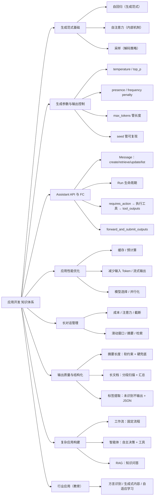

# 应用开发 知识点总结

> 归纳来源：`应用开发 2026-11-08`、`应用开发 2026-11-09`
> 整理日期：2026-11-09
> 说明：正文带「补充」标记的内容为错题之外的扩展知识，用于建立完整认知；文末附参考文献。

---

## 目录

- [0. 知识地图](#0-知识地图)
- [1. 生成范式基础](#1-生成范式基础)
  - [1.1 自回归 / 自注意力 / 采样](#11-自回归--自注意力--采样)
- [2. 生成参数与输出控制](#2-生成参数与输出控制)
  - [2.1 多样性与确定性](#21-多样性与确定性)
  - [2.2 参数速查](#22-参数速查)
- [3. Assistant API 与 Function Calling](#3-assistant-api-与-function-calling)
  - [3.1 Message 类的方法](#31-message-类的方法)
  - [3.2 Run 的生命周期与 requires_action](#32-run-的生命周期与-requires_action)
  - [3.3 forward_and_submit_outputs 工具闭环](#33-forward_and_submit_outputs-工具闭环)
- [4. 应用性能优化](#4-应用性能优化)
  - [4.1 降低输出等待时间的方向](#41-降低输出等待时间的方向)
  - [4.2 缓存与预计算手段](#42-缓存与预计算手段)
- [5. 长对话管理](#5-长对话管理)
  - [5.1 全量历史发送的问题](#51-全量历史发送的问题)
  - [5.2 长对话管理策略](#52-长对话管理策略)
- [6. 输出质量控制与结构化输出](#6-输出质量控制与结构化输出)
  - [6.1 摘要长度控制](#61-摘要长度控制)
  - [6.2 长文档营销表达检测](#62-长文档营销表达检测)
  - [6.3 标签提取与 JSON / XML](#63-标签提取与-json--xml)
- [7. 复杂应用构建：工作流 / Agent / RAG](#7-复杂应用构建工作流--agent--rag)
  - [7.1 工作流 vs 智能体编排](#71-工作流-vs-智能体编排)
  - [7.2 RAG vs Agent：回答知识 vs 执行操作](#72-rag-vs-agent回答知识-vs-执行操作)
  - [7.3 Agent 的完整能力](#73-agent-的完整能力)
- [8. 行业应用：AI 教育](#8-行业应用ai-教育)
  - [8.1 个性化 / 智能化 / 普惠](#81-个性化--智能化--普惠)
- [9. 高频易混点速查](#9-高频易混点速查)
- [10. 参考文献](#10-参考文献)
- [11. 关联](#11-关联)
- [附：基于错题的复习清单](#附基于错题的复习清单)

---

## 0. 知识地图

应用开发可以挂到「生成范式 → 参数控制 → 接口调用 → 性能优化 → 内容与结构控制 → 复杂应用构建」这条主链路上：



| 模块 | 核心问题 | 对应章节 |
|---|---|---|
| 生成范式 | 模型是怎么一个字一个字吐出来的 | 1 |
| 参数控制 | 怎么调多样性、确定性、长度 | 2 |
| Assistant API | Message 有哪些方法、Run 怎么流转、工具怎么回传 | 3 |
| 性能优化 | 怎么让用户更快看到结果 | 4 |
| 长对话管理 | 全量历史有什么问题、怎么管理上下文 | 5 |
| 输出控制 | 怎么控长度、检测长文档、结构化输出 | 6 |
| 复杂应用 | 用工作流、Agent、RAG 怎么组合 | 7 |
| 行业应用 | AI 教育怎么落地 | 8 |

**高频考点定位**：

| 考点 | 位置 |
|---|---|
| 自回归 / 自注意力 / 采样的区别 | 1.1 |
| 哪些参数影响多样性 / 确定性 | 2.1 |
| `max_tokens`、`seed` 各管什么 | 2.1、2.2 |
| Message 类的方法（create/retrieve/update/list） | 3.1 |
| `forward_and_submit_outputs` 的核心功能 | 3.3 |
| 减少输出等待时间的方法 | 4.1 |
| 提前生成与复用的落地方式 | 4.2 |
| 全量发送对话历史的问题 | 5.1 |
| 摘要不超过 80 字的正确改法 | 6.1 |
| 长文档营销表达的全面检测方法 | 6.2 |
| 标签提取的正确做法（未识别不输出、JSON 优先） | 6.3 |
| 百炼复杂业务流程用什么工具 | 7.1 |
| 客服平台扩展业务操作能力用什么 | 7.2 |
| AI 教育的个性化 / 普惠方案 | 8.1 |

---

## 1. 生成范式基础

### 1.1 自回归 / 自注意力 / 采样

题目（11-08 第 6 题）：大模型生成文本时，根据已生成文本预测下一个词的概率，这种方式称为什么？**答案：B. 自回归**。

| 选项 | 判断 | 说明 |
|---|---|---|
| A. 自注意力机制 | ❌ | 这是模型**内部结构**，用来计算上下文表示，不是生成范式 |
| B. 自回归 | ✅ | 用已生成序列预测下一个 Token，逐步生成 |
| C. 条件概率预测 | ❌ | 是对预测过程的**数学描述**，不是这种生成方式的名称 |
| D. 概率分布采样 | ❌ | 是**解码策略**之一，不是生成范式 |

**自回归的定义**：根据已生成序列 `x₁…xₜ`，预测下一个 Token `xₜ₊₁` 的概率：

```
P(xₜ₊₁ | x₁, …, xₜ)
```

**三个层面必须分清**：

| 层面 | 代表 | 回答的问题 |
|---|---|---|
| **生成范式** | 自回归 | 整体怎么一步步生成？ |
| **内部机制** | 自注意力 | 每一步如何计算上下文表示？ |
| **解码策略** | 贪心 / 采样 / temperature / top-k / top-p / beam search | 拿到概率分布后怎么选出下一个 Token？ |

> **严谨表述**：模型以**自回归**方式逐步生成 Token；每一步利用**自注意力**等组件，根据已生成上下文计算下一个 Token 的概率分布，再通过**采样或选择策略**得到下一个 Token。
> **易错**：不要说「自注意力机制采用自回归方式」——一个是结构机制，一个是生成范式，层面不同。

---

## 2. 生成参数与输出控制

### 2.1 多样性与确定性

题目（11-09 第 34 题）：哪些参数可以影响生成文本的**多样性**？**答案：A、C**。

| 选项 | 判断 | 说明 |
|---|---|---|
| A. `temperature` | ✅ | 控制采样随机性；越高越多样，越低越确定 |
| B. `max_tokens` | ❌ | 只限制生成**长度**，不改变词的概率分布 |
| C. `presence_penalty` | ✅ | 惩罚已出现的词，鼓励引入新词、减少重复 |
| D. `seed` | ❌ | 控制随机种子，影响**可复现性**，不直接提升多样性 |

题目（11-09 第 35 题）：哪些操作有助于生成更具**确定性**的文本？**答案：A、D**。

| 选项 | 判断 | 说明 |
|---|---|---|
| A. 降低 `temperature` | ✅ | 越倾向高概率词，趋近 0 时接近贪心解码 |
| B. 减少 `max_tokens` | ❌ | 只限长度，不改变采样随机性 |
| C. 降低 `presence_penalty` | ❌ | 改变重复/用词倾向，不等于提升确定性 |
| D. 固定 `seed` | ✅ | 相同输入+参数下更易复现相同/相近输出 |

**两个最关键的易错辨析**：

- **重复 ≠ 确定性**：降低 `presence_penalty` 可能让内容更重复，但采样仍是随机的。
- **去掉 `seed` ≠ 增加多样性**：只是放弃可复现性，不代表模型被调得更有多样。

> **一句话**：**提升多样性 → 调高 `temperature` / `presence_penalty`；提升确定性 → 调低 `temperature` / 固定 `seed`。**

### 2.2 参数速查

| 参数 | 管什么 | 对多样性的影响 |
|---|---|---|
| `temperature` | 采样随机性 | 高→多样，低→确定 |
| `top_p` | 核采样范围 | 高→多样，低→确定 |
| `presence_penalty` | 已出现词的惩罚 | 高→鼓励新词、更多样 |
| `frequency_penalty` | 按出现频次惩罚 | 高→减少重复用词 |
| `max_tokens` | 生成长度上限 | **不影响多样性** |
| `seed` | 随机种子 | **不影响多样性，只影响可复现性** |

> **补充**：不同平台参数名可能略有差异（如 `max_completion_tokens`、`repetition_penalty`），含义相通。
> **补充**：`temperature` 与 `top_p` 通常二选一调节，避免同时大幅调整导致行为难预测。

---

## 3. Assistant API 与 Function Calling

### 3.1 Message 类的方法

题目（11-08 第 5 题）：以下哪些属于 Assistant API `Message` 类中的函数？**答案：A、B、C、F**。

| 选项 | 判断 | 说明 |
|---|---|---|
| A. `retrieve` | ✅ | 检索单条消息 |
| B. `create` | ✅ | 创建消息 |
| C. `update` | ✅ | 更新消息 |
| D. `modify` | ❌ | 是 **HTTP 操作名**（Modify message），Python SDK 中对应方法叫 `update` |
| E. `search` | ❌ | 不属于 `Message` 类的标准方法 |
| F. `list` | ✅ | 列出线程中的消息 |

**核心方法**：`create`、`retrieve`、`update`、`list`。注意区分 **HTTP API 操作名** 与 **SDK 方法名**。

> **补充（口径更新）**：`update` 在 Assistants API 中**只能修改 `metadata`，不能修改消息正文**；要改内容只能删掉重建。
> **补充（演进）**：OpenAI 已将 **Assistants API 标记弃用**，推荐迁移到 **Responses API**。Responses 中不再有独立「Message 资源」，上下文直接作为 `input` 传入，多轮用 `previous_response_id` 或 Conversations API 续接。考试按旧 API 作答，实际开发以 Responses API 为准。

### 3.2 Run 的生命周期与 requires_action

Assistant 里「执行一次」是通过 **Run** 驱动的，核心是轮询它的状态：

| 状态 | 含义 |
|---|---|
| `queued` | 排队中 |
| `in_progress` | 生成中 |
| `requires_action` | 需要客户端执行工具（函数调用） |
| `completed` | 完成 |
| `failed` | 失败 |
| `cancelled` | 取消 |

**Function Calling 闭环**：

```
创建 Run
   ↓ 轮询
状态变为 requires_action（required_action.type = submit_tool_outputs）
   ↓
客户端按模型给的工具名/参数在本地执行函数
   ↓
调用 submit_tool_outputs 把结果回传给服务器
   ↓
Run 继续 → 轮询直到 completed
```

> **补充**：处理 `requires_action` 是工具调用闭环的关键；漏掉这一步 Run 会一直卡住。

### 3.3 forward_and_submit_outputs 工具闭环

题目（11-08 第 26 题）：示例代码里 `forward_and_submit_outputs` 的核心功能是什么？**答案：C. 执行 function call 并将结果提交给服务器**。

| 选项 | 判断 | 说明 |
|---|---|---|
| A. 创建新的 Assistant | ❌ | 由 `Assistants.create` 完成 |
| B. 向 Assistant 提交用户 query | ❌ | 由 `Messages.create` 完成 |
| C. 执行 function call 并提交结果 | ✅ | 在 `requires_action` 时执行本地工具，再回传 `tool_outputs` |
| D. 获取 Assistant 的回复 | ❌ | 由 `Messages.list` 等完成 |

> **记忆**：`forward_and_submit_outputs` = **执行工具 + 回传结果**，推动 Run 从 `requires_action` 继续往下跑。

---

## 4. 应用性能优化

### 4.1 降低输出等待时间的方向

题目（11-08 第 8-1 题）：以下哪些方法有助于减少大模型应用的输出结果等待时间？**答案：B、C、D**。

| 选项 | 判断 | 说明 |
|---|---|---|
| A. 使用参数量更大的模型 | ❌ | 参数越大通常**推理越慢**，反而增加延迟 |
| B. 使用支持上下文缓存的模型 API | ✅ | 复用已处理上下文，降低首 Token 延迟 |
| C. 提前生成和复用内容 | ✅ | 预计算，减少实时生成耗时 |
| D. 减少输入 Token 数量 | ✅ | 缩短输入处理时间，降低延迟 |

**降低延迟的常见方向**：

| 方向 | 手段 |
|---|---|
| 缓存 | 上下文缓存 / Prompt Caching、响应缓存 |
| 预计算 | 提前生成、Predicted Outputs |
| 减少输入 | 精简 prompt、压缩上下文、减少 Token |
| 流式 | 流式输出，让用户先看到首字 |
| 模型选择 | 选更小/更快的模型，而不是更大 |
| 并行化 | 并发调用、预取 |

> **易错**：**参数量更大 ≠ 更快**。想降延迟优先缓存、预计算、减少输入、流式，而不是盲目换大模型。

### 4.2 缓存与预计算手段

「提前生成和复用内容」的常见落地方式：

1. **KV Cache / Prompt Caching**：复用长上下文的预计算缓存（见 [[KV Cache]]）。
2. **响应缓存**：对重复或语义相似的查询直接返回缓存答案。
3. **Predicted Outputs**：对大部分已知、只需微调的内容，让模型只生成差异部分。
4. **工具 Schema 缓存**：Agent 的工具定义是静态的，可持久化复用。
5. **RAG 检索预取**：在对话间歇期提前检索并缓存可能用到的内容。

> **补充**：缓存是「用空间换时间」；要注意失效策略（内容更新、上下文差异）。

---

## 5. 长对话管理

### 5.1 全量历史发送的问题

题目（11-09 第 43 题）：每次把全部对话历史完整发给模型，哪些认识正确？**答案：A、B、D**。

| 选项 | 判断 | 说明 |
|---|---|---|
| A. 每轮费用越来越高（Token 累积） | ✅ | 输入 Token 随轮次累积，成本和延迟上升 |
| B. 历史太长时注意力分散，忽略中间信息 | ✅ | 长上下文有「中间信息丢失」和噪声稀释问题 |
| C. 没超上下文窗口就越多越好 | ❌ | 窗口是上限，不是越多越好；还有成本/延迟/干扰 |
| D. 超过上下文长度后早期内容被截断丢失 | ✅ | 需要截断、摘要或检索来保留关键信息 |

> **补充**：「上下文窗口大」≠「能同等有效地利用所有内容」。长上下文存在 **Lost in the Middle** 现象——关键信息落在中间时更容易被忽略。

### 5.2 长对话管理策略

| 策略 | 说明 |
|---|---|
| **滑动窗口** | 只保留最近 N 轮，简单但会丢早期信息 |
| **对话摘要** | 把早期内容压缩成摘要，兼顾成本与信息 |
| **关键信息提取** | 抽取实体、结论、约束等结构化记忆 |
| **RAG 检索历史** | 按相关性从历史中检索片段，而非全量塞入 |
| **分层记忆** | 短期上下文 + 长期偏好/经验，分层存储 |

> **结论**：长对话要关注**相关性、压缩、检索、记忆管理**，而不是无脑堆历史。

---

## 6. 输出质量控制与结构化输出

### 6.1 摘要长度控制

题目（11-08 摘要题）：修改生成摘要的函数，使其生成的摘要**不超过 80 个字**，应如何修改？**答案：A（单选最合理）**。

| 选项 | 判断 | 说明 |
|---|---|---|
| A. 在提示词中明确要求摘要不超过 80 个字 | ✅ 最合理 | 通过提示词约束输出 |
| B. 生成后 `query = query[:80]` | ❌ | 硬截断可能破坏语义、标点、词语；「80 个字」≠「80 个字符」 |
| C. 函数开头 `document = document[:80]` | ❌ | 截断输入文档，摘要基于残缺内容，错误 |
| D. 以上都不正确 | ❌ | A 是合理方向 |

> **重要补充**：**A 是有概率失败的软约束**，模型不保证严格满足「80 个字」的精确计数。`max_tokens` 控制的是 **Token 数**，不是汉字数。

**工程上应分层防御**：

1. **提示词优化**：明确「不超过 80 个汉字」，说明超限时优先删减细节，并给符合长度的 Few-Shot 示例。
2. **解码参数控制**：设置 `max_tokens` / `max_completion_tokens` 作为物理上限；可用 `stop` 在句号等语义边界停下。
3. **后处理校验 + 条件重试**：统计实际字数，超长则把原输出 + 更严格指令让模型压缩，最多重试 2–3 次。
4. **兜底语义截断**：仍超长时，在 80 字范围内从后往前找最近标点截断，作为最后安全网。

> **结论**：单选选 A；工程上不能只靠 A，要「提示词 + 参数 + 校验重试 + 兜底截断」组合。

### 6.2 长文档营销表达检测

题目（11-08 第 8-2 题）：检测文档中是否存在营销表达，哪种方法更全面？**答案：D**。

| 选项 | 判断 | 说明 |
|---|---|---|
| A. 一次性生成所有类型的识别结果 | ❌ | 输入长、任务多，容易遗漏 |
| B. 按分类逐条单独识别营销词汇 | ❌ | 偏词汇匹配，忽略上下文和隐性表达 |
| C. 仅识别有内容错误的部分 | ❌ | 目标不一致，不覆盖营销表达 |
| D. 按段落扫描全文，每段完成所有类型识别，汇总后返回 | ✅ | 覆盖全文、结合上下文、汇总去重，最全面 |

**推荐策略**：**分段扫描 + 多类型识别 + 汇总返回**。

> **补充（工程细节）**：分段重叠窗口、每段输出结构化结果、最后去重汇总、对边界段落二次校验。

### 6.3 标签提取与 JSON / XML

题目（11-09 第 58 题）：提取标签时，以下哪些操作正确？**答案：A、C**。

| 选项 | 判断 | 说明 |
|---|---|---|
| A. 某类标签未识别到就不输出 | ✅ | 识别什么输出什么，避免空值和硬凑/臆造 |
| B. 输出所有标签类型，即使未识别到 | ❌ | 产生空字段/默认值，增加解析负担，可能诱导编造 |
| C. 用 JSON 格式输出标签 | ✅ | 结构清晰、易解析、易校验，是结构化输出常用推荐 |
| D. 用 XML 格式输出标签 | ❌（不推荐） | XML 可用，但标签提取/程序化解析场景通常 JSON 更佳 |

**结构化格式对比**：

| 格式 | 适用场景 | 说明 |
|---|---|---|
| **JSON** | 结构化输出、标签提取、工具调用 | 平台支持广、解析成熟、可配 JSON Schema |
| **XML** | 提示词中分隔指令与上下文 | 大模型能理解，但作为输出格式通常非首选 |
| YAML / CSV / Markdown | 特定场景 | 通用结构化输出不如 JSON |

> **易错**：「大模型只能用 JSON」是错的。更准确：**大模型能理解 XML 等多种格式，但标签提取和程序化解析场景中，JSON 通常是更推荐的最佳实践。**

---

## 7. 复杂应用构建：工作流 / Agent / RAG

### 7.1 工作流 vs 智能体编排

题目（11-09 第 32 题）：复杂业务流程可借助百炼上的哪些工具构建更强的应用？**答案：A、B**。

| 选项 | 判断 | 说明 |
|---|---|---|
| A. 可视化工作流 | ✅ | 可视化节点编排，把多步骤任务串成稳定、可控、可复现的链路 |
| B. 智能体编排 | ✅ | 智能体自主决策、调用工具，可与工作流嵌套 |
| C. LlamaIndex 组件 | ❌ | 是可集成的外部开发框架，不是百炼内置的流程编排工具 |
| D. 自然语言处理模型 | ❌ | 大模型是底层能力，不是流程编排工具 |

**两者定位**：

| 类型 | 适合 | 特点 |
|---|---|---|
| **工作流** | 确定性高、步骤固定的流程 | 可控、可复现、稳定 |
| **智能体** | 需要自主决策、工具调用、多步推理 | 灵活，但不确定性更高 |
| **组合** | 复杂业务 | 工作流固化确定性步骤，智能体处理灵活决策 |

> **补充**：实际架构常见「工作流 + 智能体嵌套」；LlamaIndex 可在代码层辅助 RAG/检索，但不属于本题的流程编排答案。

### 7.2 RAG vs Agent：回答知识 vs 执行操作

题目（11-09 第 38 题）：客服平台除回答产品知识外，还要能查订单、改手机号、提交工单/退款，应引入什么技术？**答案：B. Agent（智能体）**。

| 选项 | 判断 | 说明 |
|---|---|---|
| A. RAG | ❌/不完整 | 适合知识库问答，不负责实时业务操作 |
| B. Agent | ✅ | 通过工具/API 连接订单、账户、工单系统，完成多步执行 |
| C. 大模型微调 | ❌ | 改善话术/格式/分类，但不能实时访问业务系统 |
| D. 数据增强 | ❌ | 扩充训练数据，与实时业务操作无关 |

> **记忆**：**「回答知识」靠 RAG，「执行操作」靠 Agent + 工具/API。**

**客服平台常见组合**：RAG（产品知识）+ Agent（意图理解、工具选择）+ 工具/API（查订单、改手机号、提工单、退款）+ 安全机制（权限校验、二次确认、审计日志）。

### 7.3 Agent 的完整能力

> **补充**：**Agent ≠ 工具调用**。工具调用只是执行手段，完整智能体还包括：

| 能力 | 说明 |
|---|---|
| **规划 Planning** | 任务分解、策略选择、动态调整 |
| **记忆 Memory** | 短期上下文、长期偏好、经验记忆 |
| **反思 Reflection** | 自我评估、过程复盘、自我修正 |
| **多智能体协作 Multi-Agent** | 角色分工、通信协调、冲突解决 |

---

## 8. 行业应用：AI 教育

### 8.1 个性化 / 智能化 / 普惠

题目（11-09 第 42 题）：哪些方案能利用 AI 实现个性化、智能化、普惠教育？**答案：A、B、D**。

| 选项 | 判断 | 说明 |
|---|---|---|
| A. 方言识别辅助少数民族学生练普通话 | ✅ | 语音识别 + 发音评测，降低门槛，体现普惠 |
| B. 按进度和兴趣生成课后实验 | ✅ | 生成式 AI 个性化内容 |
| C. 在线抽选择题 + 自动判卷 + 标准解析 | ❌/不够准确 | 偏自动化考试，统一标准解析个性化不足 |
| D. 自适应学习平台动态调整题库 | ✅ | 按水平调整难度，典型个性化学习路径 |

**AI 教育落地方向**：语音识别与发音评测、生成式个性化内容、自适应学习、智能辅导与反馈。

> **补充**：真正的个性化反馈应基于**错因分析、知识掌握图谱、学习风格与兴趣、历史学习轨迹**，而不是只给统一“标准解析”。

---

## 9. 高频易混点速查

| 易混点 | 正确理解 |
|---|---|
| 自回归 vs 自注意力 vs 采样 | 自回归是**生成范式**；自注意力是**内部机制**；采样是**解码策略** |
| `temperature` / `presence_penalty` 管什么 | 影响**多样性**；高 temperature、高 presence_penalty 更有多样性 |
| `max_tokens` 管什么 | 只限制**长度**，不影响多样性/确定性 |
| `seed` 管什么 | 只影响**可复现性/确定性**，不是多样性 |
| 重复 vs 确定性 | 内容重复 ≠ 输出确定；低 presence_penalty 更重复但仍可能随机 |
| 去掉 seed vs 增加多样性 | 去掉 seed 只是放弃可复现，不是增加多样性 |
| `modify` vs `update` | `modify` 是 **HTTP 操作名**；Python SDK `Message` 类里是 `update` |
| `update` 能改什么 | Assistants API 里只改 `metadata`，不能改正文 |
| 参数量更大 = 更快？ | 错，通常更慢；降延迟优先缓存/预计算/减少输入/流式 |
| 提示词写「不超过 80 字」= 一定成功？ | 软约束有失败概率，需后处理校验和重试 |
| `max_tokens` 能控制汉字数？ | 不能，它控制 **Token** 数 |
| 硬截断 vs 提示词约束 | 硬截断保长度但破坏语义；提示词保语义但不保证长度，二者要组合 |
| 长文档检测：一次性生成 vs 分段扫描 | 分段扫描 + 多类型 + 汇总更全面 |
| 上下文没超限就越多越好？ | 错，长上下文有成本、延迟、注意力稀释和截断问题 |
| 大模型只能用 JSON？ | 错，XML 等也能用；标签提取/程序解析场景 JSON 通常更推荐 |
| 未识别标签也要全部输出？ | 错，识别什么输出什么，避免空值和臆造 |
| Agent = 工具调用？ | 错，Agent 还包括规划、记忆、反思、多智能体协作 |
| RAG 能执行业务操作？ | 错，RAG 增强知识回答；业务操作靠 Agent + 工具/API |
| 工作流 vs 智能体 | 工作流适合固定流程；智能体适合自主决策；复杂业务可嵌套组合 |
| 自动判卷 = 个性化教育？ | 错，统一标准解析个性化不足 |
| Assistant API vs Responses API | Assistants 已弃用；Responses 无独立 Message 资源，用 `input` / `previous_response_id` |

---

## 10. 参考文献

1. OpenAI Assistants API 概览：https://platform.openai.com/docs/assistants/overview
2. OpenAI Messages API 参考：https://platform.openai.com/docs/api-reference/messages
3. OpenAI Responses API 参考：https://platform.openai.com/docs/api-reference/responses
4. OpenAI Function Calling 指南：https://platform.openai.com/docs/guides/function-calling
5. OpenAI Prompt Caching 指南：https://platform.openai.com/docs/guides/prompt-caching
6. OpenAI 流式输出（Streaming）：https://platform.openai.com/docs/api-reference/streaming
7. OpenAI 结构化输出（Structured Outputs）：https://platform.openai.com/docs/guides/structured-outputs
8. OpenAI 弃用说明（Deprecations）：https://platform.openai.com/docs/deprecations
9. 阿里云百炼（Model Studio）：https://help.aliyun.com/zh/model-studio/
10. Liu et al. *Lost in the Middle: How Language Models Use Long Contexts*. arXiv:2307.03172

---

## 11. 关联

### 来源（错题复习）

- [[应用开发 2026-11-08]]
- [[应用开发 2026-11-09]]

### 相关笔记

- [[应用开发 复习资料]]（按复习建议整理：对照表 + 代码模板 + 自测清单）
- [[LLM 服务栈与 API 设计]]（Assistants vs Responses、模型/API/OpenAI 分层）
- [[Responses API 概览]]（新一代统一接口能干什么）
- [[Responses API 实战]]（安装、代码、工具闭环、迁移）
- [[KV Cache]]（上下文缓存与推理加速）
- [[Prompt 知识点总结]]
- [[RAG 知识点总结]]
- [[模型训练 知识点总结]]

---

## 附：基于错题的复习清单

### 生成与参数
- [ ] 自回归是生成范式；自注意力是内部机制；采样是解码策略，三者层面不同。
- [ ] `P(xₜ₊₁ | x₁…xₜ)`：根据已生成文本预测下一个 Token。
- [ ] 多样性：调高 `temperature` / `presence_penalty`；也涉及 `top_p`、`frequency_penalty`。
- [ ] 确定性：调低 `temperature`、固定 `seed`。
- [ ] `max_tokens` 只管长度；`seed` 只管可复现性。
- [ ] 重复 ≠ 确定性；去掉 seed ≠ 增加多样性。

### Assistant API
- [ ] Assistant `Message` 类方法：`create`、`retrieve`、`update`、`list`。
- [ ] `modify` 是 HTTP 操作名，SDK 对应 `update`；`update` 只改 metadata。
- [ ] Run 状态：`queued`/`in_progress`/`requires_action`/`completed`/`failed`/`cancelled`。
- [ ] `requires_action` → 本地执行工具 → `submit_tool_outputs` → Run 继续。
- [ ] `forward_and_submit_outputs` = 执行 function call 并回传结果。
- [ ] Assistants API 已弃用，实际开发迁移到 Responses API。

### 性能与长对话
- [ ] 降延迟：上下文缓存、提前生成与复用、减少输入 Token、流式、选小模型。
- [ ] 参数量更大通常更慢，不利于降延迟。
- [ ] 预计算落地：KV Cache / 响应缓存 / Predicted Outputs / 工具 Schema 缓存 / RAG 预取。
- [ ] 全量历史导致：成本累积、注意力稀释、超限截断。
- [ ] 长对话策略：滑动窗口、摘要、关键信息提取、RAG 检索、分层记忆。

### 输出控制
- [ ] 摘要 80 字：单选选提示词约束；工程上「提示词 + max_tokens + 校验重试 + 兜底截断」。
- [ ] `max_tokens` 控制 Token 数，不等于汉字数；提示词是软约束。
- [ ] 长文档检测：分段扫描 + 每段多类型识别 + 汇总，比一次性生成或纯词汇匹配更全面。
- [ ] 标签提取：未识别到的不输出；优先 JSON。
- [ ] XML 可用但非首选；「大模型只能用 JSON」是错误说法。

### 复杂应用
- [ ] 百炼复杂流程：可视化工作流 + 智能体编排；LlamaIndex 是外部框架，不是内置编排工具。
- [ ] 工作流适合固定流程，智能体适合自主决策；复杂业务可嵌套。
- [ ] 回答知识靠 RAG，执行操作靠 Agent + 工具/API。
- [ ] Agent 不止工具调用：规划、记忆、反思、多智能体协作。
- [ ] AI 教育个性化：方言识别、生成式内容、自适应学习；自动判卷+标准解析个性化不足。
