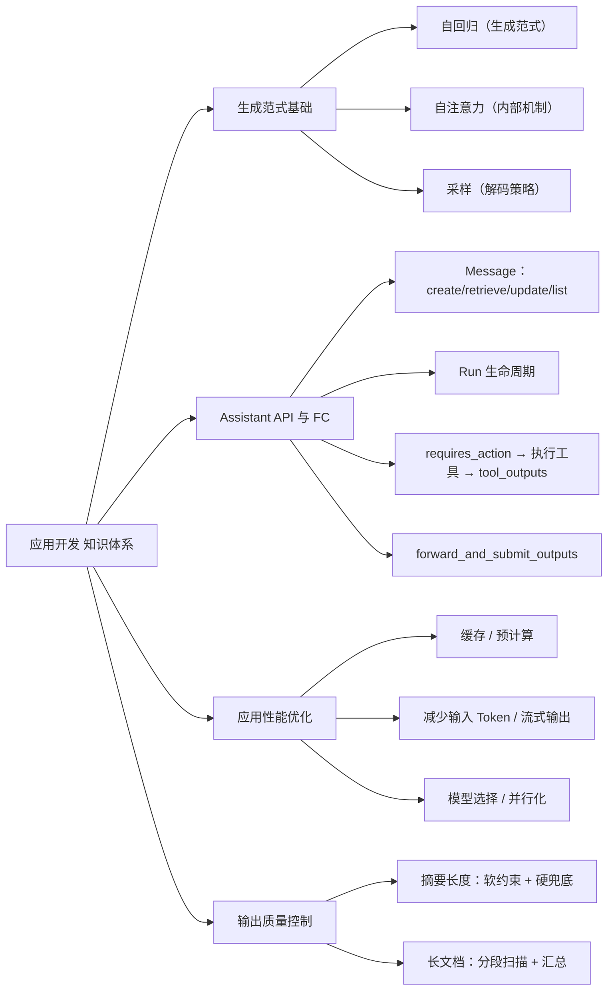

# 应用开发 知识点总结

> 归纳来源：`应用开发 2026-11-08`
> 整理日期：2026-11-08
> 说明：正文带「补充」标记的内容为错题之外的扩展知识，用于建立完整认知；文末附参考文献。

---

## 目录

- [0. 知识地图](#0-知识地图)
- [1. 生成范式基础](#1-生成范式基础)
  - [1.1 自回归 / 自注意力 / 采样](#11-自回归--自注意力--采样)
- [2. Assistant API 与 Function Calling](#2-assistant-api-与-function-calling)
  - [2.1 Message 类的方法](#21-message-类的方法)
  - [2.2 Run 的生命周期与 requires_action](#22-run-的生命周期与-requires_action)
  - [2.3 forward_and_submit_outputs 工具闭环](#23-forward_and_submit_outputs-工具闭环)
- [3. 应用性能优化](#3-应用性能优化)
  - [3.1 降低输出等待时间的方向](#31-降低输出等待时间的方向)
  - [3.2 缓存与预计算手段](#32-缓存与预计算手段)
- [4. 输出质量控制](#4-输出质量控制)
  - [4.1 摘要长度控制](#41-摘要长度控制)
  - [4.2 长文档营销表达检测](#42-长文档营销表达检测)
- [5. 高频易混点速查](#5-高频易混点速查)
- [6. 参考文献](#6-参考文献)
- [7. 关联](#7-关联)
- [附：基于错题的复习清单](#附基于错题的复习清单)

---

## 0. 知识地图

应用开发可以挂到「生成范式 → 接口调用 → 性能优化 → 输出控制」这条主链路上：



| 模块 | 核心问题 | 对应章节 |
|---|---|---|
| 生成范式 | 模型是怎么一个字一个字吐出来的 | 1 |
| Assistant API | Message 有哪些方法、Run 怎么流转、工具怎么回传 | 2 |
| 性能优化 | 怎么让用户更快看到结果 | 3 |
| 输出控制 | 怎么控制长度、怎么全面地检测长文档 | 4 |

**高频考点定位**：

| 考点 | 位置 |
|---|---|
| 自回归 / 自注意力 / 采样的区别 | 1.1 |
| Message 类的方法（create/retrieve/update/list） | 2.1 |
| `forward_and_submit_outputs` 的核心功能 | 2.3 |
| 减少输出等待时间的方法 | 3.1 |
| 提前生成与复用的落地方式 | 3.2 |
| 摘要不超过 80 字的正确改法 | 4.1 |
| 长文档营销表达的全面检测方法 | 4.2 |

---

## 1. 生成范式基础

### 1.1 自回归 / 自注意力 / 采样

题目（11-08 第 6 题）：大模型生成文本时，根据已生成文本预测下一个词的概率，这种方式称为什么？**答案：B. 自回归**。

| 选项 | 判断 | 说明 |
|---|---|---|
| A. 自注意力机制 | ❌ | 这是模型**内部结构**，用来计算上下文表示，不是生成范式 |
| B. 自回归 | ✅ | 用已生成序列预测下一个 Token，逐步生成 |
| C. 条件概率预测 | ❌ | 是对预测过程的**数学描述**，不是这种生成方式的名称 |
| D. 概率分布采样 | ❌ | 是**解码策略**之一，不是生成范式 |

**自回归的定义**：根据已生成序列 `x₁…xₜ`，预测下一个 Token `xₜ₊₁` 的概率：

```
P(xₜ₊₁ | x₁, …, xₜ)
```

**三个层面必须分清**：

| 层面 | 代表 | 回答的问题 |
|---|---|---|
| **生成范式** | 自回归 | 整体怎么一步步生成？ |
| **内部机制** | 自注意力 | 每一步如何计算上下文表示？ |
| **解码策略** | 贪心 / 采样 / temperature / top-k / top-p / beam search | 拿到概率分布后怎么选出下一个 Token？ |

> **严谨表述**：模型以**自回归**方式逐步生成 Token；每一步利用**自注意力**等组件，根据已生成上下文计算下一个 Token 的概率分布，再通过**采样或选择策略**得到下一个 Token。
> **易错**：不要说「自注意力机制采用自回归方式」——一个是结构机制，一个是生成范式，层面不同。

---

## 2. Assistant API 与 Function Calling

### 2.1 Message 类的方法

题目（11-08 第 5 题）：以下哪些属于 Assistant API `Message` 类中的函数？**答案：A、B、C、F**。

| 选项 | 判断 | 说明 |
|---|---|---|
| A. `retrieve` | ✅ | 检索单条消息 |
| B. `create` | ✅ | 创建消息 |
| C. `update` | ✅ | 更新消息 |
| D. `modify` | ❌ | 是 **HTTP 操作名**（Modify message），Python SDK 中对应方法叫 `update` |
| E. `search` | ❌ | 不属于 `Message` 类的标准方法 |
| F. `list` | ✅ | 列出线程中的消息 |

**核心方法**：`create`、`retrieve`、`update`、`list`。注意区分 **HTTP API 操作名** 与 **SDK 方法名**。

> **补充（口径更新）**：`update` 在 Assistants API 中**只能修改 `metadata`，不能修改消息正文**；要改内容只能删掉重建。
> **补充（演进）**：OpenAI 已将 **Assistants API 标记弃用**，推荐迁移到 **Responses API**。Responses 中不再有独立「Message 资源」，上下文直接作为 `input` 传入，多轮用 `previous_response_id` 或 Conversations API 续接。考试按旧 API 作答，实际开发以 Responses API 为准。

### 2.2 Run 的生命周期与 requires_action

Assistant 里「执行一次」是通过 **Run** 驱动的，核心是轮询它的状态：

| 状态 | 含义 |
|---|---|
| `queued` | 排队中 |
| `in_progress` | 生成中 |
| `requires_action` | 需要客户端执行工具（函数调用） |
| `completed` | 完成 |
| `failed` | 失败 |
| `cancelled` | 取消 |

**Function Calling 闭环**：

```
创建 Run
   ↓ 轮询
状态变为 requires_action（required_action.type = submit_tool_outputs）
   ↓
客户端按模型给的工具名/参数在本地执行函数
   ↓
调用 submit_tool_outputs 把结果回传给服务器
   ↓
Run 继续 → 轮询直到 completed
```

> **补充**：处理 `requires_action` 是工具调用闭环的关键；漏掉这一步 Run 会一直卡住。

### 2.3 forward_and_submit_outputs 工具闭环

题目（11-08 第 26 题）：示例代码里 `forward_and_submit_outputs` 的核心功能是什么？**答案：C. 执行 function call 并将结果提交给服务器**。

| 选项 | 判断 | 说明 |
|---|---|---|
| A. 创建新的 Assistant | ❌ | 由 `Assistants.create` 完成 |
| B. 向 Assistant 提交用户 query | ❌ | 由 `Messages.create` 完成 |
| C. 执行 function call 并提交结果 | ✅ | 在 `requires_action` 时执行本地工具，再回传 `tool_outputs` |
| D. 获取 Assistant 的回复 | ❌ | 由 `Messages.list` 等完成 |

> **记忆**：`forward_and_submit_outputs` = **执行工具 + 回传结果**，推动 Run 从 `requires_action` 继续往下跑。

---

## 3. 应用性能优化

### 3.1 降低输出等待时间的方向

题目（11-08 第 8-1 题）：以下哪些方法有助于减少大模型应用的输出结果等待时间？**答案：B、C、D**。

| 选项 | 判断 | 说明 |
|---|---|---|
| A. 使用参数量更大的模型 | ❌ | 参数越大通常**推理越慢**，反而增加延迟 |
| B. 使用支持上下文缓存的模型 API | ✅ | 复用已处理上下文，降低首 Token 延迟 |
| C. 提前生成和复用内容 | ✅ | 预计算，减少实时生成耗时 |
| D. 减少输入 Token 数量 | ✅ | 缩短输入处理时间，降低延迟 |

**降低延迟的常见方向**：

| 方向 | 手段 |
|---|---|
| 缓存 | 上下文缓存 / Prompt Caching、响应缓存 |
| 预计算 | 提前生成、Predicted Outputs |
| 减少输入 | 精简 prompt、压缩上下文、减少 Token |
| 流式 | 流式输出，让用户先看到首字 |
| 模型选择 | 选更小/更快的模型，而不是更大 |
| 并行化 | 并发调用、预取 |

> **易错**：**参数量更大 ≠ 更快**。想降延迟优先缓存、预计算、减少输入、流式，而不是盲目换大模型。

### 3.2 缓存与预计算手段

「提前生成和复用内容」的常见落地方式：

1. **KV Cache / Prompt Caching**：复用长上下文的预计算缓存（见 [[KV Cache]]）。
2. **响应缓存**：对重复或语义相似的查询直接返回缓存答案。
3. **Predicted Outputs**：对大部分已知、只需微调的内容，让模型只生成差异部分。
4. **工具 Schema 缓存**：Agent 的工具定义是静态的，可持久化复用。
5. **RAG 检索预取**：在对话间歇期提前检索并缓存可能用到的内容。

> **补充**：缓存是「用空间换时间」；要注意失效策略（内容更新、上下文差异）。

---

## 4. 输出质量控制

### 4.1 摘要长度控制

题目（11-08 摘要题）：修改生成摘要的函数，使其生成的摘要**不超过 80 个字**，应如何修改？**答案：A（单选最合理）**。

| 选项 | 判断 | 说明 |
|---|---|---|
| A. 在提示词中明确要求摘要不超过 80 个字 | ✅ 最合理 | 通过提示词约束输出 |
| B. 生成后 `query = query[:80]` | ❌ | 硬截断可能破坏语义、标点、词语；「80 个字」≠「80 个字符」 |
| C. 函数开头 `document = document[:80]` | ❌ | 截断输入文档，摘要基于残缺内容，错误 |
| D. 以上都不正确 | ❌ | A 是合理方向 |

> **重要补充**：**A 是有概率失败的软约束**，模型不保证严格满足「80 个字」的精确计数。`max_tokens` 控制的是 **Token 数**，不是汉字数。

**工程上应分层防御**：

1. **提示词优化**：明确「不超过 80 个汉字」，说明超限时优先删减细节，并给符合长度的 Few-Shot 示例。
2. **解码参数控制**：设置 `max_tokens` / `max_completion_tokens` 作为物理上限；可用 `stop` 在句号等语义边界停下。
3. **后处理校验 + 条件重试**：统计实际字数，超长则把原输出 + 更严格指令让模型压缩，最多重试 2–3 次。
4. **兜底语义截断**：仍超长时，在 80 字范围内从后往前找最近标点截断，作为最后安全网。

> **结论**：单选选 A；工程上不能只靠 A，要「提示词 + 参数 + 校验重试 + 兜底截断」组合。

### 4.2 长文档营销表达检测

题目（11-08 第 8-2 题）：检测文档中是否存在营销表达，哪种方法更全面？**答案：D**。

| 选项 | 判断 | 说明 |
|---|---|---|
| A. 一次性生成所有类型的识别结果 | ❌ | 输入长、任务多，容易遗漏 |
| B. 按分类逐条单独识别营销词汇 | ❌ | 偏词汇匹配，忽略上下文和隐性表达 |
| C. 仅识别有内容错误的部分 | ❌ | 目标不一致，不覆盖营销表达 |
| D. 按段落扫描全文，每段完成所有类型识别，汇总后返回 | ✅ | 覆盖全文、结合上下文、汇总去重，最全面 |

**推荐策略**：**分段扫描 + 多类型识别 + 汇总返回**。

> **补充（工程细节）**：分段重叠窗口、每段输出结构化结果、最后去重汇总、对边界段落二次校验。

---

## 5. 高频易混点速查

| 易混点 | 正确理解 |
|---|---|
| 自回归 vs 自注意力 vs 采样 | 自回归是**生成范式**；自注意力是**内部机制**；采样是**解码策略** |
| `modify` vs `update` | `modify` 是 **HTTP 操作名**；Python SDK `Message` 类里是 `update` |
| `update` 能改什么 | Assistants API 里只改 `metadata`，不能改正文 |
| 参数量更大 = 更快？ | 错，通常更慢；降延迟优先缓存/预计算/减少输入/流式 |
| 提示词写「不超过 80 字」= 一定成功？ | 软约束有失败概率，需后处理校验和重试 |
| `max_tokens` 能控制汉字数？ | 不能，它控制 **Token** 数 |
| 硬截断 vs 提示词约束 | 硬截断保长度但破坏语义；提示词保语义但不保证长度，二者要组合 |
| 长文档检测：一次性生成 vs 分段扫描 | 分段扫描 + 多类型 + 汇总更全面 |
| `forward_and_submit_outputs` 做什么 | 执行 function call 并提交 `tool_outputs`，不是创建消息或取回复 |
| Assistant API vs Responses API | Assistants 已弃用；Responses 无独立 Message 资源，用 `input` / `previous_response_id` |

---

## 6. 参考文献

1. OpenAI Assistants API 概览：https://platform.openai.com/docs/assistants/overview
2. OpenAI Messages API 参考：https://platform.openai.com/docs/api-reference/messages
3. OpenAI Responses API 参考：https://platform.openai.com/docs/api-reference/responses
4. OpenAI Function Calling 指南：https://platform.openai.com/docs/guides/function-calling
5. OpenAI Prompt Caching 指南：https://platform.openai.com/docs/guides/prompt-caching
6. OpenAI 流式输出（Streaming）：https://platform.openai.com/docs/api-reference/streaming
7. OpenAI 弃用说明（Deprecations）：https://platform.openai.com/docs/deprecations

---

## 7. 关联

### 来源（错题复习）

- [[应用开发 2026-11-08]]

### 相关笔记

- [[应用开发 复习资料]]（按复习建议整理：对照表 + 代码模板 + 自测清单）
- [[LLM 服务栈与 API 设计]]（Assistants vs Responses、模型/API/OpenAI 分层）
- [[KV Cache]]（上下文缓存与推理加速）
- [[Prompt 知识点总结]]
- [[RAG 知识点总结]]
- [[模型训练 知识点总结]]

---

## 附：基于错题的复习清单

- [ ] 自回归是生成范式；自注意力是内部机制；采样是解码策略，三者层面不同。
- [ ] `P(xₜ₊₁ | x₁…xₜ)`：根据已生成文本预测下一个 Token。
- [ ] Assistant `Message` 类方法：`create`、`retrieve`、`update`、`list`。
- [ ] `modify` 是 HTTP 操作名，SDK 对应 `update`；`update` 只改 metadata。
- [ ] Run 状态：`queued`/`in_progress`/`requires_action`/`completed`/`failed`/`cancelled`。
- [ ] `requires_action` → 本地执行工具 → `submit_tool_outputs` → Run 继续。
- [ ] `forward_and_submit_outputs` = 执行 function call 并回传结果。
- [ ] 降延迟：上下文缓存、提前生成与复用、减少输入 Token、流式、选小模型。
- [ ] 参数量更大通常更慢，不利于降延迟。
- [ ] 预计算落地：KV Cache / 响应缓存 / Predicted Outputs / 工具 Schema 缓存 / RAG 预取。
- [ ] 摘要 80 字：单选选提示词约束；工程上「提示词 + max_tokens + 校验重试 + 兜底截断」。
- [ ] `max_tokens` 控制 Token 数，不等于汉字数；提示词是软约束。
- [ ] 长文档检测：分段扫描 + 每段多类型识别 + 汇总，比一次性生成或纯词汇匹配更全面。
- [ ] Assistants API 已弃用，实际开发迁移到 Responses API。
