# 应用开发 知识点总结

> 归纳来源：`应用开发 2026-11-08`、`应用开发 2026-11-09`、`应用开发 2026-11-12`、`应用开发 2026-11-14`、`应用开发 2026-11-15`、`应用开发 2026-11-17`
> 整理日期：2026-11-17
> 说明：正文带「补充」标记的内容为错题之外的扩展知识，用于建立完整认知；文末附参考文献。

---

## 目录

- [0. 知识地图](#0-知识地图)
- [1. 生成范式基础](#1-生成范式基础)
  - [1.1 自回归 / 自注意力 / 采样](#11-自回归--自注意力--采样)
- [2. 生成参数与输出控制](#2-生成参数与输出控制)
  - [2.1 多样性与确定性](#21-多样性与确定性)
  - [2.2 参数速查](#22-参数速查)
  - [2.3 样例（Few-shot）的作用](#23-样例few-shot的作用)
- [3. Assistant API 与 Function Calling](#3-assistant-api-与-function-calling)
  - [3.1 Message 类的方法](#31-message-类的方法)
  - [3.2 Run 的生命周期与 requires_action](#32-run-的生命周期与-requires_action)
  - [3.3 forward_and_submit_outputs 工具闭环](#33-forward_and_submit_outputs-工具闭环)
  - [3.4 Assistant 类（资源）生命周期](#34-assistant-类资源生命周期)
- [4. 应用性能优化](#4-应用性能优化)
  - [4.1 降低输出等待时间的方向](#41-降低输出等待时间的方向)
  - [4.2 缓存与预计算手段](#42-缓存与预计算手段)
  - [4.3 流式输出与适用场景](#43-流式输出与适用场景)
- [5. 长对话管理](#5-长对话管理)
  - [5.1 全量历史发送的问题](#51-全量历史发送的问题)
  - [5.2 长对话管理策略](#52-长对话管理策略)
  - [5.3 多轮对话历史管理](#53-多轮对话历史管理)
- [6. 输出质量控制与结构化输出](#6-输出质量控制与结构化输出)
  - [6.1 摘要长度控制](#61-摘要长度控制)
  - [6.2 长文档营销表达检测](#62-长文档营销表达检测)
  - [6.3 标签提取与 JSON / XML](#63-标签提取与-json--xml)
- [7. 复杂应用构建：工作流 / Agent / RAG](#7-复杂应用构建工作流--agent--rag)
  - [7.1 工作流 vs 智能体编排](#71-工作流-vs-智能体编排)
  - [7.2 RAG vs Agent：回答知识 vs 执行操作](#72-rag-vs-agent回答知识-vs-执行操作)
  - [7.3 Agent 的完整能力](#73-agent-的完整能力)
  - [7.4 LangChain 自定义 LLM 对象](#74-langchain-自定义-llm-对象)
- [8. 行业应用：AI 教育](#8-行业应用ai-教育)
  - [8.1 个性化 / 智能化 / 普惠](#81-个性化--智能化--普惠)
- [9. 安全、合规与风险治理](#9-安全合规与风险治理)
  - [9.1 大模型风险评测步骤](#91-大模型风险评测步骤)
  - [9.2 大模型 API 开发注意事项](#92-大模型-api-开发注意事项)
  - [9.3 版权、许可证与合规](#93-版权许可证与合规)
  - [9.4 生成式 AI 备案与上线合规](#94-生成式-ai-备案与上线合规)
  - [9.5 用户输入清洗与安全预处理](#95-用户输入清洗与安全预处理)
- [10. 机器学习基础](#10-机器学习基础)
  - [10.1 机器学习范式](#101-机器学习范式)
  - [10.2 机器学习 vs 深度学习](#102-机器学习-vs-深度学习)
  - [10.3 类别不平衡与评估指标](#103-类别不平衡与评估指标)
- [11. 应用监控与可观测性](#11-应用监控与可观测性)
  - [11.1 核心监控指标](#111-核心监控指标)
  - [11.2 分层监控体系](#112-分层监控体系)
  - [11.3 准确率的定位与监控](#113-准确率的定位与监控)
  - [11.4 生产监控的五个维度](#114-生产监控的五个维度)
- [12. 内容质量保障](#12-内容质量保障)
  - [12.1 技术文档术语一致性](#121-技术文档术语一致性)
  - [12.2 内容审核降低误判](#122-内容审核降低误判)
  - [12.3 中立客观摘要](#123-中立客观摘要)
  - [12.4 引用格式：工具化优先](#124-引用格式工具化优先)
- [13. 任务编排与难度控制](#13-任务编排与难度控制)
  - [13.1 任务类型映射](#131-任务类型映射)
  - [13.2 系统化控制题目难度](#132-系统化控制题目难度)
  - [13.3 代码生成的额外上下文](#133-代码生成的额外上下文)
- [14. 生成质量评估](#14-生成质量评估)
  - [14.1 生成质量的五个维度](#141-生成质量的五个维度)
  - [14.2 自动评估指标与适用边界](#142-自动评估指标与适用边界)
- [15. 多媒体应用开发](#15-多媒体应用开发)
  - [15.1 语音合成与 CosyVoice](#151-语音合成与-cosyvoice)
  - [15.2 Python 图像与视频处理库](#152-python-图像与视频处理库)
  - [15.3 视频合规检测](#153-视频合规检测)
- [16. 模型部署与平台选型](#16-模型部署与平台选型)
  - [16.1 阿里云模型部署平台全景](#161-阿里云模型部署平台全景)
  - [16.2 计费方式与实例选型](#162-计费方式与实例选型)
  - [16.3 百炼的定位](#163-百炼的定位)
  - [16.4 端云协同部署](#164-端云协同部署)
- [17. 高频易混点速查](#17-高频易混点速查)
- [18. 参考文献](#18-参考文献)
- [19. 关联](#19-关联)
- [附：基于错题的复习清单](#附基于错题的复习清单)

---

## 0. 知识地图

应用开发可以挂到「生成范式 → 参数控制 → 接口调用 → 性能优化 → 内容与结构控制 → 复杂应用构建 → 质量评估与多媒体落地」这条主链路上：

```mermaid
flowchart LR
    T["应用开发 知识体系"] --> A["生成范式基础"]
    T --> P["生成参数与输出控制"]
    T --> B["Assistant API 与 FC"]
    T --> C["应用性能优化"]
    T --> L["长对话管理"]
    T --> D["输出质量与结构化"]
    T --> H["复杂应用构建"]
    T --> E["行业应用（教育）"]
    T --> S["安全合规与风险治理"]
    T --> M["机器学习基础"]
    T --> O["应用监控与可观测性"]
    T --> Q["内容质量保障"]
    T --> K["任务编排与难度控制"]
    T --> V["生成质量评估"]
    T --> W["多媒体应用开发"]
    T --> Z["模型部署与平台选型"]
    A --> A1["自回归（生成范式）"]
    A --> A2["自注意力（内部机制）"]
    A --> A3["采样（解码策略）"]
    P --> P1["temperature / top_p"]
    P --> P2["presence / frequency penalty"]
    P --> P3["max_tokens 管长度"]
    P --> P4["seed 管可复现"]
    B --> B1["Message：create/retrieve/update/list"]
    B --> B2["Run 生命周期"]
    B --> B3["requires_action → 执行工具 → tool_outputs"]
    B --> B4["forward_and_submit_outputs"]
    C --> C1["缓存 / 预计算"]
    C --> C2["减少输入 Token / 流式输出"]
    C --> C3["模型选择 / 并行化"]
    L --> L1["成本 / 注意力 / 截断"]
    L --> L2["滑动窗口 / 摘要 / 检索"]
    D --> D1["摘要长度：软约束 + 硬兜底"]
    D --> D2["长文档：分段扫描 + 汇总"]
    D --> D3["标签提取：未识别不输出 + JSON"]
    H --> H1["工作流：固定流程"]
    H --> H2["智能体：自主决策 + 工具"]
    H --> H3["RAG：知识问答"]
    E --> E1["方言识别 / 生成式内容 / 自适应学习"]
    S --> S1["定义风险 + Benchmark + 伦理审查"]
    S --> S2["API 开发：隐私/不确定性/成本/版权"]
    S --> S3["许可证 vs 监管准入"]
    M --> M1["监督 / 无监督 / 强化"]
    M --> M2["机器学习 ⊃ 深度学习"]
    O --> O1["延迟 / QPS / 显存"]
    O --> O2["TTFT / TPOT / 吞吐"]
    O --> O3["准确率属质量层"]
    Q --> Q1["术语库 + 模板 + 校验"]
    Q --> Q2["内容审核：规则 + 模型"]
    Q --> Q3["中立摘要：基于事实"]
    Q --> Q4["引用格式：用工具"]
    K --> K1["NER / 分类 / 抽取 / 摘要"]
    K --> K2["布鲁姆分类法控难度"]
    K --> K3["代码生成：给相关实现"]
    V --> V1["流畅 / 相关 / 事实 / 安全 / 创造"]
    V --> V2["信息量 vs 深度"]
    V --> V3["ROUGE / BLEU / BERTScore"]
    W --> W1["TTS：CosyVoice"]
    W --> W2["OpenCV / moviepy / FFmpeg"]
    W --> W3["视频合规：画面 / 音频 / 文本"]
    Z --> Z1["ECS / FC / ACS / PAI-EAS / 百炼"]
    Z --> Z2["按量 / 抢占式 / 包年包月"]
    Z --> Z3["端云协同：分工而非替代"]
```



| 模块 | 核心问题 | 对应章节 |
|---|---|---|
| 生成范式 | 模型是怎么一个字一个字吐出来的 | 1 |
| 参数控制 | 怎么调多样性、确定性、长度 | 2 |
| Assistant API | Message 有哪些方法、Run 怎么流转、工具怎么回传 | 3 |
| 性能优化 | 怎么让用户更快看到结果 | 4 |
| 长对话管理 | 全量历史有什么问题、怎么管理上下文 | 5 |
| 输出控制 | 怎么控长度、检测长文档、结构化输出 | 6 |
| 复杂应用 | 用工作流、Agent、RAG 怎么组合 | 7 |
| 行业应用 | AI 教育怎么落地 | 8 |
| 安全合规 | 怎么评测风险、用 API 注意什么、版权怎么合规 | 9 |
| 机器学习 | 有哪些学习范式、ML 与 DL 什么关系 | 10 |
| 应用监控 | 跑起来后看哪些指标、准确率算哪层 | 11 |
| 内容质量 | 术语/审核/摘要/引用怎么保障 | 12 |
| 任务编排 | 任务类型怎么映射、难度怎么控、代码怎么补上下文 | 13 |
| 生成质量 | 怎么评价生成内容好不好、自动指标测什么 | 14 |
| 多媒体应用 | 语音、图像、视频怎么处理与审核 | 15 |
| 部署选型 | 模型部署到哪里、怎么计费、端云怎么分工 | 16 |

**高频考点定位**：

| 考点 | 位置 |
|---|---|
| 自回归 / 自注意力 / 采样的区别 | 1.1 |
| 哪些参数影响多样性 / 确定性 | 2.1 |
| `max_tokens`、`seed` 各管什么 | 2.1、2.2 |
| Message 类的方法（create/retrieve/update/list） | 3.1 |
| `forward_and_submit_outputs` 的核心功能 | 3.3 |
| 减少输出等待时间的方法 | 4.1 |
| 提前生成与复用的落地方式 | 4.2 |
| 全量发送对话历史的问题 | 5.1 |
| 摘要不超过 80 字的正确改法 | 6.1 |
| 长文档营销表达的全面检测方法 | 6.2 |
| 标签提取的正确做法（未识别不输出、JSON 优先） | 6.3 |
| 百炼复杂业务流程用什么工具 | 7.1 |
| 客服平台扩展业务操作能力用什么 | 7.2 |
| AI 教育的个性化 / 普惠方案 | 8.1 |
| 大模型风险评测的步骤 | 9.1 |
| 用大模型 API 开发要注意什么 | 9.2 |
| 开源许可证 vs 监管准入 | 9.3 |
| 属于机器学习的范式（超监督非标准） | 10.1 |
| 机器学习 vs 深度学习 | 10.2 |
| 大模型应用核心监控指标 | 11.1 |
| 准确率是不是实时运行核心指标 | 11.3 |
| 技术文档术语一致性最有效的方法 | 12.1 |
| 内容审核降低误判的方法 | 12.2 |
| 新闻摘要保持中立客观的方法 | 12.3 |
| 学术论文引用格式最有效的方法 | 12.4 |
| 客户反馈处理的任务类型组合 | 13.1 |
| 系统化控制测验题目难度 | 13.2 |
| 代码生成最有帮助的额外上下文 | 13.3 |
| 多轮对话历史管理的四项技术 | 5.3 |
| 类别不平衡最有效的方法 | 10.3 |
| 生成质量评估维度（全选） | 14.1 |
| ROUGE 衡量什么 | 14.2 |
| 生产环境关键监控指标（全选） | 11.4 |
| 「样例」的作用 | 2.3 |
| Assistant 类包含哪些操作 | 3.4 |
| 可处理图像/视频的 Python 库 | 15.2 |
| 基于通义千问的小程序怎么备案 | 9.4 |
| CosyVoice 的能力边界 | 15.1 |
| 视频合规检测的关键步骤 | 15.3 |
| `stream_chat` 适合哪些场景 | 4.3 |
| 文档审阅为什么不要一次输出全部结果 | 6.2 |
| LangChain 自定义 LLM 的核心要素 | 7.4 |
| 阿里云支持哪些模型部署平台 | 16.1 |
| 不定期批处理任务怎么选计费方式 | 16.2 |
| 百炼平台的主要适用场景 | 16.3 |
| 端云协同的核心优势 | 16.4 |
| 哪些输入清洗能提升安全性 | 9.5 |
| ROUGE-1 / ROUGE-L / ROUGE-P 分别是什么 | 14.2 |

---

## 1. 生成范式基础

### 1.1 自回归 / 自注意力 / 采样

题目（11-08 第 6 题）：大模型生成文本时，根据已生成文本预测下一个词的概率，这种方式称为什么？**答案：B. 自回归**。

| 选项 | 判断 | 说明 |
|---|---|---|
| A. 自注意力机制 | ❌ | 这是模型**内部结构**，用来计算上下文表示，不是生成范式 |
| B. 自回归 | ✅ | 用已生成序列预测下一个 Token，逐步生成 |
| C. 条件概率预测 | ❌ | 是对预测过程的**数学描述**，不是这种生成方式的名称 |
| D. 概率分布采样 | ❌ | 是**解码策略**之一，不是生成范式 |

**自回归的定义**：根据已生成序列 `x₁…xₜ`，预测下一个 Token `xₜ₊₁` 的概率：

```
P(xₜ₊₁ | x₁, …, xₜ)
```

**三个层面必须分清**：

| 层面 | 代表 | 回答的问题 |
|---|---|---|
| **生成范式** | 自回归 | 整体怎么一步步生成？ |
| **内部机制** | 自注意力 | 每一步如何计算上下文表示？ |
| **解码策略** | 贪心 / 采样 / temperature / top-k / top-p / beam search | 拿到概率分布后怎么选出下一个 Token？ |

> **严谨表述**：模型以**自回归**方式逐步生成 Token；每一步利用**自注意力**等组件，根据已生成上下文计算下一个 Token 的概率分布，再通过**采样或选择策略**得到下一个 Token。
> **易错**：不要说「自注意力机制采用自回归方式」——一个是结构机制，一个是生成范式，层面不同。

---

## 2. 生成参数与输出控制

### 2.1 多样性与确定性

题目（11-09 第 34 题）：哪些参数可以影响生成文本的**多样性**？**答案：A、C**。

| 选项 | 判断 | 说明 |
|---|---|---|
| A. `temperature` | ✅ | 控制采样随机性；越高越多样，越低越确定 |
| B. `max_tokens` | ❌ | 只限制生成**长度**，不改变词的概率分布 |
| C. `presence_penalty` | ✅ | 惩罚已出现的词，鼓励引入新词、减少重复 |
| D. `seed` | ❌ | 控制随机种子，影响**可复现性**，不直接提升多样性 |

题目（11-09 第 35 题）：哪些操作有助于生成更具**确定性**的文本？**答案：A、D**。

| 选项 | 判断 | 说明 |
|---|---|---|
| A. 降低 `temperature` | ✅ | 越倾向高概率词，趋近 0 时接近贪心解码 |
| B. 减少 `max_tokens` | ❌ | 只限长度，不改变采样随机性 |
| C. 降低 `presence_penalty` | ❌ | 改变重复/用词倾向，不等于提升确定性 |
| D. 固定 `seed` | ✅ | 相同输入+参数下更易复现相同/相近输出 |

**两个最关键的易错辨析**：

- **重复 ≠ 确定性**：降低 `presence_penalty` 可能让内容更重复，但采样仍是随机的。
- **去掉 `seed` ≠ 增加多样性**：只是放弃可复现性，不代表模型被调得更有多样。

> **一句话**：**提升多样性 → 调高 `temperature` / `presence_penalty`；提升确定性 → 调低 `temperature` / 固定 `seed`。**

### 2.2 参数速查

| 参数 | 管什么 | 对多样性的影响 |
|---|---|---|
| `temperature` | 采样随机性 | 高→多样，低→确定 |
| `top_p` | 核采样范围 | 高→多样，低→确定 |
| `presence_penalty` | 已出现词的惩罚 | 高→鼓励新词、更多样 |
| `frequency_penalty` | 按出现频次惩罚 | 高→减少重复用词 |
| `max_tokens` | 生成长度上限 | **不影响多样性** |
| `seed` | 随机种子 | **不影响多样性，只影响可复现性** |

> **补充**：不同平台参数名可能略有差异（如 `max_completion_tokens`、`repetition_penalty`），含义相通。
> **补充**：`temperature` 与 `top_p` 通常二选一调节，避免同时大幅调整导致行为难预测。

### 2.3 样例（Few-shot）的作用

题目（11-15 第 139 题）：在使用大语言模型时，什么是「样例」的作用？**答案：D（单选核心）**。

| 选项 | 判断 | 说明 |
|---|---|---|
| A. 确定目标用户 | ❌ | 用户定位是产品/需求分析问题，样例不负责 |
| B. 辅助模型生成单一答案 | ❌ | 样例不保证「唯一答案」，反而可能引导多样性 |
| C. 明确限制模型的回答长度 | ❌ | 长度靠提示词约束或 `max_tokens`，不是样例的核心作用 |
| D. 提供有指导性的案例 | ✅ | 通过输入—输出示例告诉模型「怎么做、输出什么格式」 |
| E. 设定模型的情感色彩 | ⚠️ 间接 | 样例的语气会被模仿，但这是副产品；情感主要由系统提示词/角色设定控制 |
| F. 抽象出实现方案 | ❌ | 是模型推理的结果，不是样例的功能 |

**样例（Few-shot examples）的三个作用**：

| 作用 | 说明 |
|---|---|
| **任务示范** | 让模型从示例中归纳任务模式，比纯文字指令更稳 |
| **格式对齐** | 示例直接展示字段、标点、层级，结构化输出更可控 |
| **风格/粒度锚定** | 通过示例体现语气、详略、术语习惯 |

**工程要点**：

- **示例质量 > 数量**：错误示例会被忠实模仿；通常 3～8 个高质量、覆盖边界的示例足够。
- **覆盖边界**：正例、负例、易混例都要有，否则模型只学会「长得像示例的」。
- **顺序有影响**：把最典型、最想被模仿的示例放在靠近用户输入的位置。
- **控制成本**：示例会占用上下文窗口，长示例要压缩或改为检索式动态选取。

> **易错**：单选选 D 最稳；多选若题目不排除「示范语气」，E 可作为**间接作用**讨论，但核心仍是 D。
> **补充**：样例不是万能的——示例过多会挤占上下文、增加延迟；示例与真实输入分布差异大时，效果会明显下降。

---

## 3. Assistant API 与 Function Calling

### 3.1 Message 类的方法

题目（11-08 第 5 题）：以下哪些属于 Assistant API `Message` 类中的函数？**答案：A、B、C、F**。

| 选项 | 判断 | 说明 |
|---|---|---|
| A. `retrieve` | ✅ | 检索单条消息 |
| B. `create` | ✅ | 创建消息 |
| C. `update` | ✅ | 更新消息 |
| D. `modify` | ❌ | 是 **HTTP 操作名**（Modify message），Python SDK 中对应方法叫 `update` |
| E. `search` | ❌ | 不属于 `Message` 类的标准方法 |
| F. `list` | ✅ | 列出线程中的消息 |

**核心方法**：`create`、`retrieve`、`update`、`list`。注意区分 **HTTP API 操作名** 与 **SDK 方法名**。

> **补充（口径更新）**：`update` 在 Assistants API 中**只能修改 `metadata`，不能修改消息正文**；要改内容只能删掉重建。
> **补充（演进）**：OpenAI 已将 **Assistants API 标记弃用**，推荐迁移到 **Responses API**。Responses 中不再有独立「Message 资源」，上下文直接作为 `input` 传入，多轮用 `previous_response_id` 或 Conversations API 续接。考试按旧 API 作答，实际开发以 Responses API 为准。

### 3.2 Run 的生命周期与 requires_action

Assistant 里「执行一次」是通过 **Run** 驱动的，核心是轮询它的状态：

| 状态 | 含义 |
|---|---|
| `queued` | 排队中 |
| `in_progress` | 生成中 |
| `requires_action` | 需要客户端执行工具（函数调用） |
| `completed` | 完成 |
| `failed` | 失败 |
| `cancelled` | 取消 |

**Function Calling 闭环**：

```
创建 Run
   ↓ 轮询
状态变为 requires_action（required_action.type = submit_tool_outputs）
   ↓
客户端按模型给的工具名/参数在本地执行函数
   ↓
调用 submit_tool_outputs 把结果回传给服务器
   ↓
Run 继续 → 轮询直到 completed
```

> **补充**：处理 `requires_action` 是工具调用闭环的关键；漏掉这一步 Run 会一直卡住。

### 3.3 forward_and_submit_outputs 工具闭环

题目（11-08 第 26 题）：示例代码里 `forward_and_submit_outputs` 的核心功能是什么？**答案：C. 执行 function call 并将结果提交给服务器**。

| 选项 | 判断 | 说明 |
|---|---|---|
| A. 创建新的 Assistant | ❌ | 由 `Assistants.create` 完成 |
| B. 向 Assistant 提交用户 query | ❌ | 由 `Messages.create` 完成 |
| C. 执行 function call 并提交结果 | ✅ | 在 `requires_action` 时执行本地工具，再回传 `tool_outputs` |
| D. 获取 Assistant 的回复 | ❌ | 由 `Messages.list` 等完成 |

> **记忆**：`forward_and_submit_outputs` = **执行工具 + 回传结果**，推动 Run 从 `requires_action` 继续往下跑。

### 3.4 Assistant 类（资源）生命周期

题目（11-15 第 140 题）：Assistant API 的 `Assistant` 类涵盖以下哪些操作？**答案：A、D、E、F**。

| 选项 | 判断 | 说明 |
|---|---|---|
| A. 列举（List） | ✅ | `Assistants.list()` 列出账号下的 Assistant |
| B. 剪切 | ❌ | 不是云端资源的标准操作 |
| C. 复制 | ❌ | 不是标准方法；需要复制只能自行读取配置后重建 |
| D. 删除（Delete） | ✅ | `Assistants.delete(id)` 删除资源 |
| E. 更新（Update） | ✅ | SDK 的 `update` 对应 HTTP `Modify`，改模型/指令/工具/参数 |
| F. 创建（Create） | ✅ | `Assistants.create()` 新建 Assistant |

**标准生命周期 = CRUD + List**：

| 操作 | HTTP | Python SDK |
|---|---|---|
| 创建 | `POST /assistants` | `Assistants.create` |
| 检索单个 | `GET /assistants/{id}` | `Assistants.retrieve` |
| 列举 | `GET /assistants` | `Assistants.list` |
| 修改 | `POST /assistants/{id}` | `Assistants.update`（HTTP 名 `Modify`） |
| 删除 | `DELETE /assistants/{id}` | `Assistants.delete` |

**Assistant 对象主要配置**：`model`、`name`、`description`、`instructions`（系统指令）、`tools`（`code_interpreter` / `file_search` / `function`）、`tool_resources`、`temperature` / `top_p`、`response_format`、`metadata`。

> **易错**：**「剪切」「复制」不是 Assistant API 的标准方法**。判断标准是「云端资源生命周期」：Create / Retrieve / List / Modify(Update) / Delete。
> **补充**：Assistants API 已被 OpenAI 标记弃用，实际开发建议迁移 Responses API；考试仍按旧 API 的资源语义作答。

---

## 4. 应用性能优化

### 4.1 降低输出等待时间的方向

题目（11-08 第 8-1 题）：以下哪些方法有助于减少大模型应用的输出结果等待时间？**答案：B、C、D**。

| 选项 | 判断 | 说明 |
|---|---|---|
| A. 使用参数量更大的模型 | ❌ | 参数越大通常**推理越慢**，反而增加延迟 |
| B. 使用支持上下文缓存的模型 API | ✅ | 复用已处理上下文，降低首 Token 延迟 |
| C. 提前生成和复用内容 | ✅ | 预计算，减少实时生成耗时 |
| D. 减少输入 Token 数量 | ✅ | 缩短输入处理时间，降低延迟 |

**降低延迟的常见方向**：

| 方向 | 手段 |
|---|---|
| 缓存 | 上下文缓存 / Prompt Caching、响应缓存 |
| 预计算 | 提前生成、Predicted Outputs |
| 减少输入 | 精简 prompt、压缩上下文、减少 Token |
| 流式 | 流式输出，让用户先看到首字 |
| 模型选择 | 选更小/更快的模型，而不是更大 |
| 并行化 | 并发调用、预取 |

> **易错**：**参数量更大 ≠ 更快**。想降延迟优先缓存、预计算、减少输入、流式，而不是盲目换大模型。

### 4.2 缓存与预计算手段

「提前生成和复用内容」的常见落地方式：

1. **KV Cache / Prompt Caching**：复用长上下文的预计算缓存（见 [[KV Cache]]）。
2. **响应缓存**：对重复或语义相似的查询直接返回缓存答案。
3. **Predicted Outputs**：对大部分已知、只需微调的内容，让模型只生成差异部分。
4. **工具 Schema 缓存**：Agent 的工具定义是静态的，可持久化复用。
5. **RAG 检索预取**：在对话间歇期提前检索并缓存可能用到的内容。

> **补充**：缓存是「用空间换时间」；要注意失效策略（内容更新、上下文差异）。

### 4.3 流式输出与适用场景

题目（11-17 第 165 题）：哪些场景适合使用流式对话 `LLM_MODEL.stream_chat(messages)`？**答案：严格口径 A、B、C；宽松口径可加 E**。

| 选项 | 判断 | 说明 |
|---|---|---|
| A. 实时聊天机器人，需要立即响应 | ✅ | 逐段返回，显著降低「等待首字」的焦虑 |
| B. 需要实时监控和干预输出 | ✅ | 可边生成边观察、随时中断或纠正 |
| C. 先给初步结果，后续继续补充 | ✅ | 符合「渐进式交付」的交互模式 |
| D. 只需一次性返回完整结果的简单任务 | ❌ | 如翻译单个单词，流式收益极小、增加复杂度 |
| E. 长文本输入，逐步返回避免超时 | ⚠️ 表述有瑕疵 | 「逐步返回」对；但流式流的是**输出**，不是输入 |

**核心概念：流式输出 ≠ 流式输入**

| 说法 | 是否成立 |
|---|---|
| 模型边生成边把 Token 推给客户端 | ✅ 流式的本质 |
| 长**输出**可分片返回，降低首屏等待、避免网关超时 | ✅ |
| 长**输入**会被「流式」拆开逐步送给模型 | ❌ 输入仍是一次性提交（prefill 阶段） |
| 流式能让长输入的首 Token 更快 | ❌ 输入越长，prefill 越久，TTFT 可能更慢 |

**适合 / 不适合**：

| 适合 | 不适合 |
|---|---|
| 实时对话、客服、语音助手 | 单词翻译、短分类等一次性小任务 |
| 长文生成、报告、代码补全 | 离线批处理、无需用户等待的后台任务 |
| 需要中断、重试、人工接管的场景 | 强结构化、必须完整 JSON 才能解析的短输出 |
| 需要展示「思考/生成过程」的产品 | 代理链路不支持流式、只能整包转发的环境 |

**工程要点**：

- **传输协议**：常用 SSE（Server-Sent Events）或 WebSocket；HTTP 分块传输也可。
- **中间层**：Nginx/网关要关闭响应缓冲（如 `proxy_buffering off`），否则「流式」会变成一次性返回。
- **结果拼装**：客户端要按 chunk 累积，最后以 `finish_reason` 判断结束；中途断线要能续传或重试。
- **取消与超时**：用户关闭页面/点击停止时，要能取消上游请求，避免继续计费。
- **结构化输出**：流式下 JSON 可能是不完整片段，需增量解析或先流式展示、结束后再校验。
- **错误处理**：流中途报错不能只返回 500，要给客户端明确的错误事件与已生成内容。

> **易错**：E 的「长文本输入」是典型表述陷阱——流式优化的是**输出体验**，不是把输入拆开。
> **补充**：LangChain 中对应 `stream` / `astream`，自定义模型实现 `_stream` 即可支持流式。

---

## 5. 长对话管理

### 5.1 全量历史发送的问题

题目（11-09 第 43 题）：每次把全部对话历史完整发给模型，哪些认识正确？**答案：A、B、D**。

| 选项 | 判断 | 说明 |
|---|---|---|
| A. 每轮费用越来越高（Token 累积） | ✅ | 输入 Token 随轮次累积，成本和延迟上升 |
| B. 历史太长时注意力分散，忽略中间信息 | ✅ | 长上下文有「中间信息丢失」和噪声稀释问题 |
| C. 没超上下文窗口就越多越好 | ❌ | 窗口是上限，不是越多越好；还有成本/延迟/干扰 |
| D. 超过上下文长度后早期内容被截断丢失 | ✅ | 需要截断、摘要或检索来保留关键信息 |

> **补充**：「上下文窗口大」≠「能同等有效地利用所有内容」。长上下文存在 **Lost in the Middle** 现象——关键信息落在中间时更容易被忽略。

### 5.2 长对话管理策略

| 策略 | 说明 |
|---|---|
| **滑动窗口** | 只保留最近 N 轮，简单但会丢早期信息 |
| **对话摘要** | 把早期内容压缩成摘要，兼顾成本与信息 |
| **关键信息提取** | 抽取实体、结论、约束等结构化记忆 |
| **RAG 检索历史** | 按相关性从历史中检索片段，而非全量塞入 |
| **分层记忆** | 短期上下文 + 长期偏好/经验，分层存储 |

> **结论**：长对话要关注**相关性、压缩、检索、记忆管理**，而不是无脑堆历史。

### 5.3 多轮对话历史管理

题目（11-15 第 118 题）：开发多轮对话系统时，哪些对话历史管理技术是重要的？**答案：A、B、C、D**。

| 选项 | 判断 | 说明 |
|---|---|---|
| A. 对话状态跟踪和维护 | ✅ | 跟踪意图、槽位、任务进度，保证多轮任务不跑偏 |
| B. 关键信息提取和存储 | ✅ | 抽取用户偏好、实体、约束并持久化，减少重复询问 |
| C. 对话历史长度优化 | ✅ | 截断、摘要、压缩，控制 Token 成本与噪声 |
| D. 上下文相关性评估 | ✅ | 判断哪些历史与当前轮相关，只带「有用的过去」 |
| E. 每次对话独立处理 | ❌ | 丢失上下文，等于放弃多轮能力 |

**四项能力对应四种工程手段**：

| 能力 | 典型实现 |
|---|---|
| **对话状态跟踪（DST）** | 结构化槽位表 / 状态机 / 任务图；每轮更新意图与已填槽位 |
| **关键信息记忆** | 用户画像、偏好、订单号等实体写入外部存储（DB / KV / 向量库） |
| **长度优化** | 滑动窗口、滚动摘要、分层摘要、按 Token 预算裁剪 |
| **相关性评估** | 会话感知 RAG、相关性打分、规则 + 模型筛选 |

**完整记忆架构**：

```
短期记忆：最近 N 轮原文（保语气、保指代）
    +
工作记忆：当前任务状态 / 槽位（DST 输出）
    +
长期记忆：用户偏好、历史结论（向量库/DB，按相关性检索）
```

> **补充**：滚动摘要要「摘要 + 最近原文」并用——只留摘要会丢细节，只留原文会爆上下文。
> **补充**：会话感知 RAG 的查询要改写（指代消解 + 省略补全），否则「它」「那个」检索不到东西。
> **易错**：不要把「每次独立处理」当成简化方案；单轮无状态只适合无上下文的一次性任务。

---

## 6. 输出质量控制与结构化输出

### 6.1 摘要长度控制

题目（11-08 摘要题）：修改生成摘要的函数，使其生成的摘要**不超过 80 个字**，应如何修改？**答案：A（单选最合理）**。

| 选项 | 判断 | 说明 |
|---|---|---|
| A. 在提示词中明确要求摘要不超过 80 个字 | ✅ 最合理 | 通过提示词约束输出 |
| B. 生成后 `query = query[:80]` | ❌ | 硬截断可能破坏语义、标点、词语；「80 个字」≠「80 个字符」 |
| C. 函数开头 `document = document[:80]` | ❌ | 截断输入文档，摘要基于残缺内容，错误 |
| D. 以上都不正确 | ❌ | A 是合理方向 |

> **重要补充**：**A 是有概率失败的软约束**，模型不保证严格满足「80 个字」的精确计数。`max_tokens` 控制的是 **Token 数**，不是汉字数。

**工程上应分层防御**：

1. **提示词优化**：明确「不超过 80 个汉字」，说明超限时优先删减细节，并给符合长度的 Few-Shot 示例。
2. **解码参数控制**：设置 `max_tokens` / `max_completion_tokens` 作为物理上限；可用 `stop` 在句号等语义边界停下。
3. **后处理校验 + 条件重试**：统计实际字数，超长则把原输出 + 更严格指令让模型压缩，最多重试 2–3 次。
4. **兜底语义截断**：仍超长时，在 80 字范围内从后往前找最近标点截断，作为最后安全网。

> **结论**：单选选 A；工程上不能只靠 A，要「提示词 + 参数 + 校验重试 + 兜底截断」组合。

### 6.2 长文档营销表达检测

题目（11-08 第 8-2 题）：检测文档中是否存在营销表达，哪种方法更全面？**答案：D**。

| 选项 | 判断 | 说明 |
|---|---|---|
| A. 一次性生成所有类型的识别结果 | ❌ | 输入长、任务多，容易遗漏 |
| B. 按分类逐条单独识别营销词汇 | ❌ | 偏词汇匹配，忽略上下文和隐性表达 |
| C. 仅识别有内容错误的部分 | ❌ | 目标不一致，不覆盖营销表达 |
| D. 按段落扫描全文，每段完成所有类型识别，汇总后返回 | ✅ | 覆盖全文、结合上下文、汇总去重，最全面 |

**推荐策略**：**分段扫描 + 多类型识别 + 汇总返回**。

> **补充（工程细节）**：分段重叠窗口、每段输出结构化结果、最后去重汇总、对边界段落二次校验。

**两道题的口径差异（148 / 152）**：

题目（11-17 第 148 题）：检测文档中是否存在营销性表达，哪种方法可以**更全面**地识别？**答案：D. 一次性生成所有类型的识别结果**。

| 选项 | 判断 | 说明 |
|---|---|---|
| A. 识别所有内容错误的部分 | ❌ | 内容错误 ≠ 营销表达 |
| B. 让大模型自动修改内容 | ❌ | 修改 ≠ 识别 |
| C. 逐条单独识别营销词汇 | ❌（局限） | 只覆盖词汇层，漏隐性营销与语境 |
| D. 一次性生成所有类型的识别结果 | ✅（相对最优） | 相比 C 覆盖类型更全：显性词汇、隐性表达、句式、语气 |

题目（11-17 第 152 题）：文档审阅中为什么**不建议一次输出所有结果**？**答案：B. 大模型可能会漏掉一些错误**。

| 选项 | 判断 | 说明 |
|---|---|---|
| A. 只需关注营销表达 | ❌ | 审阅目标不止营销 |
| B. 大模型可能会漏掉一些错误 | ✅ | 一次处理大量、多类型问题时注意力分散，容易漏检 |
| C. 内容错误不需要处理 | ❌ | 明显错误 |
| D. 信息量过大，难以理解 | ⚠️ 部分合理 | 影响阅读，但不是「模型漏检」这一核心原因 |
| E. 直接提问「优先将 NSC 翻译为神经干细胞」 | ❌ | 是具体指令示例，不是原因 |

**怎么理解两者的「矛盾」**：

| 层面 | 结论 |
|---|---|
| 11-08 的 A vs 148 的 D | 字面相同但比较对象不同：11-08 有「分段扫描」这个更优项，故 A 错；148 没有分段项，D 相对最优 |
| 148 的题型 | 在四个**方法**里选「覆盖类型最全」的，D 相对最优 |
| 152 的题型 | 问「为什么不建议一次全量输出」，答案是模型会漏 |
| 工程实践 | 两者不冲突：**目标是全面覆盖，手段是分段/分类型/多轮 + 汇总复核**，而不是真的「一次塞完」 |

> **一句话**：**148 选 D 是「矮子里拔将军」，152 选 B 是提醒「一次全量有漏检风险」；落地时用 D 的目标 + 分段执行。**
> **补充**：一次输出过长还会触发输出截断、格式崩溃、成本不可控；分类型批处理能做进度、重试与人工复核。

### 6.3 标签提取与 JSON / XML

题目（11-09 第 58 题）：提取标签时，以下哪些操作正确？**答案：A、C**。

| 选项 | 判断 | 说明 |
|---|---|---|
| A. 某类标签未识别到就不输出 | ✅ | 识别什么输出什么，避免空值和硬凑/臆造 |
| B. 输出所有标签类型，即使未识别到 | ❌ | 产生空字段/默认值，增加解析负担，可能诱导编造 |
| C. 用 JSON 格式输出标签 | ✅ | 结构清晰、易解析、易校验，是结构化输出常用推荐 |
| D. 用 XML 格式输出标签 | ❌（不推荐） | XML 可用，但标签提取/程序化解析场景通常 JSON 更佳 |

**结构化格式对比**：

| 格式 | 适用场景 | 说明 |
|---|---|---|
| **JSON** | 结构化输出、标签提取、工具调用 | 平台支持广、解析成熟、可配 JSON Schema |
| **XML** | 提示词中分隔指令与上下文 | 大模型能理解，但作为输出格式通常非首选 |
| YAML / CSV / Markdown | 特定场景 | 通用结构化输出不如 JSON |

> **易错**：「大模型只能用 JSON」是错的。更准确：**大模型能理解 XML 等多种格式，但标签提取和程序化解析场景中，JSON 通常是更推荐的最佳实践。**

---

## 7. 复杂应用构建：工作流 / Agent / RAG

### 7.1 工作流 vs 智能体编排

题目（11-09 第 32 题）：复杂业务流程可借助百炼上的哪些工具构建更强的应用？**答案：A、B**。

| 选项 | 判断 | 说明 |
|---|---|---|
| A. 可视化工作流 | ✅ | 可视化节点编排，把多步骤任务串成稳定、可控、可复现的链路 |
| B. 智能体编排 | ✅ | 智能体自主决策、调用工具，可与工作流嵌套 |
| C. LlamaIndex 组件 | ❌ | 是可集成的外部开发框架，不是百炼内置的流程编排工具 |
| D. 自然语言处理模型 | ❌ | 大模型是底层能力，不是流程编排工具 |

**两者定位**：

| 类型 | 适合 | 特点 |
|---|---|---|
| **工作流** | 确定性高、步骤固定的流程 | 可控、可复现、稳定 |
| **智能体** | 需要自主决策、工具调用、多步推理 | 灵活，但不确定性更高 |
| **组合** | 复杂业务 | 工作流固化确定性步骤，智能体处理灵活决策 |

> **补充**：实际架构常见「工作流 + 智能体嵌套」；LlamaIndex 可在代码层辅助 RAG/检索，但不属于本题的流程编排答案。

### 7.2 RAG vs Agent：回答知识 vs 执行操作

题目（11-09 第 38 题）：客服平台除回答产品知识外，还要能查订单、改手机号、提交工单/退款，应引入什么技术？**答案：B. Agent（智能体）**。

| 选项 | 判断 | 说明 |
|---|---|---|
| A. RAG | ❌/不完整 | 适合知识库问答，不负责实时业务操作 |
| B. Agent | ✅ | 通过工具/API 连接订单、账户、工单系统，完成多步执行 |
| C. 大模型微调 | ❌ | 改善话术/格式/分类，但不能实时访问业务系统 |
| D. 数据增强 | ❌ | 扩充训练数据，与实时业务操作无关 |

> **记忆**：**「回答知识」靠 RAG，「执行操作」靠 Agent + 工具/API。**

**客服平台常见组合**：RAG（产品知识）+ Agent（意图理解、工具选择）+ 工具/API（查订单、改手机号、提工单、退款）+ 安全机制（权限校验、二次确认、审计日志）。

### 7.3 Agent 的完整能力

> **补充**：**Agent ≠ 工具调用**。工具调用只是执行手段，完整智能体还包括：

| 能力 | 说明 |
|---|---|
| **规划 Planning** | 任务分解、策略选择、动态调整 |
| **记忆 Memory** | 短期上下文、长期偏好、经验记忆 |
| **反思 Reflection** | 自我评估、过程复盘、自我修正 |
| **多智能体协作 Multi-Agent** | 角色分工、通信协调、冲突解决 |

### 7.4 LangChain 自定义 LLM 对象

题目（11-17 第 151 题）：自定义 LangChain 的 LLM 对象，理论上只需要准备哪个要素？**答案：D. 一个输入为字符串、输出为字符串的函数**。

| 选项 | 判断 | 说明 |
|---|---|---|
| A. 一个 API Key | ❌ | 调用云端服务才需要；本地模型/自定义后端可能不需要 |
| B. 一个 Model name | ❌ | 只是服务侧参数，不是 LLM 抽象的必备要素 |
| C. 一个 JSON，直接加载即可 | ❌ | JSON 是配置载体，不等于模型调用逻辑 |
| D. 字符串输入 → 字符串输出的函数 | ✅ | LangChain 的 `LLM` 抽象本质就是 `prompt -> text` |

**最小实现**：

```python
from typing import Any, List, Optional
from langchain_core.callbacks import CallbackManagerForLLMRun
from langchain_core.language_models.llms import LLM

class MyLLM(LLM):
    @property
    def _llm_type(self) -> str:
        return "my-llm"

    def _call(
        self,
        prompt: str,
        stop: Optional[List[str]] = None,
        run_manager: Optional[CallbackManagerForLLMRun] = None,
        **kwargs: Any,
    ) -> str:
        # 这里接任意后端：本地模型、HTTP API、规则函数……
        return my_backend_generate(prompt, stop=stop)

llm = MyLLM()
llm.invoke("你好")   # prompt -> str
```

**必需 vs 可选**：

| 成员 | 是否必需 | 作用 |
|---|---|---|
| `_call(prompt, stop, run_manager)` | ✅ | 核心：字符串进、字符串出 |
| `_llm_type` | ✅ | 标识模型类型，用于日志/序列化 |
| `_stream` | 可选 | 逐块 `yield`，支持流式 |
| `_acall` / `_astream` | 可选 | 异步调用；不实现时框架用线程池包装 |
| `_identifying_params` | 可选 | 返回参数 dict，供缓存/追踪识别 |

**LLM vs ChatModel（别混）**：

| 抽象 | 输入/输出 | 适用 |
|---|---|---|
| **LLM** | `str -> str` | 纯文本补全接口、自定义旧模型 |
| **ChatModel** | `messages -> message` | 现代对话模型，区分 system/user/assistant |

> **易错**：自定义 LLM 的**本质是字符串到字符串的函数**，不是「必须有 API Key/Model name」，也不是「加载一个 JSON」。
> **补充**：LangChain 0.1+ 推荐从 `langchain_core` 导入；仅需对话能力时优先继承 `BaseChatModel` 并实现 `_generate`。

---

## 8. 行业应用：AI 教育

### 8.1 个性化 / 智能化 / 普惠

题目（11-09 第 42 题）：哪些方案能利用 AI 实现个性化、智能化、普惠教育？**答案：A、B、D**。

| 选项 | 判断 | 说明 |
|---|---|---|
| A. 方言识别辅助少数民族学生练普通话 | ✅ | 语音识别 + 发音评测，降低门槛，体现普惠 |
| B. 按进度和兴趣生成课后实验 | ✅ | 生成式 AI 个性化内容 |
| C. 在线抽选择题 + 自动判卷 + 标准解析 | ❌/不够准确 | 偏自动化考试，统一标准解析个性化不足 |
| D. 自适应学习平台动态调整题库 | ✅ | 按水平调整难度，典型个性化学习路径 |

**AI 教育落地方向**：语音识别与发音评测、生成式个性化内容、自适应学习、智能辅导与反馈。

> **补充**：真正的个性化反馈应基于**错因分析、知识掌握图谱、学习风格与兴趣、历史学习轨迹**，而不是只给统一“标准解析”。

---

## 9. 安全、合规与风险治理

### 9.1 大模型风险评测步骤

题目（11-12 第 63 题）：大模型风险评测中，哪些步骤能有效评估模型安全性？**答案：A、B、E**。

| 选项 | 判断 | 说明 |
|---|---|---|
| A. 定义风险类型 | ✅ | 明确要评估哪些安全风险，是评测的基础 |
| B. 构建评估基准（Benchmark） | ✅ | 提供标准化测试集和指标，便于系统评估 |
| C. 优化用户界面 | ❌ | 产品体验优化，与安全性评测无直接关系 |
| D. 增加模型计算资源 | ❌ | 影响训练/推理能力或速度，不等于安全评估 |
| E. 审查内容是否符合伦理与法律法规 | ✅ | 识别并约束输出中的安全与合规风险 |
| F. 忽略对输出内容的审核 | ❌ | 明显错误，会放大安全风险 |

**安全评测通常包含**：风险分类定义 → 评测数据集/基准 → 红队测试 → 输出内容审核 → 合规与伦理审查 → 指标量化与报告。

> **易错**：不要把「模型能力提升」「产品体验优化」误当成「安全评估步骤」。

### 9.2 大模型 API 开发注意事项

题目（11-12 第 65 题）：用大模型 API 开发应用时，需要注意哪些事项？**答案：A、B、C、D**。

| 选项 | 判断 | 说明 |
|---|---|---|
| A. 数据隐私和安全 | ✅ | 传输用户数据需脱敏、加密、权限控制与合规 |
| B. 控制模型输出的不确定性 | ✅ | 可能幻觉/不稳定，需校验、兜底、人工审核 |
| C. 成本控制，避免无限制调用 | ✅ | 按 Token/调用计费，需限额、缓存、监控 |
| D. 遵守模型版权与使用条款 | ✅ | 遵守许可、商用限制、禁止用途、数据使用条款 |
| E. 必须具备高级编程技能 | ❌ | API 通过 HTTP/SDK 调用，门槛通常较低 |

> **易错**：「必须高级编程技能」是典型**绝对化错误**。

### 9.3 版权、许可证与合规

**使用条款的典型限制**：

| 情形 | 说明 |
|---|---|
| 违反「禁止竞争」条款 | 禁止用输出开发竞争性 AI 模型，违者可能被停用 |
| 禁止武器化用途 | 用于武器控制、危害人身安全等，服务商可切断访问 |
| 生成内容侵犯第三方版权 | 生成高度相似受保护内容并传播，可能担责 |
| 开源许可证 ≠ 随意商用 | Apache 2.0 / MIT 通常允许商用但需保留声明；自定义社区许可可能有限制 |

**许可证 vs 监管准入（易混）**：

| 类型 | 解决什么 |
|---|---|
| 开源许可证（MIT/Apache 等） | 「能不能用」的**版权授权**问题 |
| 备案、安全评估等 | 「能不能对外提供服务」的**监管准入**问题 |

> **结论**：二者**不能互相替代**。

**开发者合规措施**：把使用条款转成检查清单；部署输入/输出护栏；建立版权风险证据链（提示词、参数、版本记录）；审查开源许可证并关注备案要求；设置调用限额、缓存、监控与预算告警。

### 9.4 生成式 AI 备案与上线合规

题目（11-15 第 142 题）：小明用通义千问开发 AI 写作助手小程序，已开发完成但未做任何备案，应如何操作？**答案：D、F**。

| 选项 | 判断 | 说明 |
|---|---|---|
| A. 直接上线，后续补材料 | ❌ | 未备案无法通过平台 AI 类目审核，属违规上线 |
| B. 先提交应用商店，审核通过再备案 | ❌ | 顺序反了；备案号通常是上架前置材料 |
| C. 下架小程序，停止运营 | ❌ | 过度反应；应补办而非放弃 |
| D. 联系阿里云百炼咨询备案流程并提交申请 | ✅ | 获取上游模型备案信息、合作协议等材料，按流程申报 |
| E. 无需备案，直接上线 | ❌ | 面向公众提供生成式 AI 服务需履行备案/登记义务 |
| F. 先完成算法备案，取得备案号后再上线 | ✅ | 平台审核与监管备案联动，先备案后上架 |

**关键结论：上游模型已备案 ≠ 应用层免备案。**

| 主体 | 义务 |
|---|---|
| 模型提供方（如通义千问） | 完成模型/算法相关备案，向应用方提供备案信息与合作协议 |
| 应用/服务提供方（小明） | 作为面向公众的服务提供者，仍需履行自身备案/登记义务 |
| 小程序平台（微信等） | 对 AI 类目做资质审核，通常要求提交备案号 |

**常见备案类型（按服务形态判断，具体以属地网信部门要求为准）**：

| 类型 | 主要依据 | 适用 |
|---|---|---|
| **算法备案** | 《互联网信息服务算法推荐管理规定》 | 具有舆论属性或社会动员能力的算法推荐服务 |
| **深度合成服务备案 / 安全评估** | 《互联网信息服务深度合成管理规定》 | 换脸、合成人声、虚拟主播等深度合成能力 |
| **生成式 AI 服务备案**（俗称大模型备案） | 《生成式人工智能服务管理暂行办法》 | 面向境内公众提供生成式 AI 服务 |
| **平台类目资质** | 各平台规则 | AI 类目上架审核，通常要备案号 |

> **口径说明**：题目 F 说的「算法备案」是考试口径；实际要办哪一类，取决于服务形态与属地网信部门要求，可能是生成式 AI 服务备案/登记，或算法备案、深度合成备案并行。答题选 F 的核心是「**先备案、拿号、再上线**」这个顺序。

**未备案已上线怎么办**：

1. **立即止损**：暂停新用户注册或主动下线相关功能，保留整改记录。
2. **补办备案**：准备主体资质、模型来源与备案信息、内容安全机制、用户协议与隐私政策等材料。
3. **取得备案号后再申请上架**；同步建立内容审核、投诉举报与应急处置机制。

> **风险**：继续运营可能被平台下架、限制搜索/分享/用户数，并面临警告、罚款等监管处罚。
> **易错**：不要选「先上线再补」「无需备案」；也不要把「上游已备案」当成自己的护身符。

### 9.5 用户输入清洗与安全预处理

题目（11-17 第 166 题）：哪些代码片段可以有效地对用户输入进行清洗和预处理，以提高大模型应用的安全性？**答案：C、D、E**。

| 选项 | 判断 | 说明 |
|---|---|---|
| A. emoji 替换为文本描述 | ❌（非安全核心） | 属于规范化，主要便于审核/检索，不解决注入与资源攻击 |
| B. 将输入转为小写 | ❌（非安全核心） | 规范化手段；可能破坏大小写敏感内容，且不防注入 |
| C. 限制输入长度 | ✅ | 防超长输入耗资源、挤爆上下文、绕过检测 |
| D. 去除 HTML 标签 | ✅ | 降低 XSS、HTML 注入、隐藏内容夹带风险 |
| E. 将 URL 替换为特殊占位符 | ✅ | 隔离恶意链接、自动访问、SSRF、提示注入载体 |
| F. 先把英文全部翻译为中文 | ❌ | 改变语义、增加成本与延迟，不是安全清洗 |

**输入清洗的三层职责**：

| 层 | 手段 | 解决什么 |
|---|---|---|
| **规范化** | 去控制字符、Unicode 归一化、emoji 转文本、小写 | 让后续检测/匹配稳定，**不等于安全** |
| **安全控制** | 长度限制、HTML 白名单过滤、URL 抽象/白名单、字符集校验 | XSS、注入、资源耗尽、SSRF |
| **语义防护** | 提示注入检测、指令与数据分隔、角色约束 | 「忽略以上指令」类攻击 |

**逐项工程做法**：

- **长度限制**：按字符 + Token 双上限；超限拒绝或截断并提示，不要静默截断导致语义反转。配合速率限制防 DoS。
- **HTML 过滤**：用成熟 sanitizer（如 `bleach`、DOMPurify）做**白名单**，不要用正则剥标签；渲染端仍要转义（防存储型 XSS）。
- **URL 处理**：替换为占位符或只保留域名；若业务需要访问，走服务端**allowlist + 禁止内网地址 + 不带凭据**，防 SSRF。
- **提示注入**：把用户内容放进明确的数据边界（XML 标签/JSON 字段），系统指令与用户输入分离；高风险场景加检测模型与人工复核。
- **隐私**：手机号、身份证、密钥等在入库/入模前做 PII 脱敏。
- **下游**：SQL 用参数化查询、命令执行避免拼接、输出按上下文转义。

> **易错**：**小写、emoji 替换是「规范化」，不是「安全控制」**；翻译会改变语义，更不是清洗。
> **补充**：输入清洗不能替代权限校验、输出审核与沙箱隔离——安全要分层，单点清洗挡不住所有攻击。

---

## 10. 机器学习基础

### 10.1 机器学习范式

题目（11-12 第 68 题）：以下哪些概念属于机器学习范畴？**答案：A、C、D**。

| 选项 | 判断 | 说明 |
|---|---|---|
| A. 无监督学习 | ✅ | 用无标签数据发现结构，如聚类、降维 |
| B. 超监督学习 | ❌ | 不是机器学习公认的标准概念（干扰项） |
| C. 监督学习 | ✅ | 用带标签数据学输入到输出的映射，如分类、回归 |
| D. 强化学习 | ✅ | 智能体与环境交互、按奖励学习策略 |

**常见范式**：监督学习、无监督学习、强化学习；此外还有半监督学习、自监督学习等。

> **易错**：不要因为「超监督学习」听起来专业就误选——它不是标准分类。

### 10.2 机器学习 vs 深度学习

**关系：人工智能 ⊃ 机器学习 ⊃ 深度学习。**

| 维度 | 机器学习 | 深度学习 |
|---|---|---|
| 范围 | 更大，包含深度学习 | 机器学习的一个子集 |
| 核心 | 从数据中学习规律 | 用多层神经网络自动学特征 |
| 特征工程 | 常需人工设计 | 通常自动提取 |
| 数据需求 | 中小数据也可能有效 | 通常需要大量数据 |
| 算力 | CPU 常可胜任 | 常需 GPU/TPU |
| 可解释性 | 相对较好 | 通常较差，偏「黑箱」 |
| 典型方法 | 线性回归、SVM、决策树、随机森林、聚类 | CNN、RNN、Transformer、大模型 |
| 适用场景 | 表格数据、小样本、规则明确 | 图像、语音、NLP、大规模复杂任务 |

> **结论**：深度学习是机器学习的分支，不是替代品；数据量小、特征明确、需可解释性的场景，传统机器学习仍常用。

### 10.3 类别不平衡与评估指标

题目（11-15 第 122 题）：开发文本分类系统时，处理类别不平衡最有效的方法是？**答案：B. 对少数类样本过采样**。

| 选项 | 判断 | 说明 |
|---|---|---|
| A. 使用准确率作为评估指标 | ❌ | 不平衡时准确率会严重失真（见下例） |
| B. 对少数类样本过采样 | ✅ | 增加少数类权重/样本，直接缓解模型偏向多数类 |
| C. 忽略类别不平衡 | ❌ | 模型会退化为「全猜多数类」 |
| D. 只关注多数类 | ❌ | 少数类召回会趋近于 0，业务上往往最致命 |
| E. 定期收集反馈并迭代 | ⚠️ 长期有效 | 属于系统优化，不是本题「直接处理不平衡」的核心手段 |

**为什么准确率会骗人**：95% 样本是多数类时，一个「永远预测多数类」的模型准确率也有 95%，但少数类召回为 0。

**处理不平衡的四类方法**：

| 类别 | 方法 | 说明 |
|---|---|---|
| **重采样** | 随机过采样、SMOTE、ADASYN、Borderline-SMOTE | 增加少数类；欠采样（Tomek Links、ENN）减少多数类 |
| **代价敏感** | `class_weight='balanced'`、加权损失 | 让少数类错分付出更高代价，改动小、常用 |
| **阈值调整** | 按业务目标调分类阈值 | 需要概率输出；在「召回优先」场景很有效 |
| **集成/重构** | Balanced Bagging、EasyEnsemble；异常检测视角 | 把不平衡问题转成多分类器或单类问题 |

**评估指标要换**：

| 指标 | 适用 |
|---|---|
| 混淆矩阵 | 看清每一类的错分方向，先看它 |
| 精确率 / 召回率 / F1 | 按业务取舍；少数类看召回 |
| 宏平均 F1 / 加权 F1 | 多类别不平衡时比准确率可靠 |
| PR-AUC | 正类稀少时比 ROC-AUC 更敏感 |
| Balanced Accuracy | 各类召回的平均，抵消类别先验 |

**SMOTE 的正确用法与坑**：

- **只在训练集上过采样**，验证/测试集保持真实分布，否则造成数据泄漏、指标虚高。
- 应在划分训练/验证集**之后**再做，且重采样放进 Pipeline，避免交叉验证泄漏。
- SMOTE 在少数类样本间线性插值生成合成样本，对**连续数值特征/嵌入**更合适；高维稀疏文本特征上效果有限。
- 合成样本可能引入噪声、加剧过拟合；噪声多时优先 `class_weight` + 阈值 + 补真实数据。

> **易错**：不要把「准确率」当成不平衡数据的唯一指标；也不要把「收集反馈」当成直接解决不平衡的技术手段。
> **补充**：最根本的解法通常是**补充真实少数类数据**；算法层面的重采样/加权是次优但低成本的方案。

---

## 11. 应用监控与可观测性

### 11.1 核心监控指标

题目（11-14 第 77 题）：部署大模型应用时，哪些属于核心监控指标？**答案：A、B、D**。

| 选项 | 判断 | 说明 |
|---|---|---|
| A. 推理延迟 | ✅ | 从请求到响应的时间，直接影响体验；要看 P95/P99，不只看均值 |
| B. 并发量（QPS） | ✅ | 反映负载与吞吐，是限流、扩容、告警的基础 |
| C. 准确率 | ❌（非运行核心） | 属**质量/业务效果**指标，依赖离线评测与抽样，不是实时运行指标 |
| D. 显存占用 | ✅ | KV Cache 随上下文增长，逼近上限是 OOM 前兆；持续 >85%～90% 应告警 |

> **一句话**：**运行监控保命，质量监控保效果；准确率必须监控，但不是实时运行核心指标。**

### 11.2 分层监控体系

| 层 | 关注指标 |
|---|---|
| **资源层** | GPU 显存、GPU 利用率、温度、功耗、CPU、内存、网络 |
| **服务层** | QPS、错误率、排队长度、并发数、超时淘汰率 |
| **推理性能层** | TTFT（首 Token 延迟）、TPOT/ITL（每 Token 时延）、端到端延迟、Token 吞吐量 |
| **质量与成本层** | 准确率、忠实度、格式合规率、拒答率、安全拦截率、幻觉抽检、缓存命中率、重新生成率、每千 Token 成本 |

### 11.3 准确率的定位与监控

准确率**要监控，但属于质量层**，不能逐请求实时计算（多数请求没有实时真值，人工标注成本高、主观性强）。推荐组合：

1. **离线回归评测**：维护业务评测集，模型/Prompt/检索变更前回归，下降超阈值则阻断发布。
2. **在线抽样评估**：定时抽样真实请求，人工或 LLM-as-Judge 评正确率、忠实度、相关性、格式合规、拒答率。
3. **在线代理指标**：点踩率、重新生成率、复制率、追问率、会话放弃率、检索命中率、引用覆盖率、工具调用成功率、人工接管率。
4. **漂移监控**：输入分布漂移、检索库更新、模型/Prompt/参数版本变化。
5. **告警策略**：运行指标秒级/分钟级；质量指标小时级/天级抽样，用环比、置信区间、分场景阈值，并设发布门禁。

### 11.4 生产监控的五个维度

题目（11-15 第 133 题）：生产环境部署大模型应用时，哪些监控指标是关键重要的？**答案：A、B、C、D、E（全选）**。

| 选项 | 判断 | 说明 |
|---|---|---|
| A. 响应时间和吞吐量 | ✅ | 体验与容量：P95/P99 延迟、QPS、Token/s |
| B. 错误率和异常检测 | ✅ | 4xx/5xx、超时、模型调用失败、队列积压 |
| C. 资源使用率 | ✅ | GPU/CPU/内存/显存、温度、成本 |
| D. 模型输出质量评估 | ✅ | 格式合规率、拒答率、安全拦截率、幻觉抽检、LLM-as-Judge、抽样人工评估 |
| E. 用户行为分析 | ✅ | 请求量、重试率、点踩/采纳率、投诉率、留存 |

**争议点拆解：D 与「实时准确率」不是一回事**：

| 说法 | 是否成立 |
|---|---|
| 生产环境应「逐请求实时计算准确率」 | ❌ 多数请求没有即时真值，标注成本高、主观性强 |
| 生产环境应做「输出质量评估」 | ✅ 用格式校验、安全拦截、抽样评估、用户反馈等**代理信号** |
| 准确率完全不用管 | ❌ 要管，但放在离线回归 + 在线抽样 + 发布门禁里 |

> **一句话**：**性能（A）、稳定（B）、资源（C）、质量（D）、用户（E）五项都要，但不是同一时间粒度。**
> **易错**：看到 D 就联想到「实时算准确率」而排除它——这是把「输出质量」狭义化了。

---

## 12. 内容质量保障

> 通用三段式：**事前约束 + 结构化规范 + 事后自动校验**（人工只做高风险抽检）。

### 12.1 技术文档术语一致性

题目（11-14 第 82 题）：确保术语一致性和准确性，哪些方法组合最有效？**答案：A、B、D**。

| 选项 | 判断 | 说明 |
|---|---|---|
| A. 构建术语库并在生成中强制使用 | ✅ 核心 | 从源头保证标准术语优先、禁用词不出现 |
| B. 使用统一文档模板 | ✅ 辅助 | 规范结构、术语位置与表达格式 |
| C. 事后人工检查所有术语 | ❌ | 成本高、不可扩展，适合抽检而非主方案 |
| D. 术语一致性检查工具 | ✅ | 自动扫描变体、错用、漏用、前后不一致 |
| E. 依赖模型的术语管理能力 | ❌ | 模型「记忆」不可靠，易同义词漂移、幻觉 |

> **记忆**：术语库强制约束 + 统一模板 + 自动一致性检查 = A + B + D。

### 12.2 内容审核降低误判

题目（11-14 第 87 题）：内容审核误判率较高，哪种方法最能降低误判？**答案：D**。

| 选项 | 判断 | 说明 |
|---|---|---|
| A. 降低判断阈值 | ❌ | 更宽松、可能减少误杀但增加漏放，不必然降低总体误判 |
| B. 提供更多违规内容示例 | ❌（不够） | 主要提升召回/减少漏放；若误判是误杀，可能更敏感、加剧误杀 |
| C. 要求模型「严格审核」 | ❌ | 更保守，可能增加误杀 |
| D. 结合规则引擎和模型判断 | ✅ | 规则处理确定性违规词/格式/黑名单，模型处理语义与上下文 |

> **为什么 B 不够**：只加违规正例、缺正常负例和边界样本；可能加剧误杀；示例是软约束；易过拟合表面词句；没解决阈值/类别不平衡。
> **完整组合**：规则引擎 + 模型 + 高质量负例/边界样本 + 阈值校准 + 分级处置 + 人工复核。

### 12.3 中立客观摘要

题目（11-14 第 93 题）：新闻摘要如何最能减少模型偏见？**答案：C**。

| 选项 | 判断 | 说明 |
|---|---|---|
| A. 多个模型投票 | ❌ | 只降随机偏差，不能消除系统性偏见；模型可能共享同类偏见 |
| B. 要求多角度分析 | ❌ | 多角度 ≠ 中立客观，可能造成立场混杂 |
| C. 基于事实性信息生成摘要 | ✅ | 只陈述原文事实，过滤评论/煽动/观点，减少偏见污染 |
| D. 人工编写摘要 | ❌（不够系统） | 成本高、不可规模化，人也可能有偏见 |
| E. 直接读原始格式、无需解析 | ❌ | 与减少偏见无关，格式噪声反而降低质量 |

> **完整做法**：事实性信息抽取 + 观点与事实分离 + 中立性提示约束 + 偏见检测/人工抽检。

### 12.4 引用格式：工具化优先

题目（11-14 第 13 题）：学术论文助手要按特定格式引用，哪种方法最有效？**答案：C**。

| 选项 | 判断 | 说明 |
|---|---|---|
| A. 要求模型「使用 APA 格式」 | ❌ | 指令太模糊，标点/缩写/年份/DOI 等细节易错 |
| B. 提供 APA 引用示例 | ❌（软约束） | 有帮助，但仍可能模仿不准或幻觉 |
| C. 使用专门的引用生成工具 | ✅ | 基于结构化元数据 + 样式规则（CSL/BibTeX/Zotero/citation-js），确定、可校验、可批量 |
| D. 要求模型自行决定格式 | ❌ | 不可控 |

> **工程做法**：模型抽取文献元数据（作者、标题、年份、期刊、DOI）→ 引用工具按格式排版 → 校验器最终检查。
> **记忆**：**严格格式任务交给确定性工具；模型负责理解与抽取，不负责「凭感觉排版」。**

---

## 13. 任务编排与难度控制

### 13.1 任务类型映射

题目（11-14 第 90 题）：客户反馈要「提取问题类型、满意度、联系方式，并生成统计报表」，需组合哪些任务？**答案：A、B、D**（核心 A + B，D 作信息抽取环节）。

| 任务 | 对应手段 |
|---|---|
| 提取联系方式（电话/邮箱/订单号） | **NER**（命名实体识别） |
| 判断问题类型、满意度 | **文本分类**（类别标签） |
| 转成结构化字段 | **信息抽取** |
| 压缩长文本 | **文本摘要** |
| 计数、分组、聚合、趋势 | **统计报表模块** |
| 单一检测模型 | ❌ 覆盖不了多环节 |

> **易错**：**统计报表 ≠ 文本摘要**。报表核心是「抽取结构化字段 → 分类打标 → 按维度聚合 → 生成表格/图表」；文本摘要只是可选的文字概述增强。
> **完整流程**：抽取结构化字段 → 分类/打标 → 统计聚合 → 报表。

### 13.2 系统化控制题目难度

题目（11-14 第 84 题）：如何系统化控制测验题目难度？**答案：B**。

| 选项 | 判断 | 说明 |
|---|---|---|
| A. 随机生成题目 | ❌ | 难度不可控，忽难忽易 |
| B. 基于布鲁姆分类法明确认知层次 | ✅ | 按「理解/分析/创造」等层级出题，可批量分级 |
| C. 要求模型「生成简单题目」 | ❌ | 「简单」无统一标准，指令模糊 |
| D. 人工编写所有题目 | ❌（不够系统） | 质量可控但成本高、不可规模化 |

**修订版布鲁姆分类法是二维框架**：

| 维度 | 内容 |
|---|---|
| **知识维度** | 事实性、概念性、程序性、元认知知识 |
| **认知过程维度** | 记忆、理解、应用、分析、评价、创造 |

> **补充**：同一知识点可设计不同层级任务（如牛顿第二定律：记忆公式→理解含义→计算→分析多体→评价方案→设计实验）。
> **避免误用**：① 不给知识点静态贴标签；② 不把它当唯一难度标尺（还受知识广度、推理步数、情境复杂度、计算量、干扰项影响）；③ 层级不是绝对线性。要评理解深度可配合 **SOLO**、**DOK**。

### 13.3 代码生成的额外上下文

题目（11-14 第 100 题）：除函数签名和注释外，哪种额外上下文对代码生成最有帮助？**答案：B. 相关的其他函数或类的代码实现**。

| 选项 | 判断 | 说明 |
|---|---|---|
| A. 项目文件目录结构 | ⚠️ 辅助 | 是「地图」，但不含代码语义、信息密度低，需配合检索/读文件能力 |
| B. 相关函数或类的实现 | ✅ | 直接提供依赖关系、参数含义、返回类型、调用约定、命名风格 |
| C. 开发者编程经验水平 | ❌ | 与代码质量无直接关系 |
| D. 计算机硬件配置 | ❌ | 与代码逻辑基本无关 |

> **记忆**：**A 是地图，B 是实际参考代码；写代码时最需要的是相关实现。**
> **补充**：仓库级 Agent 可用目录结构做导航，但真正有用的是最终读到的相关代码。

---

## 14. 生成质量评估

### 14.1 生成质量的五个维度

题目（11-15 第 27 题）：评估大模型生成内容质量时，通常需要考虑哪些维度？**答案：A、B、C、D、E（全选）**。

| 选项 | 判断 | 说明 |
|---|---|---|
| A. 流畅性 | ✅ | 语法通顺、表达自然、无断裂 |
| B. 相关性 | ✅ | 是否切题、是否回答了用户真正的问题 |
| C. 事实一致性 | ✅ | 与已知事实/给定来源一致，防幻觉 |
| D. 安全性 | ✅ | 无有害、歧视、违法、隐私泄露内容 |
| E. 创造性 | ✅ | 开放生成任务中的新颖性与独特性 |

题目（11-15 第 128 题）：以下哪些维度是重要的？**答案：A、B、C、D、E（全选）**。

| 选项 | 判断 | 说明 |
|---|---|---|
| A. 相关性和准确性 | ✅ | 切题 + 事实正确 |
| B. 流畅度和连贯性 | ✅ | 句内通顺 + 段落逻辑衔接 |
| C. 安全性和合规性 | ✅ | 符合安全、伦理、法律与行业规范 |
| D. 信息量和深度 | ✅ | 有效信息充分，且解释机制/条件/权衡 |
| E. 风格和语调的恰当性 | ✅ | 与场景、受众、品牌调性匹配 |

**维度速查**：

| 维度 | 回答的问题 | 失败表现 |
|---|---|---|
| 流畅性 | 读起来顺吗 | 语法错误、句子断裂 |
| 连贯性 | 前后逻辑接得上吗 | 前后矛盾、跳跃 |
| 相关性 | 答到点上了吗 | 跑题、答非所问 |
| 事实一致性 | 说的是真的吗 | 幻觉、编造引用 |
| 安全性 | 会不会有害 | 违规、歧视、泄密 |
| 信息量 | 有没有干货 | 空话套话、车轱辘话 |
| 深度 | 有没有讲透 | 只给结论、不给原因与边界 |
| 创造性 | 有没有新意 | 模板化、同质化 |
| 风格语调 | 合不合场合 | 客服像公文、公文像段子 |

**信息量 vs 深度（最易混）**：

- **信息量**：有效信息是否充分、具体、可验证——**不是字数多**。堆砌形容词不等于信息量。
- **深度**：是否解释原因、机制、条件、权衡、适用边界——**不停留在表面**。

> **易错**：创造性不是所有任务都最重要，但在「通常需要考虑的维度」里应当选；风格语调也不是可有可无，客服、营销、公文场景很关键。
> **补充**：不同任务权重不同——翻译重忠实，创意写作重创造，医疗法律重事实与安全。

### 14.2 自动评估指标与适用边界

题目（11-15 第 130 题）：评估文本生成任务时，ROUGE 主要用于衡量什么？**答案：B. 摘要质量（与参考摘要的重合度）**。

| 选项 | 判断 | 说明 |
|---|---|---|
| A. 代码的正确性 | ❌ | 代码要靠单测、编译、执行结果判断 |
| B. 摘要质量（与参考摘要的重合度） | ✅ | n-gram / LCS 重叠，衡量内容覆盖与重合 |
| C. 图像的清晰度 | ❌ | 属图像质量评估（PSNR/SSIM/主观评分） |
| D. 模型的推理速度 | ❌ | 属性能指标（延迟、吞吐） |

**常用自动指标对比**：

| 指标 | 衡量什么 | 典型场景 | 局限 |
|---|---|---|---|
| **ROUGE** | 与参考文本的 n-gram / LCS 重合，偏**召回** | 摘要、问答生成 | 不懂语义，同义改写会低分；不保证事实正确 |
| **BLEU** | n-gram 精确匹配 + 长度惩罚，偏**精确** | 机器翻译 | 对词序/措辞敏感，参考译法多样时失真 |
| **BERTScore** | 上下文嵌入的语义相似度 | 摘要、翻译、改写 | 依赖编码器，仍不直接验证事实 |
| **Perplexity** | 模型对文本的预测难度 | 语言模型训练/困惑度 | 低困惑度 ≠ 高质量、≠ 事实正确 |
| **LLM-as-Judge** | 用强模型按 rubric 打分 | 开放式生成、pairwise 比较 | 有位置/长度/自我偏好偏差，需校准 |
| **人工评估** | 人按维度打分/排序 | 高价值、低容错场景 | 成本高、主观性强、难规模化 |

**ROUGE 家族**：

| 变体 | 含义 |
|---|---|
| ROUGE-N | n-gram 召回/精确/F1（N=1、2…） |
| ROUGE-L | 最长公共子序列（LCS），看句子级结构 |
| ROUGE-W | 加权 LCS，奖励连续匹配 |
| ROUGE-S | 跳跃二元组（skip-bigram） |

题目（11-17 第 75 题）：关于 ROUGE 分数，哪些描述正确？**答案：A、C、D**。

| 选项 | 判断 | 说明 |
|---|---|---|
| A. ROUGE-1 关注单个词的重叠 | ✅ | 一元组（unigram）重叠，衡量词级覆盖 |
| B. 仅适用于翻译任务 | ❌ | 主战场是摘要，也用于文本生成、问答等；翻译更常用 BLEU |
| C. ROUGE-L 基于最长公共子序列 | ✅ | 用 LCS 捕捉句子级结构，不要求连续匹配 |
| D. ROUGE-P 是精确率指标 | ✅ | `P` = Precision；ROUGE 可报 P/R/F 三个口径 |

**`-N` / `-L` 与 `-P` / `-R` / `-F` 是两组维度**：

| 维度 | 取值 | 含义 |
|---|---|---|
| 统计方式 | `-1` / `-2` / `-L` / `-W` / `-S` | 用什么重叠单元（unigram、bigram、LCS…） |
| 结果口径 | `-P` / `-R` / `-F` | 精确率 / 召回率 / F1 |

> **易错**：`ROUGE-P` 不是与 `ROUGE-L` 并列的「统计方式」，而是**精确率口径**；完整写法常是 `ROUGE-1-P`、`ROUGE-L-R` 等。
> **补充**：ROUGE 偏内容覆盖（召回），BLEU 偏精确匹配；两者都不验证事实正确性，需配合 BERTScore、事实核查与人工评估。

**完整评估体系**：

```
自动指标（快速、可回归）
    + LLM-as-Judge（语义与指令遵循）
    + 事实性核查（检索/知识库比对）
    + 安全红队与合规审查
    + 人工抽检（高风险场景终审）
```

> **易错**：ROUGE 不衡量代码正确性、图像清晰度、推理速度；**ROUGE 高也不代表事实正确**。
> **关联**：BLEU/ROUGE 的公式与 RAG 评估口径见 [[RAG 知识点总结]] 10.6。

---

## 15. 多媒体应用开发

### 15.1 语音合成与 CosyVoice

题目（11-15 第 43 题）：关于 CosyVoice 的描述，哪些正确？**答案：A、C**。

| 选项 | 判断 | 说明 |
|---|---|---|
| A. 是文本转语音模型 | ✅ | 生成式 TTS（语音合成） |
| B. 可以直接生成视频 | ❌ | 只能产出音频；做视频要配 moviepy/FFmpeg 等 |
| C. 支持实时流式语音合成 | ✅ | 流式输出、低延迟，适合实时对话配音 |
| D. 可以用于语音识别 | ❌ | 识别是 ASR，由 Fun-ASR / Paraformer 等负责 |

**TTS vs ASR（必分清）**：

| 能力 | 方向 | 代表 |
|---|---|---|
| **TTS**（Text-to-Speech） | 文本 → 语音 | CosyVoice、Sambert |
| **ASR**（Automatic Speech Recognition） | 语音 → 文本 | Fun-ASR、Paraformer、Whisper |

**CosyVoice 的能力边界**：

| 能做 | 不能做 |
|---|---|
| 多语言/多音色语音合成 | 直接生成视频画面 |
| 零样本音色克隆（参考音频） | 语音识别/转写 |
| 流式合成、韵律与情感控制 | 视频剪辑与合成 |

> **易错**：**TTS ≠ ASR**，**配音 ≠ 视频生成**。CosyVoice 可以为视频「配音」，但视频要另用剪辑工具合成。
> **关联**：CosyVoice / Qwen-Max / moviepy 的协同流程见 [[多模态 知识点总结]] 8.1。

### 15.2 Python 图像与视频处理库

题目（11-15 第 141 题）：以下哪些 Python 库可以用于处理视频或图像？**答案：B、D、F（严格口径）；宽松口径可加 A**。

| 选项 | 判断 | 说明 |
|---|---|---|
| A. numpy | ⚠️ 宽松可算 | 图像本质是 `ndarray`，可做像素/数组运算，但不是专门的图像/视频库 |
| B. OpenCV | ✅ | 计算机视觉专用：读写、缩放、滤波、抽帧、视频流处理 |
| C. pandas | ❌ | 表格数据分析，不直接处理像素/帧 |
| D. TensorFlow | ✅ | 含 `tf.image`、`tf.data`、视频解码等能力；PyTorch 同理 |
| E. requests | ❌ | HTTP 请求，能下载文件但不处理内容 |
| F. moviepy | ✅ | 视频剪辑、拼接、加字幕/音频、读取媒体信息 |

**按用途选库**：

| 任务 | 首选 |
|---|---|
| 图像读写 / 传统 CV | OpenCV、Pillow、scikit-image |
| 视频剪辑 / 合成 / 字幕 | moviepy |
| 解码 / 抽帧 / 转码 / 推流 | FFmpeg（`ffmpeg` / `ffprobe`） |
| 深度学习推理 / 训练 | TensorFlow、PyTorch |
| 像素级数组运算 | numpy（配合 OpenCV/Pillow 使用） |

**典型视频处理流水线**：

```
FFmpeg 解码/抽帧 → OpenCV 帧级处理 → 模型推理（TF/PyTorch）
                                  → moviepy 合成音频/字幕/片段
```

> **易错**：严格题选 **B、D、F**；题目说「可用于」时 A 也可讨论，但要注明 numpy 是底层数组工具，不是专用图像库。pandas、requests 不选。
> **补充**：`Pillow` 适合静态图；`scikit-image` 偏算法；视频时序处理优先 FFmpeg + OpenCV。

### 15.3 视频合规检测

题目（11-15 第 144 题）：视频合规检测的关键步骤包括哪些？**答案：B、C、E、F**。

| 选项 | 判断 | 说明 |
|---|---|---|
| A. 视频上传后的用户评论分析 | ❌ | 评论属互动内容审核，不是视频本身合规 |
| B. 视频预处理（分段、抽帧、提取音轨/字幕） | ✅ | 长视频必须切分，才能逐段检测 |
| C. 音频合规检测 | ✅ | 检测语音中的违规、敏感、暴力/色情内容 |
| D. 视频编码格式的选择 | ❌ | 转码技术问题，与内容合规无关 |
| E. 图片合规检测 | ✅ | 抽帧画面、封面图、截图审核 |
| F. 文本合规检测（字幕、OCR、音频转录） | ✅ | 字幕/画面文字/语音转写都要过文本审核 |

**多模态审核流水线**：

```
视频上传
  ↓
预处理：分段 / 抽帧 / 提取音轨 / 提取字幕
  ↓
并行检测：画面（图像审核） + 音频（语音审核） + 文本（字幕/OCR/ASR 转写）
  ↓
结果聚合：按时间段对齐，综合判定风险等级
  ↓
处置：通过 / 拦截 / 限流 / 转人工复核
```

**工程要点**：

- **抽帧策略**：固定间隔 + 场景切换检测，关键帧要覆盖；长视频按时长分段并保留重叠窗口。
- **时序上下文**：单独一帧可能正常，连续片段才构成违规；聚合时要看相邻段。
- **音频转文本**：先 ASR 转写再做文本审核，可复用文本审核策略；注意方言、背景音乐、歌词。
- **OCR**：画面中的字幕、贴纸、水印都要识别。
- **分级处置**：高风险直接拦截，中风险限流/加标，低风险抽检；保留审核日志与申诉通道。

> **易错**：不要选「评论分析」和「编码格式选择」——前者是社区互动治理，后者是转码工程问题。
> **补充**：合规检测的目标是**视频内容本身**（画面 + 声音 + 文字），不是视频文件的封装参数。

---

## 16. 模型部署与平台选型

### 16.1 阿里云模型部署平台全景

题目（11-17 第 169 题）：阿里云支持的模型部署平台包括？**答案：A、B、C、D、E（E 题干疑为 ACS 笔误）**。

| 选项 | 判断 | 说明 |
|---|---|---|
| A. 云服务器 ECS | ✅ | IaaS：GPU 云服务器，自行装环境、部署推理服务 |
| B. 函数计算 FC | ✅ | Serverless：事件驱动、按需弹性，有冷启动与执行时长限制 |
| C. 人工智能平台 PAI-EAS | ✅ | 模型在线服务：一键部署、自动扩缩容、灰度/蓝绿、监控 |
| D. 大模型服务平台百炼 | ✅ | MaaS：托管模型 API，含 RAG/Agent/工作流、微调 |
| E. 疑似笔误（ACS / Assistant？） | ✅（按 ACS 口径） | 若指容器计算服务 ACS：Serverless K8s 可部署推理；若字面是「创建 Assistant」，则不属于部署平台 |

> **题干瑕疵**：E 原文为「创建新的 Acsictant」，明显是拼写/识别错误。按 **ACS** 理解则全选；按 **Assistant** 理解则 E 应排除。考试按参考答案全选，理解时以 ACS 为准。

**四层部署形态**：

```
全托管 MaaS        百炼（模型 API、RAG、Agent、工作流）
AI 平台 PaaS       PAI-EAS（模型服务、扩缩容、灰度）
Serverless         FC / ACS（事件驱动、容器化、按需）
IaaS               ECS（GPU 云服务器，自建自运维）
```

**按场景选型**：

| 场景 | 首选 | 原因 |
|---|---|---|
| 快速调用通义/第三方模型，少运维 | 百炼 | 托管 API，按 Token 计费，生态完整 |
| 自有模型上线、要自动扩缩容与灰度 | PAI-EAS | 模型服务化能力强 |
| 低频、突发、事件触发 | FC | 免常驻、按调用计费 |
| 已有容器/K8s 体系 | ACS | Serverless 容器，弹性调度 |
| 深度定制、特殊驱动/环境 | ECS（GPU） | 完全控制，但运维成本最高 |

> **易错**：FC 能部署大模型，但**冷启动和执行时长**是硬约束，不适合高并发低延迟的常驻服务；这类场景优先 PAI-EAS。
> **补充**：「部署平台」是能力集合，不代表同一模型要在所有平台各部署一遍；按成本、延迟、运维能力选一层即可。

### 16.2 计费方式与实例选型

题目（11-17 第 155 题）：不定期自动分析产品文档并产出改进建议，哪种计费方式最能降低成本？**答案：B. 抢占式实例 + 中断自动恢复**。

| 选项 | 判断 | 说明 |
|---|---|---|
| A. 按量付费 GPU | ⚠️ 灵活但贵 | 单位成本高于抢占式，适合短期但要求稳定的任务 |
| B. 抢占式实例 + 中断恢复机制 | ✅ | 价格最低，配合检查点/重试可满足可中断批处理 |
| C. 购买显卡自建服务器 | ❌ | 前期投入大、利用率低、运维成本高 |
| D. 预付费包年包月 | ❌ | 适合长期稳定高负载，不定期任务会大量闲置 |

**四种方式对比**：

| 方式 | 成本 | 稳定性 | 适合 |
|---|---|---|---|
| **按量付费** | 中 | 高 | 临时但要求稳定、无法容忍中断 |
| **抢占式（Spot）** | 最低 | 低（会被回收） | 可中断、可重试的批处理/离线任务 |
| **包年包月** | 长期最低 | 高 | 7×24 稳定高负载 |
| **自建** | 前期高 | 高（自己负责） | 数据不出域、特殊硬件、长期满载 |

**抢占式实例的工程前提**：

1. **任务可中断**：拆成小批次，单批可重跑。
2. **检查点**：中间结果写 OSS/数据库，恢复后从断点继续。
3. **幂等**：重复执行不产生脏数据（用任务 ID 去重）。
4. **队列 + 重试**：任务队列分发，失败自动重排；设置最大重试次数与退避。
5. **中断感知**：监听回收通知，主动保存进度、优雅退出。
6. **多实例类型/可用区**：降低整体被回收的概率。

```
OSS 文档 → 任务队列 → Spot Worker（检查点） → 结果写 OSS/DB
                ↑________失败/中断重试________|
```

> **易错**：抢占式不是「无条件最便宜」——**没有恢复机制**时，中断重跑的成本可能超过按量付费。
> **补充**：有状态服务（数据库、长连接网关）不适合抢占式；它面向的是无状态、可并行的离线计算。

### 16.3 百炼的定位

题目（11-17 第 170 题）：百炼平台的主要适用场景是？**答案：A. 闭源模型的低成本高并发部署**。

| 选项 | 判断 | 说明 |
|---|---|---|
| A. 闭源模型的低成本高并发部署 | ✅ | 托管调用平台模型，免运维、按需弹性、按 Token 计费 |
| B. 边缘计算任务 | ❌ | 百炼是中心化云平台，不做端侧/边缘推理 |
| C. 长期稳定的私有化服务 | ❌（非主要定位） | 专属版可私有化，但不是标准百炼的默认场景 |
| D. 开源模型的本地部署 | ❌ | 百炼是云端托管，不负责下载权重到本地 |

**百炼提供什么**：

| 能力 | 说明 |
|---|---|
| 模型 API | 通义千问及第三方模型，按 Token 计费 |
| 模型微调 | 托管微调、部署为专属服务 |
| RAG | 知识库、文档解析、检索增强 |
| Agent / 工作流 | 可视化编排、工具调用、多步流程 |
| 应用托管 | 应用发布、限流、监控、日志 |

> **易错**：百炼语境下的「部署闭源模型」= **调用平台托管的闭源模型服务**，不是下载权重本地安装。
> **补充**：需要数据不出域/深度定制时，才考虑 PAI-EAS、ECS 自建或百炼专属版。

### 16.4 端云协同部署

题目（11-17 第 172 题）：端云协同部署的核心优势是？**答案：B. 平衡计算效率与用户体验**。

| 选项 | 判断 | 说明 |
|---|---|---|
| A. 完全免除云端依赖 | ❌ | 端云协同仍然依赖云端 |
| B. 平衡计算效率与用户体验 | ✅ | 端侧低延迟轻量处理 + 云端强算力复杂处理 |
| C. 降低硬件采购成本 | ❌（非核心） | 可能降低，但不是核心优势 |
| D. 提高数据隐私等级 | ⚠️ 部分相关 | 敏感数据端侧处理可减少上传，但不是最概括的优势 |

题目（11-17 第 173 题）：端云协同部署的优势有哪些？**答案：B、C、D**。

| 选项 | 判断 | 说明 |
|---|---|---|
| A. 完全替代本地部署 | ❌ | 是分工，不是替代 |
| B. 复杂任务上传云端处理 | ✅ | 云端承担大模型推理、复杂推理与生成 |
| C. 边缘设备处理简单任务，降低延迟 | ✅ | 唤醒词、简单意图、实时响应在端侧完成 |
| D. 减少云端带宽压力 | ✅ | 数据先在端侧过滤/压缩，减少上传量 |

**分工模型**：

| 位置 | 适合处理 | 例子 |
|---|---|---|
| **端侧** | 低延迟、轻量、隐私敏感、离线可用 | 唤醒词、语音端点检测、简单指令、图像预处理 |
| **云端** | 大算力、复杂推理、知识密集、需要更新 | 语义理解、长文生成、RAG、模型微调 |

**优势与挑战**：

| 优势 | 挑战 |
|---|---|
| 低延迟、体验流畅 | 端侧算力/内存/功耗受限 |
| 节省带宽与云端成本 | 端云模型拆分与版本一致性 |
| 敏感数据少上传，隐私更好 | 网络抖动时的降级与回退 |
| 云端弹性扩展 | 端侧模型更新、灰度与兼容性 |

> **记忆**：**端云协同 = 分工，不是替代**；端侧保体验与隐私，云端保能力与弹性。
> **补充**：典型例子是手机语音助手——唤醒和简单指令端侧做，复杂语义理解与内容生成云端做。

---

## 17. 高频易混点速查

| 易混点 | 正确理解 |
|---|---|
| 自回归 vs 自注意力 vs 采样 | 自回归是**生成范式**；自注意力是**内部机制**；采样是**解码策略** |
| `temperature` / `presence_penalty` 管什么 | 影响**多样性**；高 temperature、高 presence_penalty 更有多样性 |
| `max_tokens` 管什么 | 只限制**长度**，不影响多样性/确定性 |
| `seed` 管什么 | 只影响**可复现性/确定性**，不是多样性 |
| 重复 vs 确定性 | 内容重复 ≠ 输出确定；低 presence_penalty 更重复但仍可能随机 |
| 去掉 seed vs 增加多样性 | 去掉 seed 只是放弃可复现，不是增加多样性 |
| `modify` vs `update` | `modify` 是 **HTTP 操作名**；Python SDK `Message` 类里是 `update` |
| `update` 能改什么 | Assistants API 里只改 `metadata`，不能改正文 |
| 参数量更大 = 更快？ | 错，通常更慢；降延迟优先缓存/预计算/减少输入/流式 |
| 提示词写「不超过 80 字」= 一定成功？ | 软约束有失败概率，需后处理校验和重试 |
| `max_tokens` 能控制汉字数？ | 不能，它控制 **Token** 数 |
| 硬截断 vs 提示词约束 | 硬截断保长度但破坏语义；提示词保语义但不保证长度，二者要组合 |
| 长文档检测：一次性生成 vs 分段扫描 | 分段扫描 + 多类型 + 汇总更全面 |
| 上下文没超限就越多越好？ | 错，长上下文有成本、延迟、注意力稀释和截断问题 |
| 大模型只能用 JSON？ | 错，XML 等也能用；标签提取/程序解析场景 JSON 通常更推荐 |
| 未识别标签也要全部输出？ | 错，识别什么输出什么，避免空值和臆造 |
| Agent = 工具调用？ | 错，Agent 还包括规划、记忆、反思、多智能体协作 |
| RAG 能执行业务操作？ | 错，RAG 增强知识回答；业务操作靠 Agent + 工具/API |
| 工作流 vs 智能体 | 工作流适合固定流程；智能体适合自主决策；复杂业务可嵌套组合 |
| 自动判卷 = 个性化教育？ | 错，统一标准解析个性化不足 |
| Assistant API vs Responses API | Assistants 已弃用；Responses 无独立 Message 资源，用 `input` / `previous_response_id` |
| 安全评测 vs 能力/体验优化 | 定义风险、建 Benchmark、伦理法律审查才是评测；界面优化、加算力不是 |
| 用大模型 API 必须会高级编程？ | 错，HTTP/SDK 调用门槛低，属于绝对化错误 |
| 开源许可证 vs 监管备案 | 前者管「能不能用」（版权授权），后者管「能不能对外服务」（准入），不能互替 |
| 超监督学习 | 不是机器学习的标准范式，是干扰项 |
| 机器学习 vs 深度学习 | 人工智能 ⊃ 机器学习 ⊃ 深度学习；DL 是 ML 的子集 |
| 延迟/QPS/显存 vs 准确率 | 前者是**运行监控**，准确率是**质量监控**；都重要但不同层 |
| 准确率要不要监控？ | 要，但不逐请求实时算；靠离线回归 + 在线抽样 + 代理指标 + 漂移 + 门禁 |
| 术语一致性靠模型记忆？ | 不行；靠术语库 + 统一模板 + 自动检查工具（A+B+D） |
| 内容审核加更多违规示例？ | 主要提升召回；降低误判靠规则引擎 + 模型 + 负例/边界 + 阈值 + 人工 |
| 统计报表 = 文本摘要？ | 不是；报表是抽取→分类→聚合统计；摘要只是可选文字概述 |
| 中立摘要靠多模型投票？ | 不够；关键是基于事实性信息，过滤观点/情绪 |
| 引用格式靠提示词/示例？ | 不够；严格格式用引用生成工具（CSL/BibTeX 等） |
| 目录结构能「按图索骥」？ | 需文件读取/检索能力；目录是地图，相关实现才是直接参考 |
| 布鲁姆 = 给知识点贴难度标签？ | 不是；它是认知过程层级，同一知识点可考不同层级 |
| 多轮对话「每次独立处理」 | 错，丢上下文；要状态跟踪 + 记忆 + 长度优化 + 相关性评估 |
| 类别不平衡看准确率 | 失真；看混淆矩阵、F1、召回、PR-AUC、Balanced Accuracy |
| 过采样怎么做才对 | 只在训练集做；先划分再重采样，否则数据泄漏、指标虚高 |
| SMOTE 万能吗 | 不；高维稀疏文本上效果有限，合成样本可能引入噪声 |
| 生成质量只看准确/流畅？ | 不够；相关、事实、安全、创造、信息量、深度、风格都是维度 |
| ROUGE 能测事实正确吗 | 不能；它测与参考文本的重合，事实要额外核查 |
| 生产监控含「输出质量」吗 | 含；但不等于逐请求实时算准确率 |
| 「样例」是设情感吗 | 核心是提供指导性案例；情感只是间接作用 |
| Assistant 类能做剪切/复制吗 | 不能；标准是创建、检索、列举、更新、删除 |
| numpy 是图像库吗 | 不是专用库；图像是 ndarray，可做数组运算 |
| 上游模型备案 = 应用免备案？ | 错；应用层仍需履行自身备案/登记义务 |
| CosyVoice 能做 ASR/视频吗 | 不能；它是 TTS，可配音但不生成视频 |
| 视频合规 = 评论审核/转码？ | 不是；核心是画面 + 音频 + 文本的多模态内容审核 |
| 流式 = 流式输入？ | 错；流的是**输出**，输入仍一次性提交 |
| 流式适合所有任务？ | 不；短小一次性任务收益小，实时/长输出/可中断才适合 |
| 148 选 D、152 选 B 矛盾吗？ | 不；148 比方法覆盖全，152 说一次全量会漏，落地要分段 + 汇总 |
| 自定义 LangChain LLM 要 API Key？ | 不；本质是 `str -> str` 的 `_call` + `_llm_type` |
| LLM vs ChatModel | LLM 是字符串进字符串出；ChatModel 是 messages 进 message 出 |
| 抢占式实例无条件最便宜？ | 不；要可中断 + 检查点 + 幂等，否则重跑成本更高 |
| 百炼能做本地/边缘部署？ | 不；云端托管调用；专属版才私有化 |
| 端云协同会替代云端/本地？ | 不；是端侧与云端分工，不是替代 |
| 输入清洗 = 小写/emoji 替换？ | 不；安全核心是长度限制、HTML 过滤、URL 隔离 |
| 把输入翻译成中文更安全？ | 不；改变语义、增加成本，不是安全清洗 |
| ROUGE 只用于翻译？ | 不；主战场是摘要；ROUGE-P 是精确率口径 |
| ECS / FC / PAI-EAS / 百炼怎么选？ | 自建 / 事件驱动 / 模型服务 / 托管 API |

---

## 18. 参考文献

1. OpenAI Assistants API 概览：https://platform.openai.com/docs/assistants/overview
2. OpenAI Messages API 参考：https://platform.openai.com/docs/api-reference/messages
3. OpenAI Responses API 参考：https://platform.openai.com/docs/api-reference/responses
4. OpenAI Function Calling 指南：https://platform.openai.com/docs/guides/function-calling
5. OpenAI Prompt Caching 指南：https://platform.openai.com/docs/guides/prompt-caching
6. OpenAI 流式输出（Streaming）：https://platform.openai.com/docs/api-reference/streaming
7. OpenAI 结构化输出（Structured Outputs）：https://platform.openai.com/docs/guides/structured-outputs
8. OpenAI 弃用说明（Deprecations）：https://platform.openai.com/docs/deprecations
9. 阿里云百炼（Model Studio）：https://help.aliyun.com/zh/model-studio/
10. Liu et al. *Lost in the Middle: How Language Models Use Long Contexts*. arXiv:2307.03172
11. OpenAI Usage Policies：https://openai.com/policies/usage-policies
12. Apache License 2.0：https://www.apache.org/licenses/LICENSE-2.0
13. MIT License：https://opensource.org/license/mit
14. NIST AI Risk Management Framework：https://www.nist.gov/itl/ai-risk-management-framework
15. OpenAI Production Best Practices：https://platform.openai.com/docs/guides/production-best-practices
16. Bloom's Taxonomy（Vanderbilt CFT）：https://cft.vanderbilt.edu/guides-sub-pages/blooms-taxonomy/
17. Citation Style Language（CSL）：https://citationstyles.org/
18. Lin. *ROUGE: A Package for Automatic Evaluation of Summaries*. ACL Workshop 2004：https://aclanthology.org/W04-1013/
19. Papineni et al. *BLEU: a Method for Automatic Evaluation of Machine Translation*. ACL 2002：https://aclanthology.org/P02-1040/
20. Zhang et al. *BERTScore: Evaluating Text Generation with BERT*. arXiv:1904.09675：https://arxiv.org/abs/1904.09675
21. Chawla et al. *SMOTE: Synthetic Minority Over-sampling Technique*. JAIR 2002：https://doi.org/10.1613/jair.953
22. 《生成式人工智能服务管理暂行办法》（网信办等七部门，2023）：https://www.cac.gov.cn/2023-07/13/c_1690898327029107.htm
23. 《互联网信息服务深度合成管理规定》（网信办、工信部、公安部，2022）：https://www.cac.gov.cn/2022-12/11/c_1672221949318230.htm
24. 《互联网信息服务算法推荐管理规定》（网信办等四部门，2022）：https://www.cac.gov.cn/2022-01/04/c_1642894606364259.htm
25. OpenCV 官方文档：https://docs.opencv.org/
26. moviepy 官方文档：https://zulko.github.io/moviepy/
27. Du et al. *CosyVoice: A Scalable Multilingual Zero-shot Text-to-speech Synthesizer based on Supervised Semantic Tokens*. arXiv:2407.05407：https://arxiv.org/abs/2407.05407
28. LangChain 模型与自定义 LLM：https://docs.langchain.com/oss/python/langchain/models
29. 阿里云云服务器 ECS：https://help.aliyun.com/zh/ecs/
30. 阿里云函数计算 FC：https://help.aliyun.com/zh/functioncompute/
31. 阿里云容器计算服务 ACS：https://help.aliyun.com/zh/acs/
32. 阿里云 PAI-EAS 模型在线服务：https://help.aliyun.com/zh/pai/user-guide/eas-overview
33. 阿里云抢占式实例：https://help.aliyun.com/zh/ecs/user-guide/spot-instance
34. OWASP XSS 防护速查表：https://cheatsheetseries.owasp.org/cheatsheets/Cross_Site_Scripting_Prevention_Cheat_Sheet.html
35. WHATWG Server-Sent Events 规范：https://html.spec.whatwg.org/multipage/server-sent-events.html

---

## 19. 关联

### 来源（错题复习）

- [[应用开发 2026-11-08]]
- [[应用开发 2026-11-09]]
- [[应用开发 2026-11-12]]
- [[应用开发 2026-11-14]]
- [[应用开发 2026-11-15]]
- [[应用开发 2026-11-17]]

### 相关笔记

- [[应用开发 复习资料]]（按复习建议整理：对照表 + 代码模板 + 自测清单）
- [[LLM 服务栈与 API 设计]]（Assistants vs Responses、模型/API/OpenAI 分层）
- [[Responses API 概览]]（新一代统一接口能干什么）
- [[Responses API 实战]]（安装、代码、工具闭环、迁移）
- [[KV Cache]]（上下文缓存与推理加速）
- [[Prompt 知识点总结]]（Few-shot 样例与提示设计）
- [[RAG 知识点总结]]（BLEU/ROUGE/Perplexity 评估口径）
- [[模型训练 知识点总结]]（类别不平衡、算法备案与合规）
- [[多模态 知识点总结]]（CosyVoice / moviepy / FFmpeg 工具链）

---

## 附：基于错题的复习清单

### 生成与参数
- [ ] 自回归是生成范式；自注意力是内部机制；采样是解码策略，三者层面不同。
- [ ] `P(xₜ₊₁ | x₁…xₜ)`：根据已生成文本预测下一个 Token。
- [ ] 多样性：调高 `temperature` / `presence_penalty`；也涉及 `top_p`、`frequency_penalty`。
- [ ] 确定性：调低 `temperature`、固定 `seed`。
- [ ] `max_tokens` 只管长度；`seed` 只管可复现性。
- [ ] 重复 ≠ 确定性；去掉 seed ≠ 增加多样性。

### Assistant API
- [ ] Assistant `Message` 类方法：`create`、`retrieve`、`update`、`list`。
- [ ] `modify` 是 HTTP 操作名，SDK 对应 `update`；`update` 只改 metadata。
- [ ] Run 状态：`queued`/`in_progress`/`requires_action`/`completed`/`failed`/`cancelled`。
- [ ] `requires_action` → 本地执行工具 → `submit_tool_outputs` → Run 继续。
- [ ] `forward_and_submit_outputs` = 执行 function call 并回传结果。
- [ ] Assistants API 已弃用，实际开发迁移到 Responses API。

### 性能与长对话
- [ ] 降延迟：上下文缓存、提前生成与复用、减少输入 Token、流式、选小模型。
- [ ] 参数量更大通常更慢，不利于降延迟。
- [ ] 预计算落地：KV Cache / 响应缓存 / Predicted Outputs / 工具 Schema 缓存 / RAG 预取。
- [ ] 全量历史导致：成本累积、注意力稀释、超限截断。
- [ ] 长对话策略：滑动窗口、摘要、关键信息提取、RAG 检索、分层记忆。
- [ ] `stream_chat` 流的是**输出**，不是输入；适合实时、长输出、可中断场景，短小任务收益小。

### 输出控制
- [ ] 摘要 80 字：单选选提示词约束；工程上「提示词 + max_tokens + 校验重试 + 兜底截断」。
- [ ] `max_tokens` 控制 Token 数，不等于汉字数；提示词是软约束。
- [ ] 长文档检测：分段扫描 + 每段多类型识别 + 汇总，比一次性生成或纯词汇匹配更全面。
- [ ] 标签提取：未识别到的不输出；优先 JSON。
- [ ] XML 可用但非首选；「大模型只能用 JSON」是错误说法。
- [ ] 文档审阅：148 选 D（覆盖类型全），但 152 提醒一次全量会漏；落地要分段/分类型 + 汇总复核。

### 复杂应用
- [ ] 百炼复杂流程：可视化工作流 + 智能体编排；LlamaIndex 是外部框架，不是内置编排工具。
- [ ] 工作流适合固定流程，智能体适合自主决策；复杂业务可嵌套。
- [ ] 回答知识靠 RAG，执行操作靠 Agent + 工具/API。
- [ ] Agent 不止工具调用：规划、记忆、反思、多智能体协作。
- [ ] AI 教育个性化：方言识别、生成式内容、自适应学习；自动判卷+标准解析个性化不足。
- [ ] LangChain 自定义 LLM：核心是 `str -> str` 的 `_call` + `_llm_type`，不是 API Key/Model name/JSON。

### 安全与合规
- [ ] 安全评测：定义风险类型、构建 Benchmark、伦理法律审查；界面优化/加算力不算。
- [ ] API 开发注意：隐私安全、输出不确定性、成本控制、版权条款；不要求高级编程。
- [ ] 开源许可证（MIT/Apache）管「能不能用」，备案/安全评估管「能不能对外服务」，不能互替。
- [ ] 生成内容可能侵犯第三方版权；禁止竞争/武器化等条款会限制用途。
- [ ] 输入清洗三件套：长度限制、HTML 白名单过滤、URL 隔离；小写/emoji 只是规范化。

### 机器学习基础
- [ ] 机器学习范式：监督、无监督、强化；半监督/自监督也常见。
- [ ] 「超监督学习」不是标准概念，是干扰项。
- [ ] 人工智能 ⊃ 机器学习 ⊃ 深度学习；深度学习是机器学习的子集。

### 监控与质量保障
- [ ] 核心运行指标：延迟、QPS、显存；准确率属质量层，非实时运行核心。
- [ ] 监控四层：资源层、服务层、推理性能层（TTFT/TPOT）、质量成本层。
- [ ] 准确率监控：离线回归 + 在线抽样 + 代理指标 + 漂移 + 发布门禁。
- [ ] 术语一致性：术语库 + 统一模板 + 自动检查（A+B+D）。
- [ ] 内容审核降误判：规则引擎 + 模型 + 负例/边界 + 阈值 + 人工；只加违规示例不够。
- [ ] 中立摘要：基于事实性信息；多模型投票/多角度不等于中立。
- [ ] 引用格式：用确定性引用工具，模型只负责抽元数据。

### 任务编排与难度
- [ ] 联系方式→NER；问题类型/满意度→分类；结构化→信息抽取。
- [ ] 统计报表 ≠ 文本摘要；报表靠计数、分组、聚合、趋势。
- [ ] 控制难度用布鲁姆认知层级；它是过程框架，不是给知识点贴静态标签。
- [ ] 代码生成最有帮助的是相关函数/类实现；目录结构只是地图。

### 多轮对话与分类
- [ ] 多轮历史管理四件事：对话状态跟踪、关键信息提取存储、历史长度优化、上下文相关性评估。
- [ ] 「每次对话独立处理」会丢上下文，是错误项。
- [ ] 分层记忆：短期原文 + 工作状态（槽位）+ 长期偏好；滚动摘要要与最近原文并用。
- [ ] 类别不平衡：过采样/欠采样/类别权重/阈值调整/集成；准确率会失真。
- [ ] 评估看混淆矩阵、F1、召回、PR-AUC、Balanced Accuracy。
- [ ] 过采样只在训练集做，先划分后重采样；SMOTE 在高维稀疏文本上慎用。

### 生成质量评估
- [ ] 质量维度：流畅、连贯、相关、事实、安全、信息量、深度、创造、风格；27/128 两题全选。
- [ ] 信息量 ≠ 字数多；深度 = 讲清原因、机制、条件、权衡。
- [ ] ROUGE 测摘要与参考文本的重合度、偏召回；不测代码正确性、图像清晰度、推理速度。
- [ ] ROUGE-1 看一元词重叠，ROUGE-L 用 LCS；`-P/-R/-F` 是精确/召回/F1 口径。
- [ ] BLEU 偏精确（翻译）；BERTScore 看语义；Perplexity 看预测难度；都需事实核查与人工抽检。

### 提示与 API
- [ ] 「样例」= few-shot 指导性案例（D）；情感色彩只是间接作用。
- [ ] Assistant 类标准操作：创建、检索、列举、更新、删除；不含剪切、复制。

### 多媒体与上线合规
- [ ] CosyVoice 是 TTS，支持流式合成；不做 ASR，不直接生成视频。
- [ ] 图像/视频库：OpenCV、TensorFlow、moviepy（严格选 B/D/F）；numpy 是数组底层，不是专用库。
- [ ] 视频合规检测：预处理 + 画面 + 音频 + 文本；评论分析与编码格式不是核心。
- [ ] 上游模型已备案 ≠ 应用免备案；先备案取得备案号再上架；未备案已上线应主动下线补办。

### 部署与平台选型
- [ ] 阿里云部署平台：ECS（IaaS）、FC（Serverless）、ACS（Serverless 容器）、PAI-EAS（模型服务）、百炼（MaaS）。
- [ ] 不定期批处理优先抢占式实例，但必须配检查点、幂等、队列与重试；有状态服务不适用。
- [ ] 百炼是云端托管调用（含 RAG/Agent/工作流），不是本地部署或边缘计算。
- [ ] 端云协同是分工：端侧低延迟/隐私，云端强算力/复杂任务；不是替代本地或云端。
