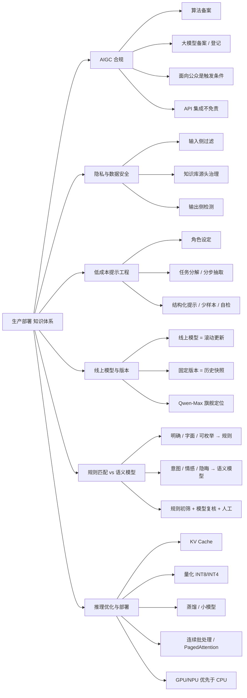
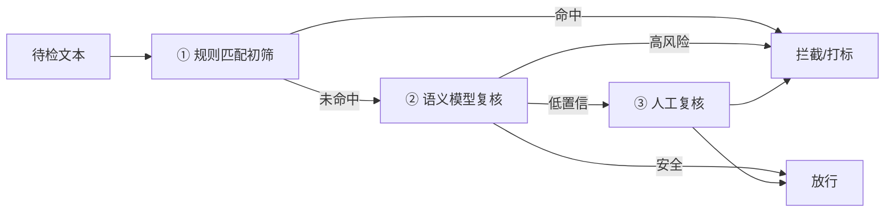

# 生产部署 知识点总结

> 归纳来源：`生产部署 2026-11-22`（AIGC合规与推理优化专题）
> 整理日期：2026-11-22
> 说明：正文带「补充」标记的内容为错题之外的扩展知识，用于建立完整认知；文末附参考文献。

---

## 目录

- [0. 知识地图](#0-知识地图)
- [1. AIGC 合规：算法备案与大模型备案/登记](#1-aigc-合规算法备案与大模型备案登记)
  - [1.1 算法备案的触发条件](#11-算法备案的触发条件)
  - [1.2 大模型备案 vs 大模型登记](#12-大模型备案-vs-大模型登记)
  - [1.3 面向公众是核心触发条件](#13-面向公众是核心触发条件)
  - [1.4 API 集成不等于免责](#14-api-集成不等于免责)
- [2. 隐私与数据安全防护](#2-隐私与数据安全防护)
  - [2.1 RAG/问答系统隐私防护的三层防线](#21-rag问答系统隐私防护的三层防线)
- [3. 低成本提示工程优化](#3-低成本提示工程优化)
  - [3.1 低成本优化手段](#31-低成本优化手段)
  - [3.2 高成本手段与决策顺序](#32-高成本手段与决策顺序)
- [4. 线上模型与版本管理](#4-线上模型与版本管理)
  - [4.1 线上模型 vs 固定版本 vs 快照](#41-线上模型-vs-固定版本-vs-快照)
  - [4.2 Qwen-Max 的定位](#42-qwen-max-的定位)
  - [4.3 生产环境的版本管理](#43-生产环境的版本管理)
- [5. 规则匹配与语义模型的适用边界](#5-规则匹配与语义模型的适用边界)
  - [5.1 规则匹配的适用条件](#51-规则匹配的适用条件)
  - [5.2 语义模型的适用条件](#52-语义模型的适用条件)
  - [5.3 合规检测的常见架构](#53-合规检测的常见架构)
  - [5.4 广告识别的难点](#54-广告识别的难点)
- [6. 推理优化与部署](#6-推理优化与部署)
  - [6.1 KV Cache](#61-kv-cache)
  - [6.2 模型量化](#62-模型量化)
  - [6.3 蒸馏与小模型替代](#63-蒸馏与小模型替代)
  - [6.4 推理框架优化](#64-推理框架优化)
  - [6.5 硬件选型](#65-硬件选型)
  - [6.6 批处理与并发调度](#66-批处理与并发调度)
  - [6.7 剪枝与稀疏化](#67-剪枝与稀疏化)
- [7. 高频易混点速查](#7-高频易混点速查)
- [8. 参考文献](#8-参考文献)
- [9. 关联](#9-关联)
- [附：基于错题的复习清单](#附基于错题的复习清单)

---

## 0. 知识地图

本专题横跨「合规准入 → 隐私安全 → 提示工程 → 模型服务 → 合规检测 → 推理优化」六条主线，核心是回答「大模型应用要上线并稳定、合规、快速地服务用户，需要做对哪些事」：



| 模块 | 核心问题 | 对应章节 |
|---|---|---|
| AIGC 合规 | 哪些场景要算法备案、大模型备案还是登记 | 1 |
| 隐私安全 | 隐私泄露要堵住哪几个口子 | 2 |
| 提示工程 | 低成本解决「模型漏内容」怎么做 | 3 |
| 模型服务 | 线上模型与固定版本、快照的区别 | 4 |
| 合规检测 | 什么时候用规则匹配、什么时候用语义模型 | 5 |
| 推理优化 | 自行部署大模型怎么提速 | 6 |

**高频考点定位**：

| 考点 | 位置 |
|---|---|
| 哪些 AIGC 场景需要算法备案 | 1.1、1.3、1.4 |
| 大模型备案 vs 大模型登记的区分 | 1.2 |
| 企业内部自用 / 个人研究是否触发备案 | 1.3 |
| 调用通义千问 API 能否免备案 | 1.4 |
| 隐私泄露防护的三层防线 | 2.1 |
| 增加知识库多样性能否防隐私泄露 | 2.1 |
| 低成本解决模型遗漏内容的方法 | 3.1 |
| 格式美化能否提升内容准确性 | 3.1 |
| Qwen-Max 线上模型指什么 | 4.1、4.2 |
| 规则匹配最适合的检测任务 | 5.1 |
| 广告信息检测能否只靠关键词 | 5.4 |
| 提升推理速度的手段 | 6 |
| CPU 集群能否替代 GPU 提速 | 6.5 |

---

## 1. AIGC 合规：算法备案与大模型备案/登记

### 1.1 算法备案的触发条件

题目（第 15 题）：下列哪些 AIGC 应用场景需要进行算法备案？**答案：A、B、E、F**。

| 选项 | 判断 | 说明 |
|---|---|---|
| A. 基于 AIGC 的智能客服系统 | ✅ | 自动生成回复文本，属生成合成类，面向公众时通常需备案 |
| B. 深度学习图像生成绘画软件 | ✅ | 典型深度合成/生成合成类，面向公众提供即触发 |
| C. 机器学习数据分析的企业内部工具 | ❌ | 仅内部使用、不对外提供服务，通常不触发 |
| D. 仅供个人研究的 AIGC 模型 Demo | ❌ | 不面向公众，不构成「向境内公众提供生成式 AI 服务」 |
| E. 基于大模型的 AI 写作工具 | ✅ | 直接生成文本内容，属生成合成类 |
| F. 集成通义千问 API 的智能问答小程序 | ✅ | 仍需算法备案，且通常还需大模型登记 |

**算法备案主要规制的服务形态**（《互联网信息服务算法推荐管理规定》口径）：

| 算法类型 | 典型场景 |
|---|---|
| 生成合成类 | 文本、图像、音视频生成，智能客服、AI 写作、智能问答 |
| 个性化推送类 | 信息流推荐、广告定向 |
| 排序精选类 | 搜索排序、榜单、热搜 |
| 检索过滤类 | 搜索结果过滤、内容拦截 |
| 调度决策类 | 派单、定价、调度 |

> **补充**：「算法备案」这条线侧重的是**算法推荐/生成合成类服务**，其触发往往还要叠加「具有舆论属性或社会动员能力」这一判断。题目语境下，面向公众的生成合成类服务通常推定为需要备案，但企业内部自用、个人研究一般不触发。

### 1.2 大模型备案 vs 大模型登记

**核心区分：看底层模型是谁的、有没有做实质性改动。**

| 情形 | 通常履行的义务 |
|---|---|
| 自研大模型（自己训、自己有完整能力） | **大模型备案** |
| 调用第三方已备案大模型 API，且**未做实质性微调** | **大模型登记** |
| 调用第三方 API 并做了实质性微调 / 深度定制 | 视情况可能需要更重的备案/安全评估 |

> **补充**：大模型备案与算法备案是**并行义务，互不替代**。备案回答的是「这个模型/这个算法能不能合规对外」，登记回答的是「调用上游模型的应用方做了最低限度的合规报备」。二者层面不同，不能用一个顶替另一个。

**易混对照**：

| 概念 | 主要依据 | 针对对象 |
|---|---|---|
| 算法备案 | 《互联网信息服务算法推荐管理规定》 | 算法推荐/生成合成类服务 |
| 深度合成服务备案/安全评估 | 《互联网信息服务深度合成管理规定》 | 换脸、合成人声、虚拟主播等 |
| 生成式 AI 服务备案（大模型备案） | 《生成式人工智能服务管理暂行办法》 | 面向境内公众提供生成式 AI 服务 |
| 大模型登记 | 各地网信部门实践口径 | 调用已备案第三方大模型的应用方 |

> **口径说明**：考试常把「面向公众 + 生成合成」统一简化为「算法备案」，把「调用第三方 API」附加「大模型登记」。实际办哪一类，取决于服务形态与属地网信部门要求，可能是生成式 AI 服务备案/登记、算法备案、深度合成备案中的一种或几种并行。

### 1.3 面向公众是核心触发条件

**判断主线：是否「向境内公众提供」生成式/生成合成类服务。**

| 情形 | 是否触发备案 |
|---|---|
| 面向公众提供服务（智能客服、AI 写作小程序、AI 绘画软件） | ✅ 通常触发 |
| 企业内部自用工具 | ❌ 通常不触发 |
| 个人研究 Demo | ❌ 通常不触发 |
| 内部工具但结果面向公众发布 | ⚠️ 需重新评估，可能触发 |
| 内部工具但具有舆论动员属性 | ⚠️ 需重新评估 |

> **补充**：判断不是「一锤定音」的。企业内部工具一旦把生成内容面向公众发布，或具备舆论属性/社会动员能力，就可能从不触发变成触发。合规判断要看**实际服务形态与影响面**，而不是看「自研/外购」「内部/外部」的静态标签。

### 1.4 API 集成不等于免责

题目（第 15 题 F 项）：集成通义千问 API 的智能问答小程序，**仍需算法备案，同时通常还需大模型登记**。

**核心结论：上游模型已备案 ≠ 应用层免备案。**

| 主体 | 义务 |
|---|---|
| 模型提供方（通义千问等） | 完成模型/算法相关备案，向应用方提供备案信息与合作协议 |
| 应用/服务提供方（集成 API 的小程序） | 作为面向用户的服务提供者，仍需履行自身备案/登记义务 |
| 平台（小程序、应用商店） | 对 AI 类目做资质审核，通常要求提交备案号 |

> **补充**：不能以「模型是第三方提供的」为由免除自己作为**直接面向用户的服务提供者**的合规义务。算法备案与大模型登记是两条并行的线，集成 API 往往「两条都要走」。

**上线前的合规动作**（把错题结论落到工程）：

1. 确认服务形态：是否面向境内公众、是否生成合成类、是否具有舆论属性。
2. 确认底层模型：自研还是调用第三方、是否做实质性微调。
3. 联系上游模型方拿备案信息与合作协议。
4. 向属地网信部门提交备案/登记申请。
5. 取得备案号后再上架平台 AI 类目。

> **易错**：不要选「先上线再补材料」「上游已备案所以自己免备案」「无需备案直接上线」。

---

## 2. 隐私与数据安全防护

### 2.1 RAG/问答系统隐私防护的三层防线

题目（第 18 题）：教育问答系统有时返回个人隐私信息，可采取哪些措施？**答案：A、B、C**。

| 选项 | 判断 | 说明 |
|---|---|---|
| A. 返回内容时实时检测并过滤敏感信息 | ✅ | 输出侧防护，直接拦截隐私信息 |
| B. 过滤用户提问，避免诱导性问题 | ✅ | 输入侧防护，降低被套取隐私的风险 |
| C. 对教育知识库内容做脱敏处理 | ✅ | 知识库源头治理，从根上降低泄露概率 |
| D. 增加知识库内容多样性 | ❌ | 不能可靠防泄露，甚至可能扩大检索范围 |

**三层防线（必须全覆盖，不能只做一层）**：


| 层 | 位置 | 典型手段 |
|---|---|---|
| **① 输入侧** | 用户提问进入系统前 | 过滤诱导性提问、敏感请求、越权查询；检测提示注入 |
| **② 检索与知识库侧** | 知识库与召回阶段 | 知识库脱敏、权限隔离、最小必要原则、敏感字段不入库 |
| **③ 输出侧** | 模型返回内容前 | 实时检测并过滤隐私信息、敏感信息、越权内容 |

> **补充**：三层是「纵深防御」，各自堵住一类泄露路径——输入侧堵「套取」，源头侧堵「召回」，输出侧堵「生成」。只做输出过滤会漏掉源头污染和诱导攻击。

**脱敏的常用技术**（错题之外的扩展）：

| 技术 | 做法 | 特点 |
|---|---|---|
| 删除/掩码 | 去掉或 `***` 替换姓名、手机号、身份证 | 简单，但可能破坏语义 |
| 假名化 | 用假名替换真实标识，保留映射表 | 可逆，便于后续追溯 |
| 匿名化 | 彻底去除标识，不可逆 | 隐私最强，但信息损失大 |
| 加密 | 对敏感字段加密存储 | 防泄露后可读 |
| 差分隐私 | 查询结果加噪声 | 统计场景防单条推断 |

**最小必要原则**：只收集、只入库、只返回业务必需的字段。敏感字段（身份证、手机号、住址、病历、成绩）能不入库就不入库；确需入库则脱敏 + 权限隔离 + 审计。

> **易错**：只关注输出过滤、忽略输入侧和知识库源头治理是典型丢分点。「增加知识库多样性」不是隐私保护措施——它回答不了「隐私信息被召回和生成」的问题，正确手段是脱敏、权限控制、过滤和评测。

---

## 3. 低成本提示工程优化

### 3.1 低成本优化手段

题目（第 19 题）：会议纪要生成工具常遗漏关键决议，哪两个选项能**较低成本**解决？**答案：A、D**。

| 选项 | 判断 | 说明 |
|---|---|---|
| A. 先对行动项和决议逐句摘要标记，再生成最终纪要 | ✅ | 分步提示/中间抽取，成本低 |
| B. 要求输出使用特定格式（紫色字体/表格） | ❌ | 只改形式，不解决内容遗漏 |
| C. 增加训练数据量 | ❌ | 需收集、标注、训练/微调，成本高 |
| D. 明确角色定义（专业秘书，提取关键决议和行动项） | ✅ | 角色设定 + 任务约束，成本低 |

**低成本提升任务效果的五个抓手**：

| 手段 | 做法 | 适用 |
|---|---|---|
| 角色设定 | 明确模型身份与任务目标 | 几乎所有任务，先给角色 |
| 任务分解/分步提示 | 先抽关键信息，再生成结果 | 复杂、易遗漏的长任务 |
| 结构化提示 | 按行动项、决议、责任人、截止时间等字段输出 | 需要程序化解析 |
| 少样本示例 | 给输入输出示例，锚定格式与粒度 | 格式/风格要求明确 |
| 输出校验 | 让模型自检是否遗漏关键项 | 关键项可枚举的场景 |

> **补充**：A 的本质是「**先抽取、再生成**」的两段式，把「边回忆边写」变成「先锁定要点再成文」，直接降低遗漏。D 的本质是「**角色 + 任务约束**」引导模型把注意力放到关键内容上。二者都只需改提示词，几乎零额外成本。

**「分步抽取」为什么有效**：

```
一次性生成（易遗漏）          分步生成（先锁定再成文）
      ↓                            ↓
会议原文 → 直接写纪要         会议原文 → ① 逐句标记行动项/决议
      ↓                            ↓
输出（可能漏关键项）          ② 依据标记生成纪要
                                    ↓
                            输出（关键项先被锚定，不易漏）
```

> **易错**：把「格式美化」误认为「内容准确性提升」——格式约束只改输出外壳，不提升内容抽取能力。另外要盯住「较低成本」这一限制条件，凡涉及数据收集、标注、训练或微调的选项都不符合。

### 3.2 高成本手段与决策顺序

**高成本方法**（题目中「较低成本」应排除的）：

| 方法 | 为什么成本高 |
|---|---|
| 扩大训练数据量 | 收集、清洗、标注、训练周期长 |
| 全量微调 | 算力、显存、时间、实验迭代成本高 |
| 重新预训练 | 最高成本，一般任务用不上 |

**优化手段的决策顺序**：

```
提示词工程（最便宜、最快）
     ↓ 不够
结构化 + 分步 + 少样本 + 角色
     ↓ 仍不够
检索增强（RAG，注入外部知识）
     ↓ 仍不够
微调（改变模型行为/能力，成本最高）
```

> **补充**：三者可组合——提示工程学「怎么说」，RAG 补「说什么」，微调定「怎么做」。但成本从低到高，永远是先试最便宜的。

---

## 4. 线上模型与版本管理

### 4.1 线上模型 vs 固定版本 vs 快照

题目（第 26 题）：Qwen-Max 线上模型可能指以下哪一种情况？**答案：C. 经过大量在线交互不断优化的模型**。

| 选项 | 判断 | 说明 |
|---|---|---|
| A. 大规模预训练的原始模型 | ❌ | 线上版本不是简单原始预训练模型 |
| B. 针对特定任务充分微调的模型 | ❌ | 不是固定不变的特定任务版本 |
| C. 经过大量在线交互不断优化的模型 | ✅ | 滚动更新、持续迭代优化 |
| D. 参数量最大的基线模型 | ❌ | 旗舰但「线上」核心不在参数量 |

**「线上模型」三个关键属性**：

| 属性 | 含义 |
|---|---|
| 服务形态 | 通过 API 在线调用，非离线权重 |
| 滚动更新 | 服务提供方会持续升级模型，用户看到的版本可能变化 |
| 持续优化 | 随着版本迭代能力持续提升，不是一次性交付 |

**线上模型 vs 固定版本 vs 历史快照**：

| 概念 | 特点 | 何时用 |
|---|---|---|
| 线上模型 | 滚动更新，效果可能随版本波动 | 追求最新能力、可容忍波动 |
| 固定版本 | 锁定某个版本号，效果稳定 | 需复现、需稳定评测 |
| 历史快照 | 某时间点的模型权重 | 需要精确回滚到过去某状态 |

> **易错**：把「线上模型」简单理解为「参数量最大的基线模型」。「线上」强调的是**服务形态和更新机制**，不是参数规模。

### 4.2 Qwen-Max 的定位

| 维度 | 说明 |
|---|---|
| 系列定位 | 通义千问系列的**旗舰**模型 |
| 能力 | 强，综合能力突出 |
| 成本 | 相对高 |
| 服务形态 | 闭源、API 调用，滚动更新 |

> **补充**：Qwen-Max 是「旗舰」而非「参数量最大」这个标签本身——旗舰强调的是综合能力与在线服务的持续升级属性。若题目问「需要固定版本怎么办」，答案是调用历史快照版本。

### 4.3 生产环境的版本管理

**滚动更新带来的风险**：线上模型悄悄升级后，Prompt 效果、输出风格、评测指标可能发生变化，导致「之前好好的，突然变差」。

**工程上的应对**：

| 措施 | 说明 |
|---|---|
| 锁定快照版本 | 生产环境固定模型版本，避免滚动更新波动 |
| 回归评测 | 模型版本变更前跑评测集，下降超阈值则阻断 |
| 灰度/金丝雀 | 新版本先小流量，对比后再放量 |
| 版本记录 | 记录每次调用的模型版本，便于问题回溯 |
| 监控漂移 | 关注输出分布、质量指标的漂移 |

> **易错**：忽略滚动更新和版本快照机制，以为线上模型「一成不变」或「就是最大参数」。

---

## 5. 规则匹配与语义模型的适用边界

### 5.1 规则匹配的适用条件

题目（第 31 题）：哪个 RAG 应用场景最适合使用规则匹配的文本合规检测？**答案：C. 检测用户上传的文本是否包含明确的违禁词汇**。

| 选项 | 判断 | 说明 |
|---|---|---|
| A. 识别复杂情感 | ❌ | 需语义理解、上下文建模 |
| B. 判断评论是否含特定品牌广告信息 | ❌（非最适合） | 「广告信息」需理解上下文与意图 |
| C. 检测是否包含明确违禁词汇 | ✅ | 固定词表、变体规则、正则，命中即判定 |
| D. 理解提问的深层含义 | ❌ | 需大模型/语义模型 |

**规则匹配适用条件：明确、字面、可枚举、边界清晰。**

| 条件 | 含义 | 例子 |
|---|---|---|
| 明确 | 判断标准无歧义 | 「是否出现『XX』词」 |
| 字面 | 不依赖上下文/隐晦表达 | 违禁词、敏感词、品牌名初筛 |
| 可枚举 | 命中项可以列全 | 黑名单词表、正则模式、变体规则 |
| 边界清晰 | 命中即判定，无需推理 | 词表命中 → 违规 |

> **补充**：规则匹配的优点是**准确、成本低、可解释**，适合违禁词这类「命中即判」的任务。缺点是覆盖不了「换说法」「谐音」「上下文意图」。

### 5.2 语义模型的适用条件

**语义模型适用条件：意图识别、情感分析、上下文判断、隐晦表达识别。**

| 任务 | 为什么规则不够 |
|---|---|
| 复杂情感识别 | 情绪是连续、依赖语境的，不是关键词命中 |
| 广告意图判断 | 正常提及 vs 推广，靠上下文与意图 |
| 深层语义理解 | 反讽、隐喻、省略、指代 |
| 隐晦/规避表达 | 谐音、拆字、拼音、表情符号、软广 |

> **记忆**：**规则匹配管「字面明确」，语义模型管「意图隐晦」。**

### 5.3 合规检测的常见架构

**规则初筛 + 模型复核 + 人工处置**的三级漏斗：



| 层 | 作用 | 特点 |
|---|---|---|
| 规则匹配 | 确定性违禁词/格式/黑名单 | 快、准、可解释 |
| 语义模型 | 意图、情感、隐晦表达 | 覆盖广，但有误判 |
| 人工复核 | 疑难、边界、高价值案例 | 成本高，做最后兜底 |

> **补充**：规则和模型不是二选一，而是**分层配合**。规则先把确定性强的拦下来，模型处理剩下的语义判断，人工只碰最难的和最贵的。

### 5.4 广告识别的难点

题目中 B 项「判断用户评论是否包含特定品牌的广告信息」不是规则匹配最适合的场景，因为**「广告信息」的判定需要理解上下文和意图**：

| 难点 | 说明 |
|---|---|
| 正常提及 vs 推广 | 同一品牌词，可能是评价也可能是广告 |
| 引流话术 | 联系方式、促销链接、「加微信」等 |
| 规避手法 | 谐音、拆字、拼音、表情符号替代 |
| 软广 | 看似分享实为推广 |
| 对比贬低/虚假宣传 | 语义与事实判断 |
| 语境依赖 | 同一句话在不同语境下是否构成广告 |

> **补充**：规则匹配可以辅助**初筛**（先命中品牌词、联系方式、链接等强信号），但核心判断靠语义模型。把「品牌广告」当成「品牌词匹配」是典型误判。

---

## 6. 推理优化与部署

题目（第 39 题）：自行部署大模型用于在线推理，哪些方案有助于提升推理速度？**答案：B、C**。

| 选项 | 判断 | 说明 |
|---|---|---|
| A. 使用 CPU 集群替代 GPU | ❌ | 单请求延迟明显劣于 GPU，非常规方案 |
| B. 长文本生成启用 KV Cache | ✅ | 缓存已计算的 Key/Value，避免重复计算 |
| C. 使用量化模型并评测确认效果 | ✅ | 降显存与计算开销，通常提速 |
| D. 任何场景优先大参数模型 | ❌ | 参数越大越慢、成本越高 |

### 6.1 KV Cache

**自回归生成的问题**：每生成一个新 Token，都要重新计算所有历史 Token 的 Key/Value，计算量随序列长度线性累积，长文本生成尤其昂贵。

**KV Cache 的解决**：把已计算过的 Key/Value **缓存**起来，生成新 Token 时只算新 Token 的注意力，复用历史 KV。

| 维度 | 无 KV Cache | 有 KV Cache |
|---|---|---|
| 每步计算 | 重算全部历史 | 只算新 Token |
| 计算量 | 随长度平方级增长 | 大幅下降 |
| 显存 | 低 | 高（缓存随长度线性增长） |
| 适用 | 短文本 | **长文本生成**收益最大 |

> **补充**：KV Cache 本质是**用显存换计算**。长上下文场景 KV Cache 显存会成为瓶颈，于是又有 **PagedAttention**（分页管理 KV，减少碎片）、**量化 KV Cache**、**滑动窗口**等进一步优化。

### 6.2 模型量化

**量化**：把模型权重和计算从高精度（FP32/FP16）降到低精度（INT8/INT4），降低显存占用和计算开销，通常能提升推理速度。

| 精度 | 显存 | 速度 | 精度损失 |
|---|---|---|---|
| FP32 | 高 | 慢 | 无 |
| FP16/BF16 | 中 | 中 | 极小 |
| INT8 | 较低 | 较快 | 小 |
| INT4 | 低 | 快 | 较大 |

**量化必须配合评测**（题目 C 项特意强调「评测确认效果符合业务需求」）：

1. 量化后跑业务评测集，确认精度损失可接受。
2. 不同任务对精度敏感度不同（生成/数学/代码更敏感）。
3. 关键指标不达标时，回退到更高精度或换量化方案。

> **补充**：量化技术包括 **PTQ**（训练后量化，直接量化，省事）与 **QAT**（量化感知训练，训练时模拟量化，精度更高但需训练）。常见量化库：GPTQ、AWQ、bitsandbytes、llm.int8() 等。

### 6.3 蒸馏与小模型替代

**模型蒸馏**：用大模型（教师）指导小模型（学生）学习，让小模型继承部分能力。

**小模型替代**：在效果可接受时直接用更小、更快的模型。

> **补充**：很多业务场景并不需要旗舰模型——分类、抽取、简单问答用小模型即可，速度快几个量级、成本低几个量级。选型原则是「**够用即可**」，不是「越大越好」。

### 6.4 推理框架优化

| 技术 | 说明 |
|---|---|
| 连续批处理（Continuous Batching） | 请求到达即加入批处理，不等固定 batch，提升吞吐 |
| PagedAttention | KV Cache 分页管理，减少显存碎片，提高并发 |
| 算子融合 | 合并多个算子减少 kernel 启动与显存读写 |
| Flash Attention | 优化注意力计算，减少显存访问 |
| 投机解码 | 小模型先草稿生成，大模型并行校验 |

> **补充**：主流推理框架 **vLLM**、**TensorRT-LLM**、**SGLang**、**llama.cpp** 等都内置了上述优化。选框架看生态、硬件适配、部署方式与团队熟悉度。

### 6.5 硬件选型

**大模型推理硬件优先级：GPU/NPU > CPU。**

| 硬件 | 特点 | 适用 |
|---|---|---|
| GPU | 高并行算力，主流选择 | 大模型训练与推理 |
| NPU/TPU 等加速器 | 专用 AI 算力，能效高 | 推理加速、端侧 |
| CPU | 通用但并行算力弱 | 小模型、轻量推理、并发调度 |

> **易错**：CPU 集群多线程能提升一定**并发吞吐**，但**单请求推理延迟**明显劣于 GPU，不能作为大模型在线推理提速的常规方案。「CPU 替代 GPU」是典型错误。

### 6.6 批处理与并发调度

| 手段 | 作用 | 代价 |
|---|---|---|
| 批处理 | 把多个请求合并计算，提升吞吐 | 单请求延迟可能上升 |
| 并发调度 | 动态组批、抢占调度 | 需平衡吞吐与延迟 |

> **补充**：在线服务要在「吞吐」和「延迟」之间取舍——批处理越大吞吐越高，但单请求等待越久。TTFT（首 Token 延迟）敏感的场景要控制 batch 大小或引入优先级调度。

### 6.7 剪枝与稀疏化

| 技术 | 做法 | 说明 |
|---|---|---|
| 剪枝 | 去掉不重要的权重/结构 | 降低计算量，但需评估效果 |
| 稀疏化 | 让大部分权重为零，利用稀疏计算加速 | 依赖硬件稀疏加速支持 |

> **补充**：剪枝/稀疏化的收益高度依赖硬件与框架对稀疏计算的支持程度，工程落地不如量化成熟；多数场景优先量化 + KV Cache + 蒸馏。

**提速手段速查表**：

| 手段 | 提速原理 | 主要代价 |
|---|---|---|
| KV Cache | 复用历史 KV，避免重复计算 | 显存随长度增长 |
| 量化 | 降低精度，减少显存与计算 | 精度损失，需评测 |
| 蒸馏/小模型 | 用更小模型 | 能力可能下降 |
| 连续批处理 | 提升吞吐 | 单请求延迟可能升 |
| PagedAttention | 减少显存碎片，提高并发 | 实现复杂度 |
| 算子融合/Flash Attention | 减少显存访问与 kernel 开销 | 框架依赖 |
| 剪枝/稀疏化 | 降低计算量 | 需硬件支持、效果评估 |
| 硬件选型（GPU/NPU） | 提升并行算力 | 成本 |

> **易错**：误以为 CPU 多线程能替代 GPU 提速；误以为参数越大越好；忽略量化后必须评测业务效果。

---

## 7. 高频易混点速查

| 易混点 | 正确理解 |
|---|---|
| 算法备案 vs 大模型备案/登记 | 算法备案管「算法推荐/生成合成」；自研大模型走备案，调用第三方 API 走登记 |
| 调用通义千问 API 能免备案吗 | 不能；应用方仍需算法备案，且可能需大模型登记 |
| 企业内部工具要备案吗 | 通常不要；但结果面向公众发布或具舆论属性时需重新评估 |
| 智能客服的边界 | AI 生成回复通常要备案；固定 FAQ 匹配理论上可主张不具舆论属性，但主流实践推定需要 |
| 隐私防护只做输出过滤够吗 | 不够；要覆盖输入侧 + 知识库源头 + 输出侧三层 |
| 增加知识库多样性能防隐私泄露吗 | 不能；不是针对性措施，甚至可能扩大召回范围 |
| 格式美化能提升内容准确性吗 | 不能；格式只改外壳，不提升抽取能力 |
| 低成本优化优先什么 | 提示工程：角色设定、分步抽取、结构化、少样本、自检 |
| 增加训练数据算低成本吗 | 不算；收集、标注、训练/微调成本高 |
| 线上模型 = 参数最大吗 | 不是；「线上」强调滚动更新、持续优化与服务形态 |
| 需要固定版本怎么办 | 调用历史快照版本 |
| 规则匹配适合什么 | 明确、字面、可枚举、边界清晰的任务（违禁词） |
| 广告信息能只靠关键词吗 | 不能；需理解上下文与意图，规则只做初筛 |
| CPU 集群能替代 GPU 提速吗 | 不能；可提吞吐但单请求延迟劣于 GPU |
| 参数越大越好吗 | 不是；越大越慢、成本越高，按需选规模 |
| 量化后能直接用吗 | 要评测确认精度损失可接受 |

---

## 8. 参考文献

1. 《生成式人工智能服务管理暂行办法》（网信办等七部门，2023）：https://www.cac.gov.cn/2023-07/13/c_1690898327029107.htm
2. 《互联网信息服务深度合成管理规定》（网信办、工信部、公安部，2022）：https://www.cac.gov.cn/2022-12/11/c_1672221949318230.htm
3. 《互联网信息服务算法推荐管理规定》（网信办等四部门，2022）：https://www.cac.gov.cn/2022-01/04/c_1642894606364259.htm
4. 阿里云百炼（Model Studio）：https://help.aliyun.com/zh/model-studio/
5. 通义千问（Qwen）模型介绍：https://help.aliyun.com/zh/model-studio/
6. vLLM：https://docs.vllm.ai/
7. NVIDIA TensorRT-LLM：https://github.com/NVIDIA/TensorRT-LLM
8. Dao et al. *FlashAttention: Fast and Memory-Efficient Exact Attention with IO-Awareness*. NeurIPS 2022：https://arxiv.org/abs/2205.14135
9. Kwon et al. *Efficient Memory Management for Large Language Model Serving with PagedAttention*. SOSP 2023：https://arxiv.org/abs/2309.06180
10. Frantar et al. *GPTQ: Accurate Post-Training Quantization for Generative Pre-trained Transformers*. arXiv:2210.17323：https://arxiv.org/abs/2210.17323
11. Dettmers et al. *LLM.int8(): 8-bit Matrix Multiplication for Transformers at Scale*. NeurIPS 2022：https://arxiv.org/abs/2208.07339
12. Leviathan et al. *Fast Inference from Transformers via Speculative Decoding*. ICML 2023：https://arxiv.org/abs/2211.17192
13. Hinton et al. *Distilling the Knowledge in a Neural Network*. arXiv:1503.02531：https://arxiv.org/abs/1503.02531
14. OpenAI Production Best Practices：https://platform.openai.com/docs/guides/production-best-practices

---

## 9. 关联

### 来源（错题复习）

- [[生产部署 2026-11-22]]

### 相关笔记

- [[应用开发 知识点总结]]（算法备案与生成式 AI 上线合规 9.4）
- [[模型训练 知识点总结]]（大模型备案与合规 7.11、量化/剪枝/蒸馏 9.5、上下文缓存 9.7）
- [[RAG 知识点总结]]（隐私与知识库治理、规则匹配与检索）
- [[Prompt 知识点总结]]（角色设定、分步提示、少样本示例）

---

## 附：基于错题的复习清单

### 合规与备案
- [ ] 算法备案：面向公众 + 生成合成/深度合成 + 舆论属性 → 通常要备案。
- [ ] 大模型备案（自研）vs 大模型登记（调用第三方 API 未实质性微调）。
- [ ] 企业内部自用、个人研究通常不触发备案；结果面向公众发布需重新评估。
- [ ] API 集成不免责：应用方仍需算法备案 + 可能大模型登记，两条并行互不替代。
- [ ] 智能客服 AI 生成回复通常要备案；固定 FAQ 匹配边界模糊，主流推定需要。

### 隐私与安全
- [ ] 隐私防护三层：输入侧过滤 + 知识库脱敏 + 输出侧检测，缺一不可。
- [ ] 增加知识库多样性不是隐私保护措施。

### 提示工程
- [ ] 低成本优化：角色设定 + 分步抽取 + 结构化提示 + 少样本 + 自检。
- [ ] 格式美化 ≠ 内容准确性提升；增加训练数据成本高，不符合「较低成本」。

### 模型服务
- [ ] Qwen-Max 线上模型 = 滚动更新、在线持续优化；不是「参数最大」。
- [ ] 固定版本靠历史快照调用；生产环境应锁定版本 + 回归评测。

### 合规检测
- [ ] 规则匹配：明确、字面、可枚举 → 违禁词检测。
- [ ] 广告意图、复杂情感、深层语义 → 语义模型；规则只做初筛。
- [ ] 三级架构：规则初筛 + 模型复核 + 人工处置。

### 推理优化
- [ ] KV Cache 缓存历史 Key/Value，长文本生成收益最大。
- [ ] 量化（INT8/INT4）降显存与计算，但必须评测精度损失。
- [ ] 蒸馏/小模型替代、连续批处理、PagedAttention、算子融合、Flash Attention。
- [ ] GPU/NPU 优先于 CPU；CPU 集群多线程不是大模型推理提速的常规方案。
- [ ] 参数越大越慢越贵，按需选规模，不是「任何场景优先大参数」。
