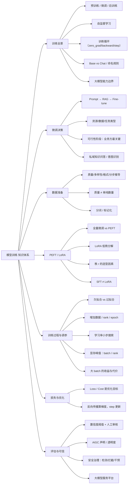

# 模型训练 知识点总结

> 归纳来源：`训练与微调 2026-10-18`（12 题）、`训练与微调 2026-10-19`（12 题）
> 整理日期：2026-10-19
> 说明：正文带「补充」标记的内容为错题之外的扩展知识，用于建立完整认知；文末附参考文献。

---

## 目录

- [0. 知识地图](#0-知识地图)
- [1. 大模型训练全景](#1-大模型训练全景)
  - [1.1 预训练 / 微调 / 后训练](#11-预训练--微调--后训练)
  - [1.2 自监督与训练目标](#12-自监督与训练目标)
  - [1.3 训练循环与 PyTorch 代码](#13-训练循环与-pytorch-代码)
  - [1.4 Base / Chat 命名与模型大小](#14-base--chat-命名与模型大小)
  - [1.5 大语言模型的能力边界](#15-大语言模型的能力边界)
- [2. 微调决策](#2-微调决策)
  - [2.1 提示词工程 vs RAG vs 微调](#21-提示词工程-vs-rag-vs-微调)
  - [2.2 微调前应考虑的事情](#22-微调前应考虑的事情)
  - [2.3 可行性研究中的关键角色](#23-可行性研究中的关键角色)
  - [2.4 意图识别的方法](#24-意图识别的方法)
- [3. 数据准备](#3-数据准备)
  - [3.1 高质量微调数据集的要素](#31-高质量微调数据集的要素)
  - [3.2 数据质量 vs 数据规模](#32-数据质量-vs-数据规模)
  - [3.3 分词 / 标记化](#33-分词--标记化)
- [4. PEFT 与 LoRA](#4-peft-与-lora)
  - [4.1 全量微调 vs 参数高效微调](#41-全量微调-vs-参数高效微调)
  - [4.2 LoRA 原理](#42-lora-原理)
  - [4.3 LoRA 秩 r 的选择因素](#43-lora-秩-r-的选择因素)
- [5. 训练过程与调参](#5-训练过程与调参)
  - [5.1 欠拟合 vs 过拟合](#51-欠拟合-vs-过拟合)
  - [5.2 欠拟合的优化措施](#52-欠拟合的优化措施)
  - [5.3 学习率调整](#53-学习率调整)
  - [5.4 显存峰值与 batch / rank](#54-显存峰值与-batch--rank)
- [6. 损失函数与优化](#6-损失函数与优化)
  - [6.1 Loss function 与 Cost function](#61-loss-function-与-cost-function)
  - [6.2 梯度下降与反向传播](#62-梯度下降与反向传播)
- [7. 评估、可信与安全治理](#7-评估可信与安全治理)
  - [7.1 置信度阈值与人机协同](#71-置信度阈值与人机协同)
  - [7.2 AIGC 声明与信任机制](#72-aigc-声明与信任机制)
  - [7.3 大模型安全治理](#73-大模型安全治理)
  - [7.4 大模型服务平台](#74-大模型服务平台)
- [8. 高频易混点速查](#8-高频易混点速查)
- [9. 参考文献](#9-参考文献)
- [10. 关联](#10-关联)
- [附：基于错题的复习清单](#附基于错题的复习清单)

---

## 0. 知识地图

把全部知识点挂到「训练全景 → 微调决策 → 数据 → 参数高效微调 → 训练调参 → 优化 → 评估可信与安全治理」的主链路上：



大模型从「通才」到「专才」的一条典型链路：

```
海量无标注文本
      ↓  预训练（自监督）
基座模型 Base Model
      ↓  指令微调 SFT（领域/任务数据）
领域/任务模型
      ↓  后训练（RLHF / DPO 对齐）
对齐后的可用模型
      ↓  部署 + 评估（置信度阈值 / AIGC 声明）
业务系统
```

| 模块 | 核心问题 | 对应章节 |
|---|---|---|
| 训练全景 | 预训练、微调、后训练各做什么 | 1 |
| 微调决策 | 到底该用 Prompt、RAG 还是微调 | 2 |
| 数据准备 | 高质量数据长什么样、为什么分词 | 3 |
| PEFT/LoRA | 为什么用 LoRA、秩 r 怎么选 | 4 |
| 训练调参 | 欠拟合怎么救、学习率怎么调、显存怎么省 | 5 |
| 损失优化 | Loss/Cost 是什么、权重怎么更新 | 6 |
| 评估可信 | 置信度低怎么办、怎么建立信任 | 7 |
| 平台与治理 | 服务平台是什么、怎么拦截非法查询 | 7 |

**若干高频考点的精确定位**：

| 考点 | 位置 |
|---|---|
| 预训练的核心目的 | 1.1 |
| 训练循环中更新权重的代码 | 1.3 |
| Base vs Chat / 模型大小 | 1.4 |
| 大模型擅长与不擅长什么 | 1.5 |
| Prompt / RAG / 微调的取舍 | 2.1 |
| 私域知识问答的方法 | 2.1 |
| 微调前应考虑的事情 | 2.2 |
| 可行性阶段的关键角色 | 2.3 |
| 意图识别的方法 | 2.4 |
| 高质量数学数据集要素 | 3.1、3.2 |
| 分词 / 标记化的目的 | 3.3 |
| SFT vs LoRA | 4.1 |
| LoRA 秩 r 的选择因素 | 4.3 |
| LoRA 数据量与秩的关系 | 4.3 |
| 欠拟合的优化措施 | 5.1、5.2 |
| 学习率调整 | 5.3 |
| 影响显存峰值的参数 / 大 batch 影响 | 5.4 |
| Loss / Cost function | 6.1 |
| 置信度低的处理 | 7.1 |
| AIGC 声明与信任机制 | 7.2 |
| 安全治理与非法查询拦截 | 7.3 |
| 大模型服务平台 | 7.4 |

---

## 1. 大模型训练全景

### 1.1 预训练 / 微调 / 后训练

题目 11：预训练在自然语言处理大模型中的**核心目的**是什么？**答案：A. 利用大量未标注文本数据学习通用的语言结构和模式**。

| 选项 | 判断 | 说明 |
|---|---|---|
| A. 海量无标注文本上自监督学习通用语言结构 | ✅ | 学语言规律、语义与世界知识，产出基座模型 |
| B. 直接在某任务数据集上优化参数 | ❌ | 这是**微调 / 任务特定训练** |
| C. 通过人类反馈调整输出以贴合偏好 | ❌ | 这是 **RLHF / 对齐** |
| D. 减少对大规模计算资源的需求 | ❌ | 预训练恰恰**需要大量算力** |

**三阶段对比**：

| 阶段 | 数据 | 学到什么 | 产物 |
|---|---|---|---|
| **预训练** | 海量无标注文本 | 通用语言结构、语义、世界知识 | 基座模型 |
| **微调（SFT）** | 任务 / 领域标注数据 | 任务模式、领域知识、输出格式 | 任务模型 |
| **后训练（对齐）** | 人类偏好 / 反馈数据 | 人类偏好、安全规范、指令遵循 | 对齐后的可用模型 |

> **记忆**：**预训练学语言和能力，微调学任务和领域，后训练学对齐和偏好。**

**对话模型的典型训练流程**（10-19 第 6 题）：**预训练 → SFT 监督微调 → RLHF / 偏好对齐**。

| 技术 | 定位 | 说明 |
|---|---|---|
| **SFT** | 让模型适应对话/指令的**首选** | 用高质量「指令—回答」数据做有监督训练，学会遵循指令、多轮对话 |
| **RLHF** | SFT 之后的**偏好对齐** | 基于人类反馈进一步优化输出偏好，不是「适应对话任务」的首选 |
| **MAML** | 小样本元学习 | 不是对话模型常规微调方法 |
| **GAN** | 生成建模 | 不适用于对话微调 |

### 1.2 自监督与训练目标

- **自监督学习（Self-supervised）**：从数据本身构造监督信号，无需人工标注，例如自回归语言建模「用前文预测下一个 Token」。
- **补充**：主流大模型多采用 **自回归下一 Token 预测**目标；也有掩码语言建模（BERT 类）、对比学习等。预训练的规模化（数据、参数、算力）是通用能力涌现的基础。

### 1.3 训练循环与 PyTorch 代码

题目 2：训练循环中，哪段代码用于**更新模型权重**？**答案：C. `optimizer.step()`**。

| 选项 | 判断 | 作用 |
|---|---|---|
| A. `loss.backward()` | ❌ | 反向传播，**计算梯度**，不直接更新权重 |
| B. `model.train()` | ❌ | 切换到训练模式，影响 Dropout / BatchNorm 行为 |
| C. `optimizer.step()` | ✅ | 根据梯度**更新模型参数** |
| D. `loss = criterion(outputs, labels)` | ❌ | 计算损失值 |

**PyTorch 典型训练顺序**：

```python
model.train()
for inputs, labels in dataloader:
    optimizer.zero_grad()          # ① 清空上一轮梯度
    outputs = model(inputs)        # ② 前向传播
    loss = criterion(outputs, labels)  # ③ 计算损失
    loss.backward()                # ④ 反向传播，计算梯度
    optimizer.step()               # ⑤ 用梯度更新权重
```

| 代码 | 作用 |
|---|---|
| `optimizer.zero_grad()` | 清空上一轮梯度（否则会累加） |
| `loss.backward()` | 自动求导，计算各参数梯度 |
| `optimizer.step()` | 按优化器规则更新参数 |

> **易错**：`loss.backward()` 只算梯度，**真正更新权重的是 `optimizer.step()`**。
> **补充**：验证时用 `model.eval()` + `torch.no_grad()`，关闭 Dropout、节省显存与计算。

### 1.4 Base / Chat 命名与模型大小

题目（10-19 第 2 题）：Qwen 系列中，哪个模型代表**经过大规模数据预训练后的基础版本**，未针对特定任务做过多的调整？**答案：C. Qwen-7B 预训练模型**。

| 选项 | 判断 | 说明 |
|---|---|---|
| A. Qwen-7B-Chat | ❌ | `-Chat` 表示经过对话指令微调与对齐的聊天模型 |
| B. Qwen-Max 线上模型 | ❌ | 线上模型经过服务化优化与对齐，面向实际应用 |
| C. Qwen-7B 预训练模型 | ✅ | 大规模无监督预训练后的基础版本，未做大量指令对齐 |
| D. Qwen-14B-Chat | ❌ | `-Chat` 是对齐后的聊天版本 |

**判断标准：看训练阶段与对齐程度，与模型大小无关。**

| 类型 | 训练 | 命名 | 能力 |
|---|---|---|---|
| **Base（基础预训练模型）** | 只做大规模无监督预训练 | 通常不带 `-Chat`，或标 `-Base` | 文本续写、通用语言建模，未专门学「如何回答指令」 |
| **Chat（对话模型）** | 预训练 + SFT + RLHF 等对齐 | 带 `-Chat` | 遵循指令、多轮对话 |

> **易错**：**模型越大 ≠ 越是基础模型**。7B、14B 是参数规模，Base / Chat 是训练阶段，两者是**独立维度**；每个规模都可能同时有基础版和 Chat 版。

### 1.5 大语言模型的能力边界

题目（10-19 第 1 题）：以下哪个任务**最适合**使用大语言模型？**答案：B. 检测一组销售数据中的异常值**。

| 选项 | 判断 | 说明 |
|---|---|---|
| A. 计算一组数据的标准差 | ❌ | 需要**精确数值运算**，交给统计软件 / Excel / Python |
| B. 检测一组销售数据中的异常值 | ✅ 相对最适合 | LLM 可理解数据、生成检测代码、解释异常原因、撰写分析报告 |
| C. 对一组图像做精确的像素级分割 | ❌ | 属于计算机视觉任务，用 U-Net、Mask R-CNN、SAM 等专用模型 |
| D. 在大型数据集上训练复杂机器学习模型 | ❌ | 需专门训练框架、算力与工程流程，LLM 只能辅助写代码/给建议 |

> **擅长**：文本理解、生成、总结、问答、代码辅助、解释分析。
> **不擅长**：精确数值计算、像素级图像分割、替代专用训练系统。
> **判据**：需要「精确」和「专用模型」的任务，不要指望 LLM 本体完成；但 LLM 可做**辅助分析**。

---

## 2. 微调决策

### 2.1 提示词工程 vs RAG vs 微调

**先判断「该不该微调」，再谈「怎么微调」。** 常见决策顺序：

```
先提示词工程（最便宜、最快）
        ↓ 不够
再评估 RAG（注入外部/私域/时效知识）
        ↓ 仍不够
最后考虑微调（改变模型行为/能力）
```

| 方案 | 擅长 | 成本 | 典型场景 |
|---|---|---|---|
| **提示词工程** | 约束输出、引导推理、快速试错 | 最低 | 任务可被清晰描述、基座能力够用 |
| **RAG** | 注入外部 / 私域 / 时效知识 | 中 | 文档问答、知识频繁更新、需溯源 |
| **微调** | 固定任务模式、风格/格式、特定推理流程 | 最高 | 提示词与 RAG 都难稳定达标 |

> **补充**：三者可组合——微调学「怎么说」，RAG 补「说什么」。**微调不是首选**。

**让大模型回答私域知识问题**（10-19 第 9 题，答案 **A、B、C**）：

| 方案 | 判断 | 说明 |
|---|---|---|
| A. 微调模型 | ✅ | 用私域指令/问答数据微调，让模型更好回答私域问题 |
| B. 训练新模型 | ✅ 但成本高 | 训练阶段加入私域数据理论上可行，周期长、成本高，通常不优先 |
| C. 通过提示词传递私域知识 | ✅ | 作为上下文输入，常配合 RAG，低成本且知识可更新 |
| D. 使用默认模型 | ❌ | 默认模型一般没有企业私域知识，不能保证回答 |

> **优先级**：**提示词 / RAG（低成本、可更新）→ 微调（领域表达与任务模式）→ 从头训练（成本最高，通常不用于一般私域问答）**。

### 2.2 微调前应考虑的事情

题目 5：在决定模型微调前，应该考虑哪些事情？**答案：A、B、C、D（全选）**。

| 选项 | 判断 | 说明 |
|---|---|---|
| A. 训练服务器资源的成本 | ✅ | 算力、显存、存储、时间、实验迭代成本 |
| B. 训练数据量是否达到微调的最低标准 | ✅ | 数据太少/质量差易欠拟合或过拟合，效果不稳定 |
| C. 该任务是否更适合使用 RAG | ✅ | 外部知识、时效信息、私域文档问答优先 RAG |
| D. 提示词工程是否能达到预期效果 | ✅ | 微调成本高，应先验证基础模型能力上限 |

> **核心**：微调前的四问——**算力够不够、数据够不够、是不是该用 RAG、提示词能不能先解决**。

### 2.3 可行性研究中的关键角色

题目 10：大模型微调项目调研与业务可行性研究阶段，哪个角色对项目成功尤为关键？**答案：C. 业务工作者（营销、运营等）**。

| 选项 | 判断 | 说明 |
|---|---|---|
| A. 数据工程师 | ❌ | 重要，但更偏后续实施 |
| B. 机器学习工程师 | ❌ | 重要，但可行性阶段要先确认业务价值 |
| C. 业务工作者提供领域知识与评估口径 | ✅ | 提供业务目标、领域知识、数据标准、评估口径、风险判断 |
| D. UI/UX 设计 | ❌ | 偏后续产品化阶段 |

> **可行性阶段要确认**：项目是否真解决业务问题、数据能否支撑、评估标准是否合理、成本收益是否成立。
> **风险**：没有业务方参与，容易出现「模型训得不错，但业务不可用」。

### 2.4 意图识别的方法

题目（10-19 第 8 题）：在意图识别中，哪些方法可以帮助大模型进行意图识别？**答案：A、B、C**。

| 选项 | 判断 | 说明 |
|---|---|---|
| A. 使用提示词 | ✅ | Zero-shot / Few-shot Prompting，按指令或示例完成意图识别 |
| B. 对模型进行微调 | ✅ | 用意图标注数据做 SFT/微调，显著提升特定业务场景效果 |
| C. 增加模型的训练数据 | ✅ | 增加高质量、领域相关的意图标注数据 |
| D. 减少模型的推理时间 | ❌ | 主要影响效率与成本，不直接提升识别准确性 |

> **常用组合**：提示词工程 / 少样本示例、监督微调、高质量领域数据，以及结合分类器或规则系统。
> 低置信结果的处理见 7.1（阈值 + 人工审核）。

---

## 3. 数据准备

### 3.1 高质量微调数据集的要素

题目 4：构建高质量的数学题微调数据集应包含哪些要素？**核心答案：A、B、D；C 有条件**。

| 选项 | 判断 | 说明 |
|---|---|---|
| A. 覆盖多种解题思路 | ✅ | 一题多解提升推理泛化与灵活性 |
| B. 统一使用 LaTeX / Markdown 输出公式 | ✅ | 减少格式噪声，便于训练、解析与评测 |
| C. 大量的数学题解题数据 | ⚠️ 有条件 | 规模重要，但「高质量」不等于「大量」；大量低质重复数据反而有害 |
| D. 包含详细分步推导 | ✅ | 数学微调需要可学习的中间推理，不能只有答案 |

> **高质量数据的六个维度**：题目与答案正确、步骤完整可验证、一题多解多样、公式格式统一、难度与知识点覆盖、去重防泄漏防错标。

### 3.2 数据质量 vs 数据规模

- **质量优先**：错误标注、重复样本、格式混乱会直接污染模型行为。
- **规模有条件**：数据量不足易欠拟合；但盲目堆量收益递减，还可能引入噪声。
- **补充**：实践中常用「去重 + 质量过滤 + 难度分层 + 防训练集/测试集泄漏」构建数据管线。

### 3.3 分词 / 标记化

题目 12：微调大语言模型前的数据准备中，为何需要进行文本分词或标记化处理？**答案：C. 帮助模型理解文本结构**。

| 选项 | 判断 | 说明 |
|---|---|---|
| A. 降低模型训练成本 | ❌ | 影响序列长度和成本是**间接效果**，不是核心目的 |
| B. 简化文本内容 | ❌ | 不是「简化」，而是转换为模型可处理的 token 表示 |
| C. 帮助模型理解文本结构 | ✅ | 决定模型看到的文本粒度与序列结构，是理解输入的基础 |
| D. 提高数据传输效率 | ❌ | 不是主要目的 |

> **机制**：模型不能直接处理原始字符串 → Tokenizer 把文本切成 **token 序列** → 映射为 **token ID** → 嵌入层转为向量。
> **补充**：词表、分词策略、序列长度会影响训练效率、显存占用与最终效果；代码/数学/多语言场景尤其要关注分词器适配。

---

## 4. PEFT 与 LoRA

### 4.1 全量微调 vs 参数高效微调

| 方式 | 做法 | 优点 | 缺点 |
|---|---|---|---|
| **全量微调（Full FT）** | 更新全部参数 | 表达能力最强 | 显存/算力/存储成本高，易灾难性遗忘 |
| **PEFT**（如 LoRA） | 只训练少量新增参数 | 成本低、易保存切换、可多任务并存 | 容量有限，极端任务可能欠拟合 |

> **补充**：常见 PEFT 方法还有 Adapter、Prefix/Prompt Tuning、IA³ 等；LoRA 因实现简单、效果好而最常用。

**SFT 与 LoRA 的关系**（10-19 第 7 题）：**二者不是同一层面的概念，SFT ≠ LoRA**。

| 概念 | 层面 | 含义 |
|---|---|---|
| **SFT（Supervised Fine-Tuning）** | **训练阶段 / 训练目标** | 用有监督的「指令—回答」数据，让预训练模型学会遵循指令、适应对话任务 |
| **LoRA（Low-Rank Adaptation）** | **参数高效微调方法** | 只训练少量低秩参数，冻结原模型大部分参数，降低显存与训练成本 |

> **关系**：SFT 可以用**全参数微调**实现，也可以用 **LoRA** 实现。「用 LoRA 做 SFT」合理；但「SFT = LoRA」不成立。
> **类比**：SFT 是「要完成的任务（监督微调）」，LoRA 是「完成任务的工具（低秩适配）」。

### 4.2 LoRA 原理

**LoRA（Low-Rank Adaptation）**：冻结原模型权重 \(W\)，为部分层增加一个**低秩增量**：

\[
W' = W + \Delta W = W + BA
\]

- \(A \in \mathbb{R}^{r \times k}\)、\(B \in \mathbb{R}^{d \times r}\)，**秩 \(r \ll \min(d,k)\)**；
- 只训练 \(A\)、\(B\)，可训练参数大幅减少；
- 推理时可把 \(BA\) 合并回 \(W\)，**不增加推理延迟**。

> **补充**：LoRA 常配合缩放系数 `alpha`、`dropout`、目标模块（q/k/v/o、MLP）等超参数使用；QLoRA 进一步用 4-bit 量化基座模型降低显存。

### 4.3 LoRA 秩 r 的选择因素

题目 6：选择 LoRA 秩 r 时需要考虑哪些因素？**答案：A、B、C、D（全选）**。

| 选项 | 判断 | 说明 |
|---|---|---|
| A. 训练数据量 | ✅ | 数据少时 r 过大易过拟合；数据多且多样可适当增大 |
| B. 基础模型参数数量 | ✅ | 模型规模影响相同 r 的相对容量与适配策略 |
| C. 任务复杂度 | ✅ | 简单任务小 r 够用；复杂推理/领域注入需更大 r |
| D. GPU 显存容量 | ✅ | r 越大，可训练参数、梯度、优化器状态越占显存 |

> **记忆**：**r 越大表达能力越强，但显存、计算与过拟合风险也越高**。
> **实践**：可从 r=8 / 16 起步，根据欠拟合（可增大）或过拟合（应减小）表现调整。

**LoRA 对数据量的要求**（10-19 第 12 题）：以下说法**错误**的是 **A. 微调数据量较小时，应增大 LoRA 的秩以提升模型表达能力**。

| 选项 | 判断 | 说明 |
|---|---|---|
| A. 数据量小时应增大 LoRA 秩 | ❌ **错误** | 盲目增大秩会增加参数与表达能力，但**更容易过拟合**；小数据应用较小秩 + 合适学习率 + 正则化 |
| B. 数据质量有保障时，增大数据量与多样性通常有益 | ✅ 正确 | 高质量、多样化数据有助于提升效果 |
| C. LoRA 微调所需数据量比预训练小 | ✅ 正确 | PEFT 所需数据量通常远小于预训练 |
| D. 同等数据量（1000 条）下 LoRA 接近全参微调 | ⚠️ 较绝对 | 在数据有限、任务适配性好时可能接近，但不是普遍保证 |

> **核心**：**数据越少，越不该盲目增大秩**；应优先保证数据质量、任务匹配度与合适超参数。

---

## 5. 训练过程与调参

### 5.1 欠拟合 vs 过拟合

| 现象 | 训练 loss | 验证 loss | 含义 | 对策方向 |
|---|---|---|---|---|
| **欠拟合** | 高 | 高 | 连训练数据都没学好 | 增容量、增数据、增训练量、降正则 |
| **过拟合** | 低 | 高 | 记住了训练集、泛化差 | 增数据、降容量、加正则、早停 |

> **易错**：只看训练 loss 就下结论。**必须同时看验证 loss 与学习曲线**。

### 5.2 欠拟合的优化措施

题目 3：微调 Qwen-2.5-1.5B 时发现模型开始**欠拟合**，可采取哪些优化措施？**答案：A、B、D（C 不选）**。

| 选项 | 判断 | 说明 |
|---|---|---|
| A. 增加训练数据量 | ⚠️ 有条件 | 若因数据不足/覆盖不够，增加**高质量多样**数据合理；若训练低验证高则属过拟合，需另法 |
| B. 增加 `lora_rank` | ✅ | 增大低秩矩阵容量，提高拟合能力 |
| C. 学习率增加一倍 | ❌ 不选 | 「翻倍」过于激进，易 loss 震荡/发散/破坏预训练能力 |
| D. 增加训练迭代次数（epoch） | ✅ | 训练不充分时增加 epoch 是常见措施 |

**欠拟合的常见原因**：模型容量不足、训练轮数不够、学习率太小、正则化过强、数据量不足或覆盖不充分。

> **关键**：调整学习率应**小步、对数尺度搜索**，不是盲目翻倍。

### 5.3 学习率调整

- 常用对数尺度搜索：`1e-5, 2e-5, 5e-5, 1e-4, 2e-4, 3e-4`。
- 配合 **warmup**（预热）与**梯度裁剪**（gradient clipping）提升稳定性。
- 学习率太大 → loss 震荡/发散；太小 → 收敛慢、欠拟合。

> **补充**：常见调度器有 cosine、linear decay、step decay 等；微调大模型通常用较小学习率以保护预训练能力。

### 5.4 显存峰值与 batch / rank

题目 8：以下哪两个参数的设置会影响训练时**显存占用峰值**？**答案：A、D**。

| 选项 | 判断 | 说明 |
|---|---|---|
| A. `batch_size` | ✅ | 越大，激活值、梯度等占用越多，是最直接影响因素 |
| B. `evaluation_step` | ❌ | 影响验证频率与总时长，不直接决定训练显存峰值 |
| C. `epoch` | ❌ | 影响总步数与总时间，不影响**单步**显存峰值 |
| D. `lora_rank` | ✅ | 越大，可训练参数、梯度、优化器状态越多，显存越大 |

**显存峰值主要来源**：模型参数、激活值、梯度、优化器状态、临时缓存；受 **batch size、序列长度、LoRA rank、混合精度**等影响。

> **补充**：显存不足时可用——梯度累积（小 batch 模拟大 batch）、梯度检查点（gradient checkpointing）、混合精度（FP16/BF16）、4-bit 量化（QLoRA）。

**较大 batch size 的影响**（10-19 第 10、11 题）：答案 **A、C、D**。

| 选项 | 判断 | 说明 |
|---|---|---|
| A. GPU 显存消耗更大 | ✅ | 需同时存储更多样本的激活值，可能 OOM |
| B. 帮助模型充分学习训练集 | ❌ 不选 | 表述不严谨；大 batch 只让梯度估计更稳定，不等于「更充分学习」 |
| C. 可能导致泛化性能下降 | ✅ | 梯度过平滑，可能收敛到尖锐局部最优 |
| D. 加速训练过程 | ✅ | 合理范围内可利用 GPU 并行、提高吞吐量 |

**为什么 B 不选**：

1. 「充分学习训练集」≠「梯度估计稳定」，还取决于 epoch、学习率、数据质量、正则化、优化器；
2. 同样 epoch 下，batch 越大参数更新次数越少（10000 条：batch=10 → 1000 次；batch=1000 → 10 次），学习率不调整可能训练不足；
3. 大 batch 降低梯度噪声，而小 batch 的噪声有正则化/探索作用；
4. 典型影响是「显存更大、可能泛化下降、合理范围内加速」，B 不是必然结论。

> **实践**：大 batch 通常需配合**学习率线性缩放或 warmup**；否则可能训练不足或泛化变差。
> **易错**：「大 batch 训练更快」不等于「学得更充分」。

---

## 6. 损失函数与优化

### 6.1 Loss function 与 Cost function

题目 7：关于 Loss function & Cost function，下面描述正确的是？**答案：A、C**。

| 选项 | 判断 | 说明 |
|---|---|---|
| A. 用于度量当前参数的设置是否合适 | ✅ | 衡量预测与真实值的差距，差距越小参数通常越好 |
| B. 决定神经元是否被激活并传递信息 | ❌ | 这是**激活函数**（ReLU、Sigmoid 等） |
| C. 帮助寻找函数的参数最优解 | ✅ | 训练通过最小化 Loss/Cost 找较优参数 |
| D. 拟合任意复杂函数 | ❌ | 这是**神经网络的万能近似能力**，不是 Loss/Cost 的作用 |

- **Loss function**：通常针对单个样本或一个 batch 的误差。
- **Cost function**：常指整个训练集上的平均/总代价。
- 二者常混用，核心都是**优化目标**，指导参数更新。

> **补充**：常见损失——回归用 MSE/MAE，分类用交叉熵（Cross-Entropy），对比学习用 InfoNCE 等。

### 6.2 梯度下降与反向传播

- **前向传播**：输入 → 网络 → 输出，计算预测值。
- **损失**：衡量预测与真实值的差距。
- **反向传播（backward）**：链式法则计算各参数梯度。
- **优化器（step）**：按梯度更新参数，如 SGD、Adam、AdamW。

```
forward → loss → backward(梯度) → optimizer.step(更新权重)
```

> **易错**：把「算梯度」当成「更新权重」——二者是先后两步。

---

## 7. 评估、可信与安全治理

### 7.1 置信度阈值与人机协同

题目 1：大模型意图分类置信度普遍较低，应该如何处理？**答案：D. 设置置信阈值，低于阈值的结果需要人工审核**。

| 选项 | 判断 | 说明 |
|---|---|---|
| A. 直接忽略置信度，使用预测结果 | ❌ | 会放大误判风险 |
| B. 放弃使用大模型进行意图分类 | ❌ | 过于激进，可用阈值/人工/二次分类优化 |
| C. 重新训练大模型 | ❌ | 成本高，且不一定立即解决 |
| D. 设置置信阈值，低置信人工审核 | ✅ | 人机协同的稳妥方案 |

- **置信度 ≠ 绝对正确率**，存在「置信度校准」问题（模型可能过度自信）。
- 实际系统常用「**高置信自动通过、低置信人工介入**」策略。
- 低置信样本还可进入：规则兜底、小模型复核、主动学习流程。

> **补充**：置信度校准方法包括温度缩放（temperature scaling）、Platt scaling 等。

### 7.2 AIGC 声明与信任机制

题目 9：为了加强大语言模型生成内容的**信任机制**，哪项措施最具有效果？**答案：C. 添加 AIGC 声明**。

| 选项 | 判断 | 说明 |
|---|---|---|
| A. 提高模型参数 | ❌ | 可能提升能力，但不直接解决信任机制 |
| B. 增加训练轮数 | ❌ | 可能改善效果，但不等于增强信任 |
| C. 添加 AIGC 声明 | ✅ | 直接提升透明度与用户知情权 |
| D. 优化用户界面 | ❌ | 改善体验，但对内容信任作用较弱 |

**AIGC 声明的常见形式**：

- 显式文字声明：「本内容由 AI 生成，仅供参考」；
- 标签 / 水印；
- 元数据标识；
- 平台提示；
- 高风险场景免责声明。

> **核心**：信任机制靠**透明度、可追溯性、用户知情权**，而不是直接提升模型准确率。
> **补充**：中国《人工智能生成合成内容标识办法》等法规要求对 AI 生成合成内容进行标识，AIGC 声明也是合规要求的一部分。

### 7.3 大模型安全治理

题目（10-19 第 4 题）：在大模型安全治理中，如何识别和避免对用户输入的**非法查询**进行响应？**答案：C. 利用大模型服务平台的快速干预功能**。

| 选项 | 判断 | 说明 |
|---|---|---|
| A. 增加训练数据量 | ❌ | 可能提升能力，但不能保证识别与拦截非法输入 |
| B. 引导用户输入示范 | ❌ | 只能引导，不能可靠识别与阻止非法查询 |
| C. 利用服务平台的快速干预功能 | ✅ | 内容审核、敏感词/风险意图识别、拦截规则、固定答复、人工干预 |
| D. 提高模型的复杂性 | ❌ | 更复杂不等于更安全，与非法查询识别无必然关系 |

**安全治理的完整机制**：

```
输入检测 → 风险识别 → 实时拦截 → 人工干预 → 审计日志
```

> **核心认识**：安全治理靠**检测与干预机制**，不是靠「加训练数据」或「模型更复杂」。
> 服务平台的「快速干预功能」是**执行层工具**。

### 7.4 大模型服务平台

题目（10-19 第 5 题，概念解释）：大模型服务平台是整合多种大模型能力的**中介与管控中枢**——不直接开发某一个模型，而是把自研或第三方模型统一接入，为企业和开发者提供调用入口、管理工具与安全控制能力。

| 核心能力 | 说明 |
|---|---|
| **统一接入** | 通过标准 API 调用不同厂商、不同类型的模型 |
| **模型选型与测试** | 在一个平台上比较、测试、选择模型 |
| **全生命周期管理** | 覆盖微调、部署、推理、应用创建等流程 |
| **统一运维与计费** | 统一统计用量、成本、监控与告警 |
| **安全治理** | 内容审核、敏感词/语义干预、权限管理、审计日志等 |

> **定位**：既是「**模型供应链枢纽**」，也是「**安全治理执行层**」。
> 与 7.3 的联系：快速干预功能就是服务平台安全治理能力的体现，可在用户输入与模型输出之间设置管控层。

---

## 8. 高频易混点速查

| 易混对 | 一句话区分 |
|---|---|
| 预训练 vs 微调 vs 后训练 | 学语言 / 学任务 / 学对齐 |
| 预训练 vs 减少算力 | 预训练需要大量算力，不是省算力 |
| Base vs Chat | 看**训练阶段/是否对齐**，不看参数大小 |
| 模型大 vs 基础模型 | 参数量（7B/14B）与 Base/Chat 是独立维度 |
| 大模型擅长 vs 精确计算 | 擅长文本理解/生成/解释；精确数值交给程序 |
| 大模型 vs 专用视觉模型 | 像素级分割用 U-Net/SAM 等，不是 LLM |
| SFT vs LoRA | SFT 是训练阶段/目标，LoRA 是参数高效微调方法 |
| `loss.backward()` vs `optimizer.step()` | 前者算梯度，后者更新权重 |
| `model.train()` vs 更新权重 | 前者切换训练模式，不更新参数 |
| 欠拟合 vs 过拟合 | 训练高验证高 = 欠拟合；训练低验证高 = 过拟合 |
| 欠拟合 vs 学习率翻倍 | 可适度提高学习率，但「翻倍」过于激进 |
| LoRA rank 大 vs 小 | 大 → 容量强、显存/过拟合高；小 → 省资源、容量有限 |
| 小数据 vs 增大 LoRA rank | 数据少时增大秩更易过拟合，应用小秩 + 正则 |
| LoRA vs 全参微调数据量 | LoRA 所需数据通常远小于预训练；与全参效果比较不能绝对化 |
| LoRA rank vs epoch 显存 | rank 影响单步显存峰值；epoch 只影响总时长 |
| batch_size vs epoch | batch 影响单步显存；epoch 影响总训练轮数 |
| 大 batch：更快 vs 更充分 | 合理范围内更快；不等于「更充分学习训练集」 |
| 数据质量 vs 数据规模 | 高质量 ≠ 大量；低质重复数据有害 |
| 分词 vs 简化文本 | 分词是转 token 序列/ID，不是简化内容 |
| Loss/Cost vs 激活函数 | Loss 是优化目标；激活函数决定神经元是否激活 |
| Loss/Cost vs 万能近似 | 万能近似是神经网络能力，不是损失函数作用 |
| 置信度 vs 正确率 | 置信度高不代表一定对，需校准 |
| 低置信：忽略 vs 人工审核 | 应阈值过滤 + 人工介入，而非忽略 |
| AIGC 声明 vs 提升模型 | 信任靠透明度/可追溯，不是靠更大模型 |
| 加训练数据 vs 安全治理 | 安全治理靠检测/拦截/干预，不是加数据 |
| 模型更复杂 vs 更安全 | 复杂度与非法查询拦截无必然关系 |
| 服务平台 vs 模型开发 | 平台是统一接入/管理/安全管控中枢，不直接开发模型 |
| 意图识别：减少推理时间 vs 提准确 | 减少推理时间只影响效率，不提升识别效果 |
| 私域知识：提示词/RAG vs 微调 vs 从头训练 | 成本递增，通常优先提示词/RAG，从头训练最少用 |
| 可行性阶段 vs 实施阶段 | 可行性先看业务价值，业务方最关键；训练/UI 偏后 |

---

## 9. 参考文献

**论文 / 教材**

1. Vaswani et al. *Attention Is All You Need*. NeurIPS 2017. arXiv:1706.03762
2. Brown et al. *Language Models are Few-Shot Learners*（GPT-3）. NeurIPS 2020. arXiv:2005.14165
3. Hu et al. *LoRA: Low-Rank Adaptation of Large Language Models*. ICLR 2022. arXiv:2106.09685
4. Dettmers et al. *QLoRA: Efficient Finetuning of Quantized LLMs*. NeurIPS 2023. arXiv:2305.14314
5. Ouyang et al. *Training Language Models to Follow Instructions with Human Feedback*（InstructGPT / RLHF）. NeurIPS 2022. arXiv:2203.02155
6. Rafailov et al. *Direct Preference Optimization: Your Language Model is Secretly a Reward Model*（DPO）. NeurIPS 2023. arXiv:2305.18290
7. Goodfellow, Bengio, Courville. *Deep Learning*. MIT Press, 2016.
8. Sennrich et al. *Neural Machine Translation of Rare Words with Subword Units*（BPE）. ACL 2016. arXiv:1508.07909
9. Qwen Team. *Qwen2.5 Technical Report*. arXiv:2412.15115

**官方文档**

10. PyTorch 优化器与训练循环：https://pytorch.org/docs/stable/optim.html
11. Hugging Face PEFT（LoRA）文档：https://huggingface.co/docs/peft
12. Hugging Face Transformers 训练文档：https://huggingface.co/docs/transformers/training
13. 阿里云百炼 模型微调：https://help.aliyun.com/zh/model-studio/fine-tuning
14. 阿里云百炼 内容安全 / 模型服务：https://help.aliyun.com/zh/model-studio/
15. Qwen 模型文档与模型卡：https://help.aliyun.com/zh/model-studio/models
16. 中国《人工智能生成合成内容标识办法》（AIGC 标识合规参考）

---

## 10. 关联

### 来源（错题复习）

- [[训练与微调 2026-10-18]]
- [[训练与微调 2026-10-19]]

### 相关笔记

- [[Prompt 知识点总结]]
- [[RAG 知识点总结]]
- [[多模态 知识点总结]]

---

## 附：基于错题的复习清单

- [ ] 预训练 = 海量无标注文本自监督学通用语言结构；不是微调、不是 RLHF。
- [ ] 三阶段：预训练学语言 → 微调学任务 → 后训练学对齐。
- [ ] 训练循环：`zero_grad` → forward → loss → `backward`（算梯度）→ `step`（更新权重）。
- [ ] `model.train()` 只切换模式，不更新参数。
- [ ] 微调前四问：算力成本、数据量、是否用 RAG、提示词能否解决。
- [ ] 决策顺序：先 Prompt → 再 RAG → 最后 Fine-tune。
- [ ] 可行性阶段最关键角色是业务方（业务价值、领域知识、评估口径）。
- [ ] 高质量数据：多解题思路、统一公式格式、详细分步推导；规模有条件。
- [ ] 数据质量 ≠ 单纯数量，低质重复数据有害。
- [ ] 分词/标记化 = 文本 → token 序列 → token ID，帮助模型理解文本结构。
- [ ] LoRA：冻结 W，训练低秩增量 BA，推理可合并、不增延迟。
- [ ] LoRA rank 选型：数据量、基础模型规模、任务复杂度、GPU 显存。
- [ ] rank 越大能力越强，但显存与过拟合风险更高；从 8/16 起步。
- [ ] 欠拟合：训练高验证高；过拟合：训练低验证高。
- [ ] 欠拟合措施：增数据（有条件）、增 rank、增 epoch；学习率别翻倍。
- [ ] 学习率小步对数搜索（1e-5 ~ 3e-4），配合 warmup 与梯度裁剪。
- [ ] 显存峰值看 batch_size 与 lora_rank；epoch / evaluation_step 不影响单步峰值。
- [ ] Loss/Cost 是优化目标，衡量参数是否合适、帮助找最优解。
- [ ] 激活函数决定神经元是否激活；万能近似是神经网络能力。
- [ ] 置信度低 → 阈值过滤 + 人工审核；置信度需校准。
- [ ] AIGC 声明提升透明度、可追溯性与用户知情权，是信任机制关键。
- [ ] Base vs Chat：看训练阶段/是否对齐，与参数量无关；Base 不带 `-Chat`。
- [ ] LLM 擅长文本理解/生成/解释；精确计算、像素级分割、复杂训练交给专用工具。
- [ ] 对话训练流程：预训练 → SFT → RLHF/偏好对齐；适应对话首选 SFT。
- [ ] SFT 是训练阶段/目标，LoRA 是参数高效微调方法；可用 LoRA 做 SFT，但 SFT ≠ LoRA。
- [ ] 私域知识：提示词/RAG 优先，微调次之，从头训练成本最高。
- [ ] 意图识别：提示词、微调、增加高质量数据；减少推理时间不提升准确率。
- [ ] 大 batch：显存更大、可能泛化下降、合理范围内加速；不等于「更充分学习」，需调学习率。
- [ ] 小数据不要盲目增大 LoRA 秩，否则更易过拟合。
- [ ] 安全治理：输入检测 → 风险识别 → 实时拦截 → 人工干预 → 审计日志。
- [ ] 大模型服务平台 = 统一接入 + 选型测试 + 生命周期管理 + 运维计费 + 安全治理。
