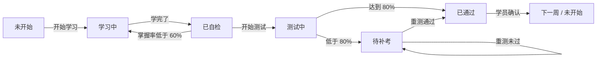

# DCIM 学习 Harness

> 给「10 周学习计划」加一个可执行的闭环：**学习 → 口述检查 → 周测 → 判分 → 过/不过 → 推进或补考**。
> 所有状态都存在本地 Markdown 里，换会话、换天都能接着走。

## 1. 它解决什么问题

原来的资料是静态的：不会告诉你「现在该学第几周」，也不会记住「上周考了多少分」。这个 harness 补上三件事：

1. **进度跟踪**：当前周次、每周状态、口述检查结果、每次周测成绩
2. **强制门槛**：周测 < 80% 不允许进入下一周
3. **自动化流程**：用自然语言触发学习、检查、测试、判分，不用记命令

## 2. 怎么用

在仓库根目录打开 OpenCode，直接说：

| 你说 | 教练做什么 |
| --- | --- |
| `开始学习DCIM运维` | 读进度 → 打开当前周资料入口 → 给出本周目标、阅读顺序、今天先读哪节 |
| `学完了` | 按学习计划里的口述题，一次一题检查；记录 掌握/部分/未掌握 |
| `开始测试` | 原样给出本周周测题（不含答案），说明限时与提交格式 |
| `1A 2B 3C … 9ABC` | 按答案文件判分 → 输出分数、错题、薄弱点 → 更新进度 |
| `进入下一周` | 只有本周 `passed` 才推进；否则拒绝并说明差多少 |
| `重测` | 同一套卷再考一次，记录为新尝试 |
| `查看进度` | 总览表 + 当前周详情 + 下一步建议 |
| `复习第 6 周` | 输出该周知识地图与高频考点，不改状态 |
| `模拟考` | 40 题 / 60 分钟模拟卷，判分并记录 |

如果 skill 没有自动触发，用 `@dcim-coach 开始学习DCIM运维` 显式加载。

## 3. 状态机



硬规则：

- `已通过` 也必须学员说「进入下一周」才推进
- `待补考` 时不能推进，即使用户要求
- 每次状态变化都写入 `progress.md`

## 4. 文件说明

| 文件 | 作用 |
| --- | --- |
| `progress.md` | **唯一状态源**：当前周次 + 10 周记录 + 模拟考记录 |
| `coach.md` | 教练执行手册：开场协议、意图路由、各流程、记录格式 |
| `grader.md` | 判分协议：答案归一化、多选规则、通过线、错题归因、输出模板 |
| `skills/dcim-coach/SKILL.md` | skill 入口（被 `opencode.json` 注册） |

题目与答案已分离：

- 题目：`notes/DCIM/每周测试/第NN周-测试.md`
- 答案：`notes/DCIM/每周测试/答案/第NN周-答案.md`

这样出题时只读题目文件，交卷后才读答案文件，避免提前泄题。

## 5. 进度文件怎么看

`progress.md` 顶部：

```yaml
current_week: 1
week_status: not_started
last_score: null
last_rate: null
```

中间是总览表，下面是每周两张表：

- **知识检查记录**：日期 / 题号 / 掌握程度 / 备注
- **周测记录**：尝试序号 / 日期 / 得分 / 正确率 / 结果 / 主要错题

想手动改也可以，但保持以下约定：

- 分数写 `10/12`，正确率写 `83.3%`
- 状态只用 `not_started` / `studying` / `checked` / `testing` / `needs_review` / `passed`
- 不要删除旧行（历史用于看趋势）

## 6. 判分口径

| 项目 | 规则 |
| --- | --- |
| 单选 | 完全一致得分 |
| 多选 | 全对得分，少选/多选/错选均不得分 |
| 通过线 | `ceil(总题数 × 0.8)`：12→10、14→12、16→13、40→32 |
| 缺号/不会 | 按错误计 |
| 答案顺序 | 多选顺序无关 |

## 7. 常见问题

**Q：skill 没反应？**
先确认当前目录是仓库根目录（有 `opencode.json`），然后 `@dcim-coach` 显式调用；必要时 `/reload`。

**Q：能不能跳过某一周？**
不能。规则是 80% 通过才推进；可以「暂停」，但不能「跳过」。确实需要调整计划时，在 `progress.md` 顶部写备注，周次映射不变。

**Q：口述检查没过怎么办？**
掌握率 < 60% 时教练会建议回读具体小节；不强制阻止测试，但会提示风险。

**Q：模拟考没过会影响进度吗？**
不影响 `current_week`，但会列出失分最多的章节，建议回炉对应周次后再考。

**Q：换电脑/换会话会丢进度吗？**
不会，只要 `notes/DCIM/harness/progress.md` 在。它就是一个普通 Markdown 文件，跟着 git 走。

**Q：想重新开始？**
说「重置 DCIM 进度」。教练会先把旧文件备份为 `progress.backup-YYYYMMDD.md`，再恢复初始状态。
