# 数据中心 IT 高级运维工程师认证 · 10 周学习计划

> 依据：阿里云 ACTS-L3 考试大纲 + 227 页官方培训课件
> 周期：10 周（以 2026-11-16 为第 1 周起点，可整体平移）
> 投入：每周约 6 小时（工作日 5×0.5h 碎片记忆 + 周末 3.5h 精读与测试），合计约 60 小时
> 目标：模考稳定 85 分以上（通过线 80 分，留 5 分安全垫）
> 配套教练：说「开始学习DCIM运维」启动，进度与成绩自动记到 [harness/progress.md](harness/progress.md)

---

## 一、先看考场规则

| 项目 | 内容 |
| --- | --- |
| 形式 | 线下上机、闭卷 |
| 时间 | 120 分钟 |
| 题型 | 单选 70 题（1 分）+ 多选 30 题（1 分） |
| 及格 | 80 分（容错 20 题） |
| 答题节奏 | 平均 72 秒/题；单选 45 秒、多选 90 秒；留 15 分钟回查 |

**这意味着**：不需要会配 BGP、会拆服务器，但必须**认得出概念、分得清对比项、记得住关键数字**。多选题是最大失分点，本计划每周都安排「多选专项」。

---

## 二、总体知识地图

考试 8 个领域的权重分布是「两头重、中间散」：网络（30%）和服务器（40%）占七成，管理类（25%）靠记忆拿分，数据中心概述（5%）属于送分题。

```mermaid
flowchart TB
    ROOT["数据中心IT高级运维<br/>ACTS-L3"]

    ROOT --> A["A. 行业与运营<br/>5%"]
    ROOT --> B["B. 服务器<br/>40%"]
    ROOT --> C["C. 网络<br/>30%"]
    ROOT --> D["D. 管理<br/>25%"]

    A --> A1["技术演进五趋势"]
    A --> A2["四层价值 + TCO"]
    A --> A3["数据中心生命周期"]
    A --> A4["运营四支柱"]

    B --> B1["硬件维修 15%"]
    B --> B2["操作系统 10%"]
    B --> B3["故障排查 15%"]

    B1 --> B11["行业生态与L6-L12分级"]
    B1 --> B12["基线管理"]
    B1 --> B13["机型: 1U/2U/4U/JBOD/GBOX"]
    B1 --> B14["不停机: 硬盘·电源"]
    B1 --> B15["停机: CPU·内存·背板·主板·PCIe·风扇"]
    B1 --> B16["混插规范与维修后检查"]

    B2 --> B21["Windows/CMD 命令"]
    B2 --> B22["Linux shell 与脚本"]
    B2 --> B23["syslog 类别与级别"]
    B2 --> B24["dmesg/journalctl"]
    B2 --> B25["PXE 与系统安装"]

    B3 --> B31["带内/带外监控架构"]
    B3 --> B32["BMC 与 ipmitool"]
    B3 --> B33["日志标准字段"]
    B3 --> B34["日志采集脚本"]
    B3 --> B35["三大故障案例"]

    C --> C1["三层架构 10%"]
    C --> C2["脊叶架构 20%"]

    C1 --> C11["接入/汇聚/核心"]
    C1 --> C12["VLAN聚合·MUX·QinQ"]
    C1 --> C13["链路聚合·堆叠·STP/RSTP/MSTP"]
    C1 --> C14["IS-IS 原理配置排错"]
    C1 --> C15["设备管理: Console/SSH"]

    C2 --> C21["CLOS 与全三层"]
    C2 --> C22["BGP: 邻居·通告·RR·选路"]
    C2 --> C23["路径控制: ACL/前缀列表/route-map/PBR"]
    C2 --> C24["QoS: 标记·队列·整形监管"]
    C2 --> C25["MPLS 与 BGP/MPLS VPN"]
    C2 --> C26["IPv6 与过渡"]
    C2 --> C27["SDN 与 VXLAN"]

    D --> D1["项目管理 15%"]
    D --> D2["资产管理 10%"]
    D1 --> D11["5 过程组 × 8 知识领域"]
    D1 --> D12["进度: WBS/关键路径"]
    D1 --> D13["质量: 七种图 + PDCA"]
    D1 --> D14["风险: 应对策略"]
    D1 --> D15["沟通/相关方/RACI"]
    D2 --> D21["资产分类与生命周期"]
    D2 --> D22["资产 IOT 平台与设备"]
    D2 --> D23["6S 与目视管理"]
```

**一句话串起来**：一个超大规模数据中心（A）里，服务器坏了要修（B1）、要装系统看日志（B2）、要定位故障（B3）；服务器接在三层/脊叶网络上（C）；维修和布线都是项目（D1），设备进出都要管资产（D2）。考试就是围绕这条主线出题。

---

## 三、学习周期与节奏

### 3.1 十周排期总表

| 周次 | 日期（示例） | 主题 | 权重 | 精读资料 | 周测 | 周末产出 |
| --- | --- | --- | --- | --- | --- | --- |
| W1 | 11/16–11/22 | 超大规模数据中心 | 5% | 01 | 第01周 | 画出数据中心生命周期图 + TCO 构成表 |
| W2 | 11/23–11/29 | 服务器硬件维修（上） | 8% | 02 | 第02周 | 默写「不停机/停机」部件清单与硬盘更换 8 条注意 |
| W3 | 11/30–12/06 | 服务器硬件维修（下） | 7% | 03 | 第03周 | 默写 CPU/内存/主板维修注意事项 + 维修后检查清单 |
| W4 | 12/07–12/13 | 服务器操作系统 | 10% | 04 | 第04周 | 手敲一遍 PXE 五组件流程 + 日志级别表 |
| W5 | 12/14–12/20 | 服务器故障排查 | 15% | 05 | 第05周 | 写出「硬盘槽位判断」两条路径的命令链 |
| W6 | 12/21–12/27 | 三层架构 + IS-IS | 10% | 06 | 第06周 | 画出 STP 选举三步 + IS-IS 邻接关系矩阵 |
| W7 | 12/28–01/03 | 脊叶（一）CLOS + BGP | 12% | 07 | 第07周 | 默写 BGP 13 条选路顺序 + 状态机 6 态 |
| W8 | 01/04–01/10 | 脊叶（二）路径控制·QoS·MPLS·IPv6·SDN | 8% | 08 | 第08周 | 做一张「QoS 标记字段 + DSCP 取值」速查卡 |
| W9 | 01/11–01/17 | 项目管理 | 15% | 09 | 第09周 | 默写 5×8 矩阵 + 风险应对 10 策略 |
| W10 | 01/18–01/24 | 资产管理 + 全科串讲 | 10% | 10 + 11 | 第10周 + 模拟考 | 按考试节奏限时完成 1 套模拟卷并复盘 |

> 权重与周次并非严格等比例：网络（30%）拆成 3 周、服务器（40%）拆成 4 周，是因为这两块**细节多、易混点多**；项目管理虽然 15%，但结构清晰、一次成体系，1 周足够。

### 3.2 每周的固定节奏（6 小时怎么花）

| 时段 | 时长 | 做什么 |
| --- | --- | --- |
| 周一 | 0.5h | 通读本周资料的「知识地图 + 高频考点」，不求记住，只求知道有什么 |
| 周二–周四 | 各 0.5h | 精读 1/3 正文，每读完一节，合上书用一句话复述该节结论 |
| 周五 | 0.5h | 只看表格和对比项（本资料所有对比表都是出题点） |
| 周六 | 2h | 二次精读 + 手写/默画关键图（拓扑、流程图、矩阵） |
| 周日 | 1.5h | **闭卷做周测 → 对答案 → 错题回填台账 → 补读对应小节** |

### 3.3 抗遗忘复习节奏

每章学完后的第 1、3、7、14 天各回看一次，每次只看三样东西：**知识地图、对比表、错题台账**（每次 10 分钟）。

---

## 四、每周任务卡

> 每张卡都包含：**学什么 / 学到什么程度 / 知识检查 / 测试 / 易错点**。
> 「知识检查」是口述题，能不看资料讲出来才算过；讲不出来就说明只是「看过了」。

### 第 1 周：超大规模数据中心（5%）

- **精读**：[01 超大规模数据中心](学习资料/01-超大规模数据中心.md)
- **学到什么程度**
  - 能说出技术演进 5 个趋势（规模、能耗、能效、功率密度、可靠性）
  - 能背出数据中心生命周期 6 阶段
  - 能区分 CapEx / OpEx，说出 TCO 的 7 个影响因素
  - 能说出运营管理「旧模式 vs 新模式」的差别（短期订单 vs 月滚动预测 + 长周期协议）
- **知识检查（口述）**
  1. 为什么超大规模数据中心会成为行业方向？中小型数据中心被淘汰的四个原因是什么？
  2. 设备生命周期里，「网络设备」和「服务器」的迭代周期分别是多久？
  3. 服务器年维修率 20%，百万台规模每天大概多少台在故障状态？这个数字对运维意味着什么？
  4. 数据中心四层价值（基本/架构/业务/成本）各举一个例子。
- **测试**：[第 01 周测试](每周测试/第01周-测试.md)
- **易错点**：把「能耗提高」和「能效提高」当成矛盾（其实是同时发生：总量上升、单位算力能耗下降）；把 TCO 只记成「采购成本」（要含运营成本）。

### 第 2 周：服务器硬件维修（上）（8%）

- **精读**：[02 服务器硬件维修（一）](学习资料/02-服务器硬件维修一.md)
- **学到什么程度**
  - 服务器研发 5 种模式（OEM/ODM/定制/自研/OCP）
  - 硬件分级 L6/L7/L10/L11/L12 各自含义
  - 基线是什么、在哪 7 个场景做基线检测
  - 机型分类（单节点 1U/2U/4U，多节点 1U2/2U4/4U2；JBOD、GBOX）
  - 不停机维修：硬盘 + 电源的注意事项（能说出 8 条硬盘注意中的 6 条）
- **知识检查（口述）**
  1. 为什么维修以「换件」为主而不是「修件」？
  2. 基线在「故障检测」和「维修后检测」中分别怎么用？
  3. 硬盘故障灯亮就能直接拔吗？为什么不行？
  4. 换电源前为什么要先紧固另一块电源？新电源为什么要在墙电处测试？
- **测试**：[第 02 周测试](每周测试/第02周-测试.md)
- **易错点**：JBOD（高密存储、多硬盘槽）与 GBOX（多 PCIe、多 GPU）搞反；把 M.2/PCIe 硬盘当成可热插拔。

### 第 3 周：服务器硬件维修（下）（7%）

- **精读**：[03 服务器硬件维修（二）](学习资料/03-服务器硬件维修二.md)
- **学到什么程度**
  - CPU：不能戴防静电手套、三角对三角、垂直插入、多 CPU 同型号、单 CPU 插 CPU0
  - 内存：同型号、先主通道后副通道、按丝印确认槽位、禁触金手指
  - 硬盘背板：多盘不识别/换盘不识别 → 背板；必须关机；拆前拔所有硬盘
  - 主板：拆装顺序、FRU 烧录、同一槽位 3 次报修考虑换主板、集成网卡换主板
  - PCIe 四种尺寸数值、Riser 概念
  - 停机维修后检查 5 步（BIOS → 指示灯 → 无盘 RAMOS → 异常刷屏 → 自动检查工具）
  - 混插三原则
- **知识检查（口述）**
  1. 停机维修前，服务器应该怎么关机？为什么不能直接拔电源线？
  2. 多节点服务器关机后能不能顺手把同框其他节点也抽出来？
  3. CPU 温度异常，第一步做什么？
  4. 混插的三个前提条件是什么？不满足怎么办？
- **测试**：[第 03 周测试](每周测试/第03周-测试.md)
- **易错点**：CPU 拆卸「要戴手套」与「不可戴防静电手套」记反；主板维修后忘了 FRU 信息烧录；把「进 BIOS 检查识别」漏掉。

### 第 4 周：服务器操作系统（10%）

- **精读**：[04 服务器操作系统](学习资料/04-服务器操作系统.md)
- **学到什么程度**
  - 带内（SSH，依赖系统）/ 带外（IPMI，依赖 BMC 通电即可）
  - Windows 命令两类：文件操作（dir/copy/move/md/cd/ren/del/rd）与系统信息（ipconfig/ping/netstat/tracert/chkdsk）
  - Linux 脚本三要素（#! 首行、# 注释、顺序执行）与三种运行方式（路径需执行权、bash/sh、source）
  - 日志：/var/log 五个关键文件、syslog 类别与 8 个级别（emerg→debug）
  - dmesg 与 journalctl 常用参数
  - 安装：分区方案（/boot 512M、swap=内存、/ 剩余）、>2T 用 GPT、/boot 只能 MBR/GPT
  - PXE 五组件与启动顺序（DHCP → TFTP → HTTP/FTP）+ KickStart 作用
- **知识检查（口述）**
  1. 无盘系统和业务系统是什么关系？为什么现场运维只登无盘？
  2. `source`、`bash`、`./x.sh` 三种执行方式有什么区别？
  3. 日志级别里哪个最高？`dmesg -l 3` 看的是什么？
  4. PXE 安装时，DHCP 的 `next-server` 和 `filename` 分别告诉客户端什么？
- **测试**：[第 04 周测试](每周测试/第04周-测试.md)
- **易错点**：swap 分区大小记错（等于内存大小）；`/boot` 用 LVM（实际是 MBR 分区）；把 journalctl 的 `-u` 记成「用户」而不是「unit」。

### 第 5 周：服务器故障排查（15%）

- **精读**：[05 服务器故障排查](学习资料/05-服务器故障排查.md)
- **学到什么程度**
  - 监控架构：带内 + 带外 → 智能监控系统 → 各运维平台
  - 带外能力清单（BMC：IPMI/SNMP/Web/rKVM/SOL/FRU/LAN）
  - ipmitool 六类命令（power / lan print / lan set / sel list / fru list / sensor list）
  - 日志标准里能认出「哪个字段属于哪个部件」（CPU、内存、硬盘、RAID、带外传感器）
  - 采集脚本：OS 8 条、BMC 7 条、GPU 1 条、BIOS 3 条
  - 三大案例的完整命令链（硬盘槽位两种机型、文件系统修复、网卡 MAC 变更）
- **知识检查（口述）**
  1. 带外系统为什么「关机也能用」？它依赖什么？
  2. 日志里看到 `/dev/sdd` 报错，怎么一步步定位到具体槽位？（分 HBA 与 RAID 两条路径）
  3. 文件系统故障导致开不了机，处理步骤是什么？两个修复命令分别对应什么文件系统？
  4. 换完网卡网络不通，根因是什么？怎么改？
- **测试**：[第 05 周测试](每周测试/第05周-测试.md)
- **易错点**：RAID 卡机型用盘符反推槽位（逻辑盘与物理盘不一一对应）；`sas2ircu`/`sas3ircu` 与 HBA 版本对不上；忘记 bond。

### 第 6 周：三层架构与 IS-IS（10%）

- **精读**：[06 三层架构网络](学习资料/06-三层架构网络.md)
- **学到什么程度**
  - 三层职责、汇聚是 L2/L3 分界、POD = 一个 L2 广播域
  - 生成树三兄弟（802.1d/802.1w/802.1s）与堆叠（iStack/CSS/IRF/VSU，最多 8 台）
  - BFD（RFC5880，毫秒级）vs OSPF Dead（40s）
  - VLAN 聚合 / MUX VLAN / QinQ（4094×4094）
  - 链路聚合：手工 vs LACP（M:N）、M-LAG、vPC
  - STP 三步选举、BPDU 关键字段、端口状态与 RSTP 角色对照、P/A 快速收敛、MSTP 实例
  - IS-IS：术语、L1/L2/L1-2、区域规则、邻接矩阵、NET 地址、PDU 类型、默认路由/路由泄露/过载位、排错表
  - 设备管理：Console 参数、Telnet/SSH/Web 对比、配置文件（running/startup）、VRP 用户级别
- **知识检查（口述）**
  1. 三层架构的三个缺陷是什么？为什么说 STP 造成带宽浪费？
  2. STP 选举的三步是什么？根桥 ID 的 8 字节怎么组成？
  3. RSTP 比 STP 快在哪？AP 端口的作用是什么？
  4. IS-IS 的 L1 路由器为什么能自动有一条默认路由？路由泄露解决什么问题？
  5. 两台 IS-IS 邻居卡在 init，最可能查什么？
- **测试**：[第 06 周测试](每周测试/第06周-测试.md)
- **易错点**：把「三层网络架构」和「全三层（Only L3）」混为一谈；QinQ 的 VLAN 数量算成 4094×2；IS-IS 的 System ID 不是 6 字节。

### 第 7 周：脊叶架构（一）CLOS 与 BGP（12%）

- **精读**：[07 脊叶架构（一）CLOS 与 BGP](学习资料/07-脊叶架构一-CLOS与BGP.md)
- **学到什么程度**
  - 传统三层四个缺点 + 云网络三目标（敏捷/隔离/规模）
  - Leaf-Spine 五个优点、CLOS 容量算法（会算「每个 Leaf 下挂多少服务器」）
  - 全三层含义（每条链路一个 /30、双上联、业务 IP 在虚拟网卡）
  - OSPF vs BGP 七个对比维度；RFC 7938
  - BGP 特性表（179、60/180、AD 20/200、RID 顺序、MD5、默认关自动汇总）
  - AS 号范围（2 字节 1–65535，私有 64512–65535；4 字节私有 4200000000–4294967294）
  - 状态机 6 态、4 种报文、通告三方式（network/redistribute/aggregate）、同步规则
  - RR 三角色 + 三种通告规则；联盟 AS_CONFED_SEQ/SET
  - 路径属性分类 + 六大属性含义 + **13 条选路顺序**
  - 多路径为什么常需 `multipath-relax`；排错命令与故障表
- **知识检查（口述）**
  1. 16 台 Spine（下联 48×100G）、48 台 Leaf（下联 64×25G、上联 16×25G），最多支持多少台服务器？为什么？
  2. 全三层网络为什么能缩小故障域？
  3. BGP 从 iBGP 学到的路由为什么不能再传给其他 iBGP 邻居？两种解法是什么？
  4. 说出 BGP 选路前 8 条（Weight → LP → 本地 → AS_PATH → Origin → MED → eBGP>iBGP → IGP 度量）。
  5. 两台 ToR 双上联同一台 Spine，为什么默认不形成 ECMP？
- **测试**：[第 07 周测试](每周测试/第07周-测试.md)
- **易错点**：把 MED 记成「越大越优」；把 eBGP 管理距离 20 / iBGP 200 记反；以为 BGP 自己会产生路由；以为 `aggregate-address` 不需要明细路由。

### 第 8 周：脊叶架构（二）路径控制·QoS·MPLS·IPv6·SDN（8%）

- **精读**：[08 脊叶架构（二）路径控制与 QoS 等](学习资料/08-脊叶架构二-路径控制与QoS等.md)
- **学到什么程度**
  - 路径控制工具谱系：ACL（标准只匹配前缀）/ 前缀列表（ge/le、末尾隐含 deny）/ AS-Path 正则 / community-list / route-map / 重发布 / PBR
  - 路由策略 vs 策略路由的区别（对象、规则、平面）
  - QoS 五功能、四要素、三服务模型、DS 域角色
  - 标记字段与位宽：802.1p PRI 3bit、MPLS EXP 3bit、IPP 3bit、DSCP 6bit（0–63）
  - 四类 PHB：CS（XXX000）、EF（101110，专线效果）、AF（4 类 × 3 丢弃级）、BE
  - 队列：CBWFQ（64 队列、75% 可预留、带宽三种写法）、LLQ（priority、防饿死）、WRED（三区间）、MDRR（7+1、QV/deficit）
  - 整形 vs 监管六项对比；令牌桶 CIR/Bc/Be/Tc
  - 云 DC QoS 硬指标（RTT 20ms / 存储 10ms、迁移 250Mbps、4Gbps、±3%、95%/99%）
  - MPLS：标签 20/3/1/8、push/pop/swap、LDP（UDP 646 / TCP 646）、PHP、RIB/FIB/LIB/LFIB
  - BGP/MPLS VPN：P/PE/CE、VRF、VPNv4（RD 64bit）、RT 导入导出、双层标签（外 LDP、内 MP-BGP）
  - IPv6：表示与压缩、地址类型与特殊前缀、报头字段、地址配置 4 法、过渡 3 法、路由协议
  - SDN 三特征、NSX 三平面、Overlay、VXLAN（VNI 24bit、1600 万）
- **知识检查（口述）**
  1. 前缀列表 `172.0.0.0/8 ge 24` 匹配哪些掩码？为什么写 `ge` 不写 `le` 时上限是 32？
  2. DSCP 与 IPP 的兼容关系（XXX000）怎么理解？EF 的十进制是多少？
  3. CBWFQ 能预留多少带宽？为什么默认只有 75%？
  4. 流量监管和流量整形，哪个会引入延迟？哪个能重标记？
  5. MPLS VPN 数据转发时内外层标签分别由谁分配、各解决什么问题？
  6. VXLAN 用 24 位 VNI 解决了什么问题？
- **测试**：[第 08 周测试](每周测试/第08周-测试.md)
- **易错点**：`AF` 的 x/y 方向记反（x 越大越优先排队，y 越大越容易丢）；PHP 是「次末跳」弹出而不是最后一跳；IPv6 组播前缀是 `FF00::/8` 而不是 `FE80::/10`。

### 第 9 周：项目管理（15%）

- **精读**：[09 项目管理](学习资料/09-项目管理.md)
- **学到什么程度**
  - 项目定义三要点、项目 vs 运营、项目/项目集/项目组合
  - 5 过程组 × 8 知识领域矩阵（能默写每个领域的子过程名）
  - EEF vs OPA；PMO 三型；组织结构类型
  - 项目经理人才三角 + 「整合者」三种整合
  - 整合：章程、计划、基准、变更流程、收尾「合标合法完工交付」
  - 范围：产品范围 vs 项目范围、SMART、需求跟踪矩阵、WBS 100% 原则、确认 vs 控制范围、范围基准三件套
  - 进度：依赖 4 类、四种逻辑关系、提前量/滞后量、估算 4 法、关键路径、资源平衡 vs 平滑、赶工 vs 快速跟进
  - 质量：预防胜于检查、一致性/非一致性成本、七种图（鱼骨/流程/直方/帕累托/散点/核查表/控制图）、审计、PDCA、六西格玛 3.4ppm
  - 资源：RACI、五种权力、四种领导风格、塔克曼五阶段、冲突五法
  - 沟通：4 种类型、7-38-55、5C、推/拉/交互
  - 风险：三类风险、风险 vs 问题、概率影响矩阵、PESTLE/SWOT、定性 vs 定量、决策树 EMV、威胁 5 策略 + 机会 5 策略
  - 相关方：权力利益方格、参与度 5 级
- **知识检查（口述）**
  1. 项目结束的四种情形是什么？
  2. 「范围蔓延」和「镀金」的区别？谁来防？
  3. 关键路径的定义里为什么强调「不考虑资源限制」？资源平衡会怎样影响工期？
  4. 帕累托图解决什么问题？六西格玛的出错率上限是多少？
  5. 威胁应对五策略各举一个数据中心场景的例子。
  6. RACI 里 A 和 R 的区别？
- **测试**：[第 09 周测试](每周测试/第09周-测试.md)
- **易错点**：把「确认范围」（客户验收，阶段末）与「控制范围」（团队监控，全过程）搞反；把「规避」和「减轻」搞反；把「转移」理解成「消除」。

### 第 10 周：资产管理 + 全科串讲（10%）

- **精读**：[10 资产管理](学习资料/10-资产管理.md)、[11 考前速查手册](学习资料/11-考前速查手册.md)
- **学到什么程度**
  - 四类资产；IT 固定资产的四种粒度（S/N 级 / 型号+数量 / 台账实物）
  - 资产生命周期全链路（需求→采购生产→到货验收→上架检测→投产运行→报废处置）
  - 资产 IOT 平台 6 大功能 + 解决的 4 个痛点
  - 9 种 IOT 设备及部署位置（尤其 RFID 在主板/硬盘/内存/电源的位置）
  - 6S 六个词 + 目视管理 7 条 + 看板尺寸 + 码堆「分类/安全/整齐/定量/节约」的量化指标
- **知识检查（口述）**
  1. 哪些配件管到 S/N 级？哪些只到「型号+数量」？
  2. 防损标签和声光标签分别装在哪、解决什么问题？
  3. 6S 的「清洁」和「清扫」区别是什么？
  4. 货垛倾斜的临界角度、高位堆叠的高度阈值分别是多少？
- **测试**：[第 10 周测试](每周测试/第10周-测试.md) → [模拟考试](每周测试/模拟考试.md)
- **易错点**：把「整理/整顿」搞反（整理=扔掉不要的，整顿=定位摆放）；看板尺寸与位置的对应关系记混（记「功能+位置」即可，尺寸只记两组：40×60 与 45×35）。

---

## 五、考前 7 天冲刺

| 天 | 任务 |
| --- | --- |
| D-7 | 重刷 10 套周测的错题（只看错题，不做新题） |
| D-6 | 背 [11 考前速查手册](学习资料/11-考前速查手册.md) 的数字表 |
| D-5 | 背三张对比表：OSPF vs BGP、STP/RSTP/MSTP、监管 vs 整形 |
| D-4 | 背 BGP 13 条选路 + IS-IS 邻接矩阵 + 项目管理 5×8 矩阵 |
| D-3 | 做 1 套模拟考（按卷面限时 60 分钟），严格闭卷 |
| D-2 | 模拟考错题回炉 + 资产/项目管理的纯记忆点过一遍 |
| D-1 | 只看错题台账和速查手册，不做题，早睡 |

**考场策略（多选题是生死线）**

1. 单选先扫一遍，30 秒内没思路的标记跳过，别恋战。
2. 多选题宁缺毋滥：不确定的选项不选（按题库习惯，多选题错选不得分）。
3. 遇到「以下说法正确的是」型多选，先排除含绝对化词（一定、必须、只能）的错误项，但要小心课程里本来就有的硬性规定（如「必须插 CPU0」）。
4. 最后 15 分钟只做两件事：检查漏答、复核标记题。

---

## 六、进度追踪

> 用教练学习时，以 [harness/progress.md](harness/progress.md) 为准；本表用于离线手工勾选。

| 周 | 精读 | 知识检查口述 | 周测 | 错题回填 | 复习 D+1/3/7 |
| --- | --- | --- | --- | --- | --- |
| W1 | [ ] | [ ] | [ ] 得分：___ | [ ] | [ ] |
| W2 | [ ] | [ ] | [ ] 得分：___ | [ ] | [ ] |
| W3 | [ ] | [ ] | [ ] 得分：___ | [ ] | [ ] |
| W4 | [ ] | [ ] | [ ] 得分：___ | [ ] | [ ] |
| W5 | [ ] | [ ] | [ ] 得分：___ | [ ] | [ ] |
| W6 | [ ] | [ ] | [ ] 得分：___ | [ ] | [ ] |
| W7 | [ ] | [ ] | [ ] 得分：___ | [ ] | [ ] |
| W8 | [ ] | [ ] | [ ] 得分：___ | [ ] | [ ] |
| W9 | [ ] | [ ] | [ ] 得分：___ | [ ] | [ ] |
| W10 | [ ] | [ ] | [ ] 得分：___ | [ ] | [ ] |
| 模拟考 | — | — | [ ] 得分：___ | [ ] | — |

---

## 七、错题台账

> 每道错题只写一行：**错在哪个概念 → 正确说法**。考前只看这张表。

| 日期 | 章节 | 错的知识点 | 正确说法（一句话） | 已掌握 |
| --- | --- | --- | --- | --- |
|  |  |  |  | [ ] |
|  |  |  |  | [ ] |
|  |  |  |  | [ ] |
|  |  |  |  | [ ] |
|  |  |  |  | [ ] |
