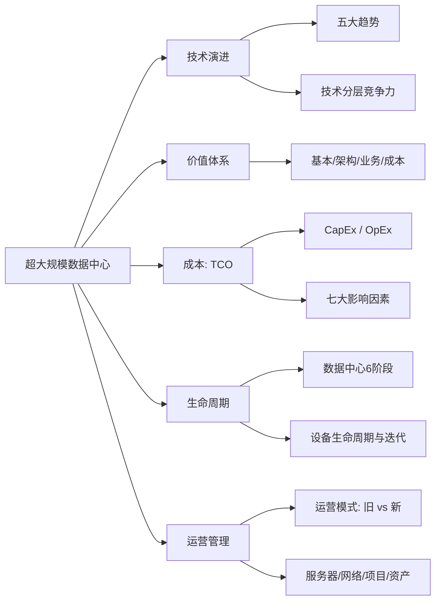

# 01 超大规模数据中心

> 对应考纲：超大规模数据中心（5%）
> 官方要求：了解发展趋势、价值体现、生命周期、超大规模带来的运营挑战、运营工作内容
> 本章特点：纯概念、纯记忆，**5 分要全拿**，是性价比最高的一章

---

## 知识地图

---

## 1. 数据中心技术演进

### 1.1 五大趋势（高频考点 · 多选常考）

随着信息产业和互联网兴起，数据中心需求量急剧增加、单体规模越来越大；中小型数据中心因**承载能力、成本、可用性、服务能力**等原因被逐渐淘汰。整体技术特点的趋势是：

| 趋势 | 含义 |
| --- | --- |
| 单体规模增大 | 从几千台服务器走向十万、百万台级 |
| 能耗提高 | 总量持续上升 |
| 能效提高 | 单位算力/单位 IT 负载的能耗下降（PUE 优化） |
| 功率密度提高 | 单机柜从 5kW 走向 20kW+，液冷登场 |
| 可靠性提高 | 架构冗余、故障域收敛、自动化运维 |

> **易错**：「能耗提高」与「能效提高」不矛盾——总量涨、效率也涨。多选题里两个都要选。

### 1.2 技术分层与核心竞争力

| 技术层次 | 核心竞争力特征 |
| --- | --- |
| 数据中心 | 大规模、可扩展 |
| 物理网络 | 架构简单、高速 |
| 服务器 | 规模化、一体化、规格收敛 |
| 虚拟化 | 可软件定义，解决业务灵动问题 |
| 调度系统 | 解决资源利用率问题 |
| 运维 | DC 大脑（智能化）解决运维问题 |

「规格收敛」是理解后面服务器维修课的前提：机型越少、部件越统一，备件、基线、自动化才成立。

---

## 2. 数据中心的价值体现

四个层次，从下往上价值递增：

| 层次 | 内容 |
| --- | --- |
| 基本价值 | 网络连通性、可靠性；计算；存储 |
| 架构价值 | 赋能业务；计算存储分离；去 IOE |
| 业务价值 | 业务竞争力；成为业务的一部分；业务本身 |
| 成本价值 | TCO（总所有成本） |

> 记忆：**连通 → 架构 → 业务 → 成本**，越往上越难量化，越往下越像「水电煤」。

---

## 3. TCO：总所有成本

**TCO（Total Cost of Ownership）** 是一种公司常用的成本估算方法，数据中心作为高成本行业一直在追求 TCO 最优解。

### 3.1 两个组成

| 组成 | 含义 |
| --- | --- |
| CapEx（Capital Expenses） | 固定成本（一次性资本支出） |
| OpEx（Operational Expenses） | 运营成本（持续性支出） |

### 3.2 影响 TCO 的七个因素（高频考点 · 多选常考）

1. 顶层架构设计
2. 软硬一体化优化
3. 核心部件技术
4. 组装运输
5. 供应链库存
6. 运营管理
7. 供应商策略及供应商管理

### 3.3 静态 TCO 构成（了解）

课件给出的静态 TCO 占比示意：**服务器约占 55%**，其余为 25%、10%、10%（分别对应网络设备、基础设施与其他）。核心结论只有一个：**服务器是 TCO 的最大头**，所以「由厂商维修转向自维修」「提高自动化」能显著优化 TCO。

### 3.4 一句话总结

TCO 是数据中心技术演进的重要指标之一，**稳定性、性能、成本的平衡**是技术发展的主要方向。

---

## 4. 数据中心生命周期

### 4.1 六个阶段

| 阶段 | 主要工作 | 责任团队 |
| --- | --- | --- |
| 规划设计 | 选址、设计架构、确认技术细节 | 专家团队 |
| 实施建设 | 基础设施的建设施工 | 建设交付团队 |
| 测试验证 | 验证新建数据中心运行状态，之后移交 | 测试 + 运营团队 |
| 运营维护 | 维护数据中心持续运行 | 运营团队 |
| 优化改造 | 优化改造、设备迭代 | 运营 + 建设 |
| 老化退出 | 数据中心老龄化，无法支撑增长的业务 | 决策层 |

> **考点**：「测试验证」之后才交给运营团队——运营不是从建设开始就接手的，但**运维要前期介入**（见服务器研发流程）。

### 4.2 设备生命周期与技术迭代（高频考点 · 数字题）

| 对象 | 生命周期 | 迭代周期 |
| --- | --- | --- |
| IDC（数据中心整体） | 10 年 | 3~5 年 |
| 楼宇设施 | 30 年 | — |
| 基础设施（电力/制冷等） | 10 年 | 3~5 年 |
| 网络设备 | 3~5 年 | 3 年 |
| 服务器 | 3~5 年 | 1 年 |
| 业务 | 数月~数年 | X 月（不确定） |

**结论**：楼宇 30 年最「长寿」，业务最短命；服务器 1 年迭代一次，意味着**机型、部件、备件每年都在变**，这正是「基线管理」「混插规范」存在的理由。设计建设要有足够弹性，运维要有足够灵活性。

---

## 5. 数据中心运营管理

### 5.1 运营模式的演进（新旧对比）

| 维度 | 旧模式 | 新模式 |
| --- | --- | --- |
| 驱动方式 | 短期需求驱动 | 月滚动预测 + 长周期规划协议 |
| 下单方式 | 生产订单 / 备件订单（临时提） | 计划交付（按预测滚动） |
| 供应链 | 整机供应商、部件供应商各自响应 | 与整机厂、部件厂签长周期协议，计划交付 |
| 结果 | 交付周期长、库存被动 | 交付可预期、库存与产能前置 |

> 关键词：**月滚动预测**、**长周期规划协议**、**计划交付**。多选题常把「短期需求」混进新模式里。

### 5.2 服务器运维：规模带来的挑战

- 服务器年维修率约 **20%**；百万台规模下，**每天 500 台以上**处于故障状态。
- 应对方向：
  - **自动化 & 智能化**：操作系统自动化安装、远程自动管理、智能监控分析、自动化维修
  - **TCO 优化**：由厂商维修向**自维修**转变；高度自动化减少人力消耗

> 算一算：100 万台 × 20% ÷ 365 ≈ 548 台/天。这个数字是「为什么必须自动化」的最好论据。

### 5.3 网络运维：两代架构

| 架构 | 关键技术 |
| --- | --- |
| 三层网络架构 | VLAN、STP、VRRP、OSPF / IS-IS |
| Leaf-Spine（脊叶）架构 | BGP、路径控制、QoS、SDN、VXLAN |

数据中心网络规模庞大、业务类型复杂，运维工程师必须对网络组成有详细了解。

### 5.4 项目管理：为什么要会

数据中心运维参与角色众多（设备厂商、运营商、客户、物流、施工交付、驻场工程师），很多工作依赖多方合作完成，因此现场运维必须具备项目管理能力：

- 项目进度管理
- 项目质量管理
- 项目资源管理
- 项目沟通管理
- 项目风险管理

### 5.5 资产管理：IOT 的引入

超大规模带来庞大的服务器与网络设备数量，维修与交付都会产生海量出入库数据；高性能设备价值昂贵，任何失误都可能造成巨大损失。IOT 技术把任意资产设备联网管理，用数字化手段提高准确性、减少损失。

资产 IOT 平台的关键硬件：**网关、RFID 标签、声光标签、防损标签、GPS、智能柜**。

---

## 6. 本章速记

- 五趋势：**规模大、能耗高、能效高、密度高、可靠高**
- 四价值：**基本、架构、业务、成本**
- TCO 两分：**CapEx 固定 + OpEx 运营**
- 六阶段：**规划、建设、测试、运维、改造、退出**
- 运营四支柱：**服务器、网络、项目、资产**
- 两个数字：**年维修率 20%**、**百万台每天 500+ 台故障**

---

## 7. 高频考点清单

| 考点 | 出题方式 |
| --- | --- |
| 技术演进五趋势 | 多选「以下属于趋势的是」 |
| 影响 TCO 的因素 | 多选，混入「服务器品牌」「机房租金」等干扰项 |
| 数据中心生命周期阶段顺序 | 单选排序 |
| 设备迭代周期（服务器 1 年、网络 3 年、楼宇 30 年） | 单选数字 |
| 服务器年维修率 20% 与每日故障量推算 | 单选计算 |
| 新旧运营模式差异（月滚动预测） | 单选/多选 |
| IOT 平台硬件组成 | 多选 |
