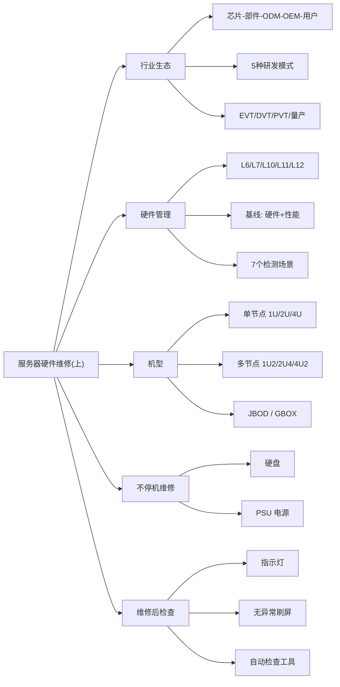

# 02 服务器硬件维修（一）：生态、机型与不停机维修

> 对应考纲：数据中心服务器硬件维修（15%，本文件约占 8%）
> 官方要求：了解基线管理及应用、了解常见机型特点、熟悉各部件维修方式与风险、熟悉维修后检查
> 本文件覆盖：行业生态 → 硬件分级 → 基线 → 机型 → 不停机维修（硬盘、电源）→ 维修后检查

---

## 知识地图



---

## 1. 服务器行业生态

### 1.1 产业链

```
晶元 → 芯片（IOT芯片/处理器/存储芯片）→ 部件（CPU、内存、HBA、HDD…）
     → ODM（广达、富士康、纬创、英业达）→ OEM（DELL、HP、联想、曙光）→ 用户
```

### 1.2 五种研发模式（高频考点 · 多选）

| 模式 | 含义 | 特点 |
| --- | --- | --- |
| OEM 模式 | 贴牌：品牌商设计/定义，代工厂生产 | 品牌与服务由 OEM 负责 |
| ODM 模式 | 代工厂设计并生产，品牌方贴牌 | 研发在制造方 |
| 定制模式 | 用户提出需求，厂商按需定制 | 贴合业务，规格收敛 |
| 自研模式 | 用户自己设计（含主板、整机） | 掌控力最强，门槛最高 |
| OCP 开源模式 | 基于开放计算项目标准，开源硬件设计 | 生态共享、降低成本 |

> 考法：给出一个场景问属于哪种模式；或者多选「服务器研发模式包括哪些」。

### 1.3 产品研发与运维介入节奏

| 阶段 | 含义 | 运维动作 |
| --- | --- | --- |
| EVT（Engineering Validation Test） | 工程验证：实验室样机 | **运维前期介入** |
| DVT（Design Validation Test） | 设计验证：实验室/灰度 | 运维前期介入 |
| PVT（Production Validation Test） | 生产验证：灰度 | 运维正式介入 |
| 量产 / 规模交付 | 大规模交付 | 运维正式介入 |

- 产品引入：实验室 → 实验室/灰度 → 灰度 → 规模
- 产品交付：实验室样机 → 交付 → 大规模交付

**要点**：运维不是等设备到了才介入，**EVT 阶段就要介入**（提可维护性需求、定基线、定备件策略）。

### 1.4 服务器硬件分级（高频考点 · 单选）

行业用 Level 逐级定义组件：

| 等级 | 定义 |
| --- | --- |
| L6 | 集成主板到机箱，可点亮测试 |
| L7 | 组装进机箱，整合 CPU、内存、HDD 等，进入系统测试 |
| L10 | 完全组装完成，含软件灌装、使用手册，可交付用户 |
| L11 | 整机服务器 + 机架的整机柜 |
| L12 | 整机柜 + 集成的交换机 |

> 记忆：**L6 能亮 → L7 能进系统 → L10 能交付 → L11 整柜 → L12 整柜带交换机**。

---

## 2. 服务器硬件管理：基线

### 2.1 基线是什么

基线定义了服务器的**基本标准**（硬件组成基线 + 性能基线），用于在各种场景下对服务器进行检测。

| 基线类型 | 内容 |
| --- | --- |
| 硬件组成基线 | 应该有哪些部件、什么型号、什么数量、在什么槽位 |
| 性能基线 | 该配置下应达到的性能水平 |

### 2.2 基线检测的 7 个场景（高频考点 · 多选）

**工厂、新装、重装、搬迁、改配、下线、线上**

### 2.3 基线的两大用途（必考）

| 用途 | 做法 |
| --- | --- |
| 故障检测 | 把服务器**实际硬件配置**与基线硬件配置比对，不一致则可能存在硬件故障（如内存少了一根、硬盘不在位） |
| 维修后检测 | 比对基线硬件配置版本，检查**新硬件是否被识别、型号是否正确** |

> 一句话：基线就是服务器的「体检标准值」，偏离标准值就是故障线索。

---

## 3. 服务器机型

### 3.1 机架服务器分类

| 类型 | 说明 | 常见规格 |
| --- | --- | --- |
| 单节点 | 每台设备是一台独立服务器，按高度分 | 1U、2U、4U |
| 多节点 | 一台设备含多个服务器节点，**多个节点共用电源** | 1U2、2U4、4U2 |

> 多节点是维修风险点：关机后**只抽故障节点**，不能动同框其他节点。

### 3.2 服务器背面板（认识接口，考图标记）

| 序号 | 部件 | 序号 | 部件 |
| --- | --- | --- | --- |
| 1 | 后置硬盘槽 | 8 | 指示灯 |
| 2 | PSU1 | 9 | IPMI 管理接口 |
| 3 | PSU2 | 10 | SFP+1 |
| 4 | ID 灯及按键 | 11 | SFP+2 |
| 5 | USB 接口 | 12 | 系统状态灯 |
| 6 | 网络卡子接口 | 13 | 电源开机键 & 电源状态灯 |
| 7 | VGA 接口 |  |  |

### 3.3 服务器正面板

| 序号 | 部件 |
| --- | --- |
| 1 | 左挂耳（USB 接口） |
| 2 | 右挂耳（按键及状态灯） |
| 3 | 前置硬盘槽 |

### 3.4 服务器内部组成

三大部分：**主板及相关部件、风扇、硬盘背板及硬盘槽**。

机箱内接线只有两类：

| 线缆 | 连接对象 |
| --- | --- |
| 数据线 | 硬盘、硬盘背板、USB、电源按钮、指示灯等 |
| 电源线 | CPU、硬盘、风扇、PCIe 设备 |

### 3.5 特殊机型（易混，必考）

| 机型 | 用途 | 特征 |
| --- | --- | --- |
| JBOD | JBOD 存储架构 | 高密度存储设备；**大量硬盘槽位**；高性能 I/O 模块；高带宽网卡 |
| GBOX | 图形计算、深度学习 | **大量 PCIe 插槽**，可装多张 GPU 卡 |

> 记忆：**J 看盘（Just a Bunch Of Disks），G 看卡（GPU Box）**。

---

## 4. 维修概述

### 4.1 维修目标与方式

服务器维修的主要目标是**快速恢复设备正常运行**，因此常用方式是**更换备用部件**（换件，不是修件）。

### 4.2 部件按维修方式分类（高频考点 · 多选）

| 类别 | 部件 |
| --- | --- |
| **不停机维修**（可热插拔） | **硬盘**（非系统盘）、**电源（PSU）** |
| **停机维修** | **CPU、内存、风扇、PCI（PCIe 卡）、硬盘背板、网卡** |

> 只记两个不停机：**盘和电**。其余全是停机。

### 4.3 工具与防护

- 防静电手套、防静电手环、防静电台布
- 螺丝刀

> 注意：**CPU 拆卸时不戴防静电手套**（手套纤维会挂弯针脚），见第 03 章。

---

## 5. 不停机维修

### 5.1 硬盘维修（非系统盘）

#### 拆装注意事项（8 条，多选高频）

1. 核对设备 SN 等信息
2. 硬盘更换**以槽位信息为准**
3. **严禁不核对槽位直接拔故障灯亮的硬盘**
4. **不是所有硬盘都支持热插拔**（PCIe 与 M.2 不支持）
5. 更换硬盘的**大小必须相同**
6. 更换硬盘的**类型必须为同一类型**
7. 不同品牌同类型替换关系由 **CPU 平台**决定
8. **拆除下的硬盘必须确认 SN**

> 为什么「不能看灯拔盘」：硬盘指示灯可能由背板/RAID 卡驱动，槽位映射与实际物理位置可能不一致；拔错盘会造成业务数据丢失。正确做法是先按槽位定位、再核对 SN。

#### 硬盘指示灯（必须记住）

| 指示灯 | 状态 | 含义 |
| --- | --- | --- |
| 硬盘活动状态灯 | 常亮绿色 | 正常 |
|  | 绿色闪烁 | 正在读写 |
| 硬盘故障报警灯 | **常亮红色** | 硬盘故障 |
|  | **常亮蓝色** | 硬盘定位（定位灯，不是故障） |

> 陷阱：蓝色是**定位**，不是故障。多选里常把「蓝灯=故障」作为错误项。

### 5.2 电源（PSU）维修

#### 注意事项（多选高频）

1. 核对设备 SN 信息
2. 戴好防静电手环
3. **新领取的电源模块需在墙电处测试**（先验证备件是好的，避免二次上架）
4. 全程避免触碰其他设备电源线
5. 根据电源指示灯查看电源模块工作状态
6. 根据**电源线标签**判断电源槽位
7. 如遇电源指示灯正常，可**暂缓更换**，报备后再操作
8. 操作前先检查电源线是否插紧
9. **拔出故障电源前，先紧固另一块电源模块**（保证单路供电稳定）
10. 避免暴力操作

> 逻辑链：确认备件好 → 确认另一路稳 → 再拔故障件。这是「先保命再手术」。

---

## 6. 维修后检查（不停机维修）

三件事：

1. **看灯**：带内网卡、OOB 网卡指示灯正常；服务器健康灯（BMC、内存、硬盘等）正常；电源指示灯正常
2. **看屏**：服务器需在系统或无盘系统中，检查没有异常刷屏打印
3. **跑工具**：执行自动检查工具

> 「异常刷屏」= 内核报错、MCE、磁盘错误在屏幕上反复打印，是硬件仍有问题的直接证据。

（停机维修的检查项更多，见第 03 章。）

---

## 7. 本章速记

- 产业链：**芯片 → 部件 → ODM → OEM → 用户**
- 五模式：**OEM、ODM、定制、自研、OCP**
- 五分级：**L6 亮、L7 系统、L10 交付、L11 整柜、L12 带交换机**
- 基线 7 场景：**工厂、新装、重装、搬迁、改配、下线、线上**
- 不停机只有：**硬盘、电源**
- 硬盘灯：**绿常亮正常 / 绿闪读写 / 红故障 / 蓝定位**

---

## 8. 高频考点清单

| 考点 | 出题方式 |
| --- | --- |
| 五种研发模式 | 多选 |
| L6–L12 含义 | 单选匹配 |
| 基线用途（故障检测 / 维修后检测） | 单选场景题 |
| 基线 7 场景 | 多选 |
| 多节点机型（1U2/2U4/4U2）共用电 | 单选 |
| JBOD vs GBOX | 单选 |
| 不停机部件清单 | 多选（混入内存、风扇作干扰） |
| 硬盘更换注意事项 | 多选 |
| 硬盘指示灯（蓝=定位） | 单选 |
| PSU 更换顺序（先紧固另一块） | 单选排序 |
