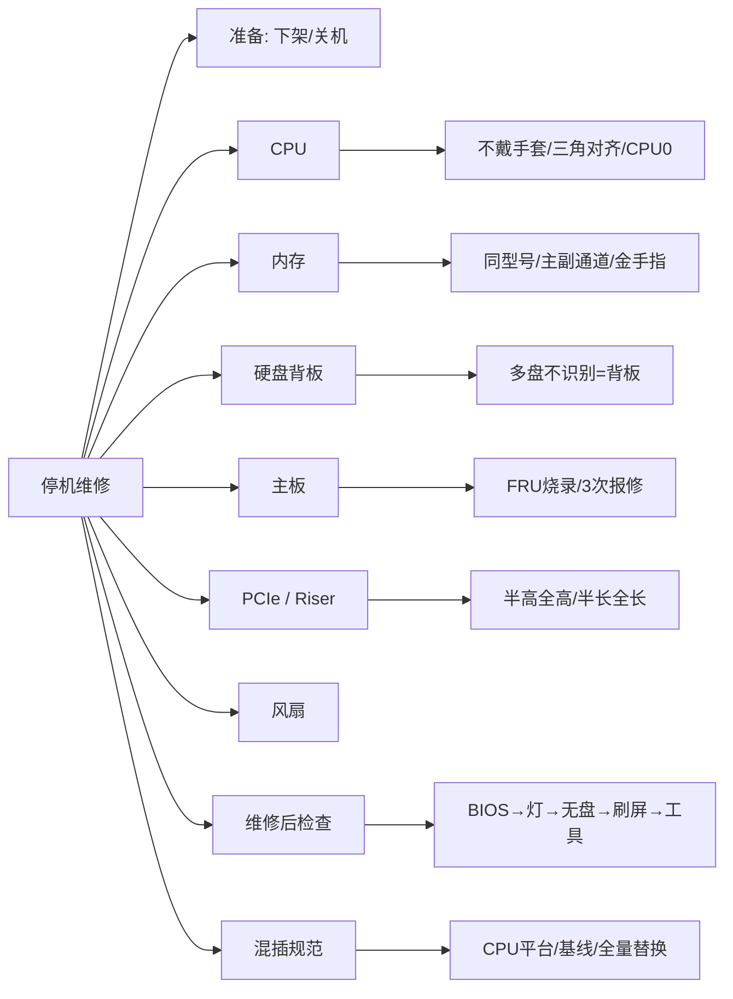

# 03 服务器硬件维修（二）：停机维修与混插规范

> 对应考纲：数据中心服务器硬件维修（15%，本文件约占 7%）
> 官方要求：熟悉服务器各部件维修方式、维修注意事项与风险、维修后检查
> 本文件覆盖：停机维修准备 → CPU → 内存 → 硬盘背板 → 主板 → PCIe → 风扇 → 维修后检查 → 混插规范
> 学习方式：这一章**全是操作细节和禁忌**，考试喜欢用「以下做法正确的是/错误的是」来考

---

## 知识地图

---

## 1. 停机维修准备

### 1.1 标准动作

1. **设备下架**：核对设备位置与 SN → 拆除外部线缆（电源线、网线）→ 将设备下架至**指定维修地点**
2. **拆卸机箱盖**
3. **拆卸导风罩**

### 1.2 四条红线（高频考点 · 多选）

| 红线 | 原因 |
| --- | --- |
| 服务器关机**必须通过 power button 按键**，不得直接拔电源线 | 直接断电会损伤文件系统/硬件，且无法正常通知业务 |
| 关机后**需拔出网线、电源线**，下架至指定位置维修 | 防止带电操作、误触业务网络 |
| **多节点服务器只抽故障节点**，不得操作同框其他节点 | 同框节点共用电源，动其他节点会扩大故障面 |
| 预约维修的关机操作**由业务方完成**，需在规定时间内完成维修 | 现场运维无权擅自停业务 |

> 「预约维修」是典型场景题：业务方关机、运维在时间窗内修完，超时要重新预约。

---

## 2. CPU 维修

### 2.1 拆卸

- 拆散热器 → 拆 CPU 固定板 → 取出 CPU
- **进行 CPU 更换操作时不可戴防静电手套**（手套可能挂到 CPU 底座插针，导致针脚弯曲）
- 拆卸下的 CPU 需放入**防静电包装袋**

### 2.2 安装五步与要点（高频考点）

| 步骤 | 要点 |
| --- | --- |
| 1. 检查底座 | 确保底座**无弯针及污染** |
| 2. 放入 CPU | **保持水平、垂直向下**插入插座 |
| 3. 防呆对齐 | CPU 上**三角形的一角**对准底座上三角形的一角 |
| 4. 纠错方式 | CPU 未放正时**禁止水平移动**（会倒针）；需先**垂直向上提起**脱离插座，再重新放入 |
| 5. 装散热器 | 散热器表面清洁；CPU 上**均匀涂抹散热硅脂** |

### 2.3 五条注意事项（必背）

1. 安装多颗 CPU 时，**多颗 CPU 型号必须相同**
2. 多插槽只装一颗 CPU 时，**必须装在 CPU0 插槽**（若主板编号从 CPU1 开始，则装 CPU1）
3. CPU 底座针脚容易变形，安装过程中**不可触碰针脚**
4. 注意**缺口位置与三角形标识**，防止 CPU 装反
5. 如遇 **CPU 温度异常，先更换硅脂**，再看温度是否恢复

> 记忆：**同型号、CPU0、不碰针、看三角、先换脂**。

---

## 3. 内存维修

### 3.1 六条注意事项（多选高频）

1. 同一台服务器**只能使用相同型号内存**
2. **内存与 CPU 位置相对应**（哪颗 CPU 的内存插哪一组）
3. 更换内存时需**根据主板上的丝印**确认内存槽位
4. **先插主通道，再插副通道**
5. 安装时注意**缺口位置**，不可暴力操作
6. 操作过程**严禁触碰金手指**

> 内存故障的典型现象：系统识别容量少于基线（例如基线 16 条、实际识别 15 条）→ 正是「基线比对」能发现的问题。

---

## 4. 硬盘背板维修

### 4.1 什么时候怀疑背板（关键判断）

| 现象 | 可能原因 |
| --- | --- |
| 硬盘更换后**无法识别新硬盘** | 背板故障 |
| **多个硬盘同时不识别** | 背板故障 |
| 单块硬盘不识别且换盘后正常 | 硬盘本身 |

**与硬盘维修的本质区别：背板维修必须关机。**

### 4.2 四条注意事项

1. 更换前检查**故障件与备件型号、硬盘接口类型、电源接口类型**是否完全一致
2. 拆除背板前**需拆除所有硬盘**
3. **硬盘物理盘位更换前后必须保持一致**（否则槽位映射全乱）
4. 更换完成后**需测试硬盘是否正常识别**

---

## 5. 主板维修

### 5.1 拆卸顺序（理解为主）

1. 打开机盖后，**用手机拍下主板各部件的位置**（防装回时接错线）
2. 拆卸所有外部线缆（电源线、网线）→ 拆机箱盖 → 拆 Riser 卡 → 拆导风罩 → 拆风扇模块 → 拔出连接到主板的所有线缆 → 拆所有 DIMM、CPU、电源模块
3. 用螺丝刀拧开主板固定螺钉
4. 将主板**往风扇方向推到不动为止**，再通过**主板提手**抬起主板

### 5.2 安装顺序

1. 从静电袋取出主板，通过提手放入机箱，拧紧固定螺丝
2. **最小化测试**：先只装最小部件，验证主板可用
3. 还原各部件
4. **进行 FRU 信息烧录**（新主板必须写入资产/序列信息，否则资产系统对不上）

### 5.3 六条注意事项（高频考点）

1. 禁止触碰各部件**金手指、CPU 针脚和插座触点**
2. **严禁通过主板上的任何突出器件向上提起主板**（会掰坏元器件）
3. 主板接口多，更换时**一定要移除所有部件和线缆**
4. 有的主板**螺丝固定**，有的**卡扣固定**，注意观察
5. **任何故障的同一槽位报修三次或三次以上，尝试排查更换主板**
6. **部分网卡集成在主板上，更换网卡即更换主板**

> 第 5 条是「排除法」的工程经验：同一位置反复坏，说明问题在主板（供电/走线），不在部件。

---

## 6. PCIe 维修

### 6.1 常见 PCIe 设备

**网卡、GPU / FPGA / MOC、SSD、RAID/SAS 卡**

### 6.2 Riser（转接卡）

- PCIe 接口扩展卡，可把主板上的一个 PCIe 接口扩展为多个
- 若故障板卡位于 Riser 上，需**先拆 Riser，再从 Riser 上拆故障板卡**

### 6.3 PCIe 插槽尺寸（数字题）

| 规格 | 上限 |
| --- | --- |
| 半高（low profile） | ≤ 68.9 mm |
| 全高 | ≤ 111.15 mm |
| 半长 | ≤ 167.65 mm |
| 全长 | ≤ 312.00 mm |

> 记忆：高 68.9 / 111.15，长 167.65 / 312。数字不必死背全部，但「半高 < 全高、半长 < 全长」和 312 这个全长上限要认得。

---

## 7. 风扇维修

- 风扇模块化，直接拆装更换
- 风扇属于**停机维修**部件（不在热插拔清单里）
- 多风扇机型注意：拆装时避免碰到相邻风扇与线缆

---

## 8. 维修后检查（停机维修，必考五步）

按顺序：

1. **进 BIOS**：检查内存、硬盘、网卡、RAID 卡、CPU **识别正常**，BIOS 选项设置正确
2. **看指示灯**：带内网卡、OOB 网卡指示灯正常；服务器健康灯（BMC、内存卡、硬盘等）正常；电源指示灯正常
3. **必须正常进无盘**，停留在 **RAMOS 界面**，检查没有异常刷屏打印
4. 如果进不了无盘系统，**尝试进系统**，停留在 **login 界面**，检查没有异常刷屏打印
5. **执行自动检查工具**

> 与不停机维修的检查相比，停机维修多了「BIOS 识别」与「进无盘/进系统」两道关。多选题常把「只需看指示灯」当错误项。

---

## 9. 混插规范（易考、易错）

在对硬盘、内存进行维修时，如遇到现有备件与原故障件型号不一致，**视情况**进行混插：

1. **是否能混插与 CPU 平台相关**
2. **混插备件需在基线范围内**
3. 如不允许混插且无备件，可采用**全量替换**方式

> 「全量替换」= 把一组（如整个通道的内存、整组硬盘）统一换成同型号，而不是单根混着插。这样虽然成本高，但能保证性能与稳定性。

---

## 10. 本章速记

- 关机：**按键关机，不拔线**；多节点**只抽故障节点**
- CPU：**不戴手套、三角对齐、垂直插拔、同型号、CPU0、温度异常先换硅脂**
- 内存：**同型号、对 CPU、看丝印、先主后副、不碰金手指**
- 背板：**多盘不识别 = 背板；必须关机；拆前拔盘；盘位不变**
- 主板：**先拍照、推到底、提手提、最小化测试、FRU 烧录、同槽 3 次换主板**
- PCIe：**Riser 先拆后拆卡**；半高 68.9 / 全高 111.15 / 半长 167.65 / 全长 312
- 检查：**BIOS → 灯 → 无盘 RAMOS → 系统 login → 自动工具**
- 混插：**看 CPU 平台、在基线内、不行就全量替换**

---

## 11. 高频考点清单

| 考点 | 出题方式 |
| --- | --- |
| 停机维修关机方式 | 单选「正确做法」 |
| 多节点维修范围 | 单选场景 |
| CPU 不可戴防静电手套 | 单选/多选 |
| CPU 单颗安装槽位 | 单选 |
| CPU 温度异常处理顺序 | 单选 |
| 内存插法（先主后副） | 单选 |
| 判断背板故障 | 单选场景 |
| 主板 FRU 烧录 | 单选 |
| 同一槽位 3 次报修 | 单选 |
| PCIe 尺寸数值 | 单选 |
| 停机维修后检查顺序 | 多选/排序 |
| 混插三原则 | 多选 |
