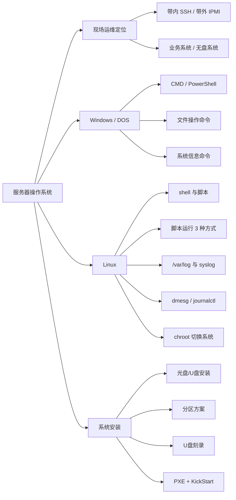

# 04 数据中心服务器操作系统

> 对应考纲：数据中心服务器操作系统（10%）
> 官方要求：了解 Windows 与 DOS 命令行基础、熟悉 Windows 常用命令、了解 Linux 脚本概念、掌握脚本运行方法、熟悉日志管理、掌握查看日志方法、熟悉系统安装方法与流程
> 本章特点：命令多、参数多，但考试只考**用途与差别**，不考冷门参数

---

## 知识地图



---

## 1. 操作系统与 IDC 现场运维

### 1.1 运维的两条通道

| 通道 | 协议/入口 | 依赖 | 典型用途 |
| --- | --- | --- | --- |
| 带内（in-band） | SSH | 依赖服务器系统运行状态 | 登业务系统/无盘系统排查 |
| 带外（out-of-band） | IPMI（BMC） | 只要通电即可 | 开关机、看传感器、远程 KVM |

现场运维的日常路径：网页/命令行访问 BMC → 远程登录无盘系统 → 在无盘系统里挂载业务盘排查。

### 1.2 两种运行模式（关键概念）

| 模式 | 位置 | 用途 | 现场运维权限 |
| --- | --- | --- | --- |
| 业务系统 | 本地硬盘 | 运行业务 | **无权登录** |
| 无盘系统 | 远程获取（PXE） | 拥有各种运维工具，日常运维使用 | 可登录 |

**关系**：业务系统所在硬盘被视为**普通硬盘挂载在无盘系统下**。所以维修后可以先在无盘里验证硬件，再交回业务。

---

## 2. Windows 与 DOS 命令行

### 2.1 基础概念

- **DOS**（Disk Operating System，磁盘操作系统）：面向磁盘的系统软件，是人与机器之间的「外壳」
- Windows 早期以 DOS 为内核的 32 位保护模式应用，后来形成独立内核，但**保留了 DOS 的命令行习惯**，因此 CMD 的命令与 DOS 非常近似
- Windows 命令行通过 **CMD、PowerShell** 等组件进行；**命令本质上是应用程序**

### 2.2 命令的两种执行方式（考点）

| 方式 | 说明 |
| --- | --- |
| 通过名称执行 | 系统在**环境变量 PATH** 对应的文件夹中自动搜索命令文件并执行 |
| 通过完整路径执行 | 直接给出应用程序完整路径，绕过 PATH 搜索 |

> 所以「命令找不到」的经典原因是：程序不在 PATH 里 → 用完整路径即可。

### 2.3 常用命令

#### 文件/文件夹操作（多选高频）

| 命令 | 作用 |
| --- | --- |
| `dir` | 显示文件夹下的文件与子文件夹列表及详细资料（大小、创建时间等） |
| `copy` | 复制一个或多个文件到另一位置 |
| `move` | 移动文件/文件夹（**移动会从源位置删除**，这是与 copy 的本质区别） |
| `md` / `mkdir` | 新建文件夹 |
| `cd` | 改变当前文件夹 |
| `ren` | 重命名文件或文件夹 |
| `del` | 删除目录中的**文件** |
| `rd` / `rmdir` | 删除**文件夹** |
| `help` | 查看命令帮助信息 |

#### 系统信息查看（必考）

| 命令 | 作用 |
| --- | --- |
| `ipconfig` | 查看网卡配置 |
| `ping` | 验证网络连通性 |
| `netstat` | 查看网络连接状态 |
| `tracert` | 路由跟踪 |
| `chkdsk` | 检测硬盘使用情况 |

> 易错：`del` 删文件、`rd` 删文件夹；`netstat` 看连接、`tracert` 看路径。

---

## 3. Linux 命令行与脚本

### 3.1 shell

- Linux 命令行与 Windows 基本一致：**所有运行的命令均为应用程序**
- Linux 的命令行「组件」统称为 **shell（命令解释器）**，负责把用户输入的命令翻译为内核能识别的指令
- 常见 shell：**sh、bash、csh** 等（课件列出 sh、bash、csh、bcsh）
- **脚本** = 多条命令的集合，执行时按顺序执行

### 3.2 脚本的三个组成部分（必考）

| 部分 | 写法 | 作用 |
| --- | --- | --- |
| 首行 | `#!` 开头 | 指明脚本运行的 **shell 环境**（如 `#!/bin/bash`） |
| 注释 | `#` 开头 | 注释信息，不参与运行 |
| 内容 | 可执行命令 | 默认**从上至下顺序执行** |

> 注意区分：`#!` 是首行解释器声明，`#` 是注释。

### 3.3 脚本运行的三种方式（高频考点，重点考「是否需要执行权限」）

| 方式 | 示例 | 是否需要执行权限 | 特点 |
| --- | --- | --- | --- |
| 直接执行 | `/root/test.sh` 或 `./test.sh` | **需要**（`chmod +x`） | 在**子 shell** 中运行 |
| 指定解释器 | `bash /root/test.sh`、`sh /root/test.sh` | **不需要** | 在子 shell 中运行 |
| source | `source /root/test.sh` | **不需要** | 在**当前 shell** 中运行（变量/环境会保留） |

> 考法：给一个「脚本没有执行权限」的场景，问哪种方式仍能运行 → bash/sh/source。
> 进阶：`source` 与 `bash` 的差别在于是否影响当前 shell 环境。

---

## 4. Linux 日志管理

### 4.1 日志目录：`/var/log`（必背）

| 文件 | 内容 |
| --- | --- |
| `/var/log/message` | 系统信息日志，包含错误信息等（最常看） |
| `/var/log/secure` | 系统登录日志 |
| `/var/log/cron` | 定时任务日志 |
| `/var/log/maillog` | 邮件日志 |
| `/var/log/boot.log` | 系统启动日志 |

### 4.2 syslog 的两个维度

Linux 一般通过 **syslog 服务**管理日志，从两个方向记录：

- **日志类别（facility）**：描述日志与哪些动作相关
- **日志级别（level/priority）**：描述日志的紧急程度

#### 日志类别（facility）

| 类别 | 含义 |
| --- | --- |
| auth | 身份认证日志（登录系统） |
| authpriv | ssh、ftp 等认证日志 |
| cron | 计划任务相关日志 |
| kern | 内核日志 |
| lpr | 打印服务日志 |
| mail | 邮件服务日志 |
| news | 新闻组信息 |
| user | 用户程序产生的日志 |
| daemon | 守护进程相关日志 |
| uucp | uucp 程序相关日志 |
| local1–local7 | 自定义日志 |

#### 日志级别（level，从高到低）

| 级别 | 含义 |
| --- | --- |
| emerg | 系统无法使用（最紧急） |
| alert | 紧急状态，需立即处理 |
| crit | 重要信息（课件写作 cirt，为笔误） |
| err | 报错信息 |
| warning | 警告信息 |
| notice | 提示信息 |
| info | 普通信息 |
| debug | 调试信息（最详细） |
| none | 无需记录 |

> 记忆：**emerGency → alert → critical → error → warning → notice → info → debug**，越往下越「啰嗦」。数字表示时 0 最紧急、7 最详细。

### 4.3 两个查看命令（必考参数）

#### dmesg：查看系统启动日志

```bash
dmesg [options...]
```

| 用法 | 含义 |
| --- | --- |
| `dmesg` | 显示所有启动日志 |
| `dmesg -l 3` | 显示指定级别日志（数字 1~7 对应 emerg~debug） |
| `dmesg | grep sda` | 显示与指定设备相关的日志 |

#### journalctl：查看系统所有日志（systemd）

```bash
journalctl [options...]
```

| 选项 | 含义 |
| --- | --- |
| `-b` | 查看启动日志（本次启动） |
| `-n` | 查看最新 N 行（默认 10 行） |
| `-p` | 查看指定级别日志，如 `-p err` |
| `--since` | 查看指定时间之后的日志 |
| `--until` | 查看指定时间之前的日志 |
| `-u` | 查看指定 **unit** 的日志，如 `-u nginx.service` |

> 易错：`-u` 是 unit（服务单元），不是 user。

### 4.4 无盘系统与业务系统切换：chroot

```bash
chroot <Document>    # 切换系统根目录
```

- 作用：使当前系统使用新的根目录
- 前提：**新的根目录下需具备用户登录环境**（用户家目录、shell 等）
- 现场用法：在无盘系统中 `chroot` 到已挂载的业务系统盘，从而修改业务系统的配置（如网卡 MAC、fstab）

**典型场景**：换网卡后网络不通 → 进无盘 → 挂载业务盘 → `chroot` → 改网卡配置文件里的 MAC → 重启网络。

---

## 5. 操作系统安装

### 5.1 光盘 / U 盘安装流程（CentOS 7 为例）

1. BOOT 菜单选择 U 盘或光驱启动
2. 安装菜单选择：
   - `Install CentOS 7`：直接安装
   - `Test this media & install CentOS 7`：**先检测镜像完整性**再安装
3. 选择安装界面语言
4. 配置项：
   - `DATE & TIME`：系统时间、时区
   - `KEYBOARD`：键盘类型
   - `LANGUAGE SUPPORT`：系统语言
   - `INSTALLATION SOURCE`：安装来源
   - `SOFTWARE SELECTION`：软件环境（左侧预设环境，右侧可选软件）
   - `INSTALLATION DESTINATION`：硬盘分区
5. `Begin Installation` 开始安装 → 设置账户密码 → 等待完成

### 5.2 默认分区方案（高频数字题）

| 分区 | 类型 | 大小 |
| --- | --- | --- |
| `/boot` | **MBR 分区** | 512M |
| `swap` | LVM 分区 | **与系统内存大小相同** |
| `/` | MBR 分区 | 剩余所有空间 |

**注意事项**：

1. 多硬盘设备分区时需**选择正确的系统盘**
2. 系统盘容量 **大于 2T** 时，注意把硬盘类型改为 **GPT**
3. **`/boot` 只能使用 MBR 或 GPT 分区**（不能放 LVM）

> 这三条几乎每年都出：swap = 内存大小、>2T 用 GPT、/boot 不能 LVM。

### 5.3 U 盘刻录

| 平台 | 步骤 |
| --- | --- |
| Windows | ① 将 U 盘格式化为 **FAT32** ② 用 **Win32 Disk Imager** 把镜像刻录进 U 盘 |
| Linux | ① 删除 U 盘所有分区，格式化为 **FAT32（VFAT）** ② 用 **dd** 命令刻录 |

### 5.4 PXE 无人值守安装（重点）

**PXE（Preboot eXecution Environment）** 是 Intel 设计的协议，可使计算机**通过网络启动**。

三大用途：远程批量安装系统、无盘系统、远程启动特定系统。

#### 五个软件组件（必背）

| 组件 | 作用 |
| --- | --- |
| **DHCP** | 分配网卡信息，并**指引客户端去哪里取引导文件**（next-server + filename） |
| **TFTP-Server** | 提供驱动及**引导文件**的传输 |
| **SYSLinux** | 提供引导文件（`pxelinux.0`、`pxelinux.cfg/default`） |
| **HTTPD（Apache）** | 提供**完整的镜像**传输 |
| **KickStart** | 提供安装过程中选项的**问答应答**（ks.cfg） |

#### 引导顺序


#### 关键配置文件

| 组件 | 配置文件 | 关键点 |
| --- | --- | --- |
| DHCP | `/etc/dhcp/dhcpd.conf` | `next-server <TFTP地址>`；`filename "pxelinux.0"`；地址池 `range` |
| TFTP | `/etc/xinetd.d/tftp` | `server_args = -s /var/lib/tftpboot`；`disable = no` |
| SYSLinux | `/var/lib/tftpboot/pxelinux.cfg/default` | `kernel vmlinuz`；`append initrd=initrd.img inst.stage2=http://... ks=http://.../ks.cfg` |
| HTTPD | 工作目录 | 把镜像所有文件复制到 httpd 工作目录 |
| KickStart | `~/anaconda-ks.cfg` | 复制到 httpd 工作目录的 `pub` 下，内容即安装选项 |

> 考点：`next-server` 指向 TFTP 服务器；`filename` 指明引导文件名；KickStart 解决「安装过程中的交互问答」。

---

## 6. 本章速记

- 两条通道：**带内 SSH（靠系统）、带外 IPMI（靠 BMC）**
- 两种模式：**业务系统（无权登录）、无盘系统（运维日常）**
- Windows：**del 删文件 / rd 删目录；netstat 看连接 / tracert 看路径**
- Linux 脚本：**#! 首行、# 注释、顺序执行**；运行三法 **./ 需权限、bash 不需、source 当前 shell**
- 日志：**message、secure、cron、maillog、boot.log**
- 级别：**emerg→alert→crit→err→warning→notice→info→debug**
- 命令：**dmesg -l、journalctl -b/-n/-p/--since/--until/-u**
- 分区：**/boot 512M MBR、swap=内存、/ 剩余；>2T 用 GPT**
- PXE：**DHCP → TFTP → HTTP；五件套 dhcp/tftp/syslinux/httpd/kickstart**

---

## 7. 高频考点清单

| 考点 | 出题方式 |
| --- | --- |
| 带内/带外区别 | 单选 |
| Windows 命令用途匹配 | 单选/多选 |
| 命令两种执行方式（PATH） | 单选 |
| 脚本三要素 | 多选 |
| 三种运行方式与执行权限 | 单选/多选 |
| /var/log 文件用途 | 单选匹配 |
| 日志级别顺序 | 单选排序 |
| dmesg / journalctl 参数 | 单选 |
| chroot 作用与前提 | 单选 |
| 分区方案数字 | 单选 |
| U 盘刻录工具 | 单选 |
| PXE 五组件与引导顺序 | 多选/排序 |
