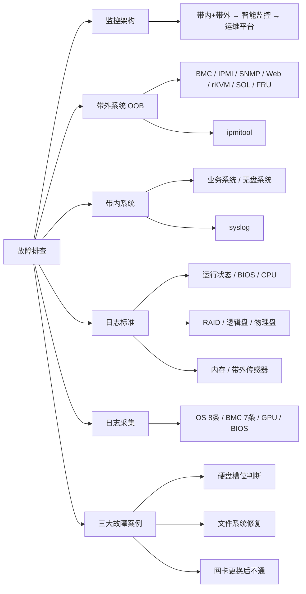
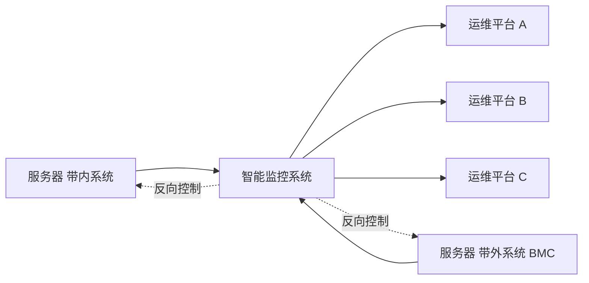

# 05 数据中心服务器故障排查

> 对应考纲：数据中心服务器故障排查（15%）
> 官方要求：了解服务器监控架构、熟悉带外/带内系统常用功能、熟悉设备日志标准、掌握提取日志常用命令、熟悉常用运维工具及场景
> 本章特点：**15% 的高权重 + 强实操性**，三个故障案例几乎必考

---

## 知识地图



---

## 1. 数据中心服务器监控架构

整体链路：



- 依赖**带内 + 带外两套系统**采集所有服务器信息，汇总到智能监控系统
- 数据经智能监控系统处理后**分发至各个运维平台**供工程师使用
- 同时也可通过两套系统对服务器进行**控制操作**（开机、关机、重置）

**为什么要两套**：带外不依赖操作系统，服务器宕机/装系统时仍可用；带内能拿到 OS 级信息（进程、文件系统、业务日志），两者互补。

---

## 2. 带外管理系统（OOB）

### 2.1 定义与依赖

**带外（Out of Band，OOB）** 是从带外网向服务器远程下发指令的通道。**无论服务器开机还是关机，只要接通电源就可以监控和管理**。带外管理的实现主要依赖 **BMC**。

### 2.2 BMC 提供的能力（多选高频）

| 能力 | 说明 |
| --- | --- |
| IPMI | 工业标准管理接口（命令行/协议） |
| SNMP | 简单网络管理协议，供监控平台采集 |
| Web GUI | 浏览器图形界面 |
| rKVM | 远程键盘/鼠标/视频（远程控制台） |
| SOL | Serial Over LAN，串口重定向 |
| FRU | 现场可更换单元信息（资产信息） |
| LAN | 带外网口 |

### 2.3 Web UI 能看什么

保持计算机与 BMC 在同一网络中，浏览器输入 BMC 网卡 IP 即可登录：

- **传感器（Sensor）** 监控信息：温度、电压、风扇转速、功率
- **日志（Logs & Reports）**：SEL 系统事件日志
- **远程控制（Remote Control）**：开关机、重启、挂载镜像

### 2.4 ipmitool（重点，考命令用途）

通用格式：

```bash
ipmitool -H <BMC_IP> -I lanplus -U <用户名> -P <密码> <子命令>
```

| 子命令 | 作用 |
| --- | --- |
| `power status` | 查看开关机状态 |
| `power on` | 开机 |
| `power off` | 关机 |
| `power reset` | 重启 |
| `lan print [ChannelNo]` | 查看网络信息 |
| `lan set <Ch> ipsrc <static/dhcp>` | 设置 IP 获取方式 |
| `lan set <Ch> ipaddr <IP>` | 修改 IP 地址 |
| `lan set <Ch> netmask <Mask>` | 修改子网掩码 |
| `sel list` | 查看 SEL 日志 |
| `fru list` | 查看 FRU 信息 |
| `sensor list` | 查看传感器信息 |

> 记忆：**power 管电、lan 管网、sel 看事件、fru 看资产、sensor 看环境**。

---

## 3. 带内系统（in-band）

- **定义**：远程管理与业务系统使用**同一套通信网络**
- **依赖**：服务器系统运行状态（正常/故障）；故障状态下带内功能会受影响
- **两种运行模式**（见第 04 章）：
  - **业务系统**：服务器正常运行状态，通过 **syslog** 传递日志
  - **无盘系统**：用于维修、改配后的验证，或故障时排查；运行时也可通过 syslog 传递日志

> 带内与带外的根本差别：**带外只要通电，带内必须系统活着**。

---

## 4. 日志标准（考「字段属于哪个部件」）

日志标准通过对**监控字段标准值**的设定，在自动判断设备故障中起重要作用。核心思路：字段 + 参考值 → 偏离即异常。

### 4.1 系统运行状态（running）

| 关键字 | 参考值示例 |
| --- | --- |
| uptime | `46 days, 21:23:52.250000` |
| uptime_seconds | `4051432.25` |

> 用途：判断是否发生**非预期重启**（uptime 忽然变小 = 重启过）。

### 4.2 BIOS

| 关键字 | 参考值示例 |
| --- | --- |
| bios_revision / version | 4.6 / 2.1 |
| firmware_revision | unknown |
| release_date | 03/24/2015 |
| rom_size | 4608 kB |
| vendor | American Megatrends Inc. |

### 4.3 CPU

| 关键字 | 含义 |
| --- | --- |
| cache_size / cores / family / model_id | 缓存、核数、家族、型号 ID |
| flags | 指令集标志列表 |
| hyper_threading | 是否超线程 |
| physical_id | 物理 CPU 编号（**定位哪颗 CPU**） |
| speed | 主频 |
| vendor | GenuineIntel 等 |

### 4.4 硬盘控制器（controller_info）

| 关键字 | 含义 |
| --- | --- |
| class / device / model | SATA controller / 芯片组型号 |
| driver_name / drive_version_current | ahci / 驱动版本 |
| slot | PCI 槽位（如 `00:1f.2`） |
| bios_version | RAID 卡固件版本 |
| controller_id / controller_state | 控制器编号与状态 |
| total_cache_size / write_policy | 缓存大小 / 写策略（WB） |

### 4.5 逻辑硬盘

| 关键字 | 含义 |
| --- | --- |
| diskname | 逻辑盘符，如 `/dev/sda` |
| logical_number | 逻辑编号（0:0） |
| pds | 组成该逻辑盘的物理盘列表（`[0:8:0,0:8:1]`） |
| size / stripsize / type | 容量 / 条带 / RAID 级别（RAID 5） |
| state | 状态（Optl = Optimal） |
| cache | 缓存策略 |

### 4.6 物理硬盘

| 关键字 | 含义 |
| --- | --- |
| did / slot | 设备 ID / **槽位**（如 `0:8:10`） |
| media_error_count | 介质错误计数 |
| other_error_count | 其他错误计数 |
| predictive_failure_count | 预测性故障计数 |
| drive_write_cache | 写缓存开关 |
| size / real_size | 标称/实际容量 |
| state | Onln（Online）等 |
| type | SSD_SATA 等 |

> **重点**：`media_error_count` 不为 0、`predictive_failure_count` 增长、SMART 告警 = 硬盘要坏。

### 4.7 内存

| 关键字 | 含义 |
| --- | --- |
| bank_locator / locator | **槽位定位**（Node0_Bank0 / Node0_Dimm0） |
| configured_clock_speed / speed | 配置频率 / 标称频率 |
| data_width / total_width | 64 / 72 bits（含 ECC） |
| manufacturer / part_number / serial_number | 厂商、料号、序列号（**备件匹配用**） |
| rank / size / type | 秩 / 容量 / DDR3 等 |

### 4.8 带外系统（传感器字段）

| 关键字 | 含义 |
| --- | --- |
| cpu*_temp / cpu_power | CPU 温度 / 功率 |
| chassis_power / total_power | 机箱/整机功率 |
| inlet_temp / outlet_temp | 进风/出风温度 |
| fan*_rpm | 风扇转速 |
| mem*_temp / mem_power | 内存温度/功率 |
| psu*_temp | 电源温度 |
| mb_12V | 主板 12V 电压 |
| wind_flow | 风流量 |

> 带外字段是**环境类**指标：温度、电压、转速、功率。CPU 利用率、磁盘 IO 不在这里。

---

## 5. 日志采集脚本（必背命令组）

### 5.1 采集操作系统日志

```bash
cat /etc/redhat-release      # 系统版本
uname -s -m -r               # 内核/架构/内核版本
dmesg                        # 启动与内核日志
cat /var/log/mcelog          # 硬件错误（MCE）
cat /var/log/kern            # 内核日志
cat /var/log/messages        # 系统信息日志
cat /proc/cpuinfo            # CPU 信息
dmidecode -t memory          # 内存硬件信息
```

### 5.2 采集 BMC 日志

```bash
ipmitool raw 6 1             # 原始命令：获取设备 ID
ipmitool sdr list            # 传感器数据记录
ipmitool fru                 # FRU 资产信息
ipmitool sel list            # 系统事件日志
ipmitool mc info             # BMC 自身信息
ipmitool sensor list         # 传感器当前值
ipmitool sel save <file>     # 保存 SEL 到文件
```

### 5.3 采集 GPU 日志

```bash
nvidia-smi                   # GPU 状态、温度、显存、ECC、掉卡
```

### 5.4 采集 BIOS 日志

```bash
dmidecode -t 0 | grep Version   # BIOS 版本
lspci -vvv                      # PCI 设备详细信息
lspci -xxxx                     # PCI 配置空间原始数据
```

> 考点：`mcelog` 对应硬件错误、`dmidecode -t memory` 对应内存、`lspci` 对应 PCIe 设备、`nvidia-smi` 对应 GPU。

---

## 6. 三大故障排查案例（必考）

### 6.1 案例一：硬盘槽位判断

**问题**：日志报错只给出盘符（如 `/dev/sdd`），无法确认物理槽位；**不能直接按盘符去拔盘**。

#### 路径 A：有 HBA 卡 / expander 卡的机型

```bash
# 1. 判断是否为 HBA 卡
lspci | grep -i -E 'LSI|SAS'

# 2. 获取故障硬盘 SN
smartctl -i /dev/sdd

# 3. 根据 SN 查槽位（按 HBA 卡版本选命令）
sas2ircu 0 display
sas3ircu 0 display
```

> 逻辑：**盘符 → SN → 槽位**。因为 HBA 直通模式下盘符与槽位没有稳定映射，只有 SN 是唯一标识。

#### 路径 B：RAID 卡机型

RAID 卡下**逻辑盘符与物理硬盘槽位不是一一对应**，必须用厂商工具查看：

```bash
# 1. 判断 RAID 卡品牌
lspci | grep -i raid

# 2A. HP 的 RAID 卡
hpssacli ctrl slot=0 pd all show detail
#    关注：physicaldrive 2I:1:21（Port/Box/Bay = 槽位）、Status、SSD 剩余寿命

# 2B. LSI 的 RAID 卡
storcli64 /c0/eall/sall show all
#    关注：Drive /c0/e8/s0（槽位）、Media Error Count、Other Error Count
#          S.M.A.R.T alert flagged by drive = Yes（故障）
```

**判读要点**：

| 字段 | 含义 |
| --- | --- |
| `physicaldrive 2I:1:21` | Port 2I / Box 1 / Bay 21 → 物理槽位 |
| `Drive /c0/e8/s0` | 控制器 0 /  enclosure 8 / slot 0 |
| `Media Error Count` | **不为零表示硬盘故障** |
| `Other Error Count` | 其他错误计数（辅助判断） |
| `S.M.A.R.T alert flagged by drive = Yes` | **硬盘故障** |
| `SSD has less than 5% life remaining` | SSD 即将写穿，需更换 |

> 高频陷阱：**RAID 卡机型用 `sas2ircu` 查不到**；HP 用 `hpssacli`、LSI 用 `storcli64`，两者不能混。

### 6.2 案例二：文件系统修复

**现象**：数据盘文件系统故障，且设置了**开机检测文件系统**，导致无法开机并出现提示页面。

**处理步骤**：

1. 进入**无盘系统**
2. **挂载业务系统硬盘**
3. 查看 `/etc/fstab`，确认哪些硬盘设置了开机检测文件系统完整性
4. 修复对应硬盘：

```bash
fsck -y /dev/sdX        # ext 系列文件系统
xfs_repair /dev/sdX     # XFS 文件系统
```

> 关键点：先看 `/etc/fstab` 定位到「是哪块盘在开机自检」；修复命令要对文件系统类型（ext → fsck，xfs → xfs_repair）。

### 6.3 案例三：网卡更换后网络不通

**根因**：Linux 中网卡通过**配置文件里的设置信息**运行并连接对应网络；更换网卡后，配置文件中的 **MAC 地址未自动更新**，导致配置无法对该网卡生效，网络不通。

**处理步骤**：

1. 进入**无盘系统**
2. `ifconfig` 查看**新网卡的 MAC 地址**
3. **挂载业务系统硬盘**
4. 修改对应网卡配置文件中的 MAC 地址（**注意是否存在 bond**）

> 注意点：如果服务器做了 bond（绑定），要改的是 bond 下对应成员口的配置，而不是只改主接口；改完要重启网络验证。

---

## 7. 常用运维工具与场景（了解）

| 工具 | 场景 |
| --- | --- |
| ipmitool | 带外开关机、传感器、SEL、FRU |
| smartctl | 硬盘健康、SN、SMART 信息 |
| sas2ircu / sas3ircu | HBA 卡下硬盘槽位与状态 |
| hpssacli / storcli64 | RAID 卡下物理/逻辑盘状态 |
| dmidecode | BIOS、内存、整机硬件信息 |
| lspci | PCIe 设备与 RAID/HBA 卡识别 |
| nvidia-smi | GPU 状态与健康 |
| dmesg / journalctl | 内核与系统日志 |
| mcelog | 硬件错误（MCE） |

---

## 8. 本章速记

- 架构：**带内 + 带外 → 智能监控 → 运维平台**
- 带外靠 **BMC**，只要**通电**就能用；带内靠**系统**
- ipmitool：**power / lan / sel / fru / sensor**
- 日志标准：**running、BIOS、CPU、controller、逻辑盘、物理盘、内存、带外传感器**
- 采集：**mcelog 硬件错、dmidecode -t memory 内存、lspci 设备、nvidia-smi GPU**
- 硬盘槽位：**HBA → lspci 判卡 → smartctl 取 SN → sas2/3ircu**；**RAID → hpssacli / storcli64**
- 文件系统：**看 /etc/fstab → fsck -y / xfs_repair**
- 换网卡：**MAC 变了 → 改配置 → 注意 bond**

---

## 9. 高频考点清单

| 考点 | 出题方式 |
| --- | --- |
| 带外系统依赖 BMC、通电即可用 | 单选 |
| BMC 能力清单 | 多选 |
| ipmitool 子命令用途 | 单选匹配 |
| 带内 vs 带外 | 单选对比 |
| 日志字段归属（cpu_temp / media_error_count / bank_locator） | 单选 |
| 采集脚本命令用途 | 单选/多选 |
| HBA 卡槽位查询三步 | 单选排序 |
| RAID 卡工具选择（HP/LSI） | 单选 |
| Media Error Count / SMART 判读 | 单选 |
| 文件系统修复命令与 fstab | 单选 |
| 换网卡后网络不通的根因 | 单选 |
