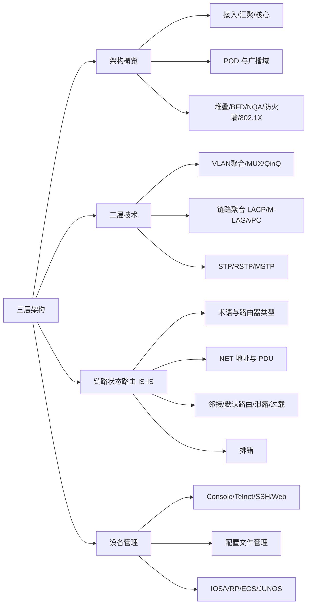

# 06 数据中心三层架构网络组成与维护

> 对应考纲：数据中心三层架构网络组成与维护（10%）
> 官方要求：了解传统三层架构特点与技术实现概要、了解三层架构下的二层技术、熟悉 IS-IS 原理配置与排错、了解网络设备管理方式与主流网络操作系统
> 本章特点：**概念 + 协议细节**，是第 07 章脊叶架构的铺垫；IS-IS 与 STP 是绝对重点

---

## 知识地图



---

## 1. 三层网络架构概览

### 1.1 定义

传统数据中心网络通常是三层结构，Cisco 称之为**分级互连网络模型**（hierarchical inter-networking model）或**经典网络模型**，包含三个层次：

| 层次 | 位置 | 职责 |
| --- | --- | --- |
| 接入层（Access） | 机架顶部，故称 **ToR（Top of Rack）** | 通过物理连接与服务器相连，提供网络接入和足够带宽 |
| 汇聚层（Aggregation） | 连接同一 VLAN 下的接入交换机 | 提供防火墙、入侵检测、网络分析等服务；**可以是二层或三层交换机** |
| 核心层（Core） | 网络最上层 | 为进出数据中心的流量提供高速转发，为跨 VLAN 通信提供连接性 |

### 1.2 关键特征（必考）

- **汇聚交换机是 L2 和 L3 的分界点**：汇聚以下是以太网二层，以上是三层
- 每组汇聚交换机管理一个或多个 **POD（Point Of Delivery）**，每个 POD 内是独立的 VLAN 网络
- 服务器**在 POD 内移动不必修改 IP 和网关**，因为一个 POD 对应一个 **L2 广播域**
- 优点：LAN 内部流量（本地流量）保持在本地，只有目的地是其他网络的流量才上到更高层

> **注意**：阿里数据中心的业务网络早已演进到 CLOS / 全三层 / 网络虚拟化，不再沿用分级模型；但**带外管理网络仍以经典模型为主**，所以一线运维必须懂三层架构。而且「层次化地解构网络」是理解任何网络架构的基本方法。

### 1.3 各层设备与关键技术

| 层次 | 典型设备 | 关键技术 |
| --- | --- | --- |
| 核心层 | 高性能模块化三层交换机、多业务路由器/防火墙 | WAN、双防火墙热备、VRRP、VGMP、VPN、防病毒、IPS、各种路由协议 |
| 汇聚层 | 提供高速转发、环网保护的三层交换机 | 堆叠、VLAN 及扩展技术、生成树、链路聚合、SNMP、二层安全 |
| 接入层 | 提供千兆接入 + 万兆上行的交换机 | VLAN 及扩展、链路聚合、生成树、二层安全 |

### 1.4 冗余带来的问题与对策

**健壮的二层网络需要冗余，但冗余本身带来危害**：广播风暴、MAC 地址表紊乱。

- 生成树协议：逻辑地阻塞广播域的某个端口，**保持冗余结构的同时消除环路危害**
- 堆叠：把多台交换机变成一台逻辑设备，简化拓扑

### 1.5 生成树三兄弟（对比表，必背）

| 技术 | 标准 | 特点 |
| --- | --- | --- |
| 生成树 STP | IEEE 802.1d | 有固定延迟，收敛慢（30~50s），资源利用率低；**所有 VLAN 共用一棵树** |
| 快速生成树 RSTP | IEEE 802.1w | 使用 **P/A 机制**快速收敛；端口状态与角色分开；所有 VLAN 共用一棵树 |
| 多生成树 MSTP | IEEE 802.1s | 基于 RSTP 改进，**按实例计算生成树**，提高资源利用率，可负载分担 |

> 802.1D-2004 认为传统 STP 已过时。

### 1.6 堆叠

- 双交换机或多交换机通过堆叠形成逻辑上的 1 台交换机
- 厂商实现：华为 **iStack / CSS**、H3C **IRF**、锐捷 **VSU**
- 好处：简化拓扑、减轻单点故障风险、增加交换能力、**降低对生成树协议的依赖**
- 前提：需要堆叠模块和堆叠线缆；**一般最多支持 8 台**设备组成堆叠
- 堆叠后的交换机可当作一台统一管理

### 1.7 BFD 与 NQA

| 技术 | 定义 | 作用 |
| --- | --- | --- |
| **BFD**（Bidirectional Forwarding Detection） | RFC 5880 定义的双向转发检测 | 利用会话（Session）检测直连/非直连链路故障；可与接口、静态路由、OSPF、VRRP、BGP 等**联动** |
| **NQA**（Network Quality Analysis） | 网络质量分析 | 实时监测网络性能、帮助排障；支持 DNS/FTP/HTTP/ICMP/SNMP/TCP 等测试方法，**ICMP 最常用**；也可与静态路由、VRRP、接口联动 |

**收敛速度对比（数字题）**：

| 场景 | 故障检测方式 | 收敛速度 |
| --- | --- | --- |
| 有 BFD 联动 | BFD 会话状态切换为 Down | **毫秒级** |
| 无 BFD | OSPF Dead 计时器超时（默认 **40 秒**） | 秒级 |

### 1.8 防火墙

- 在网络内外网之间构建相对隔绝的保护屏障，保护内网信息安全、管理内外网流量
- 应用在**核心层接入 WAN 或 Internet 的边界地带**
- 现代防火墙应用 **UTM** 概念，基于**状态检测和会话机制**
- 通过定义不同的**安全区域**、赋予不同**安全等级**来区分逻辑区域
- 提供全局的、灵活的、一体化的安全策略

### 1.9 接入安全

| 技术 | 说明 |
| --- | --- |
| **802.1X** | IEEE 定义，基于端口的网络访问控制（PNAC）；有线/无线广泛使用。C/S 结构：**设备端 Device、客户端 Client、认证服务器 Server**；常配合 IETF 的 **EAP**，故也称 **EAPoL**。系统/用户在网络入口完成认证后才能访问网络服务 |
| **端口安全 Port Security** | 工作在交换机二层端口的安全特性；只允许特定 MAC 地址设备接入；限制端口接入设备数量。实现方法：配置安全地址、配置安全地址个数、两者同时检查 |

---

## 2. 三层架构常用的二层技术

### 2.1 为什么需要二层技术

接入层负责服务器接入。传统数据中心通常按分区划分二层网络，**每个分区是一个二层广播域**。一线运维接触最多的是接入层，接入与汇聚之间是二层连接。

主要目的（多选）：

1. 有效管控**广播域的范围**
2. 提升设备之间的**网络带宽**
3. 避免可能出现的**二层环路**
4. 提升二层网络的**安全性和健壮性**

### 2.2 VLAN 的扩展

#### （1）VLAN 聚合（Super-VLAN / Sub-VLAN）

在一个物理网络内，用多个 Sub-VLAN 隔离广播域，再聚合为一个逻辑 VLAN，**共享同一 IP 子网和默认网关**。

| 角色 | 规则 |
| --- | --- |
| Super-VLAN（主 VLAN） | 管辖多个 Sub-VLAN；**不能加入任何物理端口**；需创建 **VLANIF 三层接口** |
| Sub-VLAN（子 VLAN） | 同属一个 IP 子网；**不允许启用 VLANIF**；可把端口加入；**子 VLAN 之间二层隔离**，但可通过 Super-VLAN 的 VLANIF 实现三层互通及对外通信 |

- 所有终端网关地址都配置为 **Super-VLAN 的 VLANIF 地址**
- 通信原理：比较目的 IP 与本机子网 → ARP 请求广播 → **ARP 代理**转发
- Sub-VLAN 内终端与聚合体外通信遵守标准 VLAN 规则（Access/Trunk/Hybrid 对标签的处理）；跨网段通信遵守标准三层转发（子网计算、ARP、路由）

> 解决的问题：大量小 VLAN 但希望共用一个网关/子网，减少 IP 地址浪费与维护量。

#### （2）MUX VLAN（华为）

场景：同一 IP 子网下，所有终端要访问共享服务，但部分终端之间要二层隔离；用常规 VLAN 需要配大量 VLAN。

| 角色 | 规则 |
| --- | --- |
| Principal VLAN（主 VLAN） | 可与任何从 VLAN 直接二层通信 |
| Separate VLAN（隔离从 VLAN） | 一个主 VLAN 下**只能有 1 个**；内部**不能互通**，只能与主 VLAN 通信 |
| Group VLAN（互通从 VLAN） | 内部可直接二层通信，也可与主 VLAN 通信 |

- 不同 Separate VLAN 之间、不同 Group VLAN 之间、Separate 与 Group 之间，**都不能直接二层通信**
- 每个从 VLAN 必须绑定到一个 Principal VLAN

> 记忆：**主 VLAN 是「大家都能找它」；Separate 是「互相不理」；Group 是「组内自己人」**。

#### （3）QinQ

- 在原本的 VLAN 帧上**再打一层 802.1Q 标签**：原标签为内层，新加的为外层
- 具有 QinQ 功能的交换机可添加和剥离外层标签
- 应用于**城域以太网**，是一种简单的**端到端二层 VPN**
- 运营商网络实现基于 VLAN 标签的二层 VPN 时：外层标签由**运营商设备**添加，内层标签由**客户设备**添加
- VLAN ID 数量达到 **4094 × 4094**
- 客户可实现简单的二层帧透传
- 基本 QinQ 的封装：进入一个端口的**所有流量封装同一个外层 VLAN 标签**，形成「QinQ 二层隧道」；不带标签的帧打上端口的默认 VLAN 标签

> 易错：4094×4094（内外层各 4094），不是 4094×2。

### 2.3 链路聚合

**定义**：将一对互联设备之间的多条物理以太网链路捆绑为一个总吞吐量增加的**逻辑信道**。建立后以一个逻辑端口存在，称为 **Port-Channel**（华为 **Eth-Trunk**）。

优点：负载分担、提升容错能力、成本友好。

| 模式 | 说明 |
| --- | --- |
| 手工负载分担 | 无 LACP 参与；所有活动链路都参与转发且负载平均分担 |
| **LACP（IEEE 802.3ad）** | 双方交换 LACPDU，通告系统优先级、系统 MAC、端口优先级、端口号、操作 Key；比较后确定主动端/被动端及活跃端口；也叫 **M:N 模式**：M 条活跃链路负载分担，N 条备份；活跃链路故障时从备份中选优先级最高的接替 |

**厂商扩展**：

| 技术 | 厂商 | 说明 |
| --- | --- | --- |
| E-Trunk（Enhanced Trunk） | 华为 | 统一管理 2 条 Eth-Trunk，实现互相备份 |
| **M-LAG** | 华为 | 跨设备链路聚合组：一台设备与另外两台设备跨设备聚合，可靠性从**单板级提升到设备级**，组成双活系统；也会选主/备，但正常情况下转发行为无区别 |
| **vPC** | Cisco | 类似 M-LAG，基于 LACP 扩展；避免环路、无需 STP、增加上行带宽、快速故障恢复、双活 |

### 2.4 生成树协议 xSTP（重点）

#### 基本概念

- STP 在交换机之间传递 **BPDU** 消息，使二层网络内的交换机处于**逻辑无环**状态
- 第一个 IEEE 标准化的 STP 是 802.1D；改进为 RSTP 802.1w；修正案 802.1s 描述 MSTP

#### BPDU 关键字段

| 字段 | 字节 | 要点 |
| --- | --- | --- |
| 协议标识符 / 版本 / 类型 | 2/1/1 | 类型 0x00 = 配置 BPDU，0x80 = TCN BPDU |
| 标志 | 1 | 用 **TCA**（拓扑变化确认）与 **TC**（拓扑变化）两位处理拓扑变化 |
| **根桥 ID** | 8 | 根交换机标识 |
| **根路径开销 RPC** | 4 | 到根桥的累计开销 |
| 发送网桥 ID / 发送端口 ID | 8/2 | 用于选举 |
| 消息老化时间 | 2 | 根桥为 0；其他交换机转发时**加 1** |
| 最大老化时间 | 2 | 默认 **20 秒** |
| Hello 间隔 | 2 | 默认 **2 秒** |
| 转发延迟 | 2 | 默认 15 秒 |

**网桥 ID 格式（802.1D-2004，MAC 地址缩减）**：

```
16 位桥优先级（4 位优先级值 × 4096，低 12 位为系统 ID 扩展，通常=VLAN ID） + 6 字节系统 MAC
```

#### 选举三步（必考）

1. **选根交换机（根桥）**：比较 BPDU 中的网桥 ID，最小者胜
2. **确定根端口（RP）**：非根桥上，收到**最优 BPDU** 的端口就是根端口（到根桥路径开销最小）
3. **确定指定端口（DP）**：每条网段上负责转发的最优端口；其余端口被阻塞（Block）

**运行细节**：

- 根桥每隔 1 个 Hello 间隔（默认 2s）发送 BPDU，根桥 ID 与发送网桥 ID 都是自己，**RPC = 0**
- 非根桥收到 BPDU 后，把端口开销加到 RPC 上
- 非根桥更新 RPC、发送网桥 ID、发送端口 ID、消息老化时间后，通过**指定端口**转发
- 交换机**不会从根端口和被阻塞端口**转发 BPDU

#### 端口状态与 RSTP 角色

| STP 状态 | RSTP 状态 | 功能 |
| --- | --- | --- |
| Disabled | Discarding | 不转发、不学习 MAC |
| Blocking | Discarding | 不转发、不学习 MAC |
| Listening | Discarding | 不转发、不学习 MAC |
| Learning | Learning | 不转发用户流量，但学习 MAC |
| Forwarding | Forwarding | 既转发又学习 MAC |

| RSTP 角色 | 是否 STP 也有 | 作用 |
| --- | --- | --- |
| 根端口 RP | 都有 | 到根桥路径开销最小 |
| 指定端口 DP | 都有 | 离下游设备最近，本网段唯一可接收下游数据的端口 |
| **替代端口 AP** | RSTP 特有 | 为当前根端口到根网桥提供**替代路径** |
| **备份端口 BP** | RSTP 特有 | 为指定端口到生成树叶提供备份路径 |
| 禁用端口 | 都有 | 不参与生成树运算 |

#### 收敛速度

- 传统 STP 为避免收敛过程出现环路，设置多种延迟，**收敛很慢（30~50 秒）**
- RSTP 的 **P/A（Proposal/Agreement）机制**使指定端口尽快进入转发状态，同时避免环路
- 若端口连续 **3 次 Hello 时间**没收到上游 RST BPDU，则重新计算
- **AP 端口切换为 RP 并进入转发，可在秒级完成收敛**（根桥失效时 AP 立即成为新 RP）

#### MSTP（多生成树）

- 传统 STP/RSTP 所有 VLAN 共用一棵树，链路利用率低，被阻塞链路浪费带宽
- MSTP 兼容 STP/RSTP，可生成多棵无环树，**既解决广播风暴又实现冗余备份**
- 把网络划分为一个或多个 **MST 区域**：同一区域内交换机运行**相同数量的 MST 实例**，并在实例上**映射相同的 VLAN 集合**
- 例：Instance 1 含 VLAN1–5，Instance 2 含 VLAN6–10；或 Instance1=VLAN10、Instance2=VLAN20，两棵树**负载分担且互为热备**

---

## 3. 链路状态路由协议与 IS-IS

### 3.1 链路状态 vs 距离矢量（概念对比）

| 维度 | 距离矢量 | 链路状态 |
| --- | --- | --- |
| 视角 | 平面式，路由学习完全依靠邻居 | 每台路由器收集区域内所有链路状态 |
| 交换内容 | **路由信息**（路由表项） | **链路状态信息**（接口 IP、掩码、网络类型、开销、相邻路由器） |
| 计算 | 邻居给什么用什么 | 自己构造拓扑 → **SPF** 计算路由 |
| 代表 | RIP、BGP | **OSPF、IS-IS** |

三层架构下，若不同 IP 网段的服务器要互访，就需要路由技术；跨数据中心、跨园区、跨区域的通信涉及各种路由与 IP 技术。

### 3.2 IS-IS 概述

- **IS-IS**（Intermediate System to Intermediate System，中间系统到中间系统）
- ISO 为 OSI 网络的 **CLNP** 设计的动态路由协议，支持 TCP/IP，故也称 **Dual IS-IS**
- **直接运行在数据链路层之上**（不像 OSPF 封装在 IP 中、BGP 封装在 TCP 中），可承载多种网络类型
- 可扩展性好，在大型网络、运营商骨干、互联网上大规模使用

> 层次关系：OSI 网络定义 CLNS（无连接）与 CONS（面向连接）；CLNS 的主要协议有 **CLNP、IS-IS、ES-IS**。

### 3.3 术语（必背）

| 术语 | 含义 |
| --- | --- |
| **IS** | Intermediate System，中间系统 = 运行 IS-IS 的路由器，生成和传播路由信息 |
| **ES** | End System，终端系统（主机），不参与 IS-IS，使用 ES-IS |
| **RD** | Routing Domain，运行 IS-IS 的路由器组成的区域集合 |
| **Area** | 区域；分普通 area 与骨干 area，二者直接连接，**普通 area 之间不能直接连接** |
| **Sys ID** | 唯一标识一台路由器，类似 OSPF 的 Router ID |
| **LSP** | Link-State Packet，链路状态报文，通过泛洪通告链路状态 |
| **LSDB** | 链路状态数据库，分区域存放；**同区域内 LSDB 相同**；用 SPF 算路由 |
| **DIS** | Designated IS，广播网络中的指定 IS，周期性泛洪本区域 LSDB；**非 DIS 只能与 DIS 交换 LSDB；没有备份 DIS** |

### 3.4 路由器类型（高频考点）

| 类型 | 位置与作用 | LSDB |
| --- | --- | --- |
| **L1** | 普通区域内部路由器，只能存在于非骨干区域；与同区域 L1、L1/2 建 L1 邻接 | 1 个 L1 LSDB |
| **L2** | 骨干区域路由器；负责区域间通信；与 L2、L1/2 建 L2 邻接 | 1 个 L2 LSDB |
| **L1/2** | 区域间连接者；可与同区域 L1/L1-2 建 L1 邻接，也可与骨干 L2 建 L2 邻接 | **2 个：L1 + L2** |

- **IS 路由器默认是 L1/2 类型**
- L1/2 路由器**不一定位于区域边界**，区域内也可能存在
- L1 区域是**分散的、非连续的**
- **IS-IS 路由器的各个接口必须属于同一个区域**
- 所有非骨干区域通过本区域 L1/2 连接骨干区域的 L2 实现与骨干直连；非骨干区域之间不能直连

### 3.5 路由类型（四级）

| 类型 | 含义 | 是否 IS-IS 提供 |
| --- | --- | --- |
| L0 | OSI 网络中 ES 与 IS 之间的路由 | 否（ES-IS） |
| **L1** | 同一普通区域内各 IS 之间的路由 | 是（L1 与 L1/2 都能提供） |
| **L2** | 不同区域之间各 IS 的路由（区域间路由） | 是（L2 与 L1/2 提供） |
| L3 | 不同 IS-IS 路由域之间的路由 | 否（IRDP，类似 BGP） |

**与 OSPF 的重要差别**：OSPF 只有同区域内用 SPF，区域间路由需经骨干转发；**IS-IS 中普通区域内的 L1 路由、区域间与骨干内的 L2 路由都用 SPF 计算**，分别生成各自的 SPT。

### 3.6 邻接关系矩阵（必考）

**同区域：**

| 本机 | 邻居 | 可建立的邻接 |
| --- | --- | --- |
| L1 | L1 | L1 级 |
| L1 | L1/2 | L1 级 |
| L1/2 | L1/2 | **L1 或 L2 级** |
| L2 | L2 | L2 级 |

**不同区域：**

| 本机 | 邻居 | 结果 |
| --- | --- | --- |
| L1 | L1 | 不可能建立 |
| L1 | L1/2 | **不能建立** |
| L1/2 | L1/2 | L2 级 |
| L2 | L1/2 | L2 级 |

> 记忆：**L1 只和同区域的 L1/L1-2 握手；跨区域只能靠 L2/L1-2 的 L2 邻接；L1 与 L1-2 跨区域不能建邻接**。

### 3.7 NSAP 与 NET 地址

#### NSAP

- 标识网络层服务，仅适用于 OSI 网络，标识 CLNS 网络层地址；每个通信进程对应一个 NSAP（类似 Socket）
- 结构：**IDP**（相当于主网络号）+ **DSP**（相当于子网号+主机号+端口号）
- 简化后：**Area Address（1~13 字节）+ System ID（6 字节）+ NSEL（1 字节）**
- IP 应用的 NSAP 最短 **10 字节**（AFI 1 + IDI 至少 2 + System ID 6 + NSEL 1）

#### NET（Network Entity Title）

- IP 网络的 IS-IS 中，LSP 报文用 **NET** 标识自己
- NET 也是 NSAP，但**不使用 NSEL，NSEL 恒为 00**
- 一般配 1 个 NET；区域重划分最多 3 个区域，故 **NET 最多配 3 个**
- **Area Address**：1~13 字节，相当于 OSPF 区域号
- **System ID**：6 字节，以数字开头；L1 时同区域唯一，L2 时整个路由域唯一
- **NSEL**：1 字节，总是 `00`

**例子**：`49.1a2c.1111.2222.3333.00`

| 部分 | 值 |
| --- | --- |
| Area Address | `49.1a2c` |
| System ID | `1111.2222.3333` |
| NSEL | `00` |

> 考点：给一个 NET 地址，问 Area / System ID / NSEL；或问 NSEL 固定值。

### 3.8 报文（PDU）

IS-IS 直接运行在数据链路层，对等 IS 通过 PDU 传递链路状态信息，完成 LSDB 同步。主要三类：

| PDU | 类型号 | 作用 |
| --- | --- | --- |
| **Hello PDU（IIH）** | L1 LAN IIH = **15**；L2 LAN IIH = **16**；P2P IIH = **17** | 建立和维护邻居关系，周期性发送 |
| **LSP** | L1 LSP = **18**；L2 LSP = **20** | 承载路由器基本信息（邻接、IP 前缀、OSI 终端、区域地址等） |
| **SNP**（Sequence Number PDU） | CSNP / PSNP | 数据库同步（摘要与请求） |

- 结构：**通用头部 + 专用头部 + 可变长字段（TLV）**
- **TLV（CLV：Code-Length-Value）** 是 PDU 的真正内容：Code 1 字节表示类型，Length 1 字节（最大 255），Value 变长（最大 255）
- 常见 TLV：区域地址=1、IS 邻居（LSP）=2、ES 邻居=3、分区指定 IS=4、前缀邻居=5、IS 邻居（Hello，MAC）=6、IS 邻居（SNPA）=7、填充=8、LSP 条目=9、认证信息=10

**LSP 专用头部关键字段**：PDU Length、Remaining lifetime、**LSP ID**、Sequence number、Checksum、**P/P_ATT/OL/IS type**（OL 即过载位）。

- L1 LSP 由 L1/L1-2 产生，在本区域泛洪 → 形成一致的 L1 LSDB
- L2 LSP 由 L2/L1-2 产生，在不同区域邻居间泛洪 → 形成一致的 L2 LSDB

### 3.9 OSPF 与 IS-IS

| 维度 | OSPF | IS-IS |
| --- | --- | --- |
| 出身 | IETF 项目 | 来自 OSI |
| 类型 | 链路状态 | 链路状态 |
| 算法 | Dijkstra SPF | Dijkstra SPF |
| 承载 | 封装在 IP 中 | 直接跑在数据链路层 |
| 应用 | 大型企业网络 | 大型运营商更倾向（成熟早） |

### 3.10 配置（Cisco 语法，理解即可）

```text
! R1
R1(config)# clns routing                      ! 开启 CLNS 路由（ISO CLNP）
R1(config)# interface loopback0
R1(config-if)# ip address 1.1.1.1 255.255.255.255
R1(config-if)# ip router isis                 ! 接口参与 IS-IS（宣告 IP 网段）
R1(config)# interface serial1/0
R1(config-if)# ip address 12.1.1.1 255.255.255.252
R1(config-if)# ip router isis
R1(config)# router isis
R1(config-router)# net 49.0001.0000.0000.0001.00
```

- `router isis` 激活进程后，路由器**默认以 L1/2 模式运行**（Cisco 与华为一致）
- `ip router isis` 让接口参与 IS-IS 并可路由纯 IP 包；若要 ISO CLNP 路由，接口下配 `clns router isis`
- 两台路由器分属不同区域时，修改 `net` 的区域部分即可（如 `49.0002...`）

**常用 show 命令**：

| 命令 | 作用 |
| --- | --- |
| `show clns protocol` | 列出运行的 IS-IS/ISO IGRP 进程信息 |
| `show clns neighbors detail` | 列出 ES 及 IS 邻居 |
| `show clns interface` | 接口相关的 ES-IS/CLNS 信息 |
| `show isis topology` | 各区域内与本路由器直连的邻居 |
| `show isis database` | IS-IS 链路状态数据库 |

### 3.11 默认路由、路由泄露、过载位

#### 默认路由

- **L1 路由器会自动安装一条 IP 默认路由**，下一跳是本区域内离它最近的 L2 路由器
- 骨干区域生成默认路由：路由进程下 `default-information originate`，L2 路由器以 L2 LSP 通告

#### 路由泄露（IS-IS Leak，华为称「路由渗透」）

- 默认情况下，L2 路由器**不把**自己知道的其它非骨干区域/其它骨干区域路由发布到直连的非骨干区域
- 结果：非骨干区域不了解区域外路由，出区域只能发给最近的 L1/2
- 泄露：把骨干区域路由注入非骨干区域，使普通区域也拥有全路由域信息
- 效果：原本 R1→R2→R5→R6 的路径，正确配置泄露后变成最优的 R1→R3→R4→R5→R6

#### 过载位（OL bit）

- ISO/IEC 10589 规定其他 IS **不应用过载的 IS 作为中转路由器**；Cisco 实现中，设置过载位时**直连的接口/IP 前缀仍可达**
- 扩展应用 1：`set-overload-bit on-startup 120` —— 重启后 120s 内 LSP 保持 OL 置位，之后取消（序列号 +1）
- 扩展应用 2：`set-overload-bit on-startup wait-for-bgp` —— BGP 收敛前 OL=1，收敛后 OL=0

> 场景：设备刚重启、BGP 还没收敛，此时不能让它转发流量 → 用 OL 位「假装自己过载」，让邻居别选它中转。

### 3.12 排错（高频考点）

#### 邻居关系建立过程

- P2P：双方发 IIH，报文中带自己的 System ID 与邻居 System ID，从 initialized → established
- 广播：通过 L2 LAN IIH 交互，DIS 参与

#### 邻居建立故障

| 表象 | 可能原因 |
| --- | --- |
| 进程已激活但看不到邻居 | 链路故障或接口被 shutdown；IS-IS 配置不完整（接口未参与）；接口被配成 **passive**；**接口模式（L1/L2）或区域配置不正确**；IP 地址配置有误；**System ID 冲突** |
| 部分/全部邻居停在 **init** | **直连接口 MTU 不匹配**；开启了 IS-IS 认证；Hello 包损坏（用 `log-adjacency-changes`、`debug isis adj-packets` 查） |
| 邻接 up 但协议类型是 **ES-IS** 而非 IS-IS | MTU 不匹配；认证；未收到邻居 IIH 或 IIH 损坏 |

> 注意：**IS-IS 不要求在直连路由器之间先建立 IP 连通性**（因为它跑在链路层），所以「ping 不通」不是 IS-IS 邻居起不来的必要条件。

#### 路由通告故障

| 表象 | 排查方向 |
| --- | --- |
| 外部路由重发布后没有生成外部路由 | `show isis database <lspid> detail` 看前缀是否在 LSP 中；重发布/泄露配置是否正确；LSP 是否过期；是否有到路由源的有效路由；是否被 route-map/distribute-list（华为 filter-policy）过滤 |
| 本机路由未通告 | 路由是否在远端 L1/L2 LSDB；始发 LSP 中是否有该前缀；接口是否参与进程；重发布是否正确；进程是否激活；用 `debug isis update-packets`、`debug isis snp-packets` 对比收发；接收端 `clear isis *` 后再观察 |

---

## 4. 网络设备维护管理

### 4.1 三种登录方式

| 方式 | 场景 | 特点 |
| --- | --- | --- |
| **Console 本地登录** | 新到设备初始配置；远程管理失效时的救急 | 属于**带外管理**；需终端仿真程序（SecureCRT、Xshell）；配置串口参数（波特率、Data Bits、Stop Bits）；可设置 Console 密码、超时时间、日志显示 |
| **Telnet** | 安全性要求不高、设备性能差 | **明文**、配置简单、安全性低、资源占用少 |
| **SSH** | 安全性要求高（如通过互联网远程管理） | **加密**、配置较复杂、安全性高、资源占用较高 |
| **Web** | 维护人员不掌握命令行 | 图形化界面 |

**SSH 细节（可考）**：

- 基于 **TCP，端口 22**，使用 **RSA** 算法对传输信息（含用户名密码）加密
- 传输数据经过压缩，可加快速度
- 两个版本：v1 有加密算法漏洞已被破解（可插入数据），v2 修复并兼容 v1

**SSH 密钥交互流程**（了解）：服务器生成公钥 A/私钥 B → 客户端请求连接 → 服务器下发公钥 A → 客户端随机生成公钥 a/私钥 b → 公钥 a 给服务器 → 双向加解密。

### 4.2 配置文件管理

| 概念 | 说明 |
| --- | --- |
| **运行配置 running-config** | 当前生效的配置，存放在 **RAM** |
| **启动配置 startup-config** | 系统启动时加载的配置，存放在 **NVRAM**（A 类闪存文件系统平台存放在 CONFIG_FILE 指定的位置） |
| 保存 | `copy running-config startup-config`（Cisco）；华为用 `save` |
| 典型场景 | 从服务器复制配置到路由器（恢复备份）；从路由器复制到 TFTP；从路由器复制到 FTP |

**华为 VRP 的配置文件操作**：

| 操作 | 命令 |
| --- | --- |
| 自动保存 | `autosave interval`（开关 + 间隔） |
| 定点保存 | `autosave time` |
| 手动保存 | `save` |
| 比较配置 | `compare configuration`（当前配置 vs 下次启动配置） |
| 查看当前配置 | `display current-configuration` |
| 另存备份 | `save config.cfg` → `copy config.cfg backup.cfg` |
| TFTP 备份 | `<Huawei> tftp 192.168.1.2 put sd1:/config.cfg backup.cfg`（设备作 TFTP 客户端） |
| FTP 备份 | 设备作 FTP 服务器，PC 作客户端 |

### 4.3 网络设备操作系统

网络设备也需要操作系统，实现人机交互、任务调度、任务间通信、中断管理、内存管理等。常见：

| 系统 | 厂商 | 特点 |
| --- | --- | --- |
| **IOS**（Internetwork Operating System） | Cisco | 与硬件分离、可动态升级；支持大量协议簇与多平台 |
| **VRP**（Versatile Routing Platform） | 华为 | 以 TCP/IP 协议栈为核心，集成路由、组播、QoS、VPN、安全和 IP 语音；命令行分权限级别 |
| **EOS**（Extensible Operating System） | Arista | 完全可编程、高度模块化的**基于 Linux** 的网络操作系统；单一二进制镜像；多进程状态共享架构，状态/转发与协议处理分离 |
| **JUNOS** | Juniper | — |

**VRP 用户级别（数字题）**：

| 用户级别 | 可访问命令级别 | 级别名称 | 可用命令 |
| --- | --- | --- | --- |
| 0 | 0 | 访问级 | 网络诊断工具（ping、tracert）、telnet 客户端、部分 display |
| 1 | 0、1 | 监控级 | 系统维护类 display（但 `display current-configuration`、`display saved-configuration` 属于 3 级） |
| 2 | 0、1、2 | 配置级 | 业务配置命令（路由、各层网络命令） |
| 3–15 | 0、1、2、3 | 管理级 | 文件系统、FTP/TFTP 下载、用户管理、命令级别设置、系统内部参数、debugging 等 |

---

## 5. 本章速记

- 三层：**接入 ToR / 汇聚（L2-L3 分界）/ 核心**；一个 POD = 一个 L2 广播域
- 冗余之害：**广播风暴、MAC 表紊乱** → STP 阻塞端口
- 三兄弟：**802.1d 慢、802.1w 有 P/A、802.1s 按实例**
- 堆叠：**iStack/CSS、IRF、VSU，最多 8 台**
- BFD：**RFC5880、毫秒级**；OSPF Dead **40s**
- VLAN 扩展：**聚合（Super 无物理口/Sub 无 VLANIF）、MUX（1 个 Separate）、QinQ（4094×4094）**
- 链路聚合：**手工无 LACP、LACP 802.3ad M:N、M-LAG 设备级双活、vPC**
- STP 选举：**根桥 → 根端口 → 指定端口**；Hello 2s、老化 20s
- IS-IS：**跑在链路层、默认 L1/2、接口同区域、NET 三段、L1 自动默认路由、L2 缺省不泄露**

---

## 6. 高频考点清单

| 考点 | 出题方式 |
| --- | --- |
| 三层各层职责与 L2/L3 分界 | 单选 |
| POD 与广播域、服务器迁移不改 IP | 单选 |
| STP/RSTP/MSTP 标准号与特点 | 单选/多选 |
| 堆叠厂商名称与最多台数 | 单选 |
| BFD/NQA 作用与收敛速度 | 单选 |
| 802.1X 三角色、EAPoL | 多选 |
| VLAN 聚合 Super/Sub 规则 | 单选 |
| MUX VLAN 三类角色 | 多选 |
| QinQ 双层标签与 4094×4094 | 单选 |
| LACP M:N 与 M-LAG | 单选 |
| BPDU 字段/计时器 | 单选 |
| STP 选举三步与端口状态 | 单选/排序 |
| RSTP AP/BP 作用、P/A | 单选 |
| MSTP 实例与 VLAN 映射 | 单选 |
| IS-IS 术语（DIS 无备份、同区 LSDB 相同） | 单选 |
| L1/L2/L1-2 与邻接矩阵 | 单选/多选 |
| NET 地址拆分 | 单选 |
| PDU 类型号 15/16/17/18/20 | 单选 |
| 默认路由、路由泄露、过载位 | 单选 |
| 邻居 init 卡住的原因（MTU） | 单选 |
| Telnet/SSH 对比、SSH 端口 | 单选 |
| running/startup 存储位置 | 单选 |
| VRP 用户级别 | 单选 |
