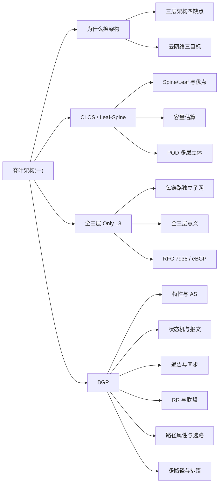
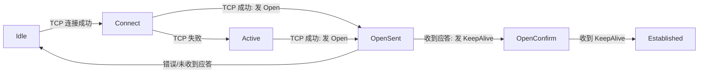

# 07 脊叶架构（一）：CLOS 架构与 BGP

> 对应考纲：数据中心脊叶架构网络组成与维护（20%，本文件约占 12%）
> 官方要求：了解 CLOS 先进性、了解全三层脊叶架构特点、了解 BGP 的特点/配置/作用/应用、了解路径控制工具
> 本章特点：**权重最高的一章**，BGP 是绝对核心。考试不会让你配 BGP，但会考**特性参数、报文、通告规则、选路顺序、RR/联盟**

---

## 知识地图



---

## 1. 传统数据中心网络架构的缺点

三层架构（接入-汇聚-核心）在校园网、企业网、园区网非常流行，但面对云计算有四个硬伤：

| 缺点 | 具体表现 |
| --- | --- |
| **带宽浪费** | 为防止环路，汇聚与接入之间运行 STP，接入交换机上联链路实际只有一条承载流量，其余被阻塞。Cisco 的 vPC 可把两条上联做成一个 vPC 同时承载，但**限制水平扩展且是思科私有** |
| **故障域（爆炸域）大** | 单台汇聚或核心宕机，或链路失效导致 STP 重算与网络重收敛，会**影响整个 VLAN** |
| **不适应超大规模部署** | 云数据中心分布在不同地域，VM 要能在任意地点创建、迁移且**保持 IP/网关等网络属性不变**，需要大二层 |
| **无法匹配新技术与新交付模式** | 见下 |

**新需求带来的压力**：

- **东西向流量剧增**：微服务把功能拆成小组件部署在不同 VM 上，频繁通信；云中客户 VM 可能分布在全网多个节点但需无缝通信
- **弹性**：现代数据中心认为故障是必然的，应用在故障下必须继续服务 → **必须限制故障域**
- **虚拟化**：虚机互访与迁移大幅增加东西向流量
- **分布式**：数据与应用分布在成千上万台服务器上，任务分发/计算/汇总/返回增加东西向流量

### 支持云的网络需要什么（三目标，必考）

| 目标 | 含义 |
| --- | --- |
| **Agility 灵活** | 支持客户快速启动和卸载网络 |
| **Isolation 隔离** | 一个客户的流量不能泄露到其他客户网络 |
| **Scale 规模** | 必须支持大量客户/租户 |

传统网络的问题：租户隔离用 VLAN（运营商用 VPN）；VLAN 无法支持大量租户也不能快速伸缩；VM 上线/下线/迁移交换机感知不到，无法快速响应。

→ 解法：**VXLAN**（把 VM 数据包封装进 UDP，用物理网络 IP/MAC 作外层），解决 VM 数量增长、频繁迁移、VLAN 租户数量少的问题。

---

## 2. 脊叶（Leaf-Spine）架构

### 2.1 形态

- 脊叶架构是一种 **CLOS 网络架构**
- 最上层是 **Spine（脊）** 交换机，往下是 **Leaf（叶）** 交换机；**Spine 连接每一个 Leaf，服务器通过 Leaf 接入**
- 每个 Leaf 都连接到每个 Spine

### 2.2 五个优点（多选高频）

1. 服务器之间连接数量非常多，**可容忍单点甚至多点故障**；链路故障只影响部分带宽
2. 节点间带宽大、利用率高：每个 Leaf 到 Spine 的多条上行链路**可负载均衡**工作
3. **带宽扩展方便**：带宽不足时增加 Spine 数量，水平扩展带宽
4. **服务器数量水平扩展**：服务器增加时增加 Leaf
5. 整体可扩展性好：**无需提前规划网络规模，按需扩容**

### 2.3 CLOS 容量估算（会算，单选题）

**例题**：

- SPINE：16 台；每台下联 **48 × 100G**，上联 16 × 100G
- LEAF：48 台；每台下联 **64 × 25G**，上联 16 × 25G

**推导**：

1. Spine 下联端口数（48）与所有 Leaf 上联链路数相同，端口充分利用
2. 每个 Leaf 下联服务器数 = `Spine总数 × Spine下联单口带宽 ÷ Leaf下联单口带宽` = **16 × 100 / 25 = 64**
3. 刚好等于 Leaf 的下联端口数（64），形成 1:1 无收敛
4. 总服务器数 = 64 × 48 = **3072 台**

**扩容思路**（思考题答案）：此时 Leaf 与 Spine 的下联端口都已耗尽 → 增加 Spine 受 Leaf 上联端口限制，增加 Leaf 受 Spine 下联端口限制 → 只能**建新的 POD / 增加平面**，构建多层立体脊叶。

> 记忆公式：**每 Leaf 可挂服务器数 = (Spine 数 × Spine 下行端口速率) / Leaf 下行端口速率**，前提是上下行端口数配平。
>
> 注意：这是课件给出的**端口配平估算口径**（只看 Spine 下联端口与 Leaf 下联速率），用于考试计算；真实组网还要考虑 Leaf 上联带宽与收敛比。

### 2.4 多层立体脊叶

| 概念 | 说明 |
| --- | --- |
| **POD** | 一个 Spine-Leaf 网络称为一个 POD 单元 |
| **Fabric 交换机** | POD 内部原来的 Spine 节点 |
| **Rack 交换机（ToR）** | POD 内部原来的 Leaf 节点 |
| **顶层 Spine** | 整个多层立体脊叶的 spine 节点，负责把各 POD 连接起来 |
| 扩容 | **增加新的 POD** 即可继续扩容 |

### 2.5 全三层（Only L3 / ALL L3）

**注意**：这里的「三层」不是「接入-汇聚-核心」的层次，而是 **OSI 第三层 IP 路由层**。

特征：

- 所有交换机之间、服务器与交换机之间的**所有端口都配 IP 地址**，**每条链路处于一个独立的 IP 子网**
- 服务器一般用**两个网卡分别接入两台 Leaf/ToR**（双上联）
- 物理网卡 IP 一般**仅用于设备互联**，业务地址配置在虚拟网卡/虚拟网桥上，更多由 VM 承担

**举例（双上联划分子网）**：

| Leaf | 端口 | Leaf 侧地址 | 服务器网卡地址 | 业务 IP |
| --- | --- | --- | --- | --- |
| Leaf1 | 1/1 | 192.168.1.1/30 | 192.168.1.2/30 | 10.10.10.1/32 |
| Leaf2 | 1/1 | 192.168.1.5/30 | 192.168.1.6/30 | 10.10.10.1/32 |

**全三层的意义（多选）**：

1. **限制 L2 广播域**，提高网络稳定性和可伸缩性
2. **减少使用二层高级功能**：VLAN、STP、单向链路检测、HSRP/VRRP 等
3. 使用**简单、易于维护且可靠**的路由协议（静态、OSPF、BGP 等）
4. 通过**控制路径**调度流量，**缩小故障域**
5. 舍弃高级功能带来的便捷，换取更高的**可靠性和可用性**

### 2.6 路由协议选择：为什么是 BGP

- 传统三层架构下，中大型数据中心选 OSPF / IS-IS
- **RFC 7938**《Use of BGP for Routing in Large-Scale Data Centers》提出用 BGP 作为数据中心内唯一路由协议，并做了详细分析
- 更具体：**eBGP 更适合 CLOS 架构的数据中心网络**

#### OSPF vs BGP（对比表，必背）

| 比较项 | OSPF | BGP |
| --- | --- | --- |
| 协议类型 | 链路状态 | **距离矢量** |
| 运行在哪层 | **IP 之上** | **TCP 之上**（提供可靠性） |
| 大规模组网 | 理论无跳数限制，但需**定期整网同步链路状态**；超大规模下 LSDB 过大、计算消耗大、震荡影响面大 | 只传递**计算好的最优路由**；适合大型/超大型数据中心 |
| 单一协议支撑 IDC | 可以；Server 上软件支持丰富 | 可以；Server 上也有软件支持；外部 AS 之间本来就用 BGP |
| 缩小故障域 | 域内要同步链路状态，所有 Failure 都要同步更新 | 本地只传播最优路径，网络变化时**只传增量** |
| 负载分担 | 规划 COST，多链路形成 ECMP；链路故障需同步域内重算 | 规划跳数/AS 后多链路可 ECMP；故障时把对应下一跳从 ECMP 组移除 |
| 收敛速度 | 配合 BFD 可毫秒级；域大时计算慢 | 路由少时 BFD 联动可毫秒级；通告本地算好的路由，域大不明显影响性能；有基于 AS 的快速切换 |
| 灵活度 | 用 Area、LSA 控制，相对复杂 | **丰富的选路原则**，可过滤、控制路由收发 |

### 2.7 流量形态（BUM）

| 类型 | 说明 |
| --- | --- |
| 单播 | 一对一 |
| **广播** | 发往网络中任何可达目的地；交换机收到后复制到 VLAN 内除来源外的所有端口 |
| **未知单播** | 目的地址不在转发信息库（FIB）中 → 交换机**泛洪**到 VLAN 内所有转发端口 |
| **组播** | 发给加入组的主机子集；无组管理机制时会退化为广播 |

后三者统称 **BUM 流量**。理解并控制流量，是提高带宽利用率、降低时延、提供 QoS 的基础。

### 2.8 数据中心互联与 IPv6

**互联**：

- 公有云数据中心必须通过公共互联网或运营商网络与客户/其它数据中心互联
- 云上 VPC 与云下 IDC 私网连接：**VPN（IPSec/SSL）** 走公网，或**租用专线**绕过公网
- 运营商骨干普遍部署 **MPLS**，基于 MPLS 的二三层 VPN 广泛应用
- 现代 DC 需要 IP VPN / E-VPN 的虚拟化能力、虚拟化向 DC 外延伸、DC 间流量工程（TE）保障 QoS → **MPLS 都有用武之地**
- 典型叠加：**Overlay = IPSec，Underlay = MPLS**

**IPv6 过渡三阶段**（IETF 2013 年 7 月数据中心操作指南）：

| 阶段 | 特征 |
| --- | --- |
| 实验阶段 Experimental | 保持本地 IPv4 基础设施，通过网关路由器和应用网关适配来自互联网的 IPv6 流量 |
| **双栈阶段 Dual Stack** | 可预见未来大多数数据中心的阶段；本地 IPv4 与 IPv6 都出现在基础设施中，贯穿互连方案任何一层 |
| 仅 IPv6 IPv6-Only | 普遍 IPv6 基础设施（含 hypervisor）；IPv4 应用需隧道或 NAT |

---

## 3. BGP 路由协议

### 3.1 BGP 与现代数据中心

BGP 以「帮全球互联网找彼此」闻名，在单个数据中心也有用：标准公有协议、众多开源软件支持。

数据中心网络架构经历 3 个阶段：**仅二层 → 混合二三层 → 仅三层（Only L3 / ALL L3）**。仅三层限制 L2 广播域、极大简化网络，CLOS 下横向扩展简单。构建仅三层网络，BGP 是最佳选择：

1. BGP 协议设计**复杂性较少**，内部数据结构和状态机更简单
2. 与链路状态 IGP 相比，BGP **信息泛洪开销更小**
3. BGP 支持**第三方（递归解析）下一跳**
4. **eBGP 配置简单**，对路由策略依赖性不强，便于维护

### 3.2 BGP 特性（高频考点 · 数字与默认值）

| 特性 | 说明及取值 |
| --- | --- |
| 协议类型 | 距离矢量；通过 **AS_PATH** 标记途经 AS，避免环路 |
| AS 归属 | 一台路由器只能属于**一个 AS**；一个 AS 可有多台路由器 |
| 版本 | IPv4 单播用 **BGP4（RFC 4271）**；**BGP4+** 支持 IPv6；其它网络用 **MP-BGP（RFC 4760）** |
| **TCP 端口** | **179**；邻居关系依赖 TCP；邻居更新源地址须路由可达 |
| **计时器** | Keepalive 默认 **60s**（Holdtime 的 1/3）；Holdtime 默认 **180s**；Holdtime 超时未收到 keepalive 认为邻居失效 |
| iBGP 对等体 | 双方在**同一个 AS** 内 |
| eBGP 对等体 | 双方在**不同 AS** |
| **RID 确定顺序** | ① `bgp router-id` 手工配置 → ② 进程启动时 up/up 的**环回接口最大 IP** → ③ 进程启动时 up/up 的**其他接口最大 IP** |
| 到达邻居的源 IP | `neighbor update-source` 指定；默认是到邻居路由所关联的**出接口 IP** |
| 到达邻居的目的 IP | `neighbor` 命令显式定义 |
| 自动汇总 | **默认关闭**，可用 `auto-summary` 启用 |
| 邻居认证 | **仅支持 MD5**，`neighbor password` |

### 3.3 AS（自治系统）

- AS：在一个组织机构管辖下、拥有**相同选路策略**的 IP 网络；每个 AS 有唯一 AS 号
- **2 字节 AS 号**：1 ~ 65535；私有 **64512 ~ 65535**
- **4 字节 AS 号（扩展）**：1 ~ 4 294 967 295；私有 **4 200 000 000 ~ 4 294 967 294**
- 公有 AS 号需向 **IANA** 申请

#### CLOS 全三层的 AS 号分配原则（多选）

1. 使用私有 ASN（**64512–65534**），避免 ASN 冲突
2. 所有 CLOS 拓扑的**第一层分配一个 ASN**
3. 唯一的 ASN 分配给同一 POD（或集群）中的**每组第 2 层设备**
4. 一个唯一 ASN 分配给**每个第 3 层设备**（如 ToR）

> 两层 CLOS 就是「Spine 层一个 AS，每个 Leaf 各自一个 AS」；若服务器与 ToR 之间也跑 BGP，还要给服务器规划 AS 号。

### 3.4 邻居关系建立（状态机，必考）

- BGP **不能自动发现邻居**，必须明确定义



| 状态 | 含义 |
| --- | --- |
| **Idle** | 空闲，初始状态，侦听邻居的 BGP 连接 |
| **Connect** | 等待 TCP 连接建立；成功则发 Open → OpenSent |
| **Active** | 侦听并发起 TCP 连接；成功则发 Open → OpenSent |
| **OpenSent** | 已发 Open，等待邻居应答；收到应答 → OpenConfirm 并发送 KeepAlive |
| **OpenConfirm** | 等待邻居的 KeepAlive；收到 → Established |
| **Established** | **只有此状态才能交换 BGP 消息**（Update、Keepalive、Notification） |

> 排错记忆：卡在 **Active** 通常是 TCP 连不上（路由/ACL/端口）；卡在 **OpenSent/OpenConfirm** 通常是参数不匹配或认证问题。

### 3.5 iBGP / eBGP 与管理距离

| 类型 | 场景 | Cisco 管理距离 AD |
| --- | --- | --- |
| **iBGP** | 同 AS | **200** |
| **eBGP** | 不同 AS | **20** |

**配置方法**：

```text
! iBGP 直连
R1(config)# router bgp 100
R1(config-router)# neighbor 12.1.1.2 remote-as 100

! iBGP 非直连（推荐用 loopback）
R1(config-router)# neighbor 2.2.2.2 remote-as 100
R1(config-router)# neighbor 2.2.2.2 update-source loopback0

! eBGP 直连（推荐做法）
R1(config-router)# neighbor 12.1.1.2 remote-as 200

! eBGP 用 loopback（需多跳 + 路由可达）
R1(config-router)# neighbor 2.2.2.2 remote-as 200
R1(config-router)# neighbor 2.2.2.2 ebgp-multihop 3
R1(config-router)# neighbor 2.2.2.2 update-source loopback0
```

- iBGP 对等体通常用**环回接口**建邻接，提高可用性
- eBGP 用**直连物理接口**是推荐做法；用 loopback 要注意 `ebgp-multihop` 与 loopback 路由可达性

**批量建邻居：peer group**

```text
router bgp 64512
 neighbor all_ebgp_nei peer-group
 neighbor all_ebgp_nei advertisement-interval 0
 neighbor all_ebgp_nei timers connect 5
 neighbor 192.168.1.2 remote-as 65501
 neighbor 192.168.1.2 peer-group all_ebgp_nei
 ...
```

> CLOS 中 Leaf 要与所有 Spine 建 eBGP，邻居数量多，**peer-group 统一调参数**是标准做法。

### 3.6 四种报文（必考）

| 报文 | 作用 |
| --- | --- |
| **Open** | 建立邻居关系并交换基本参数（版本、AS 号、Holdtime、RID 等） |
| **Keepalive** | 维护邻居关系；Holdtime 内未收到则关闭连接 |
| **Update** | **交换路由信息**（撤销路由、路径属性、NLRI） |
| **Notification** | 出现错误时使用，发送后**重置邻居关系** |

#### Update 报文与 NLRI

**NLRI（Network Layer Reachability Information）** = 路由更新，包含：

- 网络前缀（IP 地址的网络部分）
- 前缀长度（掩码中连续 1 的个数）
- 附加的路径属性（PA）

Update 结构：`已撤销路由长度 + 已撤销路由（变长） + 路径属性长度 + 路径属性（变长） + NLRI（前缀长度 + 前缀）…`

### 3.7 路由通告（重点）

#### 五条规则（多选高频）

1. 必须建立 **Established** 状态
2. **BGP 本身不「生产」路由**，只通告路由表中已存在的路由（IGP、静态、直连等）
3. 只把 BGP 表中的**最优路由**（best）通告给邻居
4. 从 **iBGP 邻居学到的路由不会再通告给其它 iBGP 邻居**（防环：AS 内传递 AS_PATH 不变，无法靠 AS 号防环）
5. 受**同步规则**约束

#### 三种通告方法

| 方法 | 作用 | 要点 |
| --- | --- | --- |
| **Network** | 把 IP 路由表中**已存在**的路由宣告进 BGP | 前缀与掩码必须与路由表**完全一致** |
| **Redistribute** | 把 RIP/OSPF/IS-IS、静态、直连等**重发布**进 BGP | 常配合 route-map 精确控制 |
| **Aggregate** | 前缀**聚合/汇总**后通告 | 见下 |

**Aggregate 两条规则**：

1. BGP 表中**至少拥有该聚合路由的一条明细前缀**，否则聚合不生效
2. 使用 aggregate 通告后，本机 IP 路由表会**自动生成一条指向 NULL0 的汇总路由**（防环）

```text
R1(config-router)# aggregate-address 192.168.0.0 255.255.252.0              ! 同时通告聚合与明细
R1(config-router)# aggregate-address 192.168.0.0 255.255.252.0 summary-only ! 只通告聚合
```

也可以用 ACL 匹配明细，配合 `suppress-map` 指明抑制哪些明细。

#### 同步规则（Synchronization）

- 开启时：BGP 路由器**不会**把从 iBGP 学到的路由通告给 eBGP 邻居，除非该路由是**本地注入**（network/重发布），或自己通过 IGP 也学到了该前缀
- 开启同步时需在 AS 边界做 BGP→IGP 重发布，让非 BGP 路由器也学到 BGP 路由，达到 BGP 与 IGP 数据库同步
- **默认关闭**；为防止路由黑洞，必须让 AS 内所有路由器都运行 BGP；而 BGP 又不把 iBGP 路由传给其他 iBGP → 要求在 AS 内建立**全互联 iBGP**
- 为解决同步约束与全互联问题：**路由反射器 RR、AS 联盟、或引入 MPLS**

> 考试常问：「同步规则默认开还是关？」→ **默认关闭**（Cisco）。「iBGP 为什么需要全互联或 RR？」→ 因为 iBGP 不转发 iBGP 路由。

### 3.8 路由反射器 RR 与 AS 联盟

#### 作用

减少 AS 内 iBGP 对等连接数量，同时满足 BGP 路由器学习必要前缀的需求。两者可配合使用，也可只用其一。

#### RR 关键概念

| 概念 | 说明 |
| --- | --- |
| **路由反射集群（簇）** | 1 台或多台 RR + 客户端组成的一组 BGP 路由器 |
| **Cluster-ID** | 4 字节整数，标识集群；未指定时 **RR 的 Router-ID 充当 Cluster-ID** |
| **Cluster_List** | 记录 Cluster-ID 列表，记录前缀传递途经的所有集群（**防环**） |
| **Originator-ID** | AS 内**最先发起** eBGP 通告或本机通告的路由器的 BGP Router-ID，由 RR 封装进更新（**防环**） |

#### RR 的三条通告规则（必考）

| RR 收到路由来自 | 通告给 |
| --- | --- |
| **eBGP 邻居** | 所有 BGP 邻居（iBGP、eBGP、客户端） |
| **iBGP 邻居（非客户端）** | 所有**客户端**和 **eBGP** 邻居 |
| **客户端** | 所有**其它客户端**和**非客户端**邻居（iBGP、eBGP） |

> 记忆：**从客户端来的给「其他客户端 + 非客户端」，从不认识的外人来的给所有人**。

#### AS 联盟（Confederation）

- 把 AS 划分成多个**子 AS（sub AS）**
- 同子 AS 内：**联盟 iBGP**（confederation iBGP peer），仍需全互联
- 不同子 AS：**联盟 eBGP**（confederation eBGP peer），可把从联盟子 AS 学到的 iBGP 路由宣告给其它子 AS
- **联盟外部的其它 AS 仍把联盟视作一个 AS**
- 路由在子 AS 间传播时，大多数 PA（LP、MED、Next-Hop）保持原样，AS_PATH 中加入途经子 AS 号
- 联盟利用 AS_PATH 防环：**AS_CONFED_SEQ**（有序子 AS 列表）、**AS_CONFED_SET**（无序，用于聚合场景）
- **联盟内的 AS_PATH 中「（）」内的 AS 号不参与 AS_PATH 长度计算**

### 3.9 路径属性（Path Attributes）

#### 分类（必考）

| 分类 | 含义 | 属性 |
| --- | --- | --- |
| **公认必遵** | 所有实现必须理解，且 Update 中**必须携带** | **Origin、AS_PATH、Next_Hop** |
| **公认自决定** | 所有实现必须理解，但**不要求**携带 | **Local_Preference、ATOMIC_Aggregate** |
| **可选传递** | 可以不支持，但收到后仍应接收并**传给其它对等体** | **Community、Aggregator** |
| **可选非传递** | 可以不支持；不识别的进程**忽略且不转发** | **MED、Originator_ID、Cluster_List、Weight（华为 Preferred_Value）** |

#### 六大属性逐一

**① Local_Preference（LP，本地优先级）**

- 32 位非负整数，**AS 内有效，越大越优**
- 告诉 AS 内路由器哪条是**离开 AS** 的首选路径
- **不传给 eBGP 邻居，但传给 iBGP 邻居**
- 默认：本机始发路由 LP=100；从 eBGP 学到的路由 LP 也设为 100

**② MED（Multi_Exit_Discriminator，多出口鉴别器）**

- 32 位非负整数，**越小越优**，可理解为 BGP 的 metric
- 告诉 eBGP 邻居**进入本 AS** 选哪条路径（影响别人怎么进来）
- 主要用于 **AS 之间**影响选路；传给 eBGP 后，对等体在 AS 内传递时携带，但再传给其 eBGP 邻居时**缺省不携带**（只传 iBGP）
- 默认只比较**来自同一个 AS** 的 MED；要跨 AS 比较需改命令（`bgp always-compare-med`）

**③ AS_PATH**

- 包含路由更新途经的 AS 号，**强制属性**
- **只有离开本 AS 时 AS_PATH 才改变**
- 优选 **AS_PATH 最短**
- 聚合时 `{ }` 内为 **AS_SET**，无论几个 AS 号都**整体算 1 个长度**；联盟 `（ ）` 内**不参与长度计算**

**④ Next_Hop**

- BGP 路由的下一跳通常**通过 IGP 学到**
- 优先选择到 NEXT_HOP **最近（IGP 度量最小）**的路由
- AS 内 NEXT_HOP **默认不变**；常用 `next-hop-self` 把 AS 外地址改成 AS 内边界路由器地址

**⑤ Origin**

- 优选顺序：**IGP（i）> EGP（e）> Incomplete（?）**
- `i`：network 或 aggregate 生成；`e`：通过 EGP 获得；`?`：其它方式（一般重发布）
- **不推荐用该属性操控选路**

**⑥ Weight（Cisco 专有）/ Preferred-Value（华为）**

- **只在本机有效，不传给任何邻居**；4 字节，**越大越优**
- 从其它邻居学到的路由默认 weight = 0
- 本地 network 产生、本地重发布直连/静态、本地聚合产生的路由 **weight = 32768**

**⑦ Community（团体属性）**

- 本质是**打标记**：把一组路由标记相同的 community 字符串，再按标记做路由决策
- **可选传递**：即使 AS 不理解也能传递，对下游 AS 仍有效
- 匹配工具：Cisco `community-list`（标准 1–99，扩展 100–199）；华为 `community-filter`（基本/高级）

#### 读懂 BGP 表

| 字段 | 含义 |
| --- | --- |
| Network | BGP 前缀；多个 NLRI 时只有第一个显示，其余空白；有效 NLRI 前有 `*`，最佳路径前有 `>` |
| Next Hop | 下一跳 |
| Metric | MED 值 |
| LocPrf | Local_Preference |
| Weight | Cisco 私有权重 |
| Path / Origin | AS_PATH 与 Origin 标记 |

### 3.10 BGP 选路顺序（13 条，必背）

| 顺序 | 比较项 |
| --- | --- |
| 1 | **Weight（Cisco）/ Preferred-value（华为），越大越优** |
| 2 | **Local_Preference，越大越优** |
| 3 | **起源于本地**（本机 network/重发布/aggregate）更优 |
| 4 | **AS_PATH 最短** |
| 5 | **Origin：IGP > EGP > Incomplete** |
| 6 | **MED，越小越优** |
| 7 | **eBGP 路由优于 iBGP 路由** |
| 8 | 到 Next_Hop 的 **IGP 度量最小** |
| 9 | **负载均衡**（多路径） |
| 10 | 都是 eBGP 时，优选**最早（最老）**的路径 |
| 11 | 优选 **Router-ID 较低**的邻居学到的路由 |
| 12 | 优选 **Cluster_List 最短**的路由 |
| 13 | 优选**邻居 IP 地址较低**的路由 |

> 口诀：**权重 → 本地优先 → 本地起源 → 路径短 → 出身好 → MED 小 → 外优于内 → IGP 近 → 负载均衡 → 老 → RID 小 → 簇短 → IP 小**。

### 3.11 多路径与 ECMP（理解原理）

- CLOS 连接密度大、BGP 对等体多；Spine 可从多个 eBGP 邻居（Leaf/ToR）学到同一前缀
- BGP 判定「等价」的条件：**前 8 个路径属性全部一致**
- 注意：**AS_PATH 中的 AS 数字必须完全匹配**，不仅是长度相等
- 场景：server 双上联两台 ToR；ToR 用静态路由指向业务 IP 并重发布进 BGP；两台 ToR 与 Spine 建 eBGP
  - Spine 从 ToR1、ToR2 学到的路由 AS_PATH 分别是 64513、64514
  - 长度相同但 ASN 列表不同 → **默认不形成 ECMP，只选一条**

**解法**：

| 厂商 | 命令 |
| --- | --- |
| Cisco | `bestpath as-path multipath-relax` |
| 华为 | `load-balancing as-path-relax` |

> 这是 CLOS 网络的经典坑：**AS_PATH 长度相同但 AS 号不同，默认不负载分担**。

### 3.12 BGP 排错

#### 常用命令

| 命令 | 作用 |
| --- | --- |
| `show ip bgp` | 查看 BGP 表 |
| `show ip bgp <prefix>` | 查看某前缀的详细属性 |
| `show ip bgp summary` | 本机 BGP 配置与邻居摘要 |
| `show ip bgp neighbor <addr>` | 某邻居状态与消息收发 |
| `show ip bgp neighbor <addr> advertised-routes` | 本机通告给该邻居的路由 |
| `show ip bgp neighbor <addr> routes` | 从该邻居接收的路由 |
| `debug ip bgp update [acl]` | 排查路由通告故障 |
| `debug ip bgp <neighbor> updates [acl]` | 特定邻居的更新消息 |

#### eBGP 邻居建立故障

| 表象 | 排错方向 |
| --- | --- |
| 连通性故障、ping 不通、邻居一直 **Active** | 按物理层→网络层、硬件→配置、外部→内部的原则排查连通性 |
| 直连 eBGP 建不起来，debug 显示 `timed out`、`host not responding` | 检查**直连接口 IP 配置**是否有误 |
| 非直连 eBGP（loopback / 跨路由器）建不起来，debug 显示 `connection refused`，show 显示 `No active TCP connection`、`External BGP neighbor not directly connected` | ① 路由表是否有到邻居 IP 的路由 ② 是否指定 **update-source**（否则默认用出接口 IP，与 neighbor 指定不一致会被丢弃）③ 是否配置 **ebgp-multihop** 且跳数合理 |

#### iBGP 邻居建立故障

| 表象 | 排错方向 |
| --- | --- |
| 配了 ACL 后邻居建不起来 | ACL 拦了 **TCP 目的端口 179**；注意 ACL 末尾隐含 `deny any` |
| 非直连 iBGP 建不起来 | 是否有到对等体 IP 的路由；是否配置 **update-source** |

#### 无法生成 BGP 路由（BGP 表无条目）

| 原因 | 排错方向 |
| --- | --- |
| IP 路由表无相关条目（`network not in table`） | 确保路由已存在，且 **前缀与前缀长度完全一致** |
| network 引用的前缀/掩码与路由表不一致 | 同上；重发布时检查 route-map 调用的 ACL/prefix-list 是否精确匹配 |
| Aggregate 聚合不生效 | BGP 表中是否有**至少一条明细**；若要同时通告明细与聚合，**不能用 summary-only** |
| 有类网络边界自动汇总（重发布 10.10.10.0/16 变成 10.0.0.0/8） | 检查是否配置 `no auto-summary`（一般应关闭） |
| 重发布语法不规范 | 如 `redistribute ospf 1 metric 20 match internal external 1 external 2` 的含义要理解：内部 + 外部 1/2 都引入，MED=20 |

#### 无法向邻居通告路由

| 原因 | 排错方向 |
| --- | --- |
| 路由控制策略配置有误 | 理解 prefix-list / route-map / filter-list / distribute-list 各自功能 |
| iBGP 防环：iBGP 学的不传给其它 iBGP | 部署 RR 或 AS 联盟 |
| 同步规则约束 | `show ip bgp <prefix>` 看到 `not synchronized` → 关闭同步 `no synchronization` |

---

## 4. 本章速记

- 三层四缺点：**带宽浪费、故障域大、不适超大规模、不匹配新交付**
- 云三目标：**Agility、Isolation、Scale**
- 脊叶五优点：**容多故障、带宽大、扩 Spine 加带宽、扩 Leaf 加服务器、按需扩容**
- 容量公式：**每 Leaf 服务器 = Spine 数 × Spine 下行速率 / Leaf 下行速率**
- 全三层：**每链路独立子网、双上联、业务 IP 在虚机**
- BGP 数字：**TCP 179、Keepalive 60 / Hold 180、AD 20/200、私有 AS 64512-65535**
- 状态机：**Idle → Connect/Active → OpenSent → OpenConfirm → Established**
- 四报文：**Open、Keepalive、Update、Notification**
- 五通告规则：**Established、不生产、只传最优、iBGP 不传 iBGP、受同步约束**
- RR 三规则；联盟 **CONFED_SEQ/SET 不计长度**
- 选路 13 条：**权重→LP→本地→AS_PATH→Origin→MED→eBGP→IGP→ECMP→老→RID→簇→IP**

---

## 5. 高频考点清单

| 考点 | 出题方式 |
| --- | --- |
| 传统三层四缺点 | 多选 |
| 云网络三目标 | 单选/多选 |
| Leaf-Spine 优点 | 多选 |
| CLOS 容量计算 | 单选计算 |
| POD/Fabric/ToR 概念 | 单选匹配 |
| 全三层意义 | 多选 |
| RFC 7938 与 eBGP | 单选 |
| OSPF vs BGP 对比 | 多选/单选 |
| BUM 流量定义 | 单选 |
| IPv6 过渡三阶段 | 单选排序 |
| BGP 端口与计时器 | 单选数字 |
| RID 确定顺序 | 单选排序 |
| AS 号范围与私有段 | 单选 |
| CLOS ASN 分配原则 | 多选 |
| BGP 状态机 | 单选排序 |
| iBGP/eBGP 管理距离 | 单选 |
| 四种报文作用 | 单选匹配 |
| 通告五规则 | 多选 |
| network/redistribute/aggregate | 单选场景 |
| aggregate 需明细 + NULL0 | 单选 |
| 同步规则默认状态与目的 | 单选 |
| RR 三条通告规则 | 多选 |
| 联盟 AS_CONFED_SEQ/SET | 单选 |
| 路径属性分类 | 多选 |
| LP/MED 方向与默认值 | 单选 |
| Weight 32768 | 单选 |
| 13 条选路顺序 | 单选/排序 |
| AS_PATH 长度计算（AS_SET 算 1、联盟不算） | 单选 |
| multipath-relax 场景 | 单选 |
| eBGP 邻居 Active 的排查 | 单选 |
| 无法生成 BGP 路由的原因 | 多选 |
