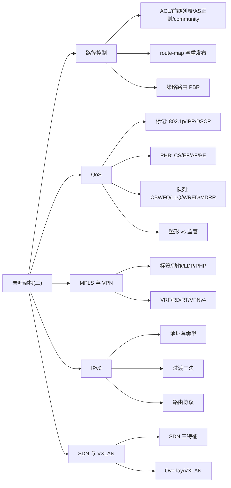
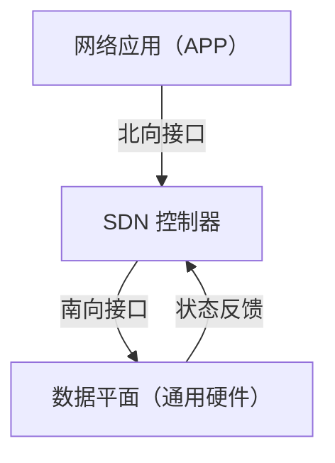

# 08 脊叶架构（二）：路径控制、QoS、MPLS VPN、IPv6、SDN

> 对应考纲：数据中心脊叶架构网络组成与维护（20%，本文件约占 8%）
> 官方要求：了解路径控制工具、QoS 实现与差分服务、BGP/MPLS 三层 VPN、IPv6 地址/过渡/路由、SDN 与 Overlay
> 本章特点：**面广但不深**，考点集中在「工具用途、字段位宽、默认值、对比关系」

---

## 知识地图



---

## 1. 路径控制

### 1.1 定义与目的

**路径控制**：利用某种工具或技术影响路由协议选路，或影响网络流量穿越网络时的路径走向。

- 控制对象：**路由信息**（AD、度量值、路由本身）或**特定网络流量**（某主机的数据）
- 它不是一种特定技术，而是**一系列工具和技术的集合**（ACL 也算）
- 目的（多选）：
  1. **弹性**：链路主动切换，备用链路可用于负载分担
  2. **性能**：提升带宽利用率
  3. **可用性和自适应**
  4. 无须大规模改网，在局部影响特定路由或流量

### 1.2 路由（前缀）匹配工具

#### ACL

| 类型 | 能力 |
| --- | --- |
| 标准 ACL | **只能匹配路由的前缀，无法匹配前缀长度**。如 `access-list 1 permit 192.168.1.0` 会匹配 /25、/26… |
| 扩展 ACL | 可分别匹配**前缀**和**前缀长度** |

```text
! 精确匹配 192.168.1.0/24
access-list 100 permit ip 192.168.1.0 0.0.0.0 255.255.255.0 0.0.0.0
!                              ↑前缀+通配符        ↑掩码+通配符
```

#### 前缀列表（Cisco prefix-list / 华为 ip-prefix）

- 可匹配前缀，也可匹配前缀长度，范围灵活
- **不能用于匹配 IP 数据包**
- 可包含多条语句；**按顺序匹配，命中即停止**
- **末尾隐含 deny**

**语法**：

```text
ip prefix-list <name> [seq <n>] {deny|permit} <network>/<length> [ge <ge-value>] [le <le-value>]
```

约束：`length < ge-value < le-value <= 32`

**四个必须记住的例子**：

| 配置 | 匹配结果 |
| --- | --- |
| `permit 172.0.0.0/8` | 只匹配 `172.0.0.0/8` 本身 |
| `permit 172.0.0.0/8 le 24` | /8、/9、…、/24（前 8 位固定） |
| `permit 172.0.0.0/8 ge 24` | 掩码**大于 24**（未写 le，默认到 32）——课件口径 |
| `permit 0.0.0.0/0 le 32` | **匹配一切路由** |

#### AS 路径过滤（AS-Path Filter）

- 利用 BGP 更新携带的 **AS_PATH** 过滤路由
- 大型 BGP 网络里比 ACL/前缀列表**更有效**
- **末尾隐含 deny 所有**

```text
! Cisco：拒绝经过 AS 300 的路由，允许其它
ip as-path access-list 1 deny _300_
ip as-path access-list 1 permit .*

! 华为
ip as-path-filter 10 permit .*        ! 匹配所有 AS_PATH
ip as-path-filter 10 permit 100$      ! 匹配从 AS 100 发起的路由更新
ip as-path-filter 10 permit ^100      ! 匹配从 AS 200 接收的路由（AS_PATH 以 100 开头）
```

**正则表达式（必考符号）**：

| 符号 | 含义 | 例子 |
| --- | --- | --- |
| `*` | 前一字符出现 **0 次或多次** | `10*` 匹配 1、10、100… |
| `+` | 前一字符出现 **1 次或多次** | `10+` 匹配 10、100… |
| `^` | 行首（字符串开始） | `^10` 匹配 1012345，不匹配 2012345 |
| `$` | 行尾（字符串结束） | `1$` 匹配 …10.1，不匹配 …10.2 |
| `_` | 匹配逗号、大括号、小括号、空格、字符串开始/结束 | `_100_` 匹配 100、空格 100 空格等 |
| `[ ]` | 匹配括号内任一字符 | `[ab]` 匹配 a 或 b |
| `\|` | 或 | `a\|b` 匹配 a 或 b |
| `.` | 任意单个字符 | `0.0` 匹配 010、020、0x0 |

#### 团体属性匹配

| 厂商 | 工具 | 特点 |
| --- | --- | --- |
| 华为 | 基本团体属性过滤器 / 高级（正则） | 基本较粗放，高级更灵活 |
| Cisco | 标准 1–99 / 扩展 100–199 | 都可在单条命令匹配多个团体；**扩展支持正则**；标准**不能超过 16 行**，扩展可以 |

### 1.3 路由映射 Route-Map（Cisco）/ 路由策略 Route-Policy（华为）

**作用**：按路由属性过滤路由，并修改被匹配路由的属性；也可过滤数据包并执行动作。

| 元素 | 作用 |
| --- | --- |
| **Match**（华为 if-match） | 定义节点匹配规则（匹配对象是路由属性） |
| **Set**（华为 apply） | 匹配后执行的动作（修改属性） |

**工作方法（考点）**：

- 一个 route-map 下可有多个序列（sequence，华为称 node），用十进制数字标识
- 从**最小序列号**开始逐个执行；某序列匹配则执行其 set，不匹配则继续下一序列
- 序列**默认为 permit**；**默认序列号为 10**；序列号**不会自动递增**，需指定
- 只写 `route-map NAME permit` 不加 match/set → **匹配一切**（deny 则是不匹配一切）
- **末尾隐含 deny any**
- 单条 match 含多个条件 → **逻辑 OR**；多条 match 语句 → **逻辑 AND**

**常用 match / set**：

| match | set |
| --- | --- |
| `match ip address`（ACL/前缀列表） | `set metric` 度量值 |
| `match length` 三层长度 | `set metric-type` 度量类型 |
| `match interface` 下一跳出接口 | `set default interface` 默认出接口 |
| `match ip next-hop` | `set ip default next-hop` |
| `match metric` | `set as-path`（BGP） |
| `match route-type` 路由类型 | `set weight` / `set origin` / `set local-preference`（BGP） |

### 1.4 路由重发布（Redistribute / 华为 route-import）

- 一个企业可能用了多种路由协议，用重发布把一个协议的路由通告到另一个协议
- 影响范围：当前路由表中**已存在的某协议路由**，以及被相关命令宣告进该协议的接口（状态双 up）所在网络前缀

**默认种子度量（seed metric，数字题）**：

| 重发布到 | 默认种子度量（Cisco） |
| --- | --- |
| **RIP** | **0（视为无穷大）→ 不会被装入路由表**（必须手工指定 metric） |
| **OSPF** | **BGP → OSPF 是 1；其它协议 → OSPF 是 20** |
| **IS-IS** | **0** |

- OSPF 引入外部路由默认种子度量 **20**，默认外部路由类型 **type 2（E2/N2）**

```text
R2(config)# router ospf 1
R2(config-router)# redistribute rip subnets metric 300
R2(config)# router rip
R2(config-router)# redistribute ospf 1 metric 5
```

> 高频陷阱：重发布进 **RIP 不写 metric = 不通**（0 被当作无穷大）。

### 1.5 策略路由 PBR（Policy-Based Routing）

- 操作对象是 **IP 数据包**（数据流）
- 常规路由：按目的地址、最长匹配、查路由表转发
- PBR：可根据**协议类型、报文大小、应用、源 IP** 等选择转发路径

#### 路由策略 vs 策略路由（必考对比）

| 比较项 | 路由策略（route-map） | 策略路由（PBR） |
| --- | --- | --- |
| 作用对象 | **路由信息** | **IP 数据包（数据流）** |
| 转发规则 | 按路由表 | 基于策略；策略失败后再查路由表 |
| 服务对象 | 控制平面，服务路由协议与路由表 | 转发平面，服务转发策略 |
| 实现方法 | 结合路由协议实现 | 管理员逐跳配置 |

#### 配置要点

```text
route-map test permit 10
 match ip address 1                 ! 用 ACL 匹配流量
 set ip next-hop 12.1.1.2 13.1.1.3  ! 可写多个，必须是直连路由器的接口 IP

interface fast 0/0
 ip policy route-map test           ! 接口下应用：仅对进入该接口的流量生效
```

| 关键字 | 要点 |
| --- | --- |
| 多个 next-hop | 第一个关联的出接口失效时自动切换到下一个 |
| `recursive <ip>` | 递归下一跳，**可以不是直连**，只要路由表有可达路由（迭代查询） |
| 同时配 next-hop 与 recursive | next-hop **优先生效**；next-hop 失效再用 recursive；都失效则走常规路由表 |
| `set ip default next-hop` | 默认下一跳（优先级低于明细路由） |
| `ip local policy route-map` | 全局应用 PBR，对**本路由器始发**的流量生效 |

**应用示例**：正常时经 ISP1 出网，ISP1 失效时访问 100.100.100.100 的流量切到 ISP2 —— ACL 匹配流量 + `set ip next-hop` 写两个下一跳。

---

## 2. QoS 服务质量

### 2.1 概念与功能

**QoS（Quality of Service）**：针对不同需求提供不同的网络服务质量，通过对网络资源的监控和合理分配，最大限度减少**网络延时与抖动**，提供端到端服务保障。

| 功能 | 做法 |
| --- | --- |
| **拥塞管理** | 拥塞时通过**队列调度**优先处理符合条件的队列 |
| **拥塞避免** | 拥塞时**丢弃**符合条件的报文 |
| **流量监管（policing）** | **丢弃**进入接口的超出速率限制的报文 |
| **流量整形（shaping）** | 对超出速率的报文**先缓存**，等不超限时再发 |
| 其它 | 分类、过滤、镜像、统计、重定向、重标记优先级/VLAN 标签 |

### 2.2 影响网络质量的四要素（必考）

| 要素 | 定义 | 敏感业务 |
| --- | --- | --- |
| **带宽**（吞吐量） | 单位时间数据流量的平均速率，kb/s | 大文件、备份 |
| **时延**（delay） | 流量穿越网络所需平均时间 | 实时交互 |
| **抖动** | **时延的变化** | 直播、语音 |
| **丢包率** | 丢失报文比例 | 金融数据（语音视频反而较不敏感） |

未部署 QoS 的 IP 网络：所有报文无差别对待，按 **FIFO** 原则、**尽力而为（Best-Effort）** 转发，时延与丢包无法保证。

### 2.3 三种服务模型

| 模型 | 优点 | 缺点 |
| --- | --- | --- |
| **Best-Effort** 尽力而为 | 实现简单 | 不能区分业务流 |
| **IntServ** 综合服务 | 可提供端到端 QoS，保证带宽、延迟 | 需跟踪每个流状态，实现复杂、扩展性差、带宽利用率低，不适合骨干汇聚 |
| **DiffServ** 区分服务 | **不跟踪每个流状态**，资源占用少、扩展性强；能提供不同服务质量 | 需端到端每个节点手工部署，对人员能力要求高 |

> 现在网络实施 QoS 通常采用 **DiffServ**。DiffServ 下应用发报文时在头部设置优先级字段通告需求，网络设备分析 IP 头获知服务类别，无需为每个流维护状态。

### 2.4 DiffServ 的组成要素

| 要素 | 说明 |
| --- | --- |
| **DS 域** | 一组采用相同服务策略、实现相同 PHB 组的相连 DS 节点 + 边界节点 |
| **DS 节点** | 实现 DiffServ 功能的网络节点 |
| **边界节点** | 连接另一个 DS 域或无 DS 功能的域；负责**分类与可能的流量调整**，保证穿过本域的流被适当标记并按 PHB 转发 |
| **内部节点** | 连接同一 DS 域内其它节点；按 IP 头 **DS 字段**或 VLAN 帧 **802.1p** 定义的 PHB 选择转发行为 |

### 2.5 报文分类与标记

#### 二层标记

| 字段 | 位置 | 位宽/取值 |
| --- | --- | --- |
| **CoS / PRI** | 802.1Q 标签 TCI 中的 PRI（也用于 ISL 的 User 字段） | **3 bit，0–7**；默认 0；**7 最高** |
| MPLS **EXP** | MPLS 标签 | **3 bit，0–7**，与 IP ToS 等效 |

#### 三层标记

| 字段 | 位置 | 位宽 | 要点 |
| --- | --- | --- | --- |
| **ToS** | IP 头（RFC 791） | 1 字节 | 高 3 位为 **IPP**；3–5 位为 D/T/R；6–7 保留 |
| **IPP**（IP Precedence） | ToS 高 3 位 | **3 bit** | 0 Routine ~ 7 Network Control |
| **DS 字段 / DSCP** | IP 头（RFC 2474 重定义） | **6 bit，0–63** | 高 6 位为 DSCP，最后 2 位保留用于**显式拥塞通知** |

**IPP 取值表**：0 Routine、1 Priority、2 Immediate、3 Flash、4 Flash override、5 Critical、6 Internetwork Control、7 Network Control。

#### PHB（Per-Hop Behavior，逐跳行为）

RFC 2597 定义 PHB，通过 PHB 取值决定网关处的转发行为；每个 DSCP 与 PHB 是**一对一或多对一**关系。

**四类标准 PHB（必背）**：

| PHB | DSCP 形式 | 含义与用途 |
| --- | --- | --- |
| **CS**（Class Selector） | **XXX000** | DSCP = IPP × 8（CS6=48、CS7=56）；**CS6/CS7 默认用于协议报文**，多数厂商硬件队列最高优先级（丢了会协议中断） |
| **EF**（Expedited Forwarding） | **101110 = 46** | 模拟**虚拟租用线**：低丢包、低延迟、低抖动、确定带宽；**在 DS 域内不能被重标记，只允许边界节点重标记**；用于视频、语音、会议电视等实时业务 |
| **AF**（Assured Forwarding） | **XXXYY0** | 4 个类别（x=1–4）× 3 个丢弃级别（y=1–3）；**x 越大越优先排队；y 越大越容易被丢弃**；用于电子商务、企业 VPN 等要求可靠的数据业务 |
| **BE**（Best Effort） | **000000 = 0** | 传统尽力而为，只关注可达性；任何路由器必须支持 |

**AF 取值表**（能认出即可）：

| 队列 | 低丢弃 | 中丢弃 | 高丢弃 |
| --- | --- | --- | --- |
| 1 | AF11 = 10 | AF12 = 12 | AF13 = 14 |
| 2 | AF21 = 18 | AF22 = 20 | AF23 = 22 |
| 3 | AF31 = 26 | AF32 = 28 | AF33 = 30 |
| 4 | AF41 = 34 | AF42 = 36 | AF43 = 38 |

#### 流分类与标记（配置模型）

| 厂商 | 分类 | 动作 | 策略应用 |
| --- | --- | --- | --- |
| Cisco | `class-map` + `match`（`match-any`/`match-all`，**默认 match-all**） | `policy-map` + `set` | 接口 `service-policy` |
| 华为 | `traffic classifier` + `if-match`（`operator and/or`，**默认 or**） | `traffic behavior` + `remark` | `traffic policy` → 接口 `traffic-policy` |

**逻辑关系细节（易错）**：

- 华为 `and`：有 ACL 规则时，报文必须匹配其中一条 ACL 且匹配所有非 ACL 规则；无 ACL 时须匹配所有非 ACL 规则
- Cisco class-map 可嵌套引用其它 class-map（`match class`）；`match-any` = OR

**标记策略示例**：VoIP → DSCP EF；视频会议 → AF41；URL 含 "test" 的 HTTP → AF21；其它 → Default(0)。

### 2.6 拥塞管理：队列与调度

当出接口速率小于流入速率时，路由器把数据包放入不同队列，通过管理队列决定谁能离开、谁被丢弃。比较维度：**分类、丢弃策略、调度、最大队列数、最大队列长度**。

#### CBWFQ（基于类别的加权公平排队）

- 可为每个队列/类别**保证最小链路带宽比例**
- 所有队列都有大量包时，各队列获得配置的带宽比例；某些队列空闲时，其带宽按比例分给其它类别
- 队列数 **64**；除 **class-default 用 FIFO 或 WFQ** 外，其余 63 个队列都是 **FIFO**
- 丢弃策略：尾部丢弃或 WRED（可对每个队列单独配置）

| 命令 | 作用 |
| --- | --- |
| `bandwidth {kbps \| percent p}` | 为类别设绝对带宽或带宽比例 |
| `bandwidth remaining percent p` | 设剩余带宽比例 |
| `queue-limit n` | 设置队列最大长度 |
| `fair-queue [queue-limit n]` | 仅在 class-default 启用 WFQ |

**可预留带宽公式（数字题）**：

```
可预留带宽 = Bandwidth × MaxReservable − SUM(所有已固定预留的带宽)
```

- `Bandwidth`：接口下用 `bandwidth` 配置的值；没配则用接口实际带宽
- `MaxReservable`：最大可预留百分比，**默认 75%**
- 单个策略映射中，`bandwidth`、`bandwidth percent`、`bandwidth remaining percent` **只能选一条**

#### LLQ（低延迟排队）

- LLQ = CBWFQ + **优先级队列**；优先级队列被调度为**严格优先级**，始终优先服务
- 为避免**饿死**其它队列，优先级队列有**最小保证带宽 + 最大监管带宽**，所以优先级队列的包也可能被丢弃
- 配置：把 `bandwidth` 换成 **`priority {kbps | percent p} [burst]`**
- burst 默认 **20%**（例：100 kbps → 100000/8×20% = 2500 bytes）
- 一个策略中可同时使用显式带宽与百分比（这一点与 bandwidth 不同）
- 可配置**多个 LLQ 队列**：Cisco 把多个 LLQ 的包放入单个内部 LLQ，按到达顺序调度；目的主要是**对不同 LLQ 分别限速**
- LLQ + 非 LLQ 带宽总和不能超过 `max-res * int-bw`

**剩余带宽**：配置 priority 后，可预留带宽减去 priority 预留的部分即剩余带宽，可再按百分比分给非优先级队列。

#### WRED（加权随机先期检测）

- 队列满后丢弃新到包是默认动作（**尾部丢弃 tail drop**），突发流量下会造成全局同步
- WRED 依据**平均队列深度**与两个阈值决策：

| 平均队列深度 | 动作 |
| --- | --- |
| < 最小阈值 | **不丢弃** |
| 介于最小与最大阈值之间 | **按比例随机丢弃**（越接近最大阈值，丢弃比例越大） |
| > 最大阈值 | **全部丢弃**新到包 |

#### MDRR（改进型差额轮询）

- 比轮询更公平，同时支持优先级队列
- 分为 **7 个轮询队列（0–6）+ 1 个优先级队列**
- 优先级队列空时：轮询服务所有队列
- 优先级队列有包时，两种模式：
  - **严格优先（strict priority）**：始终服务优先级队列，可能饿死其它队列
  - **交替（alternate）**：在优先级与其它队列间交替（如 0、P、1、P、2、P、3、P）
- **QV（quantum value）**：一次轮询某队列可发送的字节配额
- **差额（deficit）**：QV 被消耗的程度，可负、可零、可正；因包大小超过 QV 而多发的字节记为 deficit，多个周期平均后实现精确带宽预留

### 2.7 流量整形与监管

#### 令牌桶

- 桶有固定容量；系统按设定速度放令牌，满了溢出
- 发数据时从桶中领取与数据大小相当的令牌；令牌不够则**丢弃或缓存**
- 通过令牌数量限制转发速率

#### 术语（数字题）

| 术语 | 含义 |
| --- | --- |
| **CIR**（Committed Information Rate） | 运营商承诺的链路速率（按协议应达到的速率） |
| **Tc** | 可发送 Bc 的时间间隔（ms） |
| **Bc**（Committed Burst） | Tc 内发送的总流量（bit） |
| **Be**（Excess Burst） | 静默期后可发送的**超过 Bc** 的比特数 |
| 整形速率 | 希望流量达到的速率（可能等于 CIR，也可能不是） |

**公式**：`Tc = Bc / 整形速率`

**举例**：CIR=128kb/s，希望整形到 64kb/s → 取 Tc=125ms（1/8 秒），每 Tc 发 8000 bit（Bc = 64000/8）即可。

**Be 的实现**：增大令牌桶尺寸；若某 Tc 结束还有剩余令牌，下个 Tc 再加 Bc 就会超过 Bc，于是允许发送超过 Bc 的比特（即 Be）。

#### 单速单桶流程

1. 报文分类进入不同队列
2. 队列未配整形 → 直接发送
3. 配了整形 → 按 CIR 放令牌：
   - 令牌足够 → 发送，令牌减少
   - 令牌不足 → 放入缓存队列；缓存满则丢弃
4. 缓存有报文时持续与令牌数比较，够就转发，直到清空

#### 整形 vs 监管（必考对比）

| 维度 | 流量监管 Policing | 流量整形 Shaping |
| --- | --- | --- |
| 方向 | **入站** | **出站** |
| 超限处理 | **丢弃**或**重标记**为低优先级 | **缓存**超额流量 |
| 内存/时延 | 不需额外内存，**不引入延迟/抖动** | 需缓存，**可能引入延迟/抖动** |
| 丢包影响 | 丢包可能引起重传 | 丢包少、重传少 |
| 重标记 | **可以**（着色） | **不可以** |
| 共同点 | 都监控流量、都用令牌桶评估速率、都应用于网络边缘 | 同左 |

**效果差异**：整形是「削峰填谷」，输出平滑；监管是锯齿状（有波峰波谷），可能丢重要突发数据。

#### 配置（Cisco CAR）

```text
Router(config-if)# rate-limit {input|output} access-group <acl> <rate-bps> <normal-burst-bytes> <max-burst-bytes> conform-action <action> exceed-action <action>
```

- rate 单位 bps；normal-burst 对应 Bc（byte）；max-burst 对应 Be（byte）
- conform-action：符合速率时的动作（如 set-prec-transmit 0）
- exceed-action：超出时的动作（如 drop）

### 2.8 云计算网络的 QoS 要求（YD/T 3218-2017）

标准从 **QoS 基本要求、策略要求、功能要求、性能要求、统计** 五方面规定指标。

**性能要求（数字题，记住加粗项）**：

| 指标 | 要求 |
| --- | --- |
| 同一计算集群内任意两台服务器之间**二层 RTT** | **≤ 20ms** |
| 同一计算集群用于**虚拟机在线迁移**的网络最低带宽 | **≥ 250Mbps** |
| 迁移网络丢包率 | **≤ 0.1%** |
| 迁移网络最大时延抖动 | **≤ 50ms** |
| 同一存储集群服务器到存储设备的**网络 RTT** | **≤ 10ms** |
| 同一存储集群**存储网络带宽** | **≥ 4Gbps** |
| 流分类误差率 | 不大于设备标称误差率 |
| 实施流分类后线性转发能力 | ≥ 实施前的 **95%** |
| 实施 CAR 时流量控制误差 | **< ±3%** |
| 实施 WRR 队列调度时权重控制误差 | **< ±3%** |
| 实施流量标记后线性转发能力 | ≥ 实施前的 **99%** |

---

## 3. MPLS 与 BGP/MPLS VPN

### 3.1 MPLS 概述

- **MPLS（Multi-Protocol Label Switching，多协议标签交换）**：支持多种网络层/链路层协议
- 除 IP 单播外，广泛用于 **VPN、流量工程、QoS**
- ISP 用 MPLS 实现对等体到对等体架构：把包从 PE 传到另一个 PE，**无需查看原始 IP 内容，也没有查路由表的操作**
- 运行 MPLS 与 **LDP** 的路由器为路由表中每个 IGP 前缀生成本地标签，把「标签-前缀」绑定关系通告给邻居，同时学习邻居的标签，存入 **LIB**
- 标签插在**二层信息之后、IP 头部之前**
- 硬件发展后 MPLS 的转发速度优势已不明显，但其**承载多协议、支持 QoS** 仍是优势；广泛用于运营商骨干，可搭建连接各站点（数据中心）的 VPN

### 3.2 术语（必背）

| 术语 | 含义 |
| --- | --- |
| **LSR** | Label Switching Router，具有标签分发与交换能力的设备，MPLS 网络基本元素 |
| **LER** | Label Edge Router，位于 MPLS 网络边缘、连接其它网络的 LSR |
| **FEC** | Forwarding Equivalence Class，转发等价类：具有相同特征（目的地相同/服务等级相同）的报文归为一类，获得完全相同处理 |
| **LSP** | Label Switching Path，标签转发路径；标签包穿越 MPLS 网络所经过的一连串 LSR，**单向** |
| **控制平面** | 负责标签分配、路由选择、标签转发表建立、LSP 建立与拆除（OSPF、LDP、MP-BGP 等） |
| **转发平面** | 依据标签转发表转发分组 |

### 3.3 MPLS 的四张表

| 平面 | 表 | 由谁生成 | 作用 |
| --- | --- | --- | --- |
| 控制平面 | **RIB**（路由表） | IP 路由协议 | 选择路由 |
| 控制平面 | **LIB**（标签信息表） | 标签分发协议（LDP） | 管理标签 |
| 转发平面 | **FIB**（转发信息表） | 从 RIB 提取 | 转发**普通 IP 报文** |
| 转发平面 | **LFIB**（标签转发表） | LDP 在 LSR 上建立 | 转发**带标签报文** |

**CEF 补充**：Cisco 启用 CEF 后除 FIB 还会创建**邻接表**，列出新的二层头部，转发时直接复制封装（提高效率）。

### 3.4 MPLS 标签格式（数字题）

| 字段 | 位宽 | 作用 |
| --- | --- | --- |
| **Label** | **20 bit** | 标识 LSP |
| **EXP** | **3 bit** | 用于 **QoS 标记**（不再作试验用途） |
| **BoS** | **1 bit** | Bottom of Stack；=1 表示栈底标签，紧挨 IP 头 |
| **TTL** | **8 bit** | 同 IP TTL |

### 3.5 对标签的四种动作（必考）

| 动作 | 含义 |
| --- | --- |
| **Push（压入）** | 在 IP 包或标签包栈顶添加一个新标签（入 PE） |
| **Pop（弹出）** | 移除顶部标签；后续靠余下标签或作为无标签报文转发（出 PE / PHP） |
| **Swap（交换）** | 移除顶部标签并用新标签替代（P 路由器） |
| **Untagged（未标记）** | 整个标签栈移除，按无标签方式转发 |

### 3.6 LDP（标签分发协议）

**作用**：建立和维护 LDP 邻居，分配、通告、维护**标签与前缀的绑定关系**。

路由表出现新 IP 路由时触发：本地分配 local label → 通告邻居。

#### 邻居建立

| 阶段 | 细节 |
| --- | --- |
| **发现** | 发送 **Hello**（基于 **UDP，源/目的端口 646**，目的 224.0.0.2）；Hello 中含 **Transport Address**，用于会话建立与后续报文发送 |
| **TCP 连接** | 双方获知传输地址后，**传输地址大的一方**发起 TCP 连接（目的端口 **646**，源端口随机） |
| **初始化** | 互发 **Initialization**（协议版本、标签分发方式、Keepalive 定时器、最大 PDU 长度、标签空间）与 **Keepalive**，认可对方参数 |
| **稳态** | 邻居状态 **operational**，之后进入标签分发：互发 **Label Mapping** |

#### 查看与 PHP

- `show mpls ldp bindings` 看 LIB；`show mpls forwarding-table` 看 LFIB
- **imp-null（隐含空标签）**：分配给**本机直连路由**的前缀
- **PHP（Penultimate Hop Popping，次末跳弹出）**：在把包交给相邻 LER **之前**，由 LSR 弹出最外层标签
  - 没有 PHP 时，LER 至少要查 2 次标签（外层 MPLS 标签 + 内层 VPN 标签）
  - 有 PHP 后，出站 PE 只需查一次（VPN 标签对应的 VRF），弹出 VPN 标签后把 IP 包放入 VRF 发给 CE
  - PHP 为 MPLS VPN 提供了识别和转发不同客户 VPN 前缀的方法

#### 配置与查看（Cisco）

```text
ip cef                              ! 开启 CEF
mpls ldp router-id loopback 0       ! LDP router-id 用 loopback
mpls label protocol ldp             ! 标签协议（默认即 LDP）
mpls label range 100 199            ! 本地标签范围（16–1048575，其它为保留）
interface fast 0/0
 mpls ip                            ! 接口激活 MPLS（实际激活 LDP）
```

| 命令 | 作用 |
| --- | --- |
| `show ip cef detail` | FIB 详情 |
| `show mpls ldp parameters` | LDP 参数 |
| `show mpls ldp neighbor` | LDP 邻居 |
| `show mpls ldp discovery` | LDP 发现 |
| `show mpls forwarding-table` | LFIB |
| `show mpls ldp bindings` | LIB |

### 3.7 BGP/MPLS VPN

#### 提供的服务

| 类型 | 说明 |
| --- | --- |
| **二层 VPN** | PE 在节点间创建**虚拟链路**为 CE 提供连通性；接口关联虚拟链路，用**链路 ID** 标记，标记对端 PE 的 IP 后转发；PE **不参与**私网设备路由 |
| **三层 VPN** | PE 与 CE 交换前缀，再与远端 PE 交换这些前缀；PE 按 **IP 地址/标签**转发（不是链路 ID） |

MPLS VPN 利用 **MP-BGP** 克服了把 IP 网络连接到大量客户网络时的问题，包括**客户 IP 地址空间重叠**。

#### 三种角色（必考）

| 角色 | 说明 |
| --- | --- |
| **P 路由器** | 运营商网络内部路由器；只转发标签包，**不关心客户 VPN 路由** |
| **PE 路由器** | 运营商边缘路由器，连接客户 CE；提供 **iBGP 和 VRF** 等功能 |
| **CE 路由器** | 客户边缘路由器；普通路由器，**无需运行 MPLS** |

#### 控制平面

- P 与 PE 之间运行 **IGP**，只宣告 MPLS 网络内部子网
- MPLS 网络内用**标签交换**把包从入站 PE 转发到出站 PE
- PE 与 CE 之间建立 **eBGP 或 IGP**，学习客户路由（VPN 路由）
- PE 用基于客户的 **VRF** 存放客户路由（不放全局路由表），再通过 **iBGP** 与其它 PE 交换

#### VRF（Virtual Routing and Forwarding）

- PE 上为每个客户创建的**虚拟路由转发实例**；不同客户 VRF 之间**隔离**；一台 PE 至少为每个连接的客户提供 1 个 VRF
- VRF 包含：
  1. **IP 路由表（RIB）**
  2. **FIB（转发表）**，基于该 VRF 的 RIB 建立
  3. **一个独立的路由协议进程**，用于与 CE 建邻接、交换该 VRF 的 VPN 路由

#### VPNv4 与 RD

- ISP 的 MPLS 网络用 iBGP 传递不同 VRF 的 VPNv4 路由
- MPLS VPN 使用 RFC 4760 的 **MP-BGP**，在原始 BGP NLRI 前缀前**加一个可变长数字**标识不同客户，使可能重复的客户前缀变唯一，这个数字就是 **RD（Route Distinguisher）**
- 新 NLRI 格式称为 **VPNv4**：**64 bit RD + 32 bit IPv4 前缀**
- 每个 VRF 必须配置一个 RD（例 `1:111`、`2:222`）
- RD 格式：64 bit（8 字节），只需定义后 6 字节，格式有三种：2 字节整数:4 字节整数、4 字节整数:2 字节整数、4 字节点分十进制:2 字节整数（冒号前可以是 AS 号或 IPv4 地址，如 `1.1.1.1:100`、`100:1`）

#### RT（Route Target，华为 vpn-target）

- PE 用 RT 决定把从对端 PE 学到的路由**装进哪个 VRF**
- RT 作为 BGP **扩展团体属性**在 Update 中传递
- **一个前缀只能有一个 RD，但可以有一个或多个 RT**
- 分 **import RT** 与 **export RT**
  - import：对比学到的路由携带的 RT 与本地 VRF 配置的 import RT，**一致才装入该 VRF 的 RIB**
  - export：本 VRF 路由发布出去时打上的 RT

**配置（概念）**：

```text
ip vrf cust-a                  ! 创建 VRF（华为：创建 vpn-instance）
 rd 1:111                      ! 配置 RD
 route-target export 1:100     ! 华为：vpn-target
 route-target import 1:100
interface e0/1
 ip vrf forwarding cust-a      ! 接口绑定 VRF（华为：ip binding vpn-instance）
```

#### 数据平面：双层标签（必考）

| 标签 | 由谁分配 | 解决什么问题 |
| --- | --- | --- |
| **外层标签** | **LDP**（为 BGP 下一跳地址分配） | 把包从入站 PE 送到出站 PE（穿越 MPLS 骨干） |
| **内层标签** | **MP-BGP**（PE 为每条 VPN 路由分配唯一标签） | 出站 PE 判断把包交给哪个 VRF/哪个 CE |

**转发过程**：

1. CE-A2 下主机访问远端 CE-A1 下主机 → 到 PE-2
2. PE-2 查 VRF 的 FIB，打上**内层 VPN 标签**（如 104）+ **外层标签**（如 133，对应 BGP 下一跳 2.2.2.2）
3. P2 查 LFIB，**swap** 外层标签
4. P1 是 2.2.2.2 的次末跳，PE-1 向 P1 分的是 imp-null → **P1 弹出外层标签**，包到 PE-1 时只剩内层标签
5. PE-1 看内层标签 104 → 知道要交给 **CE-A1 而不是 CE-B1** → 查 VRF cust-a 的 LFIB → 正确转发

> 注意：内层标签由 **MP-BGP 分配**，用 `show mpls ldp bindings` **看不到**；用 `show bgp vpnv4 unicast all labels` 查看。

#### 配置总体步骤（顺序题）

1. 创建 VRF，配置 RD、RT，把连接 CE 的 PE 接口绑定到 VRF
2. PE 与 CE 之间配置 IGP
3. VRF 的 IGP 与 PE 的 BGP 之间配置**互相重发布**
4. PE 之间配置 **MP-BGP**

---

## 4. IPv6

### 4.1 地址表示

- 128 bit，通常写 8 组、冒号分隔、每组 4 个十六进制数
- **压缩规则**：
  1. 每组**前导 0 可省略**：`2000:00b8:...` → `2000:b8:...`
  2. 连续两个或多个全 0 组用 **`::`** 代替（一个地址中只能用一次）
- 地址 = **前缀**（类似子网，网络标识）+ **接口标识符**（类似主机 ID）
- 前缀写法：`2001:db8:8086:6512::/64`，若以双冒号结尾可省略，写成 `2001:db8:8086:6512/64`

### 4.2 地址类型（必考）

| 类型 | 说明 |
| --- | --- |
| **单播** | 标识一个接口；一台主机可有多个地址，一个接口有多个 IPv6 地址非常常见 |
| **组播** | 标识多个接口；只有加入组的设备才侦听 |
| **任播** | 标识一组接口（通常属于不同节点）；发往任播地址的包送给**路由意义上最近**的一个接口 |

**特殊地址（必背前缀）**：

| 地址 | 前缀 | 含义 |
| --- | --- | --- |
| 未指定地址 | **::/128** | 全 0，未配置时使用 |
| 环回地址 | **::1/128** | 本机 |
| 链路本地 | **FE80::/10** | 链路内通信，自动生成 |
| 唯一本地 | **FC00::/7** | 私网地址（类比 RFC1918） |
| 全球单播 | **2000::/3** | 公网地址 |
| 组播 | **FF00::/8** | 高 8 bit 固定 FF |

**组播地址结构**：`FF` + Flags（0000 永久/众所周知，0001 临时）+ Scope（范围）+ Group ID。

### 4.3 报文格式

IPv6 基本报头字段：**Version、Traffic Class、Flow Label、Payload Length、Next Header、Hop Limit、Source Address(128)、Destination Address(128)**。

- IPv6 报文 = 基本报头 + 扩展报头 + 上层协议数据单元
- 相比 IPv4：**增加流标签域、去除冗余字段**，报头处理更简单高效
- 扩展报头可选，可有一个或多个
- 规则：除**目的选项扩展报头**外，每个扩展报头在报文中**最多出现一次**；目的选项报头**最多出现两次**（路由报头之前一次、上层协议报头之前一次）

### 4.4 地址获取方式（四种）

| 方式 | 说明 |
| --- | --- |
| 静态配置 | 管理员手工配置地址、掩码、网关 |
| **SLAAC**（无状态地址自动配置） | 主机自动配置地址；节点发送**路由器请求（RS）**，请求用于配置接口的**路由器通告（RA）** |
| **状态化 DHCPv6** | 用 DHCP 获取地址，类似 IPv4 的 DHCP |
| **无状态 DHCP** | 用 SLAAC 获取地址 + DHCP 获取 TFTP、WINS 等其它参数 |

### 4.5 过渡技术（三种）

| 技术 | 说明 | 局限 |
| --- | --- | --- |
| **双栈** | 设备同时运行 IPv4 和 IPv6；应用根据 DNS 响应判断用哪个 | **不能缓解 IPv4 地址需求**，不是长期方案 |
| **隧道** | 把 IPv6 流量封装在 IPv4 包中（IPv6 over IPv4、**6to4**） | 用于 IPv6 站点跨 IPv4 骨干通信 |
| **转换** | 地址族转换（AFT），把地址从一个地址族转到另一个 | — |

**6to4**：地址格式 `2002:IPv4-add1:...`，用 IPv4 地址嵌入 IPv6 前缀，6to4 路由器自动建隧道。

### 4.6 IPv6 路由

| 协议 | 说明 |
| --- | --- |
| **RIPng** | RIP 的 IPv6 升级版 |
| **OSPFv3** | 支持 IPv6 的内部路由协议，**与 OSPFv2 互不兼容** |
| **BGP4+** | BGP 升级以支持 IPv6 路由 |
| **IS-IS** | 基于 TLV 结构，天然可扩展，容易支持 IPv6 |

- OSPFv3 用组播地址 **FF02::5**（AllSPFRouters）等
- 静态路由：

```text
ipv6 unicast-routing                          ! 全局开启 IPv6 单播路由
interface FastEthernet0/0
 ipv6 address 2000::1/126
ipv6 route 2001::/126 2000::2                 ! 静态路由
```

- OSPFv3（华为）：

```text
[R1] ospfv3 2
[R1-ospfv3-2] router-id 10.10.10.10
[R1-GigabitEthernet0/0/1] ipv6 enable
[R1-GigabitEthernet0/0/1] ipv6 address 2000::1 64
[R1-GigabitEthernet0/0/1] ospfv3 2 area 0
```

> 注意：OSPFv3 的 RID 仍是 32 位 IPv4 格式，需手工配置。

---

## 5. 软件定义网络（SDN）

### 5.1 定义

**SDN（Software Defined Network）**：在现有基础网络之上建立的抽象网络形态，是一种**体系结构**、网络虚拟化技术之一，很可能成为主流。

- SDN **不是一个协议或标准**，也不是纯软件环境（可基于硬件开发 SDN 产品，如华为 Agile Controller；典型软件套件如 VMware NSX for vSphere）

### 5.2 体系架构



| 组成 | 作用 |
| --- | --- |
| 网络应用 | 通过调用控制器的**北向接口**，实现对数据平面的设置、管理和控制 |
| **北向接口** | 控制器与应用之间的**开放编程接口** |
| **SDN 控制器** | SDN 的大脑：北向提供可编程能力，南向统一配置、管理、控制数据平面 |
| 数据平面 | 接收控制器指令完成数据处理，并向控制器反馈配置与运行状态 |

### 5.3 三大特征（必考）

1. **网络开放可编程**：提供 API，可在控制器上编程实现配置、控制、管理
2. **控制平面与数据平面分离**：二者不再像黑盒交换机那样互相依赖，是区别于传统交换机的重要标志
3. **逻辑上的集中控制**：控制器集中统一管理分布式网络

### 5.4 NSX 与三平面

**VMware NSX for vSphere** 是典型的 SDN（SDN-via-Overlay）方案：

| 平面 | 组件 | 职责 |
| --- | --- | --- |
| 管理平面 | **NSX Manager** | 配置和管理 NSX 功能组件 |
| 控制平面 | **NSX Controller** | 控制数据转发 |
| 转发平面 | 虚拟/逻辑/实际网络设备与链路 | 只负责转发数据或帮助建立 Overlay 转发通道 |

### 5.5 Overlay 与 VXLAN

**Overlay（覆盖网络）**：建立在已有网络上的虚拟网，由逻辑节点和逻辑链路构成。

- 具有**独立的控制和转发平面**；对连接在 Overlay 边缘设备之外的终端系统，**物理网络是透明的**
- 无须对现有网络大规模调整即可承载应用，并能与其它业务分离，以基于 IP 的基础网络技术为主
- SDN 必须依赖一种 Overlay 技术才能创建完整可交付的 Overlay 空间（含网络、虚拟机、计算、存储、安全）
- 常见组合：**SDN + VXLAN**

**传统网络三大限制 → VXLAN 三大优势**：

| 传统限制 | VXLAN 解法 |
| --- | --- |
| 虚拟机规模受设备表项规格限制 | 把 VM 原始报文封装成新 UDP 报文，用物理网络（Underlay）IP/MAC 作外层，其他设备只关注外层参数，**极大降低大二层对 MAC 表项的需求** |
| 网络隔离能力限制（VLAN 只有 4094） | 引入 **VNI（VXLAN Network Identifier）24 bit**，支持**超过 1600 万**个 VXLAN 空间，解决海量租户隔离 |
| 虚拟机迁移范围受网络架构限制 | 通过 VXLAN 隧道传输，两端 VM 不关注物理架构；同网段 VM 即使不在同一二层，逻辑上仍处同一二层域（**大二层**） |

**VXLAN 定义**：基于 IP 网络、采用 **MAC in UDP** 封装形式的二层 VPN 技术，主要应用于数据中心网络。

**封装层次**：`外层 MAC 头 | 外层 IP 头 | UDP 头 | VXLAN 头 | 原始帧 | FCS`

**三个组件**：

| 组件 | 作用 |
| --- | --- |
| **VTEP**（VXLAN Tunnel Endpoint） | VXLAN 隧道终结点 |
| **VNI** | VXLAN 网络标识符（24 bit） |
| **VXLAN 隧道** | 承载封装后的流量 |

**租户隔离**：用 VNI 标识不同二层网络；同时大幅降低交换机学习 MAC 与广播/泛洪数量，优化设备资源。

### 5.6 DCaaS

**DCaaS（Data Center as a Service）** 是云数据中心的典型交付模式：

1. 把底层物理设备虚拟化，形成资源池：服务器虚拟化（VMware、KVM、FusionSphere）、存储虚拟化（OceanStor、分布式存储）、网络虚拟化（各厂商 SDN）
2. 用资源管理平台把资源层规划成不同**逻辑数据中心（如 VPC）**出租
3. 最终用户无需自建数据中心即可使用云数据中心

---

## 6. 本章速记

- 路径控制：**ACL（标准不匹配掩码）→ 前缀列表（ge/le，末尾 deny）→ AS 正则 → community → route-map（末尾 deny）→ 重发布 → PBR**
- 种子度量：**RIP=0（无穷）、OSPF 从 BGP=1 其他=20、IS-IS=0**
- QoS 五功能：**拥塞管理/拥塞避免/监管/整形/其它**
- 标记：**PRI 3、EXP 3、IPP 3、DSCP 6、EF=46、CS=IPP×8**
- 队列：**CBWFQ 64 队列/75%、LLQ priority/burst 20%、WRED 三区间、MDRR 7+1**
- 监管 vs 整形：**入站丢弃重标记 / 出站缓存延迟**
- MPLS：**标签 20/3/1/8、push/pop/swap、LDP UDP+TCP 646、PHP 次末跳**
- VPN：**VRF 隔离、RD 唯一、RT 决定进哪个 VRF、外 LDP 内 MP-BGP**
- IPv6：**128 位、::1、FE80::/10、FC00::/7、2000::/3、FF00::/8**；过渡 **双栈/隧道/转换**
- SDN：**开放可编程、控制转发分离、逻辑集中**；VXLAN **MAC in UDP、VNI 24 位**

---

## 7. 高频考点清单

| 考点 | 出题方式 |
| --- | --- |
| 标准 ACL vs 扩展 ACL vs 前缀列表能力 | 单选 |
| 前缀列表 ge/le 匹配范围 | 单选 |
| AS-Path 正则（`_`、`^`、`$`） | 单选 |
| route-map 序列号/末尾 deny/AND-OR | 单选 |
| 重发布种子度量（RIP 0） | 单选 |
| 路由策略 vs 策略路由 | 多选/单选 |
| PBR 多下一跳与 recursive | 单选 |
| QoS 四要素 | 单选 |
| 三种服务模型对比 | 单选 |
| 802.1p / IPP / DSCP 位宽 | 单选 |
| DSCP 取值范围与 ECN 保留位 | 单选 |
| CS/EF/AF/BE 判别 | 单选 |
| CBWFQ 可预留 75% 与公式 | 单选 |
| LLQ 防饿死与 burst 20% | 单选 |
| WRED 三区间 | 单选 |
| 监管 vs 整形 | 多选 |
| 令牌桶 Tc=Bc/速率 | 单选计算 |
| 云 DC QoS 数值 | 单选 |
| MPLS 标签字段位宽 | 单选 |
| push/pop/swap 位置 | 单选 |
| LDP 端口 646 与传输地址大者发起 TCP | 单选 |
| PHP 作用 | 单选 |
| VRF 组成 | 多选 |
| RD vs RT | 单选 |
| 内外层标签由谁分配 | 单选 |
| IPv6 地址压缩 | 单选 |
| IPv6 特殊前缀 | 单选 |
| 过渡三技术 | 单选 |
| OSPFv3 vs OSPFv2 | 单选 |
| SDN 三特征 | 多选 |
| NSX 三平面 | 单选匹配 |
| VXLAN VNI 24 位 | 单选 |
