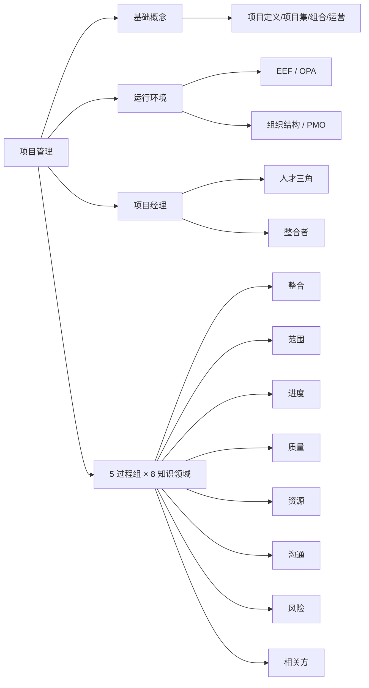

# 09 数据中心项目管理

> 对应考纲：数据中心项目管理（15%）
> 官方要求：了解基本概念与运行环境、了解项目经理作用与能力、了解管理流程与各知识领域、了解常见工具并应用
> 本章特点：**纯记忆、结构极清晰**，是 15% 里最容易拿满的一块；重点在「5 过程组 × 8 知识领域」框架 + 高频工具

---

## 知识地图

---

## 1. 项目管理基础

### 1.1 项目的定义（PMI）

> **项目是为创造独特的产品、服务或成果而进行的临时性工作。**

例：完成一个机房包间的带外管理系统布线、建设一座完整的数据中心。

**四个核心要点**：

| 要点 | 含义 |
| --- | --- |
| **独特的产品、服务或成果** | 项目是独特的，可交付成果也是独特的 |
| **临时性工作** | 有明确起点和终点 |
| **项目驱动变革** | 把组织从一个状态推进到另一个状态（如人工运维 → 自动化智能运维） |
| **项目创造商业价值** | 成果能为相关方带来效益 |

**项目结束的四种情形（必考）**：

1. 达成项目目标，或**无法达成**项目目标
2. **资金耗尽**或资源（人力和物资）缺失
3. 项目**需求不复存在**
4. 法律或便利原因

### 1.2 项目启动背景（四种）

| 背景 | 数据中心例子 |
| --- | --- |
| 符合法规、法律或社会要求 | 按工信部/住建部标准改造基础设施；按隐私法规更新 App 策略 |
| 满足相关方要求或需求 | 建更先进的电商物流体系满足「当日达」 |
| 执行、变更业务或技术战略 | 阿里数据中心 HAIL 架构升级 |
| 创造、改进或修复产品、过程或服务 | 淘宝 App 不定期更新推送 |

### 1.3 项目管理的重要性

项目管理 = 将**知识、技能、工具和技术**应用于项目活动，以满足项目要求。能帮助个人/群体/组织：

- 达成业务目标（如某季度服务器自维修率提升 10%）
- 满足相关方期望（如 IoT 资产系统让资产岗从容盘点）
- 提高可预测性（如用挣值分析提升完工成本与时间预测）
- 提高成功概率
- 在适当时间交付正确产品（如按进度基准完成 4 台柴油发电机测试验收）
- 解决问题和争议
- 及时应对风险
- 管理制约因素（范围、质量、进度、成本：做什么、做成什么样、多久、多少钱）
- 更好地管理变更

### 1.4 项目、项目集、项目组合、运营

| 概念 | 定义 | 数据中心例子 |
| --- | --- | --- |
| **项目** | 临时性工作，创造独特成果 | 完成一个机房包间布线 |
| **项目集** | 一组**相互关联且需协调管理**的项目 | 新数据中心建设：地块采购 + 基础设施建设 + IT 建设 |
| **项目组合** | 管理在特定时间内同时进行的多个项目集和项目 | 组织级的所有基建/IT/研发项目 |
| **运营** | 关注产品的持续生产和/或服务的持续运作，用最优质资源满足客户需求 | 数据中心日常运维 |

**项目与运营的关系**：

- 项目关注业务或组织运营的**改变**；项目交付新产品/新服务给运营
- 二者在产品生命周期不同时点交叉：
  - 新产品开发、产品升级或提高产量（如液冷环境下开发新 SOP）
  - 改进运营或产品开发流程（瀑布 → 敏捷；运维 → DevOps）
  - 产品生命周期结束阶段（交付团队与运营团队沟通）
  - 每个收尾阶段（项目收尾 = 产品移交运营并培训）

### 1.5 项目管理过程与过程组

- 项目生命周期通过一系列**项目管理活动**（项目管理过程）进行
- 每个过程通过合适的**工具和技术**把**输入**转化为**输出**（输出可以是可交付成果或结果）

**五个过程组（按逻辑分组，必背）**：

| 过程组 | 定义 |
| --- | --- |
| **启动** | 定义一个新项目或现有项目的新阶段，授权开始该项目或阶段 |
| **规划** | 明确项目范围，优化目标，为实现目标制定行动方案 |
| **执行** | 完成项目管理计划中确定的工作，满足项目要求 |
| **监控** | 跟踪、审查和调整项目进展与绩效，识别必要变更并启动变更 |
| **收尾** | 正式完成或结束项目、阶段或合同 |

### 1.6 八个知识领域（定义，必背）

| 知识领域 | 定义 |
| --- | --- |
| **整合管理** | 统一和协调各过程组的各个过程和活动 |
| **范围管理** | 确保项目**做且只做**所需的全部工作 |
| **进度管理** | 管理项目进展，以**按时完成** |
| **资源管理** | 识别、获取和管理所需资源（人力 + 实物） |
| **质量管理** | 把组织质量政策应用于规划、管理、控制项目和产品质量要求 |
| **沟通管理** | 确保项目信息及时且恰当地规划、收集、生成、发布、存储、检索、管理、控制和监督 |
| **风险管理** | 规划风险管理、识别、分析、规划应对、实施应对、监督风险 |
| **相关方管理** | 识别有关人员/团体/组织，分析和管理其期望与影响 |

### 1.7 过程组 × 知识领域矩阵（高频，能默写主干）

| 知识领域 | 启动 | 规划 | 执行 | 监控 | 收尾 |
| --- | --- | --- | --- | --- | --- |
| **整合** | 制定项目章程 | 制定项目管理计划 | 指导与管理项目工作；管理项目知识 | 监控项目工作；实施整体变更控制 | 结束项目或阶段 |
| **范围** |  | 规划范围管理；收集需求；定义范围；创建 WBS |  | 确认范围；控制范围 |  |
| **进度** |  | 规划进度管理；定义活动；排列活动顺序；估算活动持续时间；制定进度计划 |  | 控制进度 |  |
| **资源** |  | 规划资源管理；估算活动资源 | 获取资源；建设团队；管理团队 | 控制资源 |  |
| **质量** |  | 规划质量管理 | 管理质量 | 控制质量 |  |
| **沟通** |  | 规划沟通管理 | 管理沟通 | 监督沟通 |  |
| **风险** |  | 规划风险管理；识别风险；定性分析；定量分析；规划风险应对 | 实施风险应对 | 监督风险 |  |
| **相关方** | 识别相关方 | 规划相关方参与 | 管理相关方参与 | 监督相关方参与 |  |

> 记忆技巧：**只有「整合」有启动和收尾；「范围/进度」重点在规划；「资源/质量/沟通/风险/相关方」都是「规划-执行-监控」三段式**。

---

## 2. 项目的运行环境

### 2.1 事业环境因素（EEF）

**定义**：源于项目外部（或企业外部）、**客观存在**、项目团队**无法控制**、会对项目产生影响/限制/指令作用的各种条件。

| 分类 | 例子 |
| --- | --- |
| **组织内部** | 组织文化、结构和治理（如阿里「新六脉神剑」影响产品服务质量）；设施和资源的地理分布（选址考虑自然冷源）；基础设施（整机柜技术影响上架效率）；信息技术软件（进度软件、配置管理、工单系统）；资源可用性（工程师存量制约排班）；员工能力（专业知识、技能影响质量/成本/进度） |
| **组织外部** | 市场条件、社会和文化、法律、商业数据库（行业统计/国民经济数据）、政府和行业标准、气候 |

### 2.2 组织过程资产（OPA）

**定义**：项目执行组织**特有并可以使用**的各种计划、过程、政策、程序、知识库；包括工件、实践、知识，以及以往项目的经验教训与历史信息。

| 分类 | 例子 | 更新者 |
| --- | --- | --- |
| **过程、政策和程序** | 现场运维 SOP、建设施工规范、施工验收表单、钉钉请假报销流程 | 通常由 **PMO** 或项目外其它团队更新；项目可直接使用或裁剪 |
| **组织知识库** | 自维修项目积累的故障案例、解决方法 | **项目期间**结合项目信息持续更新 |

> 对比记忆：**EEF 是「环境给的、你改不了」；OPA 是「组织攒的、你能拿来用」**。

### 2.3 组织结构

确定组织结构要考虑：专业能力、职责分配、授权、成本、物理位置、决策升级渠道、控制力度、设计灵活性与简单性、运作效率等。**不存在一种组织结构适合任何组织**。

常见类型：职能型（集中式）、事业部型、矩阵型、混合型、项目导向型、虚拟型、PMO。

### 2.4 PMO（项目管理办公室）

**定义**：对与项目相关的治理过程进行标准化，并促进资源、方法论、工具和技术共享的组织结构。

| 类型 | 职责 |
| --- | --- |
| **支持型** | 项目顾问：提供模板、最佳实践、培训、信息通道、经验教训 |
| **控制型** | 不仅支持，还通过各种手段要求项目服从 PMO |
| **指令型** | 直接管理和控制项目；项目经理由 PMO 指定并向其报告 |

---

## 3. 项目管理者的角色

### 3.1 三种经理

| 角色 | 职责 |
| --- | --- |
| **项目经理** | 由执行组织委派，**带领团队实现项目目标**；可能从启动参与到结束，也可能在启动前参与商业分析/商业论证 |
| 职能经理 | 专注某个职能领域或业务部门的管理 |
| 运营经理 | 负责保证业务运营的高效 |

### 3.2 知识与技能

项目经理不必是技术最优的，但一定是**知识面较广、沟通与协调能力较优**的人（像乐队指挥：不必会每种乐器，但要有音乐知识、理解力和经验）。

### 3.3 人才三角（PMI，必考）

| 能力 | 含义 |
| --- | --- |
| **技术项目管理** | 与项目、项目集、项目组合管理特定活动相关的知识、技能和行为（角色履行的技术方面）；有效运用项目管理知识实现预期成果 |
| **领导力** | 指导、激励和带领团队所需的知识、技能和行为；包括沟通协调、抗压、解决问题、批判性思考、人际关系 |
| **战略和商务管理** | 关于行业和组织的知识与专业技能；纵览组织概况并有效协商、执行有利于战略调整与创新的决策与行动 |

### 3.4 作为「整合者」的项目经理

**整合是项目经理的一项关键技能，「整合者」是最重要的角色**。整合兼具**统一、合并、连接、一体化**的性质。

三个层面的整合（多选）：

1. **过程层面**：整合相互作用的各个项目过程
2. **认知层面**：掌握并运用各知识领域的知识和技能
3. **背景层面**：充分认识项目背景和各种新因素

整合管理包括：选择资源分配方案、平衡相互竞争的目标和方案、管理知识领域之间的依赖关系。

---

## 4. 项目整合管理

### 4.1 七个子过程

| 子过程 | 定义 |
| --- | --- |
| **制定项目章程** | 编写正式批准项目并授权项目经理使用组织资源的文件 |
| **制定项目管理计划** | 定义、准备和协调计划的所有组成部分，整合为综合计划 |
| **指导与管理项目工作** | 领导和执行计划中确定的工作，实施已批准的变更 |
| **管理项目知识** | 使用现有知识并生成新知识，帮助组织学习 |
| **监控项目工作** | 跟踪、审查和报告整体进展，实现绩效目标 |
| **实施整体变更控制** | 审查、批准变更；管理对可交付成果、OPA、项目文件和计划的变更 |
| **结束项目或阶段** | 终结项目、阶段或合同的所有活动 |

### 4.2 制定项目管理计划

- **输入**：项目章程、其它过程的输出、EEF 和 OPA
- **工具与技术**：专家判断、数据收集（头脑风暴、核对单、焦点小组、访谈）、人际关系与团队技能（冲突管理、引导）、会议
- **输出**：项目管理计划

**工具要点**：

| 工具 | 要点 |
| --- | --- |
| 专家判断 | 具有专业学历、知识、技能、经验或培训经历的任何小组或个人 |
| 头脑风暴 | 短时间获取大量创意；过程中**不评价**他人想法，收集后再分析 |
| 焦点小组 | 召集相关方和主题专家就某一主题（如风险）讨论 |
| 访谈 | 与相关方直接交谈 |
| 会议 | 明确主题、会前通知与材料分发、议事日程与规则、参与方/主持人/记录者、会后纪要并正确分发 |

### 4.3 项目管理计划与基准

- 项目管理计划**不是一蹴而就**的，是一份**综合文件**，是其它各管理过程输出计划的集合；各部分可详可略
- **基准（Baseline）**：经审批流程批准的工作产品版本；**只有经过正式变更流程才能变更**；用来与实际结果比较（如综合布线完工时点被批准为 7 月最后一个工作日，超过即违反基准）
- 项目管理计划应：具备**韧性**（适应变化）、尽可能**基准化**（便于考核）、**渐进明细**（随项目推进更新，但需受控批准）

### 4.4 指导与管理项目工作

- 属于**执行过程组**
- 项目执行一般以**开工会议（kick-off）**为标志：计划基本完成，进入正式实施
- 尤其关注**工作授权**：「**无授权不操作**」——保证工作在正确的时间、由正确的人、操作正确的对象
- 输出：可交付成果、**工作绩效数据**（原始观察结果和度量值，如某日完成多少设备上架）、**问题日志**（差距、不一致、意外冲突；含类型、提出者与时间、描述、优先级、负责人、目标解决日期、解决方法、状态）、变更请求、计划更新、项目文件更新、OPA 更新

### 4.5 实施整体变更控制

- 审查所有变更请求、批准变更、管理对可交付成果/项目文件/计划的变更，并沟通处理结果
- **变更一般发生在**：
  1. 新增或减少需求导致范围、进度、成本等基准变更
  2. 质量管理中的预防措施、纠正措施、缺陷补救措施影响基准
  3. 风险管理中实施风险应对产生的变更（增加资源、成本、进度）
  4. 为更新受控文件（如管理流程）以适应新实践
- **变更可以口头提出，但所有变更请求必须以书面形式正式记录**，纳入变更管理或配置管理流程
- 常规流程：变更申请 → 记录 → 变更评审 → 批准？→（是）调整计划或基准 → 更新变更申请表 → 通知相关方 → 执行变更 → 变更审查 → 是否落实？→ 更新变更日志 / 更新 OPA → 结束；（否）更新申请表 → 通知相关方
- 工具：变更管理系统/配置管理系统、变更会议、投票、多标准决策

### 4.6 项目收尾：合标、合法、完工、交付（必考）

| 动作 | 含义 |
| --- | --- |
| **合标** | 为达到阶段或项目的**完工或退出标准**而进行的活动（如布线必须完成点亮测试才能验收） |
| **合法** | 为关闭项目合同协议或阶段合同协议而进行的活动（符合合同收尾条件） |
| **完工** | 为完成收尾工作而开展的活动（总结经验教训、审计项目、整理知识、文件归档） |
| **交付** | 为移交产品/服务/成果所必须开展的工作（交付竣工报告、光盘、线缆测试报告） |

此外可向团队、客户、合作伙伴收集改进建议，做满意度调查。

---

## 5. 项目范围管理

### 5.1 两种范围

| 范围 | 定义 |
| --- | --- |
| **产品范围** | 要交付的产品、服务或成果的**特征与功能** |
| **项目范围** | 为完成具有规定特征和功能的产品/服务/成果**所必须完成的工作** |

**范围问题的三个来源**：客户（范围蔓延）、领导（变更压力）、团队成员（镀金）。

### 5.2 六个子过程

| 子过程 | 作用 |
| --- | --- |
| 规划范围管理 | 记录如何定义、确认、控制范围 |
| 收集需求 | 确定、记录并管理相关方的需要和需求 |
| 定义范围 | 制定项目和产品的详细描述 |
| 创建 WBS | 把可交付成果和项目工作分解为更小、更易管理的组件 |
| 确认范围 | **正式验收**已完成的可交付成果 |
| 控制范围 | 监督项目和产品范围状态，管理范围基准变更 |

### 5.3 收集需求

- 需求：根据特定协议或规范，项目必须满足的条件或能力，或产品/服务/成果必须具备的条件或能力
- **需求需要基准化**，但只有**明确的、可跟踪的、完整的、相互协调的、且主要相关方认可**的需求才能作为基准
- 需求是 **WBS 的基础**，也是成本、进度、质量规划的基础，有时也是采购的基础

**SMART 原则（必考）**：

| 字母 | 含义 |
| --- | --- |
| **S**pecific | 具体的（实在的而非模糊不清的） |
| **M**easurable | 可测量的（可量化或细化） |
| **A**ttainable | 可实现的（经过努力可满足） |
| **R**elevant | 相关的（与战略目标、项目目标一致） |
| **T**ime-bound | 有时限的（有明确截止日期） |

**收集需求的工具（多选）**：

| 工具 | 场景 |
| --- | --- |
| 头脑风暴、访谈、焦点小组 | 通用 |
| **问卷调查** | 受众数量大、多样化、需快速完成且需统计分析 |
| **标杆对照** | 对比其它组织实践，识别最佳实践 |
| **文件分析** | 分析合同、政府文献、问题日志、OPA、流程等 |
| **投票** | 一致同意、大多数同意、相对多数同意 |
| **名义小组技术 NGT** | 通过投票排列最有用的创意或建议 |
| **多标准决策分析** | 决策矩阵，按风险水平、不确定性、价值收益等标准评估排序（如冷却技术选型、供应商遴选） |
| **亲和图（KJ 图）** | 对大量建议/意见/想法分组分类 |
| **思维导图** | 把创意整合成一张图，反映共性与差异 |

**需求的三个层次**（挖掘深层需求）：

- **明显的利益**：产品、价格、质量
- **隐藏的利益**：关系、维护、交往
- **深藏的利益**：情感、感受、信任

### 5.4 需求跟踪矩阵

把产品需求从其**来源**连接到能满足需求的**可交付成果**的表格：

- 把每个需求与业务目标/项目目标联系，确保需求具有**商业价值**
- 提供在**整个生命周期跟踪需求**的方法
- 确保被批准的每项需求在项目结束时**都能被交付**
- 为管理产品范围变更提供框架

典型列：项目名称、标识、关联标识、需求描述、业务需要/机会/目的和目标、项目目标、WBS 可交付成果、产品设计、产品开发、测试案例。

### 5.5 WBS（工作分解结构）

- 创建 WBS 前需先基于需求**定义范围**形成范围说明书，再基于范围说明书创建 WBS
- WBS：把项目范围和可交付成果**逐步分解**为更小、更便于管理的组成部分

**操作方法**：

1. 识别分析可交付成果及相关工作
2. 确定 WBS 的结构和编排方法
3. **自上而下逐层分解**
4. 为 WBS 组成部分制定和分配标识编码
5. 核实分解程度是否恰当

**判断分解是否恰当**：

- 是否**充分且必要**？—— **100% 原则**
- 是否能清晰完整地定义？
- 能否被恰当地安排进度、预算、资源分配？

### 5.6 确认范围 vs 控制范围（必考对比）

| 比较项 | 控制范围 | 确认范围 |
| --- | --- | --- |
| 实质 | **监控、管理变更** | **验收** |
| 实施时间 | **项目全过程** | 项目结束或阶段结束 |
| 实施主体 | **项目团队** | **客户或项目发起人** |

**范围基准三件套**：

1. 经审批的**项目范围说明书**（产品范围描述、可交付成果、验收标准、项目的除外责任）
2. **WBS**
3. **WBS 词典**（对 WBS 各组成部分的详细描述）

**确认范围的输出**：已完成并验收的可交付成果、未通过验收的可交付成果及原因、相关证明文件。

**控制范围的输出**：工作绩效信息（范围偏差及原因、对进度成本影响、未来预测）、变更请求（在整体变更控制下管理：或调整基准，或维持基准并把偏差纳入绩效报告、总结经验教训）。

**控制范围工具**：

| 工具 | 回答的问题 |
| --- | --- |
| 偏差分析 | 当前状态如何？基准 vs 实际，偏差是否在临界区间内、是否需要纠偏/预防 |
| 趋势分析 | 未来会怎样？绩效在改善还是恶化，是否需要赶工或调整活动逻辑顺序 |

---

## 6. 项目进度管理

### 6.1 概述

- 进度管理：在规定时间内完成任务
- 通过进度规划制定详尽进度计划，说明项目**如何以及何时**交付范围中定义的产品/服务/成果；也是沟通和管理相关方期望、报告绩效的基础
- 制定进度计划一般用**关键路径法**，再综合考虑活动属性、计划日期、持续时间、资源可用性、依赖关系，创建更贴近实际的进度模型
- 小型项目中「定义活动、排列顺序、估算持续时间、制定进度模型」可视为一个过程
- 大型组织需长期路线图，可能采用预测型、适应型或混合方法

### 6.2 定义活动

- 作用：把 **WBS 工作包**分解为**进度活动**，作为估算、规划、执行、监控的基础
- 工具：专家判断、会议、**分解**、**滚动式规划**
- **滚动式规划**：迭代式规划技术——**详细规划近期**要完成的工作，**粗略规划远期**工作
- 输出：活动清单、活动属性、**里程碑清单**、变更请求、计划更新

| 输出 | 内容 |
| --- | --- |
| 活动清单 | 每个活动的标识、工作范围描述，让成员知道要完成什么 |
| 活动属性 | 开展地点、日历安排、活动类型，有助于编制进度计划 |
| 里程碑清单 | 列出所有里程碑，指明是强制性还是选择性 |

### 6.3 排列活动顺序

- 作用：定义活动之间的逻辑顺序，在既定制约因素下获得最高效率
- 工具：**紧前关系绘图法（PDM）**、提前量和滞后量、项目管理信息系统
- **四种逻辑关系（必背）**：

| 关系 | 含义 |
| --- | --- |
| **FS**（结束-开始） | A 结束，B 才能开始（最常用） |
| **SS**（开始-开始） | A 开始，B 才能开始 |
| **FF**（结束-结束） | A 结束，B 才能结束 |
| **SF**（开始-结束） | A 开始，B 才能结束 |

- **四种依赖关系**：

| 依赖 | 说明 |
| --- | --- |
| **强制性依赖** | 合同要求或工作内在性质决定，硬性（如混凝土养护后才能上设备） |
| **选择性依赖** | 可根据实际需要自主定义，软性 |
| **外部依赖** | 依赖项目外部因素（设备上架前供应商必须完成物流供货） |
| **内部依赖** | 项目团队内部活动的依赖（操作设备前必须获得工单或授权） |

- **提前量（lead）**：如最终验收前可提前开始分批验收（FS-3 天）
- **滞后量（lag）**：如提交入室手续后需等待约 1 周才能进园区（SS+6 天）

### 6.4 估算活动持续时间

| 方法 | 说明 |
| --- | --- |
| **类比估算** | 参考类似活动/项目，需要专家参与 |
| **参数估算** | 基于历史数据与数据间的数学统计关系 |
| **三点估算** | 用最乐观、最可能、最悲观历时计算期望历时 |
| **自下而上估算** | 根据 WBS 自下而上逐层汇总 |
| 会议和决策 | — |

**三点估算**（PERT）：`期望时间 = (乐观 + 4×最可能 + 悲观) / 6`

### 6.5 制定进度计划

**流程**：理想进度计划（进度网络图 → **关键路径法**）→ 资源优化 → 假设与模拟 → 提前量/滞后量 → 进度压缩 → 主要相关方批准 → 最终进度计划。

| 工具 | 要点 |
| --- | --- |
| **进度网络分析** | 分析最早开始/最早完成/最晚开始/最晚完成 |
| **关键路径** | **不考虑任何资源限制**；进度网络图上**总工期最长**的那条路径 |
| **资源优化** | 资源平衡 vs 资源平滑（见下） |
| **假设情景分析与模拟** | 「如果某情景出现会怎样」；主要用**蒙特卡洛**工具估算可能的进度偏差 |
| **提前量/滞后量** | — |
| **进度压缩** | 在不缩减范围的前提下缩短工期：**赶工**（加资源/加班，增成本）与**快速跟进**（并行，增风险） |

**资源平衡 vs 资源平滑（必考）**：

| 技术 | 做法 | 对工期影响 |
| --- | --- | --- |
| **资源平衡** | 在资源需求与供给之间取得平衡（共享/关键资源只在特定时间可用、数量有限或被过度分配） | **可能延长项目工期** |
| **资源平滑** | 调整活动，使资源需求不超过限制，活动只在**浮动时间内**调整 | **一般不影响总工期**，但可能无法实现所有资源优化 |

**输出：进度计划的三种形式**：**里程碑计划、横道图、详细进度计划**。至少要包括每个活动的计划开始日期和计划完成日期。

---

## 7. 项目质量管理

### 7.1 质量的定义

- **PMBOK**：质量是一系列**内在特征满足要求的程度**
- **ISO 9000**：质量是综合概念，**不要求技术特性越高越好**，而追求性能、成本、数量、交货期、服务等因素的**最佳组合**（最适当）

### 7.2 预防胜于检查（必考）

| 层面 | 手段 | 目的 |
| --- | --- | --- |
| **过程** | 预防 | 保证过程中不出现错误 |
| **成果** | 属性抽样 / 变量抽样 | 属性：结果是合格还是不合格；变量：有多合格 |
| 检查 | — | 保证质量缺陷不流入客户手中 |

### 7.3 质量成本

| 类别 | 子类 | 例子 |
| --- | --- | --- |
| **一致性成本** | 预防成本 | 培训投入、设施设备投入、时间投入 |
|  | 评估成本 | 测试、检查、破坏性测试 |
| **非一致性成本** | 内部失败成本 | 返工、报废 |
|  | 外部失败成本 | 债务、业务流失、保修 |

### 7.4 三个子过程

| 子过程 | 作用 |
| --- | --- |
| **规划质量管理** | 为如何管理和核实质量提供指南和方向 |
| **管理质量** | 提高实现质量目标的可能性，识别无效过程和导致质量低劣的原因 |
| **控制质量** | 核实可交付成果和工作已达到主要相关方质量要求，可供验收 |

### 7.5 规划质量管理的输出

**质量管理计划**包括：

- 项目采用的**质量标准**（如《数据中心设计规范 GB 50174-2017》）
- 项目的**质量目标**（如综合布线端口故障率、标签准确率）
- **质量角色与职责**（驻场运维、操作岗、资产岗、供应商）
- 规划的质量控制与质量管理活动（定期安全检查、合规检查、培训）
- 项目使用的**质量工具**（施工 SOP、流程图、统计图表）
- 出现质量偏差时的**纠正程序**

**质量测量指标**：按时完成任务百分比、以 CPI 测量的成本绩效、故障率、缺陷数、MTBF、代码错误量、客户满意度、测试覆盖度（如布线点亮测试 100%）。

### 7.6 管理质量的工具（七种图 + 审计，必考）

| 工具 | 用途 |
| --- | --- |
| **核对单** | 结构化工具，列出特定组成部分，核实步骤是否执行/需求是否满足 |
| **因果图（鱼骨图）** | 分析导致某种结果的**根本原因**，直观显示因素如何与问题相联系 |
| **流程图（过程图）** | 显示输入转化为输出的步骤顺序与分支（活动、决策点、循环、并行路径），帮助识别质量缺陷点 |
| **直方图** | 垂直条形图显示特定情况的发生次数（柱=属性，高=次数） |
| **帕累托图** | 特殊直方图，按缺陷数量排序找主要原因；**80/20 法则**：80% 的问题由 20% 的原因导致 |
| **散点图** | 显示两个变量关系（正相关/负相关/不相关），越接近对角线关系越紧密 |
| **审计** | 结构化审查，确定项目活动是否遵守组织质量政策、过程与程序；由**项目外部团队**（内审部门、PMO、外聘机构）开展 |
| **质量改进方法** | **PDCA**（Plan-Do-Check-Action）；**六西格玛** |

**质量审计的目的（多选）**：识别良好及最佳实践；识别违规、差距、不足；分享组织或行业类似项目的良好实践；提供协助以改进质量过程；为组织经验教训知识库积累做贡献。

**六西格玛**：

- 是一种**质量尺度和追求目标**：出错率不超过**百万分之 3.4**
- 是一套科学的工具和方法：**DMAIC**（定义-测量-分析-改进-控制，用于改进现有流程）与 **DMADV**（定义-测量-分析-设计-验证，用于设计新流程）

### 7.7 控制质量

- 核实可交付成果和工作已达到主要相关方质量要求，可供最终验收
- 主要工具：**核查表**（简单计数表，统计缺陷数）、**控制图**（生产制造企业常用）；管理质量的工具也可借鉴
- 输出：质量控制测量结果、**核实的可交付成果**（确定正确性，如标签正确率）、工作绩效信息（返工、纠正措施）、变更请求

---

## 8. 项目资源管理

### 8.1 概述

- 包括识别、获取和管理所需资源；资源 = **团队资源（人力资源）+ 实物资源（设备、材料、设施）**；本课程重点关注人力资源
- **PMI 的 HR 理念**：强调团队与个人共同发展；不简单牺牲个人利益保全项目利益；强调沟通；强调积极主动；项目成功是大家共同努力的结果

### 8.2 主要子过程

| 子过程 | 作用 |
| --- | --- |
| 规划资源管理 | 根据项目类型和复杂度确定资源管理方法与管理程度 |
| 估算活动资源 | 明确资源种类、数量和特性 |
| 获取资源 | 获得所需团队成员、设施、设备等 |
| 建设团队 / 管理团队 | 改进协作、增强人际关系技能、激励员工、减少冲突、提升整体绩效 |
| 控制资源 | 确保资源按计划可用并监督使用 |

**项目经理的人力资源责任**：既是领导者又是管理者；建设高效团队；培养团队技能与能力；提高并保持满意度与积极性；留意并支持职业与道德行为。

### 8.3 规划资源管理

- 工具：**层级型**（WBS、OBS 组织分解结构、RBS 资源分解结构）、**文本型**（职责、职权、能力、资格）、**责任分配矩阵 RAM**
- **RACI 模型（必考）**：

| 字母 | 含义 |
| --- | --- |
| **R**esponsible | 执行（干活的人） |
| **A**ccountable | 负责（最终拍板、唯一） |
| **C**onsult | 咨询支持 |
| **I**nform | 被告知 |

- 输出：**资源管理计划**、**团队章程**（团队价值观、共识、工作指南；含沟通指南、决策标准与过程、冲突解决方法、会议指南、团队共识）

### 8.4 估算活动资源

- 输出：**资源需求清单**（活动、资源种类、等级、数量、相关假设）、**估算依据**（估算方法、历史数据、假设、制约、范围、风险、置信水平）、**RBS**

### 8.5 建设与管理团队

**建设高效团队是项目经理的主要职责之一**：开放有效的沟通、创造团队建设机遇、建立信任、以建设性方式管理冲突、鼓励合作型问题解决。

**五种权力（必考）**：

| 权力 | 来源 |
| --- | --- |
| **正式权力** | 基于职位 |
| **奖励权力** | 激励和引导 |
| **惩罚权力** | 强迫、威胁；尽量少用、杜绝滥用 |
| **专家权力** | 个人技术、管理专业知识和经验带来的影响力 |
| **参照权力** | 个人魅力、与权威人物的关系及潜在影响力 |

**四种领导风格**：

| 风格 | 做法 | 适用 |
| --- | --- | --- |
| **命令/指挥型** | 告诉别人做什么、怎么做 | 能力差但服从安排的成员 |
| **教练型** | 信息大量来自成员与观察，一起讨论，**PM 决策** | 需要指导的团队 |
| **参与型** | 与成员一起讨论，**共同决策** | 能力较强的团队 |
| **授权型** | 只告诉结果，授权成员自主工作 | 成熟团队 |

**塔克曼团队演进五阶段**：**形成 → 震荡 → 规范 → 成熟 → 解散**。

**冲突管理（必考）**：

| 维度 | 内容 |
| --- | --- |
| 冲突来源 | 资源稀缺；项目活动的进度优先级排序；个人工作风格差异 |
| 影响因素 | 冲突的重要性与激烈程度；解决冲突的紧迫性；涉及人员的权力；维持良好关系的重要性；解决冲突的动机 |
| **五种解决方法** | **撤退/回避、缓和/包容、妥协/调解、强迫/命令、合作/解决**（合作/解决通常最优） |

**团队绩效评价指标**：成员技能提升、工作产出提升、离职率降低、凝聚力加强。

---

## 9. 项目沟通管理

### 9.1 沟通类型（四种）

| 类型 | 场景 |
| --- | --- |
| **正式书面** | 解决复杂问题、沟通管理计划、合同、章程 |
| **正式口头** | 演讲、谈判 |
| **非正式书面** | 备忘录、便签、笔记 |
| **非正式口头** | 私下交流，主要用于人际交往 |

**注重非语音信息**：能当面沟通绝不打电话；能打电话绝不发消息；必须发邮件时尽量辅以电话。

### 9.2 沟通的 7-38-55 法则（必考）

| 组成 | 占比 |
| --- | --- |
| 文字（语言） | **7%** |
| 有声语言（语调） | **38%** |
| 肢体语言 | **55%** |

### 9.3 书面沟通 5C 原则

| 字母 | 含义 |
| --- | --- |
| **C**orrect | 正确的语法和拼写 |
| **C**oncise | 简洁的表达、没有多余文字 |
| **C**lear | 清晰的目的和表述 |
| **C**oherent | 连贯的思维逻辑 |
| **C**ontrolling | 受控的语句和想法承接 |

### 9.4 沟通模型

`发送者 → 编码 → 信道（含噪声）→ 解码 → 接收者 → 反馈`

- **发送者责任**：确保信息清晰完整；确认信息被正确接收和理解
- **接收方责任**：完整接收、正确理解；告知已收到或作出适当回应

### 9.5 规划沟通管理

- 基于每个相关方/群体的信息需求、可用 OPA、具体项目需求，为沟通活动制定方法和计划
- 工具：
  - **沟通需求分析**：确定相关方信息需求（类型、格式、对相关方的价值、频率）
  - **沟通方法**：**推式**（发给特定受众，确保发送但不确保被理解，如邮件、传真、新闻稿）、**拉式**（信息量大或受众广，需接收者主动访问，如内网公告、网盘）、**交互式**（实时多向，如会议、电话、即时信息、视频会议）
  - **数据表现——参与度评估矩阵**
- 输出：**沟通管理计划**（沟通什么、为何沟通、如何沟通、何时沟通、由谁沟通、反馈方式）

### 9.6 管理与监督沟通

- 管理沟通：确保信息及时恰当收集、生成、发布、存储、检索、管理、监督和最终处置
- 监督沟通：确保满足项目及相关方信息需求，按计划优化信息传递流程
- **有效沟通的做法**：为相关方提供机会、选择合适的媒介、写作风格、会议管理、演示、引导、积极倾听
- 输出：项目沟通记录（绩效报告、可交付成果状态、进度、成本清单、演示等）、工作绩效信息、变更请求、计划与文件更新

---

## 10. 项目风险管理

### 10.1 风险的定义与分类

> **风险是一种不确定的事件或条件，一旦发生，会对至少一个项目目标造成影响（积极或消极）。**

数据中心制定 SOP、管理规范、技术标准的重要目的就是**减少不确定性**：降低消极风险（威胁）的概率或影响，提升积极风险（机会）的概率与收益。

**按对数据的掌握程度分类（必考）**：

| 类型 | 说明 | 例子 |
| --- | --- | --- |
| **已知-已知风险** | 明确可能发生什么，且对概率和影响有准确了解 | 人的死亡 |
| **已知-未知风险** | 知道可能发生什么，但不了解概率或严重性 | 机器故障 |
| **未知-未知风险** | 发生前一无所知 | 车祸（飞来横祸） |

**风险 vs 问题（必考）**：

| 维度 | 风险 | 问题 |
| --- | --- | --- |
| 时间 | **未发生**的事件 | **已发生**的事件 |
| 记录 | **风险登记册** | **问题日志** |
| 数量期望 | 越多说明风险管理越细致、想得越周到 | **越少越好** |
| 价值 | 预测并积极管理风险是**增值活动** | 解决已发生的问题**不是增值活动** |
| 关系 | 二者可相互转化 | 同左 |

**非事件类风险（新兴）**：

- **模糊性风险**：如 SOP 对某些操作步骤有语义歧义，指导新人时隐含风险
- **变异性风险**：如土建施工遭遇反常天气

### 10.2 四个子过程

| 子过程 | 作用 |
| --- | --- |
| 规划风险管理 | 确保风险管理水平、方法和可见度与项目风险程度及项目对组织的重要程度相匹配 |
| 识别风险 | 记录单个风险及整体风险来源，汇集信息以便恰当应对 |
| 分析风险 | 定性/定量评估概率与影响，排列优先级，量化整体风险敞口 |
| 应对风险 | 制定应对方法和策略，按计划执行，管理整体与单个风险 |

### 10.3 规划风险管理

输出**风险管理计划**（项目管理计划的组成部分）：风险管理战略、资源支持、工具（风险报告格式、风险类别、概率和影响矩阵、概率与影响定义、角色与职责）。

**风险类别（四类）**：技术风险（采用未经验证的新技术）、管理风险（沟通不畅导致信息失真）、商业风险（供应商可靠度、客户稳定性）、外部风险（法律、环境、天气、监管）。

**风险概率和影响定义（示例）**：

| 定义 | 概率 | 进度影响 | 成本影响 | 质量影响 |
| --- | --- | --- | --- | --- |
| 很高 | >70% | >6 个月 | >500 万 | 对整体功能影响非常大 |
| 高 | 51%–70% | 3–6 个月 | 100–500 万 | 对整体功能影响重大 |
| 中 | 31%–50% | 1–3 个月 | 50–100 万 | 对关键功能有一些影响 |
| 低 | 11%–30% | 1–4 周 | 10–50 万 | 对整体功能有微小影响 |
| 很低 | 1%–10% | 1 周 | <10 万 | 对辅助功能有微小影响 |
| 无 | <1% | 不变 | 不变 | 功能不受影响 |

**概率和影响矩阵**：事先定义概率与影响，在风险分析中应用（威胁与机会分别有矩阵）。

### 10.4 识别风险

**工具（多选）**：

| 工具 | 要点 |
| --- | --- |
| 头脑风暴、核对单、访谈 | 数据收集 |
| 专家判断、会议 | — |
| **提示清单** | 预设的风险类别清单，作为框架协助建立想法。常用 **PESTLE、TECOP、VUCA** |
| **根本原因分析** | 发现导致问题的深层次原因并制定预防措施，追根究底中发现风险 |
| **假设条件和制约因素分析** | 分析其有效性，判定哪些会引发风险 |
| **SWOT 分析** | 优势（机会）、劣势（威胁） |
| **文件分析** | 结构化审查过去项目计划、风险登记册、经验教训 |

**PESTLE（必考六项）**：

| 字母 | 含义 |
| --- | --- |
| **P**olitical | 对组织或团队产生影响的政治力量的政策、法律、法规 |
| **E**nvironment | 活动、产品或服务中能与环境发生相互作用的要素 |
| **S**ocial | 历史、文化传承、价值观念、教育水平、风俗习惯 |
| **T**echnological | 发明创造、新技术、新工艺、新材料、技术发展趋势 |
| **L**egislative | 外部法律、法规、司法状况、公民法律意识 |
| **E**conomic | 经济结构、产业布局、资源状况、经济发展水平 |

**输出**：**风险登记册**（单个风险详细信息：风险、潜在责任人、潜在应对方法、概率、影响、敞口水平、责任人、策略）、**风险报告**（整体风险信息 + 单个风险概述）。

### 10.5 分析风险

| 类型 | 适用 | 工具 |
| --- | --- | --- |
| **定性分析** | 所有项目；主观性较强，评估单个风险现有信息质量，用概率与影响评估优先级，**为每个风险识别明确责任人** | 数据分析（风险数据质量评估、风险概率和影响评估、其它参数评估：紧迫性、临近性、潜伏期、可管理性、可控性、可监测性、战略影响力、密切度）、数据表现（**层级图**） |
| **定量分析** | 大型、复杂、重大战略意义或合同有明确要求的项目；评估**整体风险**的可靠方法 | 访谈、不确定性表现形式、影响图、**决策树**、专家判断、会议、引导、**模拟**、**敏感性分析** |

**定性分析流程**：收集风险数据 → 评估数据质量 → 评估概率、影响和其它参数 → 风险分级 → 风险分类 → 结束。

**定量分析流程**：收集量化数据 → 生成概率分布图 → 定量分析（影响图、决策树、模拟、敏感性分析）→ 结束。

**决策树与 EMV（必考计算）**：

- 在若干备选方案中选最佳方案
- **EMV（期望货币价值）= 各分支收益 × 概率 的代数和**

**课件例题**：

| 方案 | 投入 | 市场旺盛（60%） | 市场疲软（40%） | EMV |
| --- | --- | --- | --- | --- |
| 合建 | 5 亿 | 收入 8 亿 → 净 3 亿 | 收入 4 亿 → 净 -1 亿 | 3×0.6 + (-1)×0.4 = **1.4 亿** |
| 自建 | 20 亿 | 收入 30 亿 → 净 10 亿 | 收入 15 亿 → 净 -5 亿 | 10×0.6 + (-5)×0.4 = **4 亿** |

→ 选 **自建**（EMV 更高）。

### 10.6 应对风险（必背 10 策略）

**威胁（消极风险）五策略**：

| 策略 | 做法 | 例子 |
| --- | --- | --- |
| **上报** | 风险不在项目范围内，或应对超出项目经理权限 | 上报给项目集/管理层 |
| **规避** | 改变计划，**完全消除**风险发生的条件 | 延长工期、增加投资、缩减范围 |
| **转移** | 把后果与应对责任**转移给第三方** | 购买保险、外包部分工作 |
| **减轻** | **降低概率或后果** | 机柜 PDU 设 A/B 两路、服务器热备份 |
| **接受** | 承认存在但不主动措施。**主动接受**=建立应急储备（时间/资金/资源）；**被动接受**=不采取措施，定期审查 | — |

**机会（积极风险）五策略**：

| 策略 | 做法 |
| --- | --- |
| **上报** | 同威胁 |
| **开拓** | 把最优秀资源给项目，或采用全新技术/升级，把机会概率提升到 100% |
| **分享** | 与第三方共同承担应对责任、分享收益 |
| **提高** | 提高机会出现概率或提升影响（如招一个普通工程师满足人手） |
| **接受** | 承认机会存在，不主动措施 |

---

## 11. 项目相关方管理

### 11.1 定义

相关方是**可能影响**项目决策、活动或结果的个人/群体/组织，以及**会受或自认为会受影响**的个人/群体/组织。相关方与项目可能以积极或消极方式相互影响。**应尽早识别并引导参与**。

### 11.2 识别相关方

- 目的：使团队建立对每个相关方/群体的**适度关注**
- 工具：问卷和调查、头脑风暴、专家判断、数据分析（文件分析）、数据表现（**权力利益方格**、相关方立方体、凸显模型）
- 输出：**相关方登记册**（身份信息 + 评估信息：姓名、公司、职位、角色、电话、需求、期望、贡献、利益程度、影响力、支持度）

### 11.3 规划相关方参与

- 工具：专家判断、标杆对照、假设条件和制约因素分析、优先级排序/分级、思维导图、**相关方参与度评估矩阵**、会议
- 输出：**相关方参与计划**（促进相关方有效参与决策和执行的策略与行动）

### 11.4 相关方参与度五级（必考）

| 级别 | 含义 |
| --- | --- |
| **不知情** | 不知道项目及其潜在影响 |
| **抵制** | 抵制项目工作或成果可能引发的任何变更 |
| **中立** | 了解项目，不支持也不反对 |
| **支持** | 了解项目及潜在影响，支持项目工作和成果 |
| **领导** | 了解并积极参与以确保项目成功 |

**参与度评估矩阵**用 **C（Current 当前）** 与 **D（Desired 期望）** 标注每个相关方的现状与目标状态。

### 11.5 管理与监督相关方参与

- 目标：提高相关方支持，尽可能降低反对；随项目进展维持或提升参与效率与效果
- 活动：在适当阶段引导相关方以获得/确认/维持其对项目成功的持续承诺；通过谈判和沟通管理期望；处理关注点和风险、预测可能引发的问题；澄清和解决已识别的问题
- 工具：专家判断、沟通技能、人际关系与团队技能（冲突管理、文化意识、谈判、政治意识、正式/非正式联系）、会议、积极倾听、领导力、人际交往
- 流程：了解相关方目前状态 → 评估与期望的差距 → 分析原因 → 制定方案 → 充分沟通

**权力利益方格（四象限）**：

| 象限 | 策略 |
| --- | --- |
| 权力高、利益高 | **重点管理** |
| 权力高、利益低 | **令其满意** |
| 权力低、利益高 | **随时告知** |
| 权力低、利益低 | **监督** |

---

## 12. 本章速记

- 项目四要点：**独特、临时、驱动变革、创造价值**；结束四情形：**目标达成/无法达成、资金资源耗尽、需求不存在、法律便利**
- 五过程组：**启动、规划、执行、监控、收尾**；八领域：**整范进资质沟风相**
- EEF **改不了**，OPA **拿来用**；PMO **支持/控制/指令**
- 人才三角：**技术、领导力、战略商务**；整合三层面：**过程、认知、背景**
- 收尾四动作：**合标、合法、完工、交付**
- 范围：**产品范围 vs 项目范围**；确认范围=**客户验收、阶段末**，控制范围=**团队、全过程**
- 进度：**关键路径最长且不考虑资源**；资源平衡**可能延期**、资源平滑**一般不延期**
- 质量：**预防胜于检查**；帕累托 **80/20**；六西格玛 **3.4ppm**
- 资源：**RACI**；权力五种；**塔克曼五阶段**；冲突五法
- 沟通：**7-38-55**、**5C**
- 风险：**风险未发生/问题已发生**；威胁 **上报规避转移减轻接受**
- 相关方：**权力利益方格**、参与度 **不知情→抵制→中立→支持→领导**

---

## 13. 高频考点清单

| 考点 | 出题方式 |
| --- | --- |
| 项目定义与四要点 | 单选/多选 |
| 项目结束四情形 | 多选 |
| 项目集 vs 项目组合 vs 运营 | 单选 |
| 五个过程组定义 | 单选匹配 |
| 八个知识领域定义 | 单选匹配 |
| 5×8 矩阵归属 | 单选（某过程属于哪个领域） |
| EEF vs OPA | 单选分类 |
| PMO 三类型 | 单选 |
| 人才三角 | 多选 |
| 整合者三层面 | 多选 |
| 收尾「合标合法完工交付」 | 多选 |
| 变更必须以书面记录 | 单选 |
| 产品范围 vs 项目范围 | 单选 |
| SMART 原则 | 多选 |
| 需求收集工具适用场景 | 单选 |
| WBS 100% 原则 | 单选 |
| 确认范围 vs 控制范围 | 单选/多选 |
| 范围基准三件套 | 多选 |
| FS/SS/FF/SF | 单选 |
| 四种依赖关系 | 单选 |
| 三点估算公式 | 单选计算 |
| 关键路径定义 | 单选 |
| 资源平衡 vs 平滑 | 单选 |
| 赶工 vs 快速跟进 | 单选 |
| 质量成本分类 | 单选 |
| 七种图用途 | 单选匹配 |
| 帕累托 80/20 | 单选 |
| 六西格玛 3.4ppm 与 DMAIC/DMADV | 单选 |
| 审计由外部团队开展 | 单选 |
| RACI 含义 | 单选 |
| 五种权力 | 单选匹配 |
| 四种领导风格 | 单选 |
| 塔克曼五阶段 | 单选排序 |
| 冲突五种方法 | 多选 |
| 7-38-55 | 单选数字 |
| 5C 原则 | 多选 |
| 推/拉/交互式沟通 | 单选匹配 |
| 三类风险 | 单选 |
| 风险 vs 问题 | 单选/多选 |
| PESTLE 六项 | 多选 |
| 定性 vs 定量分析 | 单选 |
| 决策树 EMV 计算 | 单选计算 |
| 威胁五策略 / 机会五策略 | 单选/多选 |
| 权力利益方格四象限 | 单选 |
| 相关方参与度五级 | 单选排序 |
