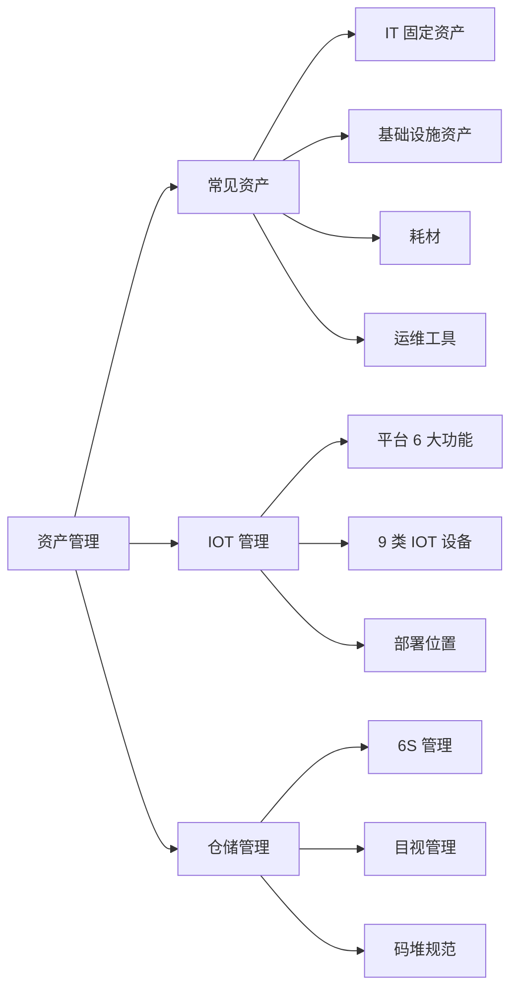
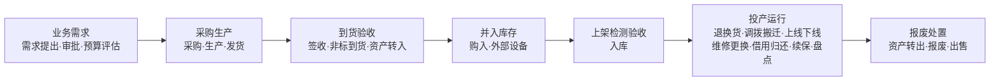

# 10 数据中心资产管理

> 对应考纲：数据中心资产管理（10%）
> 官方要求：熟悉资产设备组成、熟悉资产 IOT 平台功能、熟悉各 IOT 硬件部署及功能、了解 6S 管理法、了解目视管理法
> 本章特点：**纯记忆、条目化**，考点集中在「分类」「IOT 设备用途与部署位置」「6S 与目视管理的数字」

---

## 知识地图

---

## 1. 数据中心常见资产

### 1.1 四大类（多选）

| 类别 | 内容 |
| --- | --- |
| **IT 类固定资产** | 服务器、网络设备及其配件 |
| **基础设施类固定资产** | 基础设施常见硬件设备（如柴油发电机等） |
| **耗材** | 网线、光纤跳线、导轨等 |
| **运维工具** | 劳动保护类、办公用品、各类仪表工具等 |

### 1.2 IT 类固定资产定义（重点）

| 类型 | 包含 |
| --- | --- |
| **服务器** | 机架服务器、高密机架服务器、刀片式服务器、整机柜式服务器等 |
| **网络设备** | 交换机、路由器、商用负载均衡、防火墙、OTN 设备、安全专用网络设备、其它网络设备 |
| **其它设备** | 存储设备、存储盘柜、存储交换机、小型机、邮件网关、安全设备等 |

#### 配件管理粒度（必考）

| 配件 | 管理粒度 |
| --- | --- |
| **服务器配件**：CPU、内存、网卡、硬盘、GPU、flashio 卡、加速卡、Raid/SAS 卡、高密机箱、刀框、服务器电源、服务器光模块等 | **内存、SSD、HDD 管理到 S/N 级**；**网卡、CPU、GPU、加速卡管理到「型号 + 数量」级**；其他配件建立**日常台帐 + 实物库存管理** |
| **网络设备配件**：板卡（业务板、引擎板、交换板）、光模块、网络机框、引擎、网络电源、风扇模块、OTN 配件等 | **板卡、光模块、电源、风扇管理到 S/N 级**；其他建立日常台帐 + 实物库存管理 |
| **存储设备配件**：存储磁带、存储硬盘、存储光模块、VFCACHE 卡、存储电源板 | 建立**日常台帐 + 实物库存管理** |

> 记忆：**「贵且会单独换的」管到 SN（内存/SSD/HDD、板卡/光模块/电源/风扇）；「成批装的」管到型号+数量（CPU/网卡/GPU/加速卡）**。

### 1.3 IT 类固定资产生命周期（全链路）

**关键节点说明**：

| 节点 | 内容 |
| --- | --- |
| 需求提出 | 提出 → 审批 → 预算评估 |
| 采购生产 | 采购 → 生产 → 发货 |
| 到货验收 | 签收、非标到货处理、资产转入 |
| 入库 | 购入入库、外部设备 |
| 上架 | 检测验收后入库 |
| 投产运行 | 退换货、调拨搬迁、上线下线、维修更换、借用归还、续保、盘点 |
| 报废处置 | 资产转出：报废、出售 |

### 1.4 常用运维工具（了解，能认出即可）

红外测温仪、温湿度测试仪、红光笔/光功率计套装、光纤寻线笔/识别、网线测线仪/寻线仪一体机、充电螺丝刀、网络布线工具箱、数字万用表、交直流钳形万用表、对讲机、标签打印机、风速仪、卷盘插座、测电 PDU、绝缘电阻测试、电能质量测试工具、冰点测试仪、电池内阻测试仪、热成像仪、接地电阻测试仪、空气尘埃粒子计数器、噪音计。

> 分类记忆：**测环境**（温湿度、风速、尘埃、噪音、热成像）、**测电**（万用表、钳形表、绝缘/接地电阻、电能质量、PDU、电池内阻、冰点）、**测光/线**（红光笔、光功率计、光纤寻线、网线测线）、**施工**（螺丝刀、布线工具箱、标签机、卷盘插座）、**沟通**（对讲机）。

---

## 2. 资产 IOT 管理

### 2.1 平台定位

资产 IOT 平台通过物联网技术，使用各类传感器将数据中心资产数据**可视化、线上化、数据化**，以达成**资产安全、资产准确**的指标。

### 2.2 解决的四个痛点（多选）

1. **大量资产盘点难度大**
2. **快速响应业务需求**难
3. **可视化**不足
4. **数据不实时**（含双高设备管理不实时）

### 2.3 平台六大功能（必考）

| 功能 | 说明 |
| --- | --- |
| **硬件监控** | 监控 IOT 硬件自身的故障，确保可用性 |
| **安全监控** | 在确保 IOT 硬件可用的前提下，对**资损风险（丢失、掉包）** 进行监控 |
| **告警功能** | 出现功能性异常、安全异常时，自动告警给相关负责人跟进 |
| **事件功能** | 告警出现后在平台触发事件（**故障事件、安全事件**），由负责人处置 |
| **变更功能** | 设备替换、重复利旧、设备搬迁、状态变更 |
| **设备下线** | 设备因故障不可维修、使用寿命到期、设备损坏等情况，通过设备下线完成**不可用 IOT 设备的回收、处置** |

> 逻辑链：**硬件监控/安全监控 → 告警 → 事件 → 变更 → 下线**（设备全生命周期闭环）。

### 2.4 九类 IOT 设备（必考）

| 设备 | 说明 |
| --- | --- |
| **抗金属 RFID** | 用特殊防磁性吸波材料封装的电子标签，可**附着于金属表面**，具有防酸、防碱、防碰撞特性 |
| **双高配件 RFID** | 双高 = **高价值、高风险**；用于双高配件管理 |
| **防损标签** | 具有**防盗、防（资）损**功能，**实时预警** |
| **声光标签** | 装于**货架格位**上的电子标签，用于**指示应拣取的位置**，辅助仓管人员快速定位、拣货 |
| **智能柜 V1.0** | 通过**人脸识别、关联工单、SN 号校验**等技术存储配件，提高库存管理效率 |
| **智能柜 V2.0** | 基于 **RFID** 技术，对双高配件进行 **SN 级**存储、管理 |
| **GPS** | 基于 GPS、路普、北斗等，实现对**运输过程中资产动态监控** |
| **PDA** | 用于**标签扫描、告警信息反馈、工单信息反馈**的手持终端 |
| **网关与接收设备** | 网络 AP，安装于 IOT 设备所在房间，提供网络支持并**接收 IOT 资产监控信息** |
| **RFID 通道门** | 具有 RFID 扫描功能的通道门（出入库自动识别） |

### 2.5 部署位置（高频，容易考细节）

| 设备 | 部署位置 |
| --- | --- |
| **RFID 标签（服务器/网络设备）** | **机柜冷通道、设备前面板** |
| RFID 标签（主板） | **主板背面空白处** |
| RFID 标签（硬盘） | **硬盘背面外壳处** |
| RFID 标签（内存） | **内存正面中间偏上位置** |
| RFID 标签（电源） | **电源挂耳** |
| **防损标签** | 服务器、网络设备**侧面**；贴上后设备移动等动作均会触发告警 |
| **声光标签** | **仓库储位标识旁**，用于快速定位存储位置 |
| **GPS** | **搬迁设备上或设备包装**，监控搬迁流程、控制风险 |

> 记忆：**RFID 贴设备「前面」与部件「背面/正面偏上/挂耳」；防损贴「侧面」；声光贴「储位旁」；GPS 跟「设备/包装」走**。

---

## 3. 资产仓储管理

### 3.1 6S 管理（必考六个词 + 含义）

| 6S | 中文 | 含义 |
| --- | --- | --- |
| **SEIRI** | **整理** | 将库内物品区分为**有必要和没有必要**，必要的留下，其余**消除掉** |
| **SEITON** | **整顿** | 把留下的必要物品**按规定位置摆放**，整齐并**加以标识**，库区张贴统一看板 |
| **SEISO** | **清扫** | 把看得见与看不见的地方**清扫干净**，保持整洁：无垃圾果皮纸屑杂物（含物料乱放）、无灰尘、无积水；仓库不渗漏、地面平整无凹凸 |
| **SEIKETSU** | **清洁** | 将整理、整顿、清扫**进行到底并制度化**，经常保持环境美观 |
| **SHITSUKE** | **素养** | 养成良好习惯，遵守规则做事，培养积极主动精神 |
| **SECURITY** | **安全** | 重视仓库安全教育，时刻有安全第一观念，防患于未然 |

> 易混：**整理 = 丢东西；整顿 = 定位置；清扫 = 搞卫生；清洁 = 制度化；素养 = 成习惯；安全 = 防未然**。
> 记忆链：**整理 → 整顿 → 清扫 → 清洁**（先扔、再摆、再扫、再制度化）。

### 3.2 目视管理

**七条内容（多选）**：

1. 规章制度与工作标准的**公开化**
2. 生产任务与完成情况的**图表化**
3. 视觉显示资讯的**标准化**
4. 生产作业控制手段的**形象直观与使用方便化**
5. 物品的码放和运送的**数量标准化**
6. **着装统一化**与挂牌制度
7. **色彩的标准化管理**

#### 库内看板（必考尺寸与位置）

| 看板 | 位置 | 尺寸 |
| --- | --- | --- |
| **6S 看板** | 库内显眼位置 | **40 × 60 cm** |
| **库区分布图** | 仓库入口处 | **45 × 35 cm** |
| **紧急逃生图** | 安全出口 & 员工进出口 | **45 × 35 cm** |
| **资产管理红线** | 仓库入口处 | **40 × 60 cm** |
| **库房管理规范** | 仓库入口处 | **40 × 60 cm** |
| **公告栏**（出入库登记表、温湿度登记表等） | — | **21 × 29.7 cm（A4）** |

> 记忆：**入口处三块 40×60（红线、规范）+ 6S 看板 40×60；两块 45×35（分布图、逃生图）；公告栏 A4**。

### 3.3 资产码堆规范（数字题）

| 维度 | 要求 |
| --- | --- |
| **分类** | 按**类别、供应商、品牌、型号、批次**等特性分类存放；不同特性商品**不得堆码在一起** |
| **安全** | 货垛保持稳定，包装 **4 条棱角与地面垂线角度均 ≤ 10°**；出现倾斜立即降低货垛高度；码垛于库区内，保持**作业通道通畅**；**高位堆叠（高度 > 1.5 米）需使用缠绕膜、防护膜加固** |
| **整齐** | 规则叠放、排列整齐，同一排/列**位移不超过 15cm**；资产标识（含 SN 码）**一律朝向通道**，便于盘点扫描 |
| **定量** | 尽量规则化堆码，建议**除顶层外每层数量保持一致**，便于记数和盘点 |
| **节约** | 节省空间位置，合理安排货位，提高仓容利用率 |

---

## 4. 本章速记

- 四类资产：**IT 固定资产、基础设施资产、耗材、运维工具**
- 管理粒度：**内存/SSD/HDD 到 SN；CPU/网卡/GPU/加速卡到型号+数量；板卡/光模块/电源/风扇到 SN**
- 生命周期：**需求 → 采购生产 → 到货验收 → 入库 → 上架 → 投产 → 报废**
- 平台六功能：**硬件监控、安全监控、告警、事件、变更、下线**
- 九设备：**抗金属 RFID、双高 RFID、防损、声光、智能柜 V1/V2、GPS、PDA、网关/通道门**
- 部署：**RFID 前面板/部件背面、防损侧面、声光储位旁、GPS 包装**
- 6S：**整理、整顿、清扫、清洁、素养、安全**
- 码堆：**倾斜 ≤10°、高位 >1.5m 加固、位移 ≤15cm**

---

## 5. 高频考点清单

| 考点 | 出题方式 |
| --- | --- |
| 四类资产分类 | 多选 |
| IT 固定资产范围 | 多选 |
| 配件管理粒度 | 单选/多选 |
| 资产生命周期顺序 | 单选排序 |
| IOT 平台六大功能 | 多选 |
| IOT 平台解决的痛点 | 多选 |
| 抗金属 RFID 特性 | 单选 |
| 双高定义（高价值、高风险） | 单选 |
| 防损/声光标签作用 | 单选 |
| 智能柜 V1 vs V2 | 单选 |
| GPS/PDA 用途 | 单选 |
| RFID 部署位置（主板/硬盘/内存/电源） | 单选 |
| 6S 含义匹配 | 单选/多选 |
| 目视管理七条 | 多选 |
| 看板尺寸与位置 | 单选 |
| 码堆角度 10° / 高度 1.5m / 位移 15cm | 单选数字 |
